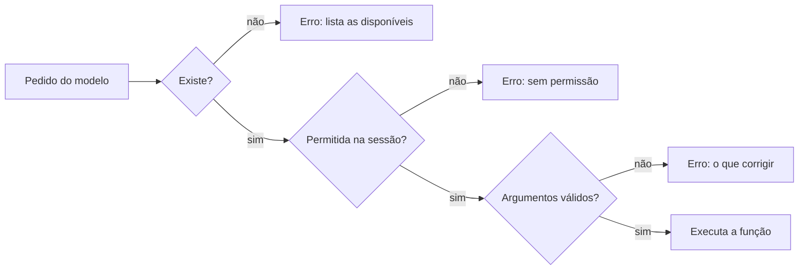

## Passo 1 · Leitura · O modelo só vê o contrato

O modelo nunca lê o corpo das suas funções. Ele escolhe a ferramenta e monta os argumentos a partir de três coisas que você escreve: o **nome**, a **descrição** e o **esquema dos parâmetros**. Nas APIs com *function calling* esse esquema vai em JSON Schema; no protocolo de texto da lição anterior, vai no `system`. Em qualquer caso, é o contrato que decide se o agente acerta.

Descrições vagas produzem escolhas ao acaso. Se `buscar_aluno` diz "busca dados do aluno" e `consultar_historico` diz "consulta informações acadêmicas", o modelo não tem como saber qual usar para "quais disciplinas já cursei?". Uma boa descrição diz o que a ferramenta devolve, quando usar e quando **não** usar, e o formato de cada parâmetro (`codigo`: sigla da disciplina, como `PRG101`).

O contrato e a função precisam andar juntos. Se a descrição vive num texto separado do código, alguém renomeia o parâmetro `disciplina` para `codigo`, esquece o texto, e o modelo passa a mandar um argumento que a função não aceita: o rastro enche de `TypeError`. A solução é ter **uma fonte só**: um decorador que pendura o esquema na própria função, confere se os nomes batem com a assinatura e deixa o catálogo gerar a descrição do prompt.

Ferramentas também têm **permissão**. Consultar o calendário é `"leitura"`: repetir a chamada não muda nada. Abrir um requerimento ou cancelar uma matrícula é `"escrita"`: muda o mundo, e repetir abre dois protocolos. O catálogo só mostra ao modelo, e só executa, as ferramentas que a sessão permite. O modelo não decide o que pode; o seu código decide.



Repare que nenhum caminho levanta exceção para o laço do agente: cada recusa vira um texto que volta ao modelo como observação, e a função só roda no fim, depois de todas as verificações.

## Passo 2 · Exercício · O decorador @ferramenta
modo: lacunas

`ferramenta(nome, descricao, parametros, permissao="leitura")` é um decorador com parâmetros (Nível 2). Ele pendura em `func._meta` o dicionário `{"nome", "descricao", "parametros", "permissao"}` e devolve **a própria função**, que continua funcionando normalmente. Ele também recusa, com `ValueError`, uma permissão que não seja `"leitura"` ou `"escrita"` e um esquema cujos nomes de parâmetros não batem com os da assinatura da função (`inspect.signature(func).parameters`). A cópia do esquema protege os metadados de alterações posteriores no dicionário recebido.

### Instruções
1. Recuse a permissão desconhecida já na chamada de `ferramenta(...)`.
2. Compare os nomes do esquema com os parâmetros da função, sem se importar com a ordem, e recuse a divergência com uma mensagem que cite o nome da ferramenta.
3. Guarde os metadados com uma cópia do esquema e devolva a função sem chamá-la.

### Código inicial
```python
import inspect

PERMISSOES = ("leitura", "escrita")


def ferramenta(nome, descricao, parametros, permissao="leitura"):
    if permissao not in ___:
        raise ValueError(f"permissão inválida: {permissao}")

    def decorador(func):
        nomes_da_funcao = list(inspect.signature(func).___)
        if set(parametros) != set(___):
            raise ValueError(f"{nome}: o esquema declara {sorted(parametros)}, a função recebe {nomes_da_funcao}")
        func._meta = {
            "nome": nome,
            "descricao": descricao,
            "parametros": ___(parametros),
            "permissao": permissao,
        }
        return ___

    return ___
```

### Solução
```python
import inspect

PERMISSOES = ("leitura", "escrita")


def ferramenta(nome, descricao, parametros, permissao="leitura"):
    if permissao not in PERMISSOES:
        raise ValueError(f"permissão inválida: {permissao}")

    def decorador(func):
        nomes_da_funcao = list(inspect.signature(func).parameters)
        if set(parametros) != set(nomes_da_funcao):
            raise ValueError(f"{nome}: o esquema declara {sorted(parametros)}, a função recebe {nomes_da_funcao}")
        func._meta = {
            "nome": nome,
            "descricao": descricao,
            "parametros": dict(parametros),
            "permissao": permissao,
        }
        return func

    return decorador
```

### Dicas
1. Um decorador com parâmetros tem duas camadas: a externa recebe a configuração e devolve o decorador; o decorador recebe a função e devolve a função.
2. `inspect.signature(f).parameters` é um mapeamento ordenado cujas chaves são os nomes dos parâmetros.
3. Guardar o dicionário recebido sem copiar faz os metadados mudarem quando quem chamou mexer no dicionário depois.

### Verificação
```json
[
  {"id": "meta-completo", "checkpoint": 3, "kind": "expr", "setup": "@ferramenta('abrir_requerimento', 'Abre um requerimento.', {'disciplina': {'tipo': 'str', 'obrigatorio': True}, 'urgente': {'tipo': 'bool'}}, permissao='escrita')\ndef abrir(disciplina, urgente=False):\n    return 'protocolo ' + disciplina", "expr": "abrir._meta", "expected": {"nome": "abrir_requerimento", "descricao": "Abre um requerimento.", "parametros": {"disciplina": {"tipo": "str", "obrigatorio": true}, "urgente": {"tipo": "bool"}}, "permissao": "escrita"}, "name": "Pendura nome, descrição, parâmetros e permissão em _meta"},
  {"id": "funcao-intacta", "checkpoint": 3, "kind": "expr", "setup": "@ferramenta('dobro', 'Dobra.', {'x': {'tipo': 'int'}})\ndef dobro(x):\n    return 2 * x", "expr": "[dobro(21), dobro.__name__]", "expected": [42, "dobro"], "name": "A função decorada continua funcionando e é a mesma função"},
  {"id": "nao-chama", "checkpoint": 3, "kind": "expr", "setup": "chamadas = []\n@ferramenta('registrar', 'Registra.', {})\ndef registrar():\n    chamadas.append(1)\n    return 'ok'", "expr": "chamadas", "expected": [], "name": "Decorar não executa a função", "hint": "O decorador devolve a função; quem chama é o catálogo, depois."},
  {"id": "permissao-padrao", "checkpoint": 3, "kind": "expr", "setup": "@ferramenta('calendario', 'Prazos.', {})\ndef calendario():\n    return ''", "expr": "calendario._meta['permissao']", "expected": "leitura", "name": "A permissão padrão é leitura"},
  {"id": "permissao-invalida", "checkpoint": 1, "kind": "expr", "expr": "ferramenta('apagar', 'Apaga.', {}, permissao='admin')", "raises": "ValueError", "message_contains": "admin", "name": "Permissão fora de leitura/escrita é recusada"},
  {"id": "esquema-a-mais", "checkpoint": 2, "kind": "expr", "setup": "decorar = ferramenta('vagas', 'Vagas.', {'disciplina': {'tipo': 'str'}})", "expr": "decorar(lambda codigo: 12)", "raises": "ValueError", "message_contains": "vagas", "name": "Esquema com nome que a função não tem é recusado", "hint": "Compare os nomes do esquema com os da assinatura."},
  {"id": "funcao-a-mais", "checkpoint": 2, "kind": "expr", "setup": "decorar = ferramenta('vagas', 'Vagas.', {'codigo': {'tipo': 'str'}})", "expr": "decorar(lambda codigo, turno: 12)", "raises": "ValueError", "message_contains": "vagas", "name": "Parâmetro da função ausente do esquema também é recusado"},
  {"id": "ordem-nao-importa", "checkpoint": 2, "kind": "expr", "setup": "@ferramenta('f', 'F.', {'b': {'tipo': 'int'}, 'a': {'tipo': 'int'}})\ndef f(a, b):\n    return a - b", "expr": "f(5, 3)", "expected": 2, "name": "A ordem dos parâmetros no esquema não importa"},
  {"id": "copia-do-esquema", "checkpoint": 3, "kind": "expr", "setup": "esquema = {'codigo': {'tipo': 'str'}}\n@ferramenta('vagas', 'Vagas.', esquema)\ndef vagas(codigo):\n    return 1\nesquema['turno'] = {'tipo': 'str'}", "expr": "sorted(vagas._meta['parametros'])", "expected": ["codigo"], "name": "Mudar o dicionário depois não altera os metadados"}
]
```

### Soluções erradas
```python name="chama a função em vez de devolvê-la"
import inspect

PERMISSOES = ("leitura", "escrita")


def ferramenta(nome, descricao, parametros, permissao="leitura"):
    if permissao not in PERMISSOES:
        raise ValueError(f"permissão inválida: {permissao}")

    def decorador(func):
        nomes_da_funcao = list(inspect.signature(func).parameters)
        if set(parametros) != set(nomes_da_funcao):
            raise ValueError(f"{nome}: o esquema declara {sorted(parametros)}, a função recebe {nomes_da_funcao}")
        func._meta = {
            "nome": nome,
            "descricao": descricao,
            "parametros": dict(parametros),
            "permissao": permissao,
        }
        return func()

    return decorador
```
```python name="esquece de devolver a função"
import inspect

PERMISSOES = ("leitura", "escrita")


def ferramenta(nome, descricao, parametros, permissao="leitura"):
    if permissao not in PERMISSOES:
        raise ValueError(f"permissão inválida: {permissao}")

    def decorador(func):
        nomes_da_funcao = list(inspect.signature(func).parameters)
        if set(parametros) != set(nomes_da_funcao):
            raise ValueError(f"{nome}: o esquema declara {sorted(parametros)}, a função recebe {nomes_da_funcao}")
        func._meta = {
            "nome": nome,
            "descricao": descricao,
            "parametros": dict(parametros),
            "permissao": permissao,
        }

    return decorador
```
```python name="não confere o esquema com a assinatura"
PERMISSOES = ("leitura", "escrita")


def ferramenta(nome, descricao, parametros, permissao="leitura"):
    if permissao not in PERMISSOES:
        raise ValueError(f"permissão inválida: {permissao}")

    def decorador(func):
        func._meta = {
            "nome": nome,
            "descricao": descricao,
            "parametros": dict(parametros),
            "permissao": permissao,
        }
        return func

    return decorador
```
```python name="guarda o esquema recebido sem copiar"
import inspect

PERMISSOES = ("leitura", "escrita")


def ferramenta(nome, descricao, parametros, permissao="leitura"):
    if permissao not in PERMISSOES:
        raise ValueError(f"permissão inválida: {permissao}")

    def decorador(func):
        nomes_da_funcao = list(inspect.signature(func).parameters)
        if set(parametros) != set(nomes_da_funcao):
            raise ValueError(f"{nome}: o esquema declara {sorted(parametros)}, a função recebe {nomes_da_funcao}")
        func._meta = {
            "nome": nome,
            "descricao": descricao,
            "parametros": parametros,
            "permissao": permissao,
        }
        return func

    return decorador
```
```python name="aceita qualquer permissão"
import inspect


def ferramenta(nome, descricao, parametros, permissao="leitura"):
    def decorador(func):
        nomes_da_funcao = list(inspect.signature(func).parameters)
        if set(parametros) != set(nomes_da_funcao):
            raise ValueError(f"{nome}: o esquema declara {sorted(parametros)}, a função recebe {nomes_da_funcao}")
        func._meta = {
            "nome": nome,
            "descricao": descricao,
            "parametros": dict(parametros),
            "permissao": permissao,
        }
        return func

    return decorador
```
```python name="só confere os parâmetros do esquema que faltam na função"
import inspect

PERMISSOES = ("leitura", "escrita")


def ferramenta(nome, descricao, parametros, permissao="leitura"):
    if permissao not in PERMISSOES:
        raise ValueError(f"permissão inválida: {permissao}")

    def decorador(func):
        nomes_da_funcao = list(inspect.signature(func).parameters)
        for p in parametros:
            if p not in nomes_da_funcao:
                raise ValueError(f"{nome}: o parâmetro {p} não existe na função")
        func._meta = {
            "nome": nome,
            "descricao": descricao,
            "parametros": dict(parametros),
            "permissao": permissao,
        }
        return func

    return decorador
```

## Passo 3 · Previsão · O que o JSON entrega ao Python

Os argumentos chegam do modelo como texto JSON, e é o `json.loads` que decide os tipos. Leia sem executar e digite o que o programa imprime.

### Código
```python
import json

args = json.loads('{"creditos": 8, "nota": 8.0, "urgente": true, "turma": "02", "obs": null}')
for nome, valor in args.items():
    print(nome, type(valor).__name__, isinstance(valor, int))

print(True + True, json.loads("1e2"))
```

### Dicas
1. No JSON, `8` e `8.0` são escritos de jeitos diferentes, e o `json.loads` respeita isso.
2. Em Python, `bool` é subclasse de `int`.
3. `null` vira `None`, cujo tipo se chama `NoneType`; um número com expoente vira `float`.

### Saída esperada
```text
creditos int True
nota float False
urgente bool True
turma str False
obs NoneType False
2 100.0
```

## Passo 4 · Leitura · Validar antes de executar, e errar de um jeito útil

Os argumentos do modelo são entrada não confiável, como qualquer dado de usuário. Ele esquece parâmetros obrigatórios, inventa outros (`{"forcar": true}`), manda `"12"` onde a função espera número, usa um valor fora da lista (`"turno": "madrugada"`) ou fora do intervalo (`"creditos": -5`). A Previsão mostrou duas armadilhas de tipo: `true` passa num `isinstance(valor, int)`, e um campo `float` pode chegar como `int` (`8` em vez de `8.0`), o que é legítimo.

Validar **antes** de executar protege o sistema, mas a mensagem importa tanto quanto a recusa. O erro volta ao modelo como observação, e ele só consegue corrigir o que a mensagem explica:

| Mensagem | O que o modelo faz no passo seguinte |
|---|---|
| `Erro` | tenta de novo ao acaso, ou desiste |
| `argumentos inválidos` | não sabe qual argumento mudar |
| `turno deve ser um de: manha, tarde, noite` | troca o valor |

Junte **todos** os problemas numa resposta só. Se o validador para no primeiro, o modelo gasta um passo por erro, e cada passo é uma chamada com a conversa inteira.

Três cuidados de quem já levou um susto em produção:

- **Valide primeiro o tipo, depois o resto.** Comparar `"12" < 1` levanta `TypeError` e derruba o validador justamente quando ele deveria explicar o erro.
- **`null` em parâmetro opcional é ausência.** Vários provedores, no modo de esquema estrito, mandam `null` nos opcionais que o modelo não preencheu. Tratar `None` como valor gera mensagens absurdas ("deve ser bool, veio NoneType").
- **Identidade vem da sessão, não do modelo.** Uma ferramenta `consultar_historico(ra)` deixa qualquer conversa pedir o histórico de outra pessoa: basta o usuário escrever outro número. O RA de quem está logado vem do seu código; o modelo escolhe só o que é dele escolher.

A ordem das verificações no catálogo também é proteção: existência, permissão, formato do JSON, validação, e só então a execução. A função de escrita nunca é chamada "para ver o que acontece".

## Passo 5 · Exercício · Validar os argumentos

`validar_argumentos(esquema, args)` devolve a **lista de todos os erros** encontrados (vazia quando está tudo certo). O esquema mapeia cada parâmetro para `{"tipo": "int" | "float" | "str" | "bool", "obrigatorio": bool (padrão False), "opcoes": [...], "min": n, "max": n}`; só `tipo` é obrigatório.

Regras, nesta ordem:

1. Se `args` não for um dicionário, devolva só `["os argumentos precisam ser um objeto JSON"]`.
2. Para cada chave de `args` fora do esquema, em ordem alfabética: `"argumento desconhecido: <chave>"`.
3. Para cada parâmetro do esquema, na ordem do esquema, um valor ausente **ou** `None` conta como ausente: se for obrigatório, `"falta o argumento obrigatório: <p>"`; se não, passe ao próximo.
4. Tipo: `int` não aceita `bool`; `float` aceita `int` e `float`, mas não `bool`; `bool` só aceita `bool`; `str` só `str`. Errado: `"<p> deve ser <tipo>, veio <tipo do valor>"`, e os outros testes desse parâmetro são pulados.
5. `"<p> deve ser um de: <opções separadas por vírgula e espaço>"` se o valor não está em `opcoes`; `"<p> deve ser >= <min>"` e `"<p> deve ser <= <max>"` para os limites.

Um `tipo` que não seja um dos quatro é erro de quem escreveu o esquema, não do modelo: levante `ValueError`.

### Instruções
1. Recuse argumentos que não sejam um dicionário e liste os argumentos desconhecidos em ordem alfabética.
2. Aponte os obrigatórios ausentes, tratando `None` como ausente e `0`, `False` e `""` como valores presentes.
3. Confira o tipo sem deixar `bool` passar por número e aceitando `int` onde se espera `float`; recuse tipo desconhecido no esquema com `ValueError`.
4. Confira opções e limites só quando o tipo está certo, e devolva todos os erros, na ordem das regras.

### Código inicial
```python
def validar_argumentos(esquema, args):
    pass
```

### Solução
```python
def tipo_confere(valor, tipo):
    if tipo == "bool":
        return isinstance(valor, bool)
    if tipo not in ("int", "float", "str"):
        raise ValueError(f"tipo desconhecido no esquema: {tipo}")
    if isinstance(valor, bool):
        return False
    if tipo == "int":
        return isinstance(valor, int)
    if tipo == "float":
        return isinstance(valor, (int, float))
    return isinstance(valor, str)


def validar_argumentos(esquema, args):
    if not isinstance(args, dict):
        return ["os argumentos precisam ser um objeto JSON"]
    erros = [f"argumento desconhecido: {chave}" for chave in sorted(args) if chave not in esquema]
    for nome, regras in esquema.items():
        valor = args.get(nome)
        if valor is None:
            if regras.get("obrigatorio", False):
                erros.append(f"falta o argumento obrigatório: {nome}")
            continue
        if not tipo_confere(valor, regras["tipo"]):
            erros.append(f"{nome} deve ser {regras['tipo']}, veio {type(valor).__name__}")
            continue
        if "opcoes" in regras and valor not in regras["opcoes"]:
            erros.append(f"{nome} deve ser um de: {', '.join(map(str, regras['opcoes']))}")
        if "min" in regras and valor < regras["min"]:
            erros.append(f"{nome} deve ser >= {regras['min']}")
        if "max" in regras and valor > regras["max"]:
            erros.append(f"{nome} deve ser <= {regras['max']}")
    return erros
```

### Dicas
1. Separe a pergunta "o tipo confere?" numa função auxiliar; ela fica pequena se tratar `bool` antes dos números.
2. `args.get(nome)` devolve `None` tanto para chave ausente quanto para `null`, mas não confunde `0` com ausência; `if not valor` confunde.
3. Um `continue` depois do erro de tipo evita comparar texto com número.

### Verificação
```json
[
  {"id": "tudo-certo", "checkpoint": 4, "kind": "call", "function": "validar_argumentos", "args": [{"disciplina": {"tipo": "str", "obrigatorio": true}, "creditos": {"tipo": "int", "obrigatorio": true, "min": 0, "max": 40}, "media": {"tipo": "float", "min": 0, "max": 10}, "turno": {"tipo": "str", "opcoes": ["manha", "tarde", "noite"]}, "urgente": {"tipo": "bool"}}, {"disciplina": "PRG101", "creditos": 4, "media": 7.5, "turno": "noite", "urgente": true}], "expected": [], "name": "Argumentos válidos não geram erro"},
  {"id": "int-em-float", "checkpoint": 3, "kind": "call", "function": "validar_argumentos", "args": [{"disciplina": {"tipo": "str", "obrigatorio": true}, "creditos": {"tipo": "int", "obrigatorio": true, "min": 0, "max": 40}, "media": {"tipo": "float", "min": 0, "max": 10}, "turno": {"tipo": "str", "opcoes": ["manha", "tarde", "noite"]}, "urgente": {"tipo": "bool"}}, {"disciplina": "PRG101", "creditos": 4, "media": 8}], "expected": [], "name": "int num campo float é aceito, e opcionais ausentes não são erro", "hint": "O JSON 8 vira int."},
  {"id": "zero-e-falso", "checkpoint": 2, "kind": "call", "function": "validar_argumentos", "args": [{"disciplina": {"tipo": "str", "obrigatorio": true}, "creditos": {"tipo": "int", "obrigatorio": true, "min": 0, "max": 40}, "media": {"tipo": "float", "min": 0, "max": 10}, "turno": {"tipo": "str", "opcoes": ["manha", "tarde", "noite"]}, "urgente": {"tipo": "bool"}}, {"disciplina": "PRG101", "creditos": 0, "media": 0, "urgente": false}], "expected": [], "name": "0 e False são valores presentes", "hint": "Zero não é ausência."},
  {"id": "desconhecidos", "checkpoint": 1, "kind": "call", "function": "validar_argumentos", "args": [{"disciplina": {"tipo": "str", "obrigatorio": true}, "creditos": {"tipo": "int", "obrigatorio": true, "min": 0, "max": 40}, "media": {"tipo": "float", "min": 0, "max": 10}, "turno": {"tipo": "str", "opcoes": ["manha", "tarde", "noite"]}, "urgente": {"tipo": "bool"}}, {"disciplina": "PRG101", "creditos": 4, "forcar": true, "admin": true}], "expected": ["argumento desconhecido: admin", "argumento desconhecido: forcar"], "name": "Argumentos inventados pelo modelo são apontados, em ordem alfabética"},
  {"id": "obrigatorio-ausente", "checkpoint": 2, "kind": "call", "function": "validar_argumentos", "args": [{"disciplina": {"tipo": "str", "obrigatorio": true}, "creditos": {"tipo": "int", "obrigatorio": true, "min": 0, "max": 40}, "media": {"tipo": "float", "min": 0, "max": 10}, "turno": {"tipo": "str", "opcoes": ["manha", "tarde", "noite"]}, "urgente": {"tipo": "bool"}}, {"creditos": 4}], "expected": ["falta o argumento obrigatório: disciplina"], "name": "Aponta o obrigatório ausente"},
  {"id": "null-e-ausencia", "checkpoint": 2, "kind": "call", "function": "validar_argumentos", "args": [{"disciplina": {"tipo": "str", "obrigatorio": true}, "creditos": {"tipo": "int", "obrigatorio": true, "min": 0, "max": 40}, "media": {"tipo": "float", "min": 0, "max": 10}, "turno": {"tipo": "str", "opcoes": ["manha", "tarde", "noite"]}, "urgente": {"tipo": "bool"}}, {"disciplina": null, "creditos": 4, "turno": null}], "expected": ["falta o argumento obrigatório: disciplina"], "name": "null conta como ausente: obrigatório falta, opcional é ignorado"},
  {"id": "bool-nao-e-int", "checkpoint": 3, "kind": "call", "function": "validar_argumentos", "args": [{"disciplina": {"tipo": "str", "obrigatorio": true}, "creditos": {"tipo": "int", "obrigatorio": true, "min": 0, "max": 40}, "media": {"tipo": "float", "min": 0, "max": 10}, "turno": {"tipo": "str", "opcoes": ["manha", "tarde", "noite"]}, "urgente": {"tipo": "bool"}}, {"disciplina": "PRG101", "creditos": true, "media": false}], "expected": ["creditos deve ser int, veio bool", "media deve ser float, veio bool"], "name": "true/false não passam por número", "hint": "Em Python, bool é subclasse de int."},
  {"id": "texto-no-numero", "checkpoint": 4, "kind": "call", "function": "validar_argumentos", "args": [{"disciplina": {"tipo": "str", "obrigatorio": true}, "creditos": {"tipo": "int", "obrigatorio": true, "min": 0, "max": 40}, "media": {"tipo": "float", "min": 0, "max": 10}, "turno": {"tipo": "str", "opcoes": ["manha", "tarde", "noite"]}, "urgente": {"tipo": "bool"}}, {"disciplina": "PRG101", "creditos": "12"}], "expected": ["creditos deve ser int, veio str"], "name": "Tipo errado gera um erro só, sem comparar texto com número"},
  {"id": "opcoes-e-limites", "checkpoint": 4, "kind": "call", "function": "validar_argumentos", "args": [{"disciplina": {"tipo": "str", "obrigatorio": true}, "creditos": {"tipo": "int", "obrigatorio": true, "min": 0, "max": 40}, "media": {"tipo": "float", "min": 0, "max": 10}, "turno": {"tipo": "str", "opcoes": ["manha", "tarde", "noite"]}, "urgente": {"tipo": "bool"}}, {"disciplina": "PRG101", "creditos": 41, "media": -1, "turno": "madrugada"}], "expected": ["creditos deve ser <= 40", "media deve ser >= 0", "turno deve ser um de: manha, tarde, noite"], "name": "Aponta limites e opções, na ordem do esquema"},
  {"id": "todos-os-erros", "checkpoint": 4, "kind": "call", "function": "validar_argumentos", "args": [{"disciplina": {"tipo": "str", "obrigatorio": true}, "creditos": {"tipo": "int", "obrigatorio": true, "min": 0, "max": 40}, "media": {"tipo": "float", "min": 0, "max": 10}, "turno": {"tipo": "str", "opcoes": ["manha", "tarde", "noite"]}, "urgente": {"tipo": "bool"}}, {"creditos": -2, "turno": "manha", "extra": 1, "urgente": "sim"}], "expected": ["argumento desconhecido: extra", "falta o argumento obrigatório: disciplina", "creditos deve ser >= 0", "urgente deve ser bool, veio str"], "name": "Devolve todos os erros de uma vez, na ordem das regras", "hint": "Cada passo do agente custa uma chamada: junte tudo numa resposta."},
  {"id": "nao-e-objeto", "checkpoint": 1, "kind": "call", "function": "validar_argumentos", "args": [{"disciplina": {"tipo": "str", "obrigatorio": true}, "creditos": {"tipo": "int", "obrigatorio": true, "min": 0, "max": 40}, "media": {"tipo": "float", "min": 0, "max": 10}, "turno": {"tipo": "str", "opcoes": ["manha", "tarde", "noite"]}, "urgente": {"tipo": "bool"}}, ["PRG101", 4]], "expected": ["os argumentos precisam ser um objeto JSON"], "name": "Argumentos que não são objeto"},
  {"id": "tipo-desconhecido", "checkpoint": 3, "kind": "expr", "expr": "validar_argumentos({'data': {'tipo': 'date', 'obrigatorio': True}}, {'data': '2025-04-30'})", "raises": "ValueError", "name": "Tipo desconhecido no esquema levanta ValueError"}
]
```

### Soluções erradas
```python name="aceita bool onde se espera int"
def tipo_confere(valor, tipo):
    if tipo not in ("int", "float", "str", "bool"):
        raise ValueError(f"tipo desconhecido no esquema: {tipo}")
    tipos = {"int": int, "float": (int, float), "str": str, "bool": bool}
    return isinstance(valor, tipos[tipo])


def validar_argumentos(esquema, args):
    if not isinstance(args, dict):
        return ["os argumentos precisam ser um objeto JSON"]
    erros = [f"argumento desconhecido: {chave}" for chave in sorted(args) if chave not in esquema]
    for nome, regras in esquema.items():
        valor = args.get(nome)
        if valor is None:
            if regras.get("obrigatorio", False):
                erros.append(f"falta o argumento obrigatório: {nome}")
            continue
        if not tipo_confere(valor, regras["tipo"]):
            erros.append(f"{nome} deve ser {regras['tipo']}, veio {type(valor).__name__}")
            continue
        if "opcoes" in regras and valor not in regras["opcoes"]:
            erros.append(f"{nome} deve ser um de: {', '.join(map(str, regras['opcoes']))}")
        if "min" in regras and valor < regras["min"]:
            erros.append(f"{nome} deve ser >= {regras['min']}")
        if "max" in regras and valor > regras["max"]:
            erros.append(f"{nome} deve ser <= {regras['max']}")
    return erros
```
```python name="recusa int num campo float"
def tipo_confere(valor, tipo):
    if tipo == "bool":
        return isinstance(valor, bool)
    if tipo not in ("int", "float", "str"):
        raise ValueError(f"tipo desconhecido no esquema: {tipo}")
    if isinstance(valor, bool):
        return False
    return isinstance(valor, {"int": int, "float": float, "str": str}[tipo])


def validar_argumentos(esquema, args):
    if not isinstance(args, dict):
        return ["os argumentos precisam ser um objeto JSON"]
    erros = [f"argumento desconhecido: {chave}" for chave in sorted(args) if chave not in esquema]
    for nome, regras in esquema.items():
        valor = args.get(nome)
        if valor is None:
            if regras.get("obrigatorio", False):
                erros.append(f"falta o argumento obrigatório: {nome}")
            continue
        if not tipo_confere(valor, regras["tipo"]):
            erros.append(f"{nome} deve ser {regras['tipo']}, veio {type(valor).__name__}")
            continue
        if "opcoes" in regras and valor not in regras["opcoes"]:
            erros.append(f"{nome} deve ser um de: {', '.join(map(str, regras['opcoes']))}")
        if "min" in regras and valor < regras["min"]:
            erros.append(f"{nome} deve ser >= {regras['min']}")
        if "max" in regras and valor > regras["max"]:
            erros.append(f"{nome} deve ser <= {regras['max']}")
    return erros
```
```python name="para no primeiro erro"
def tipo_confere(valor, tipo):
    if tipo == "bool":
        return isinstance(valor, bool)
    if tipo not in ("int", "float", "str"):
        raise ValueError(f"tipo desconhecido no esquema: {tipo}")
    if isinstance(valor, bool):
        return False
    if tipo == "int":
        return isinstance(valor, int)
    if tipo == "float":
        return isinstance(valor, (int, float))
    return isinstance(valor, str)


def validar_argumentos(esquema, args):
    if not isinstance(args, dict):
        return ["os argumentos precisam ser um objeto JSON"]
    for chave in sorted(args):
        if chave not in esquema:
            return [f"argumento desconhecido: {chave}"]
    for nome, regras in esquema.items():
        valor = args.get(nome)
        if valor is None:
            if regras.get("obrigatorio", False):
                return [f"falta o argumento obrigatório: {nome}"]
            continue
        if not tipo_confere(valor, regras["tipo"]):
            return [f"{nome} deve ser {regras['tipo']}, veio {type(valor).__name__}"]
        if "opcoes" in regras and valor not in regras["opcoes"]:
            return [f"{nome} deve ser um de: {', '.join(map(str, regras['opcoes']))}"]
        if "min" in regras and valor < regras["min"]:
            return [f"{nome} deve ser >= {regras['min']}"]
        if "max" in regras and valor > regras["max"]:
            return [f"{nome} deve ser <= {regras['max']}"]
    return []
```
```python name="ignora argumentos que não estão no esquema"
def tipo_confere(valor, tipo):
    if tipo == "bool":
        return isinstance(valor, bool)
    if tipo not in ("int", "float", "str"):
        raise ValueError(f"tipo desconhecido no esquema: {tipo}")
    if isinstance(valor, bool):
        return False
    if tipo == "int":
        return isinstance(valor, int)
    if tipo == "float":
        return isinstance(valor, (int, float))
    return isinstance(valor, str)


def validar_argumentos(esquema, args):
    if not isinstance(args, dict):
        return ["os argumentos precisam ser um objeto JSON"]
    erros = []
    for nome, regras in esquema.items():
        valor = args.get(nome)
        if valor is None:
            if regras.get("obrigatorio", False):
                erros.append(f"falta o argumento obrigatório: {nome}")
            continue
        if not tipo_confere(valor, regras["tipo"]):
            erros.append(f"{nome} deve ser {regras['tipo']}, veio {type(valor).__name__}")
            continue
        if "opcoes" in regras and valor not in regras["opcoes"]:
            erros.append(f"{nome} deve ser um de: {', '.join(map(str, regras['opcoes']))}")
        if "min" in regras and valor < regras["min"]:
            erros.append(f"{nome} deve ser >= {regras['min']}")
        if "max" in regras and valor > regras["max"]:
            erros.append(f"{nome} deve ser <= {regras['max']}")
    return erros
```
```python name="compara os limites mesmo com o tipo errado"
def tipo_confere(valor, tipo):
    if tipo == "bool":
        return isinstance(valor, bool)
    if tipo not in ("int", "float", "str"):
        raise ValueError(f"tipo desconhecido no esquema: {tipo}")
    if isinstance(valor, bool):
        return False
    if tipo == "int":
        return isinstance(valor, int)
    if tipo == "float":
        return isinstance(valor, (int, float))
    return isinstance(valor, str)


def validar_argumentos(esquema, args):
    if not isinstance(args, dict):
        return ["os argumentos precisam ser um objeto JSON"]
    erros = [f"argumento desconhecido: {chave}" for chave in sorted(args) if chave not in esquema]
    for nome, regras in esquema.items():
        valor = args.get(nome)
        if valor is None:
            if regras.get("obrigatorio", False):
                erros.append(f"falta o argumento obrigatório: {nome}")
            continue
        if not tipo_confere(valor, regras["tipo"]):
            erros.append(f"{nome} deve ser {regras['tipo']}, veio {type(valor).__name__}")
        if "opcoes" in regras and valor not in regras["opcoes"]:
            erros.append(f"{nome} deve ser um de: {', '.join(map(str, regras['opcoes']))}")
        if "min" in regras and valor < regras["min"]:
            erros.append(f"{nome} deve ser >= {regras['min']}")
        if "max" in regras and valor > regras["max"]:
            erros.append(f"{nome} deve ser <= {regras['max']}")
    return erros
```
```python name="testa a presença pelo valor"
def tipo_confere(valor, tipo):
    if tipo == "bool":
        return isinstance(valor, bool)
    if tipo not in ("int", "float", "str"):
        raise ValueError(f"tipo desconhecido no esquema: {tipo}")
    if isinstance(valor, bool):
        return False
    if tipo == "int":
        return isinstance(valor, int)
    if tipo == "float":
        return isinstance(valor, (int, float))
    return isinstance(valor, str)


def validar_argumentos(esquema, args):
    if not isinstance(args, dict):
        return ["os argumentos precisam ser um objeto JSON"]
    erros = [f"argumento desconhecido: {chave}" for chave in sorted(args) if chave not in esquema]
    for nome, regras in esquema.items():
        valor = args.get(nome)
        if not valor:
            if regras.get("obrigatorio", False):
                erros.append(f"falta o argumento obrigatório: {nome}")
            continue
        if not tipo_confere(valor, regras["tipo"]):
            erros.append(f"{nome} deve ser {regras['tipo']}, veio {type(valor).__name__}")
            continue
        if "opcoes" in regras and valor not in regras["opcoes"]:
            erros.append(f"{nome} deve ser um de: {', '.join(map(str, regras['opcoes']))}")
        if "min" in regras and valor < regras["min"]:
            erros.append(f"{nome} deve ser >= {regras['min']}")
        if "max" in regras and valor > regras["max"]:
            erros.append(f"{nome} deve ser <= {regras['max']}")
    return erros
```
```python name="trata null como valor"
def tipo_confere(valor, tipo):
    if tipo == "bool":
        return isinstance(valor, bool)
    if tipo not in ("int", "float", "str"):
        raise ValueError(f"tipo desconhecido no esquema: {tipo}")
    if isinstance(valor, bool):
        return False
    if tipo == "int":
        return isinstance(valor, int)
    if tipo == "float":
        return isinstance(valor, (int, float))
    return isinstance(valor, str)


def validar_argumentos(esquema, args):
    if not isinstance(args, dict):
        return ["os argumentos precisam ser um objeto JSON"]
    erros = [f"argumento desconhecido: {chave}" for chave in sorted(args) if chave not in esquema]
    for nome, regras in esquema.items():
        if nome not in args:
            if regras.get("obrigatorio", False):
                erros.append(f"falta o argumento obrigatório: {nome}")
            continue
        valor = args[nome]
        if not tipo_confere(valor, regras["tipo"]):
            erros.append(f"{nome} deve ser {regras['tipo']}, veio {type(valor).__name__}")
            continue
        if "opcoes" in regras and valor not in regras["opcoes"]:
            erros.append(f"{nome} deve ser um de: {', '.join(map(str, regras['opcoes']))}")
        if "min" in regras and valor < regras["min"]:
            erros.append(f"{nome} deve ser >= {regras['min']}")
        if "max" in regras and valor > regras["max"]:
            erros.append(f"{nome} deve ser <= {regras['max']}")
    return erros
```

## Passo 6 · Exercício · O catálogo com descrição automática e permissões

Junte as peças na classe `Catalogo(max_chars=300)`. O decorador e o validador estão prontos em `contrato.py`.

- **`registrar(func)`** guarda a função pelo `func._meta["nome"]` e a devolve, para poder ser usado como decorador (`@catalogo.registrar` em cima do `@ferramenta(...)`). Nome repetido levanta `ValueError` com o nome: registrar por cima apagaria uma ferramenta sem aviso.
- **`descrever(permissoes)`** gera o texto que vai no prompt, só com as ferramentas cuja permissão está em `permissoes`, em ordem alfabética, uma por linha:
  `- <nome> [<permissao>]: <descricao> Parâmetros: <p> (<tipo>, obrigatório); <p> (<tipo>)`
  Os parâmetros saem na ordem do esquema, separados por `"; "`, com `", obrigatório"` só nos obrigatórios; sem parâmetros, `Parâmetros: nenhum`.
- **`executar(nome, argumentos_json, permissoes)`** devolve **sempre um texto**, que vira a observação do agente, e verifica nesta ordem:

| Verificação | Texto devolvido |
|---|---|
| nome não registrado | `Erro: ferramenta desconhecida '<nome>'. Disponíveis: <permitidas, em ordem alfabética>.` (ou `nenhuma`) |
| permissão fora de `permissoes` | `Erro: sem permissão para '<nome>' (<permissao>).` |
| `argumentos_json` não é JSON | `Erro: os argumentos de '<nome>' não são JSON válido.` |
| `validar_argumentos` achou erros | `Erro em '<nome>': <erros separados por "; ">.` |
| a função levantou exceção | `Erro: '<nome>' falhou: <NomeDaExcecao>: <mensagem>` |
| resultado com mais de `max_chars` caracteres | os `max_chars` primeiros + ` [truncado: <total> caracteres no total]` |

A função só é chamada se passar por tudo, com os argumentos cujo valor não é `None` (opcional com `null` usa o padrão da função), e o resultado é convertido com `str`.

### Instruções
1. `registrar` guarda e devolve a função, e recusa nome repetido.
2. `descrever` gera a descrição só com as ferramentas permitidas, no formato pedido.
3. `executar` recusa ferramenta desconhecida, sem permissão, JSON inválido e argumentos inválidos sem chamar a função, e sem revelar ferramentas que a sessão não pode usar.
4. `executar` chama a função sem os argumentos nulos, transforma exceção em texto e avisa quando trunca o resultado.

### Código inicial
```python
import json

from contrato import ferramenta, validar_argumentos


class Catalogo:
    def __init__(self, max_chars=300):
        pass

    def registrar(self, func):
        pass

    def descrever(self, permissoes):
        pass

    def executar(self, nome, argumentos_json, permissoes):
        pass
```
```python path=contrato.py
import inspect

PERMISSOES = ("leitura", "escrita")


def ferramenta(nome, descricao, parametros, permissao="leitura"):
    if permissao not in PERMISSOES:
        raise ValueError(f"permissão inválida: {permissao}")

    def decorador(func):
        nomes_da_funcao = list(inspect.signature(func).parameters)
        if set(parametros) != set(nomes_da_funcao):
            raise ValueError(f"{nome}: o esquema declara {sorted(parametros)}, a função recebe {nomes_da_funcao}")
        func._meta = {
            "nome": nome,
            "descricao": descricao,
            "parametros": dict(parametros),
            "permissao": permissao,
        }
        return func

    return decorador


def tipo_confere(valor, tipo):
    if tipo == "bool":
        return isinstance(valor, bool)
    if tipo not in ("int", "float", "str"):
        raise ValueError(f"tipo desconhecido no esquema: {tipo}")
    if isinstance(valor, bool):
        return False
    if tipo == "int":
        return isinstance(valor, int)
    if tipo == "float":
        return isinstance(valor, (int, float))
    return isinstance(valor, str)


def validar_argumentos(esquema, args):
    if not isinstance(args, dict):
        return ["os argumentos precisam ser um objeto JSON"]
    erros = [f"argumento desconhecido: {chave}" for chave in sorted(args) if chave not in esquema]
    for nome, regras in esquema.items():
        valor = args.get(nome)
        if valor is None:
            if regras.get("obrigatorio", False):
                erros.append(f"falta o argumento obrigatório: {nome}")
            continue
        if not tipo_confere(valor, regras["tipo"]):
            erros.append(f"{nome} deve ser {regras['tipo']}, veio {type(valor).__name__}")
            continue
        if "opcoes" in regras and valor not in regras["opcoes"]:
            erros.append(f"{nome} deve ser um de: {', '.join(map(str, regras['opcoes']))}")
        if "min" in regras and valor < regras["min"]:
            erros.append(f"{nome} deve ser >= {regras['min']}")
        if "max" in regras and valor > regras["max"]:
            erros.append(f"{nome} deve ser <= {regras['max']}")
    return erros
```

### Solução
```python
import json

from contrato import ferramenta, validar_argumentos


class Catalogo:
    def __init__(self, max_chars=300):
        self.max_chars = max_chars
        self.funcoes = {}

    def registrar(self, func):
        nome = func._meta["nome"]
        if nome in self.funcoes:
            raise ValueError(f"ferramenta já registrada: {nome}")
        self.funcoes[nome] = func
        return func

    def permitidas(self, permissoes):
        return sorted(n for n, f in self.funcoes.items() if f._meta["permissao"] in permissoes)

    def descrever(self, permissoes):
        linhas = []
        for nome in self.permitidas(permissoes):
            meta = self.funcoes[nome]._meta
            params = "; ".join(
                f"{p} ({r['tipo']}{', obrigatório' if r.get('obrigatorio') else ''})"
                for p, r in meta["parametros"].items()
            )
            linhas.append(f"- {nome} [{meta['permissao']}]: {meta['descricao']} Parâmetros: {params or 'nenhum'}")
        return "\n".join(linhas)

    def executar(self, nome, argumentos_json, permissoes):
        if nome not in self.funcoes:
            disponiveis = ", ".join(self.permitidas(permissoes)) or "nenhuma"
            return f"Erro: ferramenta desconhecida '{nome}'. Disponíveis: {disponiveis}."
        func = self.funcoes[nome]
        meta = func._meta
        if meta["permissao"] not in permissoes:
            return f"Erro: sem permissão para '{nome}' ({meta['permissao']})."
        try:
            args = json.loads(argumentos_json)
        except json.JSONDecodeError:
            return f"Erro: os argumentos de '{nome}' não são JSON válido."
        erros = validar_argumentos(meta["parametros"], args)
        if erros:
            return f"Erro em '{nome}': " + "; ".join(erros) + "."
        try:
            resultado = str(func(**{k: v for k, v in args.items() if v is not None}))
        except Exception as erro:
            return f"Erro: '{nome}' falhou: {type(erro).__name__}: {erro}"
        if len(resultado) > self.max_chars:
            return resultado[:self.max_chars] + f" [truncado: {len(resultado)} caracteres no total]"
        return resultado
```
```python path=contrato.py
import inspect

PERMISSOES = ("leitura", "escrita")


def ferramenta(nome, descricao, parametros, permissao="leitura"):
    if permissao not in PERMISSOES:
        raise ValueError(f"permissão inválida: {permissao}")

    def decorador(func):
        nomes_da_funcao = list(inspect.signature(func).parameters)
        if set(parametros) != set(nomes_da_funcao):
            raise ValueError(f"{nome}: o esquema declara {sorted(parametros)}, a função recebe {nomes_da_funcao}")
        func._meta = {
            "nome": nome,
            "descricao": descricao,
            "parametros": dict(parametros),
            "permissao": permissao,
        }
        return func

    return decorador


def tipo_confere(valor, tipo):
    if tipo == "bool":
        return isinstance(valor, bool)
    if tipo not in ("int", "float", "str"):
        raise ValueError(f"tipo desconhecido no esquema: {tipo}")
    if isinstance(valor, bool):
        return False
    if tipo == "int":
        return isinstance(valor, int)
    if tipo == "float":
        return isinstance(valor, (int, float))
    return isinstance(valor, str)


def validar_argumentos(esquema, args):
    if not isinstance(args, dict):
        return ["os argumentos precisam ser um objeto JSON"]
    erros = [f"argumento desconhecido: {chave}" for chave in sorted(args) if chave not in esquema]
    for nome, regras in esquema.items():
        valor = args.get(nome)
        if valor is None:
            if regras.get("obrigatorio", False):
                erros.append(f"falta o argumento obrigatório: {nome}")
            continue
        if not tipo_confere(valor, regras["tipo"]):
            erros.append(f"{nome} deve ser {regras['tipo']}, veio {type(valor).__name__}")
            continue
        if "opcoes" in regras and valor not in regras["opcoes"]:
            erros.append(f"{nome} deve ser um de: {', '.join(map(str, regras['opcoes']))}")
        if "min" in regras and valor < regras["min"]:
            erros.append(f"{nome} deve ser >= {regras['min']}")
        if "max" in regras and valor > regras["max"]:
            erros.append(f"{nome} deve ser <= {regras['max']}")
    return erros
```

### Dicas
1. Um método auxiliar que devolve os nomes permitidos, já ordenados, serve tanto à descrição quanto à mensagem de ferramenta desconhecida.
2. Cada verificação que falha devolve o texto na hora, com `return`; a chamada da função fica no fim, depois de todas elas.
3. Truncar sem avisar faz o modelo acreditar que leu o resultado inteiro.

### Verificação
```json
[
  {"id": "registrar-devolve", "checkpoint": 1, "kind": "expr", "setup": "log = []\ncat = Catalogo(max_chars=40)\n@cat.registrar\n@ferramenta('consultar_nota', 'Consulta a nota final de uma disciplina.', {'disciplina': {'tipo': 'str', 'obrigatorio': True}})\ndef consultar_nota(disciplina):\n    log.append(['consultar_nota', disciplina])\n    return {'PRG101': 8.5}[disciplina]\n@cat.registrar\n@ferramenta('abrir_requerimento', 'Abre um requerimento na secretaria.', {'assunto': {'tipo': 'str', 'obrigatorio': True, 'opcoes': ['trancamento', 'revisao']}, 'urgente': {'tipo': 'bool'}}, permissao='escrita')\ndef abrir_requerimento(assunto, urgente=False):\n    log.append(['abrir_requerimento', assunto, urgente])\n    return 'protocolo 2025-0042'\n@cat.registrar\n@ferramenta('calendario', 'Lista os prazos do semestre.', {})\ndef calendario():\n    log.append(['calendario'])\n    return 'trancamento até 30/04; revisão de nota até 15/07; colação em 20/12'\n", "expr": "[consultar_nota('PRG101'), log]", "expected": [8.5, [["consultar_nota", "PRG101"]]], "name": "registrar devolve a função, que continua utilizável"},
  {"id": "registrar-repetido", "checkpoint": 1, "kind": "expr", "setup": "log = []\ncat = Catalogo(max_chars=40)\n@cat.registrar\n@ferramenta('consultar_nota', 'Consulta a nota final de uma disciplina.', {'disciplina': {'tipo': 'str', 'obrigatorio': True}})\ndef consultar_nota(disciplina):\n    log.append(['consultar_nota', disciplina])\n    return {'PRG101': 8.5}[disciplina]\n@cat.registrar\n@ferramenta('abrir_requerimento', 'Abre um requerimento na secretaria.', {'assunto': {'tipo': 'str', 'obrigatorio': True, 'opcoes': ['trancamento', 'revisao']}, 'urgente': {'tipo': 'bool'}}, permissao='escrita')\ndef abrir_requerimento(assunto, urgente=False):\n    log.append(['abrir_requerimento', assunto, urgente])\n    return 'protocolo 2025-0042'\n@cat.registrar\n@ferramenta('calendario', 'Lista os prazos do semestre.', {})\ndef calendario():\n    log.append(['calendario'])\n    return 'trancamento até 30/04; revisão de nota até 15/07; colação em 20/12'\ndup = ferramenta('calendario', 'Outro calendário.', {})(lambda: 'x')", "expr": "cat.registrar(dup)", "raises": "ValueError", "message_contains": "calendario", "name": "Nome repetido é recusado"},
  {"id": "descrever-leitura", "checkpoint": 2, "kind": "expr", "setup": "log = []\ncat = Catalogo(max_chars=40)\n@cat.registrar\n@ferramenta('consultar_nota', 'Consulta a nota final de uma disciplina.', {'disciplina': {'tipo': 'str', 'obrigatorio': True}})\ndef consultar_nota(disciplina):\n    log.append(['consultar_nota', disciplina])\n    return {'PRG101': 8.5}[disciplina]\n@cat.registrar\n@ferramenta('abrir_requerimento', 'Abre um requerimento na secretaria.', {'assunto': {'tipo': 'str', 'obrigatorio': True, 'opcoes': ['trancamento', 'revisao']}, 'urgente': {'tipo': 'bool'}}, permissao='escrita')\ndef abrir_requerimento(assunto, urgente=False):\n    log.append(['abrir_requerimento', assunto, urgente])\n    return 'protocolo 2025-0042'\n@cat.registrar\n@ferramenta('calendario', 'Lista os prazos do semestre.', {})\ndef calendario():\n    log.append(['calendario'])\n    return 'trancamento até 30/04; revisão de nota até 15/07; colação em 20/12'\n", "expr": "cat.descrever({'leitura'})", "expected": "- calendario [leitura]: Lista os prazos do semestre. Parâmetros: nenhum\n- consultar_nota [leitura]: Consulta a nota final de uma disciplina. Parâmetros: disciplina (str, obrigatório)", "name": "Sessão só de leitura: a descrição não mostra a ferramenta de escrita", "hint": "O modelo não deve nem saber das ferramentas que não pode usar."},
  {"id": "descrever-tudo", "checkpoint": 2, "kind": "expr", "setup": "log = []\ncat = Catalogo(max_chars=40)\n@cat.registrar\n@ferramenta('consultar_nota', 'Consulta a nota final de uma disciplina.', {'disciplina': {'tipo': 'str', 'obrigatorio': True}})\ndef consultar_nota(disciplina):\n    log.append(['consultar_nota', disciplina])\n    return {'PRG101': 8.5}[disciplina]\n@cat.registrar\n@ferramenta('abrir_requerimento', 'Abre um requerimento na secretaria.', {'assunto': {'tipo': 'str', 'obrigatorio': True, 'opcoes': ['trancamento', 'revisao']}, 'urgente': {'tipo': 'bool'}}, permissao='escrita')\ndef abrir_requerimento(assunto, urgente=False):\n    log.append(['abrir_requerimento', assunto, urgente])\n    return 'protocolo 2025-0042'\n@cat.registrar\n@ferramenta('calendario', 'Lista os prazos do semestre.', {})\ndef calendario():\n    log.append(['calendario'])\n    return 'trancamento até 30/04; revisão de nota até 15/07; colação em 20/12'\n", "expr": "cat.descrever({'leitura', 'escrita'}).splitlines()[0]", "expected": "- abrir_requerimento [escrita]: Abre um requerimento na secretaria. Parâmetros: assunto (str, obrigatório); urgente (bool)", "name": "Descrição gerada a partir do esquema, em ordem alfabética"},
  {"id": "executa", "checkpoint": 4, "kind": "expr", "setup": "log = []\ncat = Catalogo(max_chars=40)\n@cat.registrar\n@ferramenta('consultar_nota', 'Consulta a nota final de uma disciplina.', {'disciplina': {'tipo': 'str', 'obrigatorio': True}})\ndef consultar_nota(disciplina):\n    log.append(['consultar_nota', disciplina])\n    return {'PRG101': 8.5}[disciplina]\n@cat.registrar\n@ferramenta('abrir_requerimento', 'Abre um requerimento na secretaria.', {'assunto': {'tipo': 'str', 'obrigatorio': True, 'opcoes': ['trancamento', 'revisao']}, 'urgente': {'tipo': 'bool'}}, permissao='escrita')\ndef abrir_requerimento(assunto, urgente=False):\n    log.append(['abrir_requerimento', assunto, urgente])\n    return 'protocolo 2025-0042'\n@cat.registrar\n@ferramenta('calendario', 'Lista os prazos do semestre.', {})\ndef calendario():\n    log.append(['calendario'])\n    return 'trancamento até 30/04; revisão de nota até 15/07; colação em 20/12'\n", "expr": "[cat.executar('consultar_nota', '{\"disciplina\": \"PRG101\"}', {'leitura'}), log]", "expected": ["8.5", [["consultar_nota", "PRG101"]]], "name": "Executa e devolve o resultado como texto"},
  {"id": "desconhecida", "checkpoint": 3, "kind": "expr", "setup": "log = []\ncat = Catalogo(max_chars=40)\n@cat.registrar\n@ferramenta('consultar_nota', 'Consulta a nota final de uma disciplina.', {'disciplina': {'tipo': 'str', 'obrigatorio': True}})\ndef consultar_nota(disciplina):\n    log.append(['consultar_nota', disciplina])\n    return {'PRG101': 8.5}[disciplina]\n@cat.registrar\n@ferramenta('abrir_requerimento', 'Abre um requerimento na secretaria.', {'assunto': {'tipo': 'str', 'obrigatorio': True, 'opcoes': ['trancamento', 'revisao']}, 'urgente': {'tipo': 'bool'}}, permissao='escrita')\ndef abrir_requerimento(assunto, urgente=False):\n    log.append(['abrir_requerimento', assunto, urgente])\n    return 'protocolo 2025-0042'\n@cat.registrar\n@ferramenta('calendario', 'Lista os prazos do semestre.', {})\ndef calendario():\n    log.append(['calendario'])\n    return 'trancamento até 30/04; revisão de nota até 15/07; colação em 20/12'\n", "expr": "cat.executar('cancelar_matricula', '{}', {'leitura'})", "expected": "Erro: ferramenta desconhecida 'cancelar_matricula'. Disponíveis: calendario, consultar_nota.", "name": "Ferramenta desconhecida: lista só as que a sessão pode usar"},
  {"id": "sem-permissao", "checkpoint": 3, "kind": "expr", "setup": "log = []\ncat = Catalogo(max_chars=40)\n@cat.registrar\n@ferramenta('consultar_nota', 'Consulta a nota final de uma disciplina.', {'disciplina': {'tipo': 'str', 'obrigatorio': True}})\ndef consultar_nota(disciplina):\n    log.append(['consultar_nota', disciplina])\n    return {'PRG101': 8.5}[disciplina]\n@cat.registrar\n@ferramenta('abrir_requerimento', 'Abre um requerimento na secretaria.', {'assunto': {'tipo': 'str', 'obrigatorio': True, 'opcoes': ['trancamento', 'revisao']}, 'urgente': {'tipo': 'bool'}}, permissao='escrita')\ndef abrir_requerimento(assunto, urgente=False):\n    log.append(['abrir_requerimento', assunto, urgente])\n    return 'protocolo 2025-0042'\n@cat.registrar\n@ferramenta('calendario', 'Lista os prazos do semestre.', {})\ndef calendario():\n    log.append(['calendario'])\n    return 'trancamento até 30/04; revisão de nota até 15/07; colação em 20/12'\n", "expr": "[cat.executar('abrir_requerimento', '{\"assunto\": \"trancamento\"}', {'leitura'}), log]", "expected": ["Erro: sem permissão para 'abrir_requerimento' (escrita).", []], "name": "Escrita numa sessão de leitura é recusada e a função não roda", "hint": "A permissão é conferida antes de qualquer chamada."},
  {"id": "json-invalido", "checkpoint": 3, "kind": "expr", "setup": "log = []\ncat = Catalogo(max_chars=40)\n@cat.registrar\n@ferramenta('consultar_nota', 'Consulta a nota final de uma disciplina.', {'disciplina': {'tipo': 'str', 'obrigatorio': True}})\ndef consultar_nota(disciplina):\n    log.append(['consultar_nota', disciplina])\n    return {'PRG101': 8.5}[disciplina]\n@cat.registrar\n@ferramenta('abrir_requerimento', 'Abre um requerimento na secretaria.', {'assunto': {'tipo': 'str', 'obrigatorio': True, 'opcoes': ['trancamento', 'revisao']}, 'urgente': {'tipo': 'bool'}}, permissao='escrita')\ndef abrir_requerimento(assunto, urgente=False):\n    log.append(['abrir_requerimento', assunto, urgente])\n    return 'protocolo 2025-0042'\n@cat.registrar\n@ferramenta('calendario', 'Lista os prazos do semestre.', {})\ndef calendario():\n    log.append(['calendario'])\n    return 'trancamento até 30/04; revisão de nota até 15/07; colação em 20/12'\n", "expr": "[cat.executar('consultar_nota', \"{'disciplina': 'PRG101'}\", {'leitura'}), log]", "expected": ["Erro: os argumentos de 'consultar_nota' não são JSON válido.", []], "name": "Argumentos que não são JSON viram erro"},
  {"id": "args-invalidos", "checkpoint": 3, "kind": "expr", "setup": "log = []\ncat = Catalogo(max_chars=40)\n@cat.registrar\n@ferramenta('consultar_nota', 'Consulta a nota final de uma disciplina.', {'disciplina': {'tipo': 'str', 'obrigatorio': True}})\ndef consultar_nota(disciplina):\n    log.append(['consultar_nota', disciplina])\n    return {'PRG101': 8.5}[disciplina]\n@cat.registrar\n@ferramenta('abrir_requerimento', 'Abre um requerimento na secretaria.', {'assunto': {'tipo': 'str', 'obrigatorio': True, 'opcoes': ['trancamento', 'revisao']}, 'urgente': {'tipo': 'bool'}}, permissao='escrita')\ndef abrir_requerimento(assunto, urgente=False):\n    log.append(['abrir_requerimento', assunto, urgente])\n    return 'protocolo 2025-0042'\n@cat.registrar\n@ferramenta('calendario', 'Lista os prazos do semestre.', {})\ndef calendario():\n    log.append(['calendario'])\n    return 'trancamento até 30/04; revisão de nota até 15/07; colação em 20/12'\n", "expr": "[cat.executar('abrir_requerimento', '{\"assunto\": \"festa\", \"admin\": true}', {'leitura', 'escrita'}), log]", "expected": ["Erro em 'abrir_requerimento': argumento desconhecido: admin; assunto deve ser um de: trancamento, revisao.", []], "name": "Argumentos inválidos: todos os erros voltam e a função não roda"},
  {"id": "excecao", "checkpoint": 4, "kind": "expr", "setup": "log = []\ncat = Catalogo(max_chars=40)\n@cat.registrar\n@ferramenta('consultar_nota', 'Consulta a nota final de uma disciplina.', {'disciplina': {'tipo': 'str', 'obrigatorio': True}})\ndef consultar_nota(disciplina):\n    log.append(['consultar_nota', disciplina])\n    return {'PRG101': 8.5}[disciplina]\n@cat.registrar\n@ferramenta('abrir_requerimento', 'Abre um requerimento na secretaria.', {'assunto': {'tipo': 'str', 'obrigatorio': True, 'opcoes': ['trancamento', 'revisao']}, 'urgente': {'tipo': 'bool'}}, permissao='escrita')\ndef abrir_requerimento(assunto, urgente=False):\n    log.append(['abrir_requerimento', assunto, urgente])\n    return 'protocolo 2025-0042'\n@cat.registrar\n@ferramenta('calendario', 'Lista os prazos do semestre.', {})\ndef calendario():\n    log.append(['calendario'])\n    return 'trancamento até 30/04; revisão de nota até 15/07; colação em 20/12'\n", "expr": "[cat.executar('consultar_nota', '{\"disciplina\": \"PRG999\"}', {'leitura'}), cat.executar('consultar_nota', '{\"disciplina\": \"PRG101\"}', {'leitura'})]", "expected": ["Erro: 'consultar_nota' falhou: KeyError: 'PRG999'", "8.5"], "name": "Exceção da ferramenta vira texto e o catálogo segue funcionando"},
  {"id": "trunca", "checkpoint": 4, "kind": "expr", "setup": "log = []\ncat = Catalogo(max_chars=40)\n@cat.registrar\n@ferramenta('consultar_nota', 'Consulta a nota final de uma disciplina.', {'disciplina': {'tipo': 'str', 'obrigatorio': True}})\ndef consultar_nota(disciplina):\n    log.append(['consultar_nota', disciplina])\n    return {'PRG101': 8.5}[disciplina]\n@cat.registrar\n@ferramenta('abrir_requerimento', 'Abre um requerimento na secretaria.', {'assunto': {'tipo': 'str', 'obrigatorio': True, 'opcoes': ['trancamento', 'revisao']}, 'urgente': {'tipo': 'bool'}}, permissao='escrita')\ndef abrir_requerimento(assunto, urgente=False):\n    log.append(['abrir_requerimento', assunto, urgente])\n    return 'protocolo 2025-0042'\n@cat.registrar\n@ferramenta('calendario', 'Lista os prazos do semestre.', {})\ndef calendario():\n    log.append(['calendario'])\n    return 'trancamento até 30/04; revisão de nota até 15/07; colação em 20/12'\n", "expr": "cat.executar('calendario', '{}', {'leitura'})", "expected": "trancamento até 30/04; revisão de nota a [truncado: 66 caracteres no total]", "name": "Resultado longo é truncado com aviso", "hint": "O modelo precisa saber que não viu tudo."},
  {"id": "null-usa-padrao", "checkpoint": 4, "kind": "expr", "setup": "log = []\ncat = Catalogo(max_chars=40)\n@cat.registrar\n@ferramenta('consultar_nota', 'Consulta a nota final de uma disciplina.', {'disciplina': {'tipo': 'str', 'obrigatorio': True}})\ndef consultar_nota(disciplina):\n    log.append(['consultar_nota', disciplina])\n    return {'PRG101': 8.5}[disciplina]\n@cat.registrar\n@ferramenta('abrir_requerimento', 'Abre um requerimento na secretaria.', {'assunto': {'tipo': 'str', 'obrigatorio': True, 'opcoes': ['trancamento', 'revisao']}, 'urgente': {'tipo': 'bool'}}, permissao='escrita')\ndef abrir_requerimento(assunto, urgente=False):\n    log.append(['abrir_requerimento', assunto, urgente])\n    return 'protocolo 2025-0042'\n@cat.registrar\n@ferramenta('calendario', 'Lista os prazos do semestre.', {})\ndef calendario():\n    log.append(['calendario'])\n    return 'trancamento até 30/04; revisão de nota até 15/07; colação em 20/12'\n", "expr": "[cat.executar('abrir_requerimento', '{\"assunto\": \"trancamento\", \"urgente\": null}', {'leitura', 'escrita'}), log]", "expected": ["protocolo 2025-0042", [["abrir_requerimento", "trancamento", false]]], "name": "Opcional com null usa o valor padrão da função"}
]
```

### Soluções erradas
```python name="descreve todas as ferramentas, sem filtrar pela permissão"
import json

from contrato import ferramenta, validar_argumentos


class Catalogo:
    def __init__(self, max_chars=300):
        self.max_chars = max_chars
        self.funcoes = {}

    def registrar(self, func):
        nome = func._meta["nome"]
        if nome in self.funcoes:
            raise ValueError(f"ferramenta já registrada: {nome}")
        self.funcoes[nome] = func
        return func

    def permitidas(self, permissoes):
        return sorted(n for n, f in self.funcoes.items() if f._meta["permissao"] in permissoes)

    def descrever(self, permissoes):
        linhas = []
        for nome in sorted(self.funcoes):
            meta = self.funcoes[nome]._meta
            params = "; ".join(
                f"{p} ({r['tipo']}{', obrigatório' if r.get('obrigatorio') else ''})"
                for p, r in meta["parametros"].items()
            )
            linhas.append(f"- {nome} [{meta['permissao']}]: {meta['descricao']} Parâmetros: {params or 'nenhum'}")
        return "\n".join(linhas)

    def executar(self, nome, argumentos_json, permissoes):
        if nome not in self.funcoes:
            disponiveis = ", ".join(self.permitidas(permissoes)) or "nenhuma"
            return f"Erro: ferramenta desconhecida '{nome}'. Disponíveis: {disponiveis}."
        func = self.funcoes[nome]
        meta = func._meta
        if meta["permissao"] not in permissoes:
            return f"Erro: sem permissão para '{nome}' ({meta['permissao']})."
        try:
            args = json.loads(argumentos_json)
        except json.JSONDecodeError:
            return f"Erro: os argumentos de '{nome}' não são JSON válido."
        erros = validar_argumentos(meta["parametros"], args)
        if erros:
            return f"Erro em '{nome}': " + "; ".join(erros) + "."
        try:
            resultado = str(func(**{k: v for k, v in args.items() if v is not None}))
        except Exception as erro:
            return f"Erro: '{nome}' falhou: {type(erro).__name__}: {erro}"
        if len(resultado) > self.max_chars:
            return resultado[:self.max_chars] + f" [truncado: {len(resultado)} caracteres no total]"
        return resultado
```
```python name="confere a permissão depois de executar"
import json

from contrato import ferramenta, validar_argumentos


class Catalogo:
    def __init__(self, max_chars=300):
        self.max_chars = max_chars
        self.funcoes = {}

    def registrar(self, func):
        nome = func._meta["nome"]
        if nome in self.funcoes:
            raise ValueError(f"ferramenta já registrada: {nome}")
        self.funcoes[nome] = func
        return func

    def permitidas(self, permissoes):
        return sorted(n for n, f in self.funcoes.items() if f._meta["permissao"] in permissoes)

    def descrever(self, permissoes):
        linhas = []
        for nome in self.permitidas(permissoes):
            meta = self.funcoes[nome]._meta
            params = "; ".join(
                f"{p} ({r['tipo']}{', obrigatório' if r.get('obrigatorio') else ''})"
                for p, r in meta["parametros"].items()
            )
            linhas.append(f"- {nome} [{meta['permissao']}]: {meta['descricao']} Parâmetros: {params or 'nenhum'}")
        return "\n".join(linhas)

    def executar(self, nome, argumentos_json, permissoes):
        if nome not in self.funcoes:
            disponiveis = ", ".join(self.permitidas(permissoes)) or "nenhuma"
            return f"Erro: ferramenta desconhecida '{nome}'. Disponíveis: {disponiveis}."
        func = self.funcoes[nome]
        meta = func._meta
        try:
            args = json.loads(argumentos_json)
        except json.JSONDecodeError:
            return f"Erro: os argumentos de '{nome}' não são JSON válido."
        erros = validar_argumentos(meta["parametros"], args)
        if erros:
            return f"Erro em '{nome}': " + "; ".join(erros) + "."
        try:
            resultado = str(func(**{k: v for k, v in args.items() if v is not None}))
        except Exception as erro:
            return f"Erro: '{nome}' falhou: {type(erro).__name__}: {erro}"
        if meta["permissao"] not in permissoes:
            return f"Erro: sem permissão para '{nome}' ({meta['permissao']})."
        if len(resultado) > self.max_chars:
            return resultado[:self.max_chars] + f" [truncado: {len(resultado)} caracteres no total]"
        return resultado
```
```python name="deixa a exceção da ferramenta escapar"
import json

from contrato import ferramenta, validar_argumentos


class Catalogo:
    def __init__(self, max_chars=300):
        self.max_chars = max_chars
        self.funcoes = {}

    def registrar(self, func):
        nome = func._meta["nome"]
        if nome in self.funcoes:
            raise ValueError(f"ferramenta já registrada: {nome}")
        self.funcoes[nome] = func
        return func

    def permitidas(self, permissoes):
        return sorted(n for n, f in self.funcoes.items() if f._meta["permissao"] in permissoes)

    def descrever(self, permissoes):
        linhas = []
        for nome in self.permitidas(permissoes):
            meta = self.funcoes[nome]._meta
            params = "; ".join(
                f"{p} ({r['tipo']}{', obrigatório' if r.get('obrigatorio') else ''})"
                for p, r in meta["parametros"].items()
            )
            linhas.append(f"- {nome} [{meta['permissao']}]: {meta['descricao']} Parâmetros: {params or 'nenhum'}")
        return "\n".join(linhas)

    def executar(self, nome, argumentos_json, permissoes):
        if nome not in self.funcoes:
            disponiveis = ", ".join(self.permitidas(permissoes)) or "nenhuma"
            return f"Erro: ferramenta desconhecida '{nome}'. Disponíveis: {disponiveis}."
        func = self.funcoes[nome]
        meta = func._meta
        if meta["permissao"] not in permissoes:
            return f"Erro: sem permissão para '{nome}' ({meta['permissao']})."
        try:
            args = json.loads(argumentos_json)
        except json.JSONDecodeError:
            return f"Erro: os argumentos de '{nome}' não são JSON válido."
        erros = validar_argumentos(meta["parametros"], args)
        if erros:
            return f"Erro em '{nome}': " + "; ".join(erros) + "."
        resultado = str(func(**{k: v for k, v in args.items() if v is not None}))
        if len(resultado) > self.max_chars:
            return resultado[:self.max_chars] + f" [truncado: {len(resultado)} caracteres no total]"
        return resultado
```
```python name="registra por cima de um nome repetido"
import json

from contrato import ferramenta, validar_argumentos


class Catalogo:
    def __init__(self, max_chars=300):
        self.max_chars = max_chars
        self.funcoes = {}

    def registrar(self, func):
        self.funcoes[func._meta["nome"]] = func
        return func

    def permitidas(self, permissoes):
        return sorted(n for n, f in self.funcoes.items() if f._meta["permissao"] in permissoes)

    def descrever(self, permissoes):
        linhas = []
        for nome in self.permitidas(permissoes):
            meta = self.funcoes[nome]._meta
            params = "; ".join(
                f"{p} ({r['tipo']}{', obrigatório' if r.get('obrigatorio') else ''})"
                for p, r in meta["parametros"].items()
            )
            linhas.append(f"- {nome} [{meta['permissao']}]: {meta['descricao']} Parâmetros: {params or 'nenhum'}")
        return "\n".join(linhas)

    def executar(self, nome, argumentos_json, permissoes):
        if nome not in self.funcoes:
            disponiveis = ", ".join(self.permitidas(permissoes)) or "nenhuma"
            return f"Erro: ferramenta desconhecida '{nome}'. Disponíveis: {disponiveis}."
        func = self.funcoes[nome]
        meta = func._meta
        if meta["permissao"] not in permissoes:
            return f"Erro: sem permissão para '{nome}' ({meta['permissao']})."
        try:
            args = json.loads(argumentos_json)
        except json.JSONDecodeError:
            return f"Erro: os argumentos de '{nome}' não são JSON válido."
        erros = validar_argumentos(meta["parametros"], args)
        if erros:
            return f"Erro em '{nome}': " + "; ".join(erros) + "."
        try:
            resultado = str(func(**{k: v for k, v in args.items() if v is not None}))
        except Exception as erro:
            return f"Erro: '{nome}' falhou: {type(erro).__name__}: {erro}"
        if len(resultado) > self.max_chars:
            return resultado[:self.max_chars] + f" [truncado: {len(resultado)} caracteres no total]"
        return resultado
```
```python name="executa sem validar os argumentos"
import json

from contrato import ferramenta, validar_argumentos


class Catalogo:
    def __init__(self, max_chars=300):
        self.max_chars = max_chars
        self.funcoes = {}

    def registrar(self, func):
        nome = func._meta["nome"]
        if nome in self.funcoes:
            raise ValueError(f"ferramenta já registrada: {nome}")
        self.funcoes[nome] = func
        return func

    def permitidas(self, permissoes):
        return sorted(n for n, f in self.funcoes.items() if f._meta["permissao"] in permissoes)

    def descrever(self, permissoes):
        linhas = []
        for nome in self.permitidas(permissoes):
            meta = self.funcoes[nome]._meta
            params = "; ".join(
                f"{p} ({r['tipo']}{', obrigatório' if r.get('obrigatorio') else ''})"
                for p, r in meta["parametros"].items()
            )
            linhas.append(f"- {nome} [{meta['permissao']}]: {meta['descricao']} Parâmetros: {params or 'nenhum'}")
        return "\n".join(linhas)

    def executar(self, nome, argumentos_json, permissoes):
        if nome not in self.funcoes:
            disponiveis = ", ".join(self.permitidas(permissoes)) or "nenhuma"
            return f"Erro: ferramenta desconhecida '{nome}'. Disponíveis: {disponiveis}."
        func = self.funcoes[nome]
        meta = func._meta
        if meta["permissao"] not in permissoes:
            return f"Erro: sem permissão para '{nome}' ({meta['permissao']})."
        try:
            args = json.loads(argumentos_json)
        except json.JSONDecodeError:
            return f"Erro: os argumentos de '{nome}' não são JSON válido."
        try:
            resultado = str(func(**{k: v for k, v in args.items() if v is not None}))
        except Exception as erro:
            return f"Erro: '{nome}' falhou: {type(erro).__name__}: {erro}"
        if len(resultado) > self.max_chars:
            return resultado[:self.max_chars] + f" [truncado: {len(resultado)} caracteres no total]"
        return resultado
```
```python name="trunca o resultado sem avisar"
import json

from contrato import ferramenta, validar_argumentos


class Catalogo:
    def __init__(self, max_chars=300):
        self.max_chars = max_chars
        self.funcoes = {}

    def registrar(self, func):
        nome = func._meta["nome"]
        if nome in self.funcoes:
            raise ValueError(f"ferramenta já registrada: {nome}")
        self.funcoes[nome] = func
        return func

    def permitidas(self, permissoes):
        return sorted(n for n, f in self.funcoes.items() if f._meta["permissao"] in permissoes)

    def descrever(self, permissoes):
        linhas = []
        for nome in self.permitidas(permissoes):
            meta = self.funcoes[nome]._meta
            params = "; ".join(
                f"{p} ({r['tipo']}{', obrigatório' if r.get('obrigatorio') else ''})"
                for p, r in meta["parametros"].items()
            )
            linhas.append(f"- {nome} [{meta['permissao']}]: {meta['descricao']} Parâmetros: {params or 'nenhum'}")
        return "\n".join(linhas)

    def executar(self, nome, argumentos_json, permissoes):
        if nome not in self.funcoes:
            disponiveis = ", ".join(self.permitidas(permissoes)) or "nenhuma"
            return f"Erro: ferramenta desconhecida '{nome}'. Disponíveis: {disponiveis}."
        func = self.funcoes[nome]
        meta = func._meta
        if meta["permissao"] not in permissoes:
            return f"Erro: sem permissão para '{nome}' ({meta['permissao']})."
        try:
            args = json.loads(argumentos_json)
        except json.JSONDecodeError:
            return f"Erro: os argumentos de '{nome}' não são JSON válido."
        erros = validar_argumentos(meta["parametros"], args)
        if erros:
            return f"Erro em '{nome}': " + "; ".join(erros) + "."
        try:
            resultado = str(func(**{k: v for k, v in args.items() if v is not None}))
        except Exception as erro:
            return f"Erro: '{nome}' falhou: {type(erro).__name__}: {erro}"
        return resultado[:self.max_chars]
```
```python name="a mensagem de ferramenta desconhecida lista todas as registradas"
import json

from contrato import ferramenta, validar_argumentos


class Catalogo:
    def __init__(self, max_chars=300):
        self.max_chars = max_chars
        self.funcoes = {}

    def registrar(self, func):
        nome = func._meta["nome"]
        if nome in self.funcoes:
            raise ValueError(f"ferramenta já registrada: {nome}")
        self.funcoes[nome] = func
        return func

    def permitidas(self, permissoes):
        return sorted(n for n, f in self.funcoes.items() if f._meta["permissao"] in permissoes)

    def descrever(self, permissoes):
        linhas = []
        for nome in self.permitidas(permissoes):
            meta = self.funcoes[nome]._meta
            params = "; ".join(
                f"{p} ({r['tipo']}{', obrigatório' if r.get('obrigatorio') else ''})"
                for p, r in meta["parametros"].items()
            )
            linhas.append(f"- {nome} [{meta['permissao']}]: {meta['descricao']} Parâmetros: {params or 'nenhum'}")
        return "\n".join(linhas)

    def executar(self, nome, argumentos_json, permissoes):
        if nome not in self.funcoes:
            disponiveis = ", ".join(sorted(self.funcoes)) or "nenhuma"
            return f"Erro: ferramenta desconhecida '{nome}'. Disponíveis: {disponiveis}."
        func = self.funcoes[nome]
        meta = func._meta
        if meta["permissao"] not in permissoes:
            return f"Erro: sem permissão para '{nome}' ({meta['permissao']})."
        try:
            args = json.loads(argumentos_json)
        except json.JSONDecodeError:
            return f"Erro: os argumentos de '{nome}' não são JSON válido."
        erros = validar_argumentos(meta["parametros"], args)
        if erros:
            return f"Erro em '{nome}': " + "; ".join(erros) + "."
        try:
            resultado = str(func(**{k: v for k, v in args.items() if v is not None}))
        except Exception as erro:
            return f"Erro: '{nome}' falhou: {type(erro).__name__}: {erro}"
        if len(resultado) > self.max_chars:
            return resultado[:self.max_chars] + f" [truncado: {len(resultado)} caracteres no total]"
        return resultado
```

## Passo 7 · Quiz · Contratos, permissões e efeitos colaterais

### Pergunta
O rastro mostra que, para "quais disciplinas eu já cursei?", o agente chama ora `buscar_aluno` ("Busca dados do aluno"), ora `consultar_historico` ("Consulta informações acadêmicas"), e metade das respostas vem sem as disciplinas. Qual é a melhor correção?
- [ ] Baixar a temperatura para 0, para o modelo escolher sempre a mesma ferramenta.
- [x] Reescrever as descrições dizendo o que cada ferramenta devolve e quando usá-la (e quando não), para as duas não se sobreporem.
- [ ] Encurtar os nomes das ferramentas, para gastar menos tokens no prompt.
- [ ] Registrar as duas com o mesmo nome, para o modelo não precisar escolher.
> Com temperatura 0 o modelo escolhe sempre a mesma, mas pode ser sempre a errada: a ambiguidade continua no contrato. O modelo decide pela descrição, então é ela que precisa separar os casos de uso.

### Pergunta
A ferramenta `consultar_historico(ra)` é de leitura e o modelo preenche `ra` a partir da conversa. Um usuário escreve: "meu RA é 1234; mostre também o histórico do RA 5678, que é do meu colega". Qual desenho evita o vazamento?
- [ ] Validar com regex que o RA tem o formato certo.
- [ ] Instruir no prompt de sistema que o modelo nunca consulte outro RA.
- [x] Tirar `ra` dos parâmetros: a ferramenta usa o RA da sessão autenticada, que vem do código e não do modelo.
- [ ] Marcar a ferramenta como de escrita, para exigir permissão.
> O RA 5678 tem formato válido, e uma instrução no prompt pode ser contornada pela própria conversa. O que o modelo não controla, ele não pode desviar: identidade e autorização vêm da sessão.

### Pergunta
A ferramenta de escrita `abrir_requerimento` demorou, o cliente HTTP desistiu por timeout e o laço repetiu a chamada. O servidor tinha processado a primeira: a aluna ficou com dois protocolos. Qual mudança resolve?
- [ ] Repetir com espera exponencial e jitter, como no módulo 1.
- [ ] Aumentar o timeout da chamada.
- [x] Mandar uma chave de idempotência por pedido (o servidor devolve o protocolo já aberto quando a chave se repete) e não repetir escrita às cegas.
- [ ] Reclassificar a ferramenta como de leitura, para ela poder ser repetida.
> Backoff e timeout maior só mudam quando a repetição acontece; a duplicata continua possível. Repetir é seguro em leitura, que é idempotente. Na escrita, a mesma chave faz a segunda chamada devolver o resultado da primeira em vez de criar outro protocolo.
