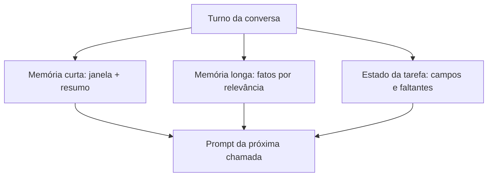

## Passo 1 · Leitura · Três memórias, três problemas

O modelo não lembra de nada entre chamadas (módulo 1): a "memória" de um agente é o que o seu código decide mandar de novo. Mandar tudo, sempre, funciona por alguns turnos. Depois a conversa passa a custar mais a cada mensagem, porque cada chamada reenvia todas as anteriores, e um dia não cabe mais na janela de contexto. Cortar as mensagens antigas resolve o custo e cria outro problema: o agente esquece o RA que a aluna informou no primeiro turno e pergunta de novo.

Não existe uma memória que resolva tudo. Agentes conversacionais costumam separar três estruturas, cada uma para um problema:

- **Memória curta**: as últimas mensagens na íntegra e um **resumo** do que saiu da janela. Mantém o custo por chamada limitado. O risco é o resumo perder justamente o que importa: números, códigos, datas, decisões.
- **Memória longa**: fatos guardados entre sessões ("prefere atendimento por e-mail", "já trancou EST202 em 2024") e **recuperados sob demanda**, só os poucos relevantes para a pergunta atual, como na busca semântica do módulo 3. Os riscos: trazer um fato velho que já mudou e misturar memórias de pessoas diferentes.
- **Estado da tarefa**: quando o agente coleta dados para abrir um requerimento, um dicionário com os campos já preenchidos, cada um validado, e a lista dos que faltam. Não depende de o modelo reler a conversa sem esquecer nada: `faltantes()` é uma conta exata. É também a parte que se salva em disco para continuar outro dia.



Uma regra atravessa as três: **o modelo propõe, o código decide**. O modelo pode extrair da mensagem que a disciplina é `PRG101`, mas quem valida o formato e grava no estado é o código; o modelo pode resumir, mas quem decide quanto da conversa fica na íntegra é o código. E toda memória é dado pessoal: pertence a uma pessoa, precisa ficar separada das outras e precisa poder ser apagada.

Nesta lição você constrói as três peças, nesta ordem: o estado da tarefa, a janela com resumo, a memória longa e, por fim, a persistência do estado em JSON.

## Passo 2 · Exercício · O estado da tarefa
modo: ordenar

Monte a classe `EstadoDaTarefa(campos)`, em que `campos` é um dicionário `{nome do campo: função validadora}`. A ordem de `campos` é a ordem em que o agente pergunta.

- `atualizar(novos)` recebe o que o modelo extraiu do turno. Valor `None` ou texto em branco significa "nada extraído" e é ignorado, **sem apagar** o que já estava preenchido. Campo conhecido com valor válido é gravado; campo desconhecido ou valor recusado pelo validador não é gravado e entra na lista devolvida, na ordem em que apareceu.
- `faltantes()` lista os campos ainda não preenchidos, na ordem de `campos`.
- `completo()` diz se não falta nada.

Duas linhas estão sobrando.

### Instruções
1. Guarde uma cópia de `campos` e comece sem dados.
2. Em `atualizar`, ignore valores vazios, grave os válidos e devolva os recusados.
3. `faltantes` segue a ordem dos campos e `completo` só é verdadeiro sem faltantes.

### Solução
```python
class EstadoDaTarefa:
    def __init__(self, campos):
        self.campos = dict(campos)
        self.dados = {}

    def atualizar(self, novos):
        recusados = []
        for nome, valor in novos.items():
            if valor is None or str(valor).strip() == "":
                continue
            if nome in self.campos and self.campos[nome](valor):
                self.dados[nome] = valor
            else:
                recusados.append(nome)
        return recusados

    def faltantes(self):
        return [nome for nome in self.campos if nome not in self.dados]

    def completo(self):
        return not self.faltantes()
```

### Distratores
```python
            if not valor:
        return len(self.dados) > 0
```

### Verificação
```json
[
  {"id": "inicio", "checkpoint": 3, "kind": "expr", "setup": "import re\ncampos = {'ra': lambda v: str(v).isdigit() and len(str(v)) == 7, 'disciplina': lambda v: re.fullmatch(r'[A-Z]{3}[0-9]{3}', str(v)) is not None, 'motivo': lambda v: len(str(v)) >= 10}\ne = EstadoDaTarefa(campos)\n", "expr": "[e.faltantes(), e.completo(), e.dados]", "expected": [["ra", "disciplina", "motivo"], false, {}], "name": "Começa vazio, com todos os campos faltando na ordem da ficha", "hint": "A ordem é a dos campos, que é a ordem em que o agente pergunta."},
  {"id": "grava-validos", "checkpoint": 2, "kind": "expr", "setup": "import re\ncampos = {'ra': lambda v: str(v).isdigit() and len(str(v)) == 7, 'disciplina': lambda v: re.fullmatch(r'[A-Z]{3}[0-9]{3}', str(v)) is not None, 'motivo': lambda v: len(str(v)) >= 10}\ne = EstadoDaTarefa(campos)\nr = e.atualizar({'ra': '1234567', 'disciplina': 'PRG101'})", "expr": "[r, e.dados, e.faltantes()]", "expected": [[], {"ra": "1234567", "disciplina": "PRG101"}, ["motivo"]], "name": "Grava valores válidos e atualiza os faltantes"},
  {"id": "ignora-vazios", "checkpoint": 2, "kind": "expr", "setup": "import re\ncampos = {'ra': lambda v: str(v).isdigit() and len(str(v)) == 7, 'disciplina': lambda v: re.fullmatch(r'[A-Z]{3}[0-9]{3}', str(v)) is not None, 'motivo': lambda v: len(str(v)) >= 10}\ne = EstadoDaTarefa(campos)\nr = e.atualizar({'ra': '', 'disciplina': '   ', 'motivo': None})", "expr": "[r, e.dados, e.faltantes()]", "expected": [[], {}, ["ra", "disciplina", "motivo"]], "name": "None e texto em branco são ignorados, sem virar recusa", "hint": "Texto só com espaços não é um valor."},
  {"id": "nao-apaga", "checkpoint": 2, "kind": "expr", "setup": "import re\ncampos = {'ra': lambda v: str(v).isdigit() and len(str(v)) == 7, 'disciplina': lambda v: re.fullmatch(r'[A-Z]{3}[0-9]{3}', str(v)) is not None, 'motivo': lambda v: len(str(v)) >= 10}\ne = EstadoDaTarefa(campos)\ne.atualizar({'ra': '1234567'})\nr = e.atualizar({'ra': None, 'disciplina': ' '})", "expr": "[r, e.dados]", "expected": [[], {"ra": "1234567"}], "name": "Um turno sem o campo não apaga o valor já preenchido"},
  {"id": "recusa-invalidos", "checkpoint": 2, "kind": "expr", "setup": "import re\ncampos = {'ra': lambda v: str(v).isdigit() and len(str(v)) == 7, 'disciplina': lambda v: re.fullmatch(r'[A-Z]{3}[0-9]{3}', str(v)) is not None, 'motivo': lambda v: len(str(v)) >= 10}\ne = EstadoDaTarefa(campos)\nr = e.atualizar({'ra': '12a', 'disciplina': 'prg101', 'motivo': 'Conflito de horário com o estágio'})", "expr": "[r, e.dados]", "expected": [["ra", "disciplina"], {"motivo": "Conflito de horário com o estágio"}], "name": "Valores recusados pelo validador não são gravados e são devolvidos"},
  {"id": "recusa-desconhecido", "checkpoint": 2, "kind": "expr", "setup": "import re\ncampos = {'ra': lambda v: str(v).isdigit() and len(str(v)) == 7, 'disciplina': lambda v: re.fullmatch(r'[A-Z]{3}[0-9]{3}', str(v)) is not None, 'motivo': lambda v: len(str(v)) >= 10}\ne = EstadoDaTarefa(campos)\nr = e.atualizar({'email': 'ana@exemplo.com', 'ra': '1234567'})", "expr": "[r, e.dados]", "expected": [["email"], {"ra": "1234567"}], "name": "Campo que não está na ficha é recusado"},
  {"id": "completo", "checkpoint": 3, "kind": "expr", "setup": "import re\ncampos = {'ra': lambda v: str(v).isdigit() and len(str(v)) == 7, 'disciplina': lambda v: re.fullmatch(r'[A-Z]{3}[0-9]{3}', str(v)) is not None, 'motivo': lambda v: len(str(v)) >= 10}\ne = EstadoDaTarefa(campos)\ne.atualizar({'ra': '1234567'})\nantes = e.completo()\ne.atualizar({'disciplina': 'PRG101', 'motivo': 'Conflito de horário com o estágio'})", "expr": "[antes, e.completo(), e.faltantes()]", "expected": [false, true, []], "name": "completo só é verdadeiro quando nada falta"}
]
```

### Soluções erradas
```python name="aceita texto em branco"
class EstadoDaTarefa:
    def __init__(self, campos):
        self.campos = dict(campos)
        self.dados = {}

    def atualizar(self, novos):
        recusados = []
        for nome, valor in novos.items():
            if valor is None:
                continue
            if nome in self.campos and self.campos[nome](valor):
                self.dados[nome] = valor
            else:
                recusados.append(nome)
        return recusados

    def faltantes(self):
        return [nome for nome in self.campos if nome not in self.dados]

    def completo(self):
        return not self.faltantes()
```
```python name="completo assim que algum campo é preenchido"
class EstadoDaTarefa:
    def __init__(self, campos):
        self.campos = dict(campos)
        self.dados = {}

    def atualizar(self, novos):
        recusados = []
        for nome, valor in novos.items():
            if valor is None or str(valor).strip() == "":
                continue
            if nome in self.campos and self.campos[nome](valor):
                self.dados[nome] = valor
            else:
                recusados.append(nome)
        return recusados

    def faltantes(self):
        return [nome for nome in self.campos if nome not in self.dados]

    def completo(self):
        return len(self.dados) > 0
```
```python name="grava sem chamar o validador"
class EstadoDaTarefa:
    def __init__(self, campos):
        self.campos = dict(campos)
        self.dados = {}

    def atualizar(self, novos):
        recusados = []
        for nome, valor in novos.items():
            if valor is None or str(valor).strip() == "":
                continue
            if nome in self.campos:
                self.dados[nome] = valor
            else:
                recusados.append(nome)
        return recusados

    def faltantes(self):
        return [nome for nome in self.campos if nome not in self.dados]

    def completo(self):
        return not self.faltantes()
```
```python name="grava campos que não existem na ficha"
class EstadoDaTarefa:
    def __init__(self, campos):
        self.campos = dict(campos)
        self.dados = {}

    def atualizar(self, novos):
        recusados = []
        for nome, valor in novos.items():
            if valor is None or str(valor).strip() == "":
                continue
            if nome not in self.campos or self.campos[nome](valor):
                self.dados[nome] = valor
            else:
                recusados.append(nome)
        return recusados

    def faltantes(self):
        return [nome for nome in self.campos if nome not in self.dados]

    def completo(self):
        return not self.faltantes()
```
```python name="faltantes em ordem alfabética"
class EstadoDaTarefa:
    def __init__(self, campos):
        self.campos = dict(campos)
        self.dados = {}

    def atualizar(self, novos):
        recusados = []
        for nome, valor in novos.items():
            if valor is None or str(valor).strip() == "":
                continue
            if nome in self.campos and self.campos[nome](valor):
                self.dados[nome] = valor
            else:
                recusados.append(nome)
        return recusados

    def faltantes(self):
        return sorted(set(self.campos) - set(self.dados))

    def completo(self):
        return not self.faltantes()
```
```python name="trata None como valor a validar"
class EstadoDaTarefa:
    def __init__(self, campos):
        self.campos = dict(campos)
        self.dados = {}

    def atualizar(self, novos):
        recusados = []
        for nome, valor in novos.items():
            if str(valor).strip() == "":
                continue
            if nome in self.campos and self.campos[nome](valor):
                self.dados[nome] = valor
            else:
                recusados.append(nome)
        return recusados

    def faltantes(self):
        return [nome for nome in self.campos if nome not in self.dados]

    def completo(self):
        return not self.faltantes()
```

## Passo 3 · Leitura · A janela e o resumo

A memória curta guarda as mensagens mais recentes na íntegra. Quando a conversa passa de `limite` mensagens, as mais antigas saem da janela e são **resumidas**: o resumo entra no prompt como uma mensagem de sistema, logo depois das instruções, e as mensagens recentes vêm em seguida.

Resumir é outra chamada ao modelo, com custo e latência. Resumir a cada mensagem que sai seria uma chamada extra por turno. Por isso, quando a janela estoura, ela **compacta**: tira de uma vez as mensagens mais antigas até sobrarem `manter`, e faz uma única chamada ao resumidor com todas elas. Com `limite = 4` e `manter = 2`, a quinta mensagem dispara a compactação das três mais antigas; a próxima só acontece depois de mais três mensagens.

O resumidor recebe o **resumo anterior** e as mensagens que saíram, e devolve o resumo novo. Se ele receber só as mensagens novas, o resumo da compactação anterior se perde e a memória volta a esquecer.

O cuidado principal é com o conteúdo. Um pedido genérico ("resuma a conversa em uma frase") produz "a aluna quer trancar uma disciplina", sem o RA, sem o código, sem o protocolo. A instrução do resumidor precisa dizer o que preservar **exatamente**: números de RA, códigos de disciplina, protocolos, datas, decisões. Mesmo assim, um resumo pode errar; o que não pode se perder vai também para o estado da tarefa, que é exato.

O visualizador usa um resumidor de brinquedo, sem modelo, que só junta os identificadores encontrados nas mensagens que saem. Acompanhe a janela e o resumo a cada turno, e conte quantas vezes o resumidor é chamado.

```python visualizar
import re


def resumir(resumo, removidas):
    # brinquedo: guarda só RA, código de disciplina, protocolo e data
    padrao = r"\b\d{7}\b|\b[A-Z]{3}\d{3}\b|\b\d{4}-\d{4}\b|\b\d{2}/\d{2}\b"
    achados = []
    for m in removidas:
        achados += re.findall(padrao, m["content"])
    partes = [resumo] if resumo else []
    return "; ".join(partes + achados)


limite, manter = 4, 2
mensagens, resumo, chamadas = [], "", 0
conversa = [
    ("user", "Oi, meu RA é 1234567."),
    ("assistant", "Olá! Em que posso ajudar?"),
    ("user", "Quero trancar PRG101."),
    ("assistant", "O prazo vai até 30/04. Confirma?"),
    ("user", "Confirmo."),
    ("assistant", "Protocolo 2025-0042 aberto."),
    ("user", "E EST202, ainda dá tempo?"),
    ("assistant", "Dá, até 30/04."),
]
for papel, texto in conversa:
    mensagens.append({"role": papel, "content": texto})
    if len(mensagens) > limite:
        removidas, mensagens = mensagens[:-manter], mensagens[-manter:]
        resumo = resumir(resumo, removidas)
        chamadas += 1
    print(len(mensagens), "na janela | resumo:", resumo or "-")

print("chamadas ao resumidor:", chamadas)
```

## Passo 4 · Exercício · Memória curta com compactação

Escreva a classe `MemoriaCurta(limite, manter, resumidor)` e a função `resumidor_com_llm(cliente)`.

- O construtor exige `1 <= manter < limite` (senão, `ValueError`) e começa com a lista `mensagens` vazia e `resumo = ""`.
- `adicionar(papel, conteudo)` acrescenta `{"role": papel, "content": conteudo}`. Se a lista passar de `limite`, as mensagens mais antigas saem até sobrarem `manter`, e `resumo` passa a ser `resumidor(resumo, removidas)`: **uma** chamada por compactação, com o resumo anterior e as mensagens que saíram, em ordem.
- `contexto(system)` devolve a lista para o modelo: `{"role": "system", "content": system}`, depois, se houver resumo, `{"role": "system", "content": "Resumo da conversa até aqui: " + resumo}`, e por fim as mensagens da janela. A lista e os dicionários são cópias: quem recebe pode alterar sem estragar a memória.
- `resumidor_com_llm(cliente)` devolve uma função `resumir(resumo, removidas)` que chama `cliente.completar(mensagens, temperature=0)` com `{"role": "system", "content": INSTRUCAO_RESUMO}` e um `{"role": "user"}` cujo conteúdo é `"Resumo anterior: <resumo, ou (vazio)>\nMensagens:\n"` seguido de uma linha `"<papel>: <conteúdo>"` por mensagem removida, unidas por `"\n"`. Devolve o `conteudo` da resposta sem espaços nas pontas.

O cliente é o `ClienteLLM` do curso (`llm_simulado.py`); nos testes, a resposta do "modelo" é uma função que devolve um resumo fixo.

### Instruções
1. Valide `limite` e `manter` e guarde a janela, o resumo e o resumidor.
2. Ao estourar o limite, compacte até sobrarem `manter` mensagens, com uma única chamada ao resumidor.
3. O resumidor recebe o resumo anterior junto com as mensagens que saíram.
4. `contexto` monta instruções, resumo (se houver) e janela, sempre em cópias.
5. `resumidor_com_llm` monta o pedido de resumo e chama o cliente com temperatura 0.

### Código inicial
```python
from llm_simulado import ClienteLLM

INSTRUCAO_RESUMO = (
    "Atualize o resumo da conversa em poucas frases. Preserve exatamente números de RA, "
    "códigos de disciplina, protocolos, datas e decisões já tomadas."
)


class MemoriaCurta:
    def __init__(self, limite, manter, resumidor):
        pass

    def adicionar(self, papel, conteudo):
        pass

    def contexto(self, system):
        pass


def resumidor_com_llm(cliente):
    pass
```
```python path=llm_simulado.py
"""Cliente de LLM simulado do curso: a interface de um SDK real, sem rede.

Aproximações declaradas (tudo reproduzível):
- tokens: brinquedo, cada palavra vira pedaços de até 4 caracteres;
  o espaço em branco (quebras de linha inclusive) não conta à parte:
  vai colado no pedaço seguinte, ou no último quando fecha o texto,
  então "".join(tokenizar(t)) == t; o tokenizador real dá outros números;
- preços: fictícios, em R$ por milhão de tokens;
- latência: TTFT + ms por token de saída, somada a um relógio falso;
- sorteio: random.Random(seed); com temperature > 0 a resposta pode variar;
- falhas: fila programada (429, 503, "timeout", 400), consumida em ordem.
"""
import random
import re

PRECO_ENTRADA = 2.0  # R$ por milhão de tokens de entrada (fictício)
PRECO_SAIDA = 8.0  # R$ por milhão de tokens de saída (fictício)
SOBRECARGA_POR_MENSAGEM = 4  # tokens de formatação de cada mensagem


class ErroDeTaxa(Exception):  # HTTP 429: transitório
    def __init__(self, mensagem="429 Too Many Requests", retry_after=None):
        super().__init__(mensagem)
        self.retry_after = retry_after  # espera sugerida pelo servidor, em s


class ErroDeServidor(Exception):  # HTTP 5xx: transitório
    pass


class ErroDeTimeout(Exception):  # resposta não chegou no prazo: transitório
    pass


class ErroDeRequisicao(Exception):  # HTTP 400/401: permanente, não repita
    pass


def tokenizar(texto):
    return re.findall(r"\s*\S{1,4}(?:\s+\Z)?|\s+\Z", texto)


def contar_tokens(texto):
    return len(tokenizar(texto))


class Resposta:
    def __init__(self, conteudo, finish_reason, prompt_tokens, completion_tokens,
                 latencia_ms=0, tool_calls=None):
        self.conteudo = conteudo
        self.finish_reason = finish_reason  # "stop", "length" ou "tool_calls"
        self.usage = {"prompt_tokens": prompt_tokens,
                      "completion_tokens": completion_tokens,
                      "total_tokens": prompt_tokens + completion_tokens}
        self.latencia_ms = latencia_ms
        self.tool_calls = tool_calls or []


class Relogio:  # relógio falso: só anda quando alguém manda
    def __init__(self):
        self.agora_ms = 0

    def avancar(self, ms):
        self.agora_ms += ms


class ClienteLLM:
    """respostas: lista de textos candidatos, ou função(mensagens) que devolve
    um texto ou uma lista de tool_calls."""

    def __init__(self, respostas, seed=None, falhas=(), relogio=None,
                 ttft_ms=300, ms_por_token=20):
        self.respostas = respostas
        self.rng = random.Random(seed)
        self.falhas = list(falhas)
        self.relogio = relogio or Relogio()
        self.ttft_ms = ttft_ms
        self.ms_por_token = ms_por_token
        self.chamadas = 0

    def _preparar(self, mensagens, temperature):
        self.chamadas += 1
        falha = self.falhas.pop(0) if self.falhas else None
        if falha == 429:
            raise ErroDeTaxa(retry_after=2.0)
        if falha == 503:
            raise ErroDeServidor("503 Service Unavailable")
        if falha == "timeout":
            self.relogio.avancar(10_000)
            raise ErroDeTimeout("sem resposta em 10 s")
        if falha == 400:
            raise ErroDeRequisicao("400 Bad Request")
        if callable(self.respostas):
            return self.respostas(mensagens)
        if temperature == 0:
            return self.respostas[0]  # num servidor real, nem isso é garantido
        return self.rng.choice(self.respostas)

    def completar(self, mensagens, max_tokens=256, temperature=1.0):
        gerado = self._preparar(mensagens, temperature)
        entrada = sum(contar_tokens(m["content"]) + SOBRECARGA_POR_MENSAGEM
                      for m in mensagens)
        if isinstance(gerado, list):  # o modelo pediu ferramentas
            self.relogio.avancar(self.ttft_ms)
            return Resposta("", "tool_calls", entrada, 10, self.ttft_ms, gerado)
        tokens, motivo = tokenizar(gerado), "stop"
        if len(tokens) > max_tokens:
            tokens, motivo = tokens[:max_tokens], "length"
        latencia = self.ttft_ms + len(tokens) * self.ms_por_token
        self.relogio.avancar(latencia)
        return Resposta("".join(tokens), motivo, entrada, len(tokens), latencia)

    def completar_stream(self, mensagens, max_tokens=256, temperature=1.0, cair_apos=None):
        """Gera eventos {"delta": texto}; o último traz "finish_reason".
        cair_apos=n: a conexão cai depois de n tokens, sem o evento final."""
        tokens, motivo = tokenizar(self._preparar(mensagens, temperature)), "stop"
        if len(tokens) > max_tokens:
            tokens, motivo = tokens[:max_tokens], "length"
        self.relogio.avancar(self.ttft_ms)
        for i, token in enumerate(tokens):
            if i == cair_apos:
                return
            self.relogio.avancar(self.ms_por_token)
            yield {"delta": token}
        yield {"delta": "", "finish_reason": motivo}
```

### Solução
```python
from llm_simulado import ClienteLLM

INSTRUCAO_RESUMO = (
    "Atualize o resumo da conversa em poucas frases. Preserve exatamente números de RA, "
    "códigos de disciplina, protocolos, datas e decisões já tomadas."
)


class MemoriaCurta:
    def __init__(self, limite, manter, resumidor):
        if not 1 <= manter < limite:
            raise ValueError("é preciso 1 <= manter < limite")
        self.limite = limite
        self.manter = manter
        self.resumidor = resumidor
        self.mensagens = []
        self.resumo = ""

    def adicionar(self, papel, conteudo):
        self.mensagens.append({"role": papel, "content": conteudo})
        if len(self.mensagens) > self.limite:
            removidas = self.mensagens[:-self.manter]
            self.mensagens = self.mensagens[-self.manter:]
            self.resumo = self.resumidor(self.resumo, removidas)

    def contexto(self, system):
        lista = [{"role": "system", "content": system}]
        if self.resumo:
            lista.append({"role": "system", "content": "Resumo da conversa até aqui: " + self.resumo})
        return lista + [dict(m) for m in self.mensagens]


def resumidor_com_llm(cliente):
    def resumir(resumo, removidas):
        linhas = [f"{m['role']}: {m['content']}" for m in removidas]
        pedido = f"Resumo anterior: {resumo or '(vazio)'}\nMensagens:\n" + "\n".join(linhas)
        resposta = cliente.completar(
            [{"role": "system", "content": INSTRUCAO_RESUMO}, {"role": "user", "content": pedido}],
            temperature=0,
        )
        return resposta.conteudo.strip()

    return resumir
```
```python path=llm_simulado.py
"""Cliente de LLM simulado do curso: a interface de um SDK real, sem rede.

Aproximações declaradas (tudo reproduzível):
- tokens: brinquedo, cada palavra vira pedaços de até 4 caracteres;
  o espaço em branco (quebras de linha inclusive) não conta à parte:
  vai colado no pedaço seguinte, ou no último quando fecha o texto,
  então "".join(tokenizar(t)) == t; o tokenizador real dá outros números;
- preços: fictícios, em R$ por milhão de tokens;
- latência: TTFT + ms por token de saída, somada a um relógio falso;
- sorteio: random.Random(seed); com temperature > 0 a resposta pode variar;
- falhas: fila programada (429, 503, "timeout", 400), consumida em ordem.
"""
import random
import re

PRECO_ENTRADA = 2.0  # R$ por milhão de tokens de entrada (fictício)
PRECO_SAIDA = 8.0  # R$ por milhão de tokens de saída (fictício)
SOBRECARGA_POR_MENSAGEM = 4  # tokens de formatação de cada mensagem


class ErroDeTaxa(Exception):  # HTTP 429: transitório
    def __init__(self, mensagem="429 Too Many Requests", retry_after=None):
        super().__init__(mensagem)
        self.retry_after = retry_after  # espera sugerida pelo servidor, em s


class ErroDeServidor(Exception):  # HTTP 5xx: transitório
    pass


class ErroDeTimeout(Exception):  # resposta não chegou no prazo: transitório
    pass


class ErroDeRequisicao(Exception):  # HTTP 400/401: permanente, não repita
    pass


def tokenizar(texto):
    return re.findall(r"\s*\S{1,4}(?:\s+\Z)?|\s+\Z", texto)


def contar_tokens(texto):
    return len(tokenizar(texto))


class Resposta:
    def __init__(self, conteudo, finish_reason, prompt_tokens, completion_tokens,
                 latencia_ms=0, tool_calls=None):
        self.conteudo = conteudo
        self.finish_reason = finish_reason  # "stop", "length" ou "tool_calls"
        self.usage = {"prompt_tokens": prompt_tokens,
                      "completion_tokens": completion_tokens,
                      "total_tokens": prompt_tokens + completion_tokens}
        self.latencia_ms = latencia_ms
        self.tool_calls = tool_calls or []


class Relogio:  # relógio falso: só anda quando alguém manda
    def __init__(self):
        self.agora_ms = 0

    def avancar(self, ms):
        self.agora_ms += ms


class ClienteLLM:
    """respostas: lista de textos candidatos, ou função(mensagens) que devolve
    um texto ou uma lista de tool_calls."""

    def __init__(self, respostas, seed=None, falhas=(), relogio=None,
                 ttft_ms=300, ms_por_token=20):
        self.respostas = respostas
        self.rng = random.Random(seed)
        self.falhas = list(falhas)
        self.relogio = relogio or Relogio()
        self.ttft_ms = ttft_ms
        self.ms_por_token = ms_por_token
        self.chamadas = 0

    def _preparar(self, mensagens, temperature):
        self.chamadas += 1
        falha = self.falhas.pop(0) if self.falhas else None
        if falha == 429:
            raise ErroDeTaxa(retry_after=2.0)
        if falha == 503:
            raise ErroDeServidor("503 Service Unavailable")
        if falha == "timeout":
            self.relogio.avancar(10_000)
            raise ErroDeTimeout("sem resposta em 10 s")
        if falha == 400:
            raise ErroDeRequisicao("400 Bad Request")
        if callable(self.respostas):
            return self.respostas(mensagens)
        if temperature == 0:
            return self.respostas[0]  # num servidor real, nem isso é garantido
        return self.rng.choice(self.respostas)

    def completar(self, mensagens, max_tokens=256, temperature=1.0):
        gerado = self._preparar(mensagens, temperature)
        entrada = sum(contar_tokens(m["content"]) + SOBRECARGA_POR_MENSAGEM
                      for m in mensagens)
        if isinstance(gerado, list):  # o modelo pediu ferramentas
            self.relogio.avancar(self.ttft_ms)
            return Resposta("", "tool_calls", entrada, 10, self.ttft_ms, gerado)
        tokens, motivo = tokenizar(gerado), "stop"
        if len(tokens) > max_tokens:
            tokens, motivo = tokens[:max_tokens], "length"
        latencia = self.ttft_ms + len(tokens) * self.ms_por_token
        self.relogio.avancar(latencia)
        return Resposta("".join(tokens), motivo, entrada, len(tokens), latencia)

    def completar_stream(self, mensagens, max_tokens=256, temperature=1.0, cair_apos=None):
        """Gera eventos {"delta": texto}; o último traz "finish_reason".
        cair_apos=n: a conexão cai depois de n tokens, sem o evento final."""
        tokens, motivo = tokenizar(self._preparar(mensagens, temperature)), "stop"
        if len(tokens) > max_tokens:
            tokens, motivo = tokens[:max_tokens], "length"
        self.relogio.avancar(self.ttft_ms)
        for i, token in enumerate(tokens):
            if i == cair_apos:
                return
            self.relogio.avancar(self.ms_por_token)
            yield {"delta": token}
        yield {"delta": "", "finish_reason": motivo}
```

### Dicas
1. Fatiamento resolve a compactação: `lista[:-n]` são todas menos as `n` últimas, e `lista[-n:]` são as `n` últimas.
2. Uma função que devolve outra função "lembra" das variáveis de quem a criou (closure, Nível 2): é assim que `resumir` enxerga o `cliente`.
3. `list(self.mensagens)` copia a lista, mas os dicionários dentro dela continuam sendo os mesmos.

### Verificação
```json
[
  {"id": "abaixo-do-limite", "checkpoint": 2, "kind": "expr", "setup": "chamadas = []\ndef resumidor(resumo, removidas):\n    chamadas.append([m['content'] for m in removidas])\n    novo = ','.join(m['content'] for m in removidas)\n    return resumo + '|' + novo if resumo else novo\nmem = MemoriaCurta(4, 2, resumidor)\nfor i in range(1, 5):\n    mem.adicionar('user' if i % 2 else 'assistant', f'm{i}')\n", "expr": "[chamadas, mem.contexto('S')]", "expected": [[], [{"role": "system", "content": "S"}, {"role": "user", "content": "m1"}, {"role": "assistant", "content": "m2"}, {"role": "user", "content": "m3"}, {"role": "assistant", "content": "m4"}]], "name": "Até o limite, nenhuma compactação", "hint": "Compacta quando passa do limite, não quando o atinge."},
  {"id": "primeira-compactacao", "checkpoint": 2, "kind": "expr", "setup": "chamadas = []\ndef resumidor(resumo, removidas):\n    chamadas.append([m['content'] for m in removidas])\n    novo = ','.join(m['content'] for m in removidas)\n    return resumo + '|' + novo if resumo else novo\nmem = MemoriaCurta(4, 2, resumidor)\nfor i in range(1, 6):\n    mem.adicionar('user' if i % 2 else 'assistant', f'm{i}')\n", "expr": "[chamadas, [m['content'] for m in mem.contexto('S')]]", "expected": [[["m1", "m2", "m3"]], ["S", "Resumo da conversa até aqui: m1,m2,m3", "m4", "m5"]], "name": "Ao passar do limite, uma chamada ao resumidor com as mensagens que saíram", "hint": "Uma chamada por compactação, com todas as mensagens removidas."},
  {"id": "papeis-no-contexto", "checkpoint": 4, "kind": "expr", "setup": "chamadas = []\ndef resumidor(resumo, removidas):\n    chamadas.append([m['content'] for m in removidas])\n    novo = ','.join(m['content'] for m in removidas)\n    return resumo + '|' + novo if resumo else novo\nmem = MemoriaCurta(4, 2, resumidor)\nfor i in range(1, 6):\n    mem.adicionar('user' if i % 2 else 'assistant', f'm{i}')\n", "expr": "[m['role'] for m in mem.contexto('S')]", "expected": ["system", "system", "assistant", "user"], "name": "Instruções, depois o resumo, depois a janela"},
  {"id": "duas-compactacoes", "checkpoint": 3, "kind": "expr", "setup": "chamadas = []\ndef resumidor(resumo, removidas):\n    chamadas.append([m['content'] for m in removidas])\n    novo = ','.join(m['content'] for m in removidas)\n    return resumo + '|' + novo if resumo else novo\nmem = MemoriaCurta(4, 2, resumidor)\nfor i in range(1, 10):\n    mem.adicionar('user' if i % 2 else 'assistant', f'm{i}')\n", "expr": "[chamadas, mem.resumo, [m['content'] for m in mem.contexto('S')][2:]]", "expected": [[["m1", "m2", "m3"], ["m4", "m5", "m6"]], "m1,m2,m3|m4,m5,m6", ["m7", "m8", "m9"]], "name": "A segunda compactação recebe o resumo anterior e o acumula"},
  {"id": "copias", "checkpoint": 4, "kind": "expr", "setup": "chamadas = []\ndef resumidor(resumo, removidas):\n    chamadas.append([m['content'] for m in removidas])\n    novo = ','.join(m['content'] for m in removidas)\n    return resumo + '|' + novo if resumo else novo\nmem = MemoriaCurta(4, 2, resumidor)\nfor i in range(1, 6):\n    mem.adicionar('user' if i % 2 else 'assistant', f'm{i}')\nctx = mem.contexto('S')\nctx[2]['content'] = 'alterado'\nctx.append({'role': 'user', 'content': 'x'})", "expr": "[len(mem.contexto('S')), mem.contexto('S')[2]['content']]", "expected": [4, "m4"], "name": "Alterar a lista devolvida não altera a memória", "hint": "Copie também cada dicionário."},
  {"id": "manter-igual-ao-limite", "checkpoint": 1, "kind": "expr", "setup": "chamadas = []\ndef resumidor(resumo, removidas):\n    chamadas.append([m['content'] for m in removidas])\n    novo = ','.join(m['content'] for m in removidas)\n    return resumo + '|' + novo if resumo else novo\n", "expr": "MemoriaCurta(4, 4, resumidor)", "raises": "ValueError", "name": "manter igual ao limite é recusado"},
  {"id": "manter-zero", "checkpoint": 1, "kind": "expr", "setup": "chamadas = []\ndef resumidor(resumo, removidas):\n    chamadas.append([m['content'] for m in removidas])\n    novo = ','.join(m['content'] for m in removidas)\n    return resumo + '|' + novo if resumo else novo\n", "expr": "MemoriaCurta(4, 0, resumidor)", "raises": "ValueError", "name": "manter zero é recusado"},
  {"id": "pedido-de-resumo", "checkpoint": 5, "kind": "expr", "setup": "vistos = []\ndef modelo(msgs):\n    vistos.append(msgs)\n    return '  RA 1234567 quer trancar PRG101.  '\nclass Espiao(ClienteLLM):\n    def completar(self, mensagens, **kw):\n        self.kw = kw\n        return super().completar(mensagens, **kw)\ncli = Espiao(modelo)\nresumir = resumidor_com_llm(cli)\nr = resumir('Aluna se identificou.', [{'role': 'user', 'content': 'Quero trancar PRG101.'}, {'role': 'assistant', 'content': 'Confirma o RA 1234567?'}])", "expr": "[r, cli.chamadas, cli.kw, vistos[0][0]['role'], vistos[0][0]['content'] == INSTRUCAO_RESUMO, vistos[0][1]]", "expected": ["RA 1234567 quer trancar PRG101.", 1, {"temperature": 0}, "system", true, {"role": "user", "content": "Resumo anterior: Aluna se identificou.\nMensagens:\nuser: Quero trancar PRG101.\nassistant: Confirma o RA 1234567?"}], "name": "resumidor_com_llm monta o pedido com o resumo anterior e chama o modelo com temperatura 0"},
  {"id": "resumo-vazio", "checkpoint": 5, "kind": "expr", "setup": "vistos = []\ndef modelo(msgs):\n    vistos.append(msgs)\n    return '  RA 1234567 quer trancar PRG101.  '\nclass Espiao(ClienteLLM):\n    def completar(self, mensagens, **kw):\n        self.kw = kw\n        return super().completar(mensagens, **kw)\ncli = Espiao(modelo)\nresumir = resumidor_com_llm(cli)\nresumir('', [{'role': 'user', 'content': 'Quero trancar PRG101.'}, {'role': 'assistant', 'content': 'Confirma o RA 1234567?'}])", "expr": "vistos[0][1]['content'].split(chr(10))[0]", "expected": "Resumo anterior: (vazio)", "name": "Sem resumo anterior, o pedido diz (vazio)"},
  {"id": "integrado", "checkpoint": 5, "kind": "expr", "setup": "vistos = []\ndef modelo(msgs):\n    vistos.append(msgs)\n    return '  RA 1234567 quer trancar PRG101.  '\nclass Espiao(ClienteLLM):\n    def completar(self, mensagens, **kw):\n        self.kw = kw\n        return super().completar(mensagens, **kw)\ncli = Espiao(modelo)\nresumir = resumidor_com_llm(cli)\nmem = MemoriaCurta(3, 1, resumir)\nfor t in ['Oi', 'Meu RA é 1234567', 'Quero trancar PRG101', 'Até quando?']:\n    mem.adicionar('user', t)", "expr": "[cli.chamadas, mem.contexto('S')[1]['content'], len(mem.contexto('S'))]", "expected": [1, "Resumo da conversa até aqui: RA 1234567 quer trancar PRG101.", 3], "name": "Com o modelo como resumidor: uma chamada por compactação"}
]
```

### Soluções erradas
```python name="descarta as antigas sem resumir"
from llm_simulado import ClienteLLM

INSTRUCAO_RESUMO = (
    "Atualize o resumo da conversa em poucas frases. Preserve exatamente números de RA, "
    "códigos de disciplina, protocolos, datas e decisões já tomadas."
)


class MemoriaCurta:
    def __init__(self, limite, manter, resumidor):
        if not 1 <= manter < limite:
            raise ValueError("é preciso 1 <= manter < limite")
        self.limite = limite
        self.manter = manter
        self.resumidor = resumidor
        self.mensagens = []
        self.resumo = ""

    def adicionar(self, papel, conteudo):
        self.mensagens.append({"role": papel, "content": conteudo})
        if len(self.mensagens) > self.limite:
            self.mensagens = self.mensagens[-self.manter:]

    def contexto(self, system):
        lista = [{"role": "system", "content": system}]
        if self.resumo:
            lista.append({"role": "system", "content": "Resumo da conversa até aqui: " + self.resumo})
        return lista + [dict(m) for m in self.mensagens]


def resumidor_com_llm(cliente):
    def resumir(resumo, removidas):
        linhas = [f"{m['role']}: {m['content']}" for m in removidas]
        pedido = f"Resumo anterior: {resumo or '(vazio)'}\nMensagens:\n" + "\n".join(linhas)
        resposta = cliente.completar(
            [{"role": "system", "content": INSTRUCAO_RESUMO}, {"role": "user", "content": pedido}],
            temperature=0,
        )
        return resposta.conteudo.strip()

    return resumir
```
```python name="resume uma mensagem por vez"
from llm_simulado import ClienteLLM

INSTRUCAO_RESUMO = (
    "Atualize o resumo da conversa em poucas frases. Preserve exatamente números de RA, "
    "códigos de disciplina, protocolos, datas e decisões já tomadas."
)


class MemoriaCurta:
    def __init__(self, limite, manter, resumidor):
        if not 1 <= manter < limite:
            raise ValueError("é preciso 1 <= manter < limite")
        self.limite = limite
        self.manter = manter
        self.resumidor = resumidor
        self.mensagens = []
        self.resumo = ""

    def adicionar(self, papel, conteudo):
        self.mensagens.append({"role": papel, "content": conteudo})
        if len(self.mensagens) > self.limite:
            while len(self.mensagens) > self.manter:
                antiga = self.mensagens.pop(0)
                self.resumo = self.resumidor(self.resumo, [antiga])

    def contexto(self, system):
        lista = [{"role": "system", "content": system}]
        if self.resumo:
            lista.append({"role": "system", "content": "Resumo da conversa até aqui: " + self.resumo})
        return lista + [dict(m) for m in self.mensagens]


def resumidor_com_llm(cliente):
    def resumir(resumo, removidas):
        linhas = [f"{m['role']}: {m['content']}" for m in removidas]
        pedido = f"Resumo anterior: {resumo or '(vazio)'}\nMensagens:\n" + "\n".join(linhas)
        resposta = cliente.completar(
            [{"role": "system", "content": INSTRUCAO_RESUMO}, {"role": "user", "content": pedido}],
            temperature=0,
        )
        return resposta.conteudo.strip()

    return resumir
```
```python name="tira as mensagens mais recentes"
from llm_simulado import ClienteLLM

INSTRUCAO_RESUMO = (
    "Atualize o resumo da conversa em poucas frases. Preserve exatamente números de RA, "
    "códigos de disciplina, protocolos, datas e decisões já tomadas."
)


class MemoriaCurta:
    def __init__(self, limite, manter, resumidor):
        if not 1 <= manter < limite:
            raise ValueError("é preciso 1 <= manter < limite")
        self.limite = limite
        self.manter = manter
        self.resumidor = resumidor
        self.mensagens = []
        self.resumo = ""

    def adicionar(self, papel, conteudo):
        self.mensagens.append({"role": papel, "content": conteudo})
        if len(self.mensagens) > self.limite:
            removidas = self.mensagens[self.manter:]
            self.mensagens = self.mensagens[:self.manter]
            self.resumo = self.resumidor(self.resumo, removidas)

    def contexto(self, system):
        lista = [{"role": "system", "content": system}]
        if self.resumo:
            lista.append({"role": "system", "content": "Resumo da conversa até aqui: " + self.resumo})
        return lista + [dict(m) for m in self.mensagens]


def resumidor_com_llm(cliente):
    def resumir(resumo, removidas):
        linhas = [f"{m['role']}: {m['content']}" for m in removidas]
        pedido = f"Resumo anterior: {resumo or '(vazio)'}\nMensagens:\n" + "\n".join(linhas)
        resposta = cliente.completar(
            [{"role": "system", "content": INSTRUCAO_RESUMO}, {"role": "user", "content": pedido}],
            temperature=0,
        )
        return resposta.conteudo.strip()

    return resumir
```
```python name="o resumo novo esquece o anterior"
from llm_simulado import ClienteLLM

INSTRUCAO_RESUMO = (
    "Atualize o resumo da conversa em poucas frases. Preserve exatamente números de RA, "
    "códigos de disciplina, protocolos, datas e decisões já tomadas."
)


class MemoriaCurta:
    def __init__(self, limite, manter, resumidor):
        if not 1 <= manter < limite:
            raise ValueError("é preciso 1 <= manter < limite")
        self.limite = limite
        self.manter = manter
        self.resumidor = resumidor
        self.mensagens = []
        self.resumo = ""

    def adicionar(self, papel, conteudo):
        self.mensagens.append({"role": papel, "content": conteudo})
        if len(self.mensagens) > self.limite:
            removidas = self.mensagens[:-self.manter]
            self.mensagens = self.mensagens[-self.manter:]
            self.resumo = self.resumidor("", removidas)

    def contexto(self, system):
        lista = [{"role": "system", "content": system}]
        if self.resumo:
            lista.append({"role": "system", "content": "Resumo da conversa até aqui: " + self.resumo})
        return lista + [dict(m) for m in self.mensagens]


def resumidor_com_llm(cliente):
    def resumir(resumo, removidas):
        linhas = [f"{m['role']}: {m['content']}" for m in removidas]
        pedido = "Mensagens:\n" + "\n".join(linhas)
        resposta = cliente.completar(
            [{"role": "system", "content": INSTRUCAO_RESUMO}, {"role": "user", "content": pedido}],
            temperature=0,
        )
        return resposta.conteudo.strip()

    return resumir
```
```python name="contexto devolve as mensagens internas"
from llm_simulado import ClienteLLM

INSTRUCAO_RESUMO = (
    "Atualize o resumo da conversa em poucas frases. Preserve exatamente números de RA, "
    "códigos de disciplina, protocolos, datas e decisões já tomadas."
)


class MemoriaCurta:
    def __init__(self, limite, manter, resumidor):
        if not 1 <= manter < limite:
            raise ValueError("é preciso 1 <= manter < limite")
        self.limite = limite
        self.manter = manter
        self.resumidor = resumidor
        self.mensagens = []
        self.resumo = ""

    def adicionar(self, papel, conteudo):
        self.mensagens.append({"role": papel, "content": conteudo})
        if len(self.mensagens) > self.limite:
            removidas = self.mensagens[:-self.manter]
            self.mensagens = self.mensagens[-self.manter:]
            self.resumo = self.resumidor(self.resumo, removidas)

    def contexto(self, system):
        lista = [{"role": "system", "content": system}]
        if self.resumo:
            lista.append({"role": "system", "content": "Resumo da conversa até aqui: " + self.resumo})
        return lista + list(self.mensagens)


def resumidor_com_llm(cliente):
    def resumir(resumo, removidas):
        linhas = [f"{m['role']}: {m['content']}" for m in removidas]
        pedido = f"Resumo anterior: {resumo or '(vazio)'}\nMensagens:\n" + "\n".join(linhas)
        resposta = cliente.completar(
            [{"role": "system", "content": INSTRUCAO_RESUMO}, {"role": "user", "content": pedido}],
            temperature=0,
        )
        return resposta.conteudo.strip()

    return resumir
```
```python name="compacta ao atingir o limite, não ao passar dele"
from llm_simulado import ClienteLLM

INSTRUCAO_RESUMO = (
    "Atualize o resumo da conversa em poucas frases. Preserve exatamente números de RA, "
    "códigos de disciplina, protocolos, datas e decisões já tomadas."
)


class MemoriaCurta:
    def __init__(self, limite, manter, resumidor):
        if not 1 <= manter < limite:
            raise ValueError("é preciso 1 <= manter < limite")
        self.limite = limite
        self.manter = manter
        self.resumidor = resumidor
        self.mensagens = []
        self.resumo = ""

    def adicionar(self, papel, conteudo):
        self.mensagens.append({"role": papel, "content": conteudo})
        if len(self.mensagens) >= self.limite:
            removidas = self.mensagens[:-self.manter]
            self.mensagens = self.mensagens[-self.manter:]
            self.resumo = self.resumidor(self.resumo, removidas)

    def contexto(self, system):
        lista = [{"role": "system", "content": system}]
        if self.resumo:
            lista.append({"role": "system", "content": "Resumo da conversa até aqui: " + self.resumo})
        return lista + [dict(m) for m in self.mensagens]


def resumidor_com_llm(cliente):
    def resumir(resumo, removidas):
        linhas = [f"{m['role']}: {m['content']}" for m in removidas]
        pedido = f"Resumo anterior: {resumo or '(vazio)'}\nMensagens:\n" + "\n".join(linhas)
        resposta = cliente.completar(
            [{"role": "system", "content": INSTRUCAO_RESUMO}, {"role": "user", "content": pedido}],
            temperature=0,
        )
        return resposta.conteudo.strip()

    return resumir
```
```python name="pede o resumo com a temperatura padrão"
from llm_simulado import ClienteLLM

INSTRUCAO_RESUMO = (
    "Atualize o resumo da conversa em poucas frases. Preserve exatamente números de RA, "
    "códigos de disciplina, protocolos, datas e decisões já tomadas."
)


class MemoriaCurta:
    def __init__(self, limite, manter, resumidor):
        if not 1 <= manter < limite:
            raise ValueError("é preciso 1 <= manter < limite")
        self.limite = limite
        self.manter = manter
        self.resumidor = resumidor
        self.mensagens = []
        self.resumo = ""

    def adicionar(self, papel, conteudo):
        self.mensagens.append({"role": papel, "content": conteudo})
        if len(self.mensagens) > self.limite:
            removidas = self.mensagens[:-self.manter]
            self.mensagens = self.mensagens[-self.manter:]
            self.resumo = self.resumidor(self.resumo, removidas)

    def contexto(self, system):
        lista = [{"role": "system", "content": system}]
        if self.resumo:
            lista.append({"role": "system", "content": "Resumo da conversa até aqui: " + self.resumo})
        return lista + [dict(m) for m in self.mensagens]


def resumidor_com_llm(cliente):
    def resumir(resumo, removidas):
        linhas = [f"{m['role']}: {m['content']}" for m in removidas]
        pedido = f"Resumo anterior: {resumo or '(vazio)'}\nMensagens:\n" + "\n".join(linhas)
        resposta = cliente.completar(
            [{"role": "system", "content": INSTRUCAO_RESUMO}, {"role": "user", "content": pedido}]
        )
        return resposta.conteudo.strip()

    return resumir
```

## Passo 5 · Leitura · Memória longa e o estado salvo em disco

A memória longa guarda fatos de conversas anteriores e devolve só os relevantes para a pergunta atual. Em produção isso é a busca semântica do módulo 3: cada fato vira um embedding, e a consulta busca os vizinhos mais próximos. Esta lição roda sem numpy, então a similaridade é **lexical**: cada texto vira o conjunto dos seus termos (minúsculas, sem acento, sem palavras vazias como "de" e "meu"), e a semelhança entre dois conjuntos é o **índice de Jaccard**:

$$
J(A, B) = \frac{|A \cap B|}{|A \cup B|}
$$

Contar só os termos em comum favorece o texto longo, que tem mais palavras para coincidir, o mesmo viés do produto interno sem normalizar do módulo 3. Dividir pela união corrige isso. Dois cuidados: conjuntos vazios dos dois lados dão $0/0$, e similaridade zero não é resultado, é ruído.

Fatos mudam. "Curso Engenharia" pode ter sido verdade no ano passado; "transferida para Computação" é o fato atual. Com a mesma similaridade, o fato **mais recente** vem primeiro. Para ordenar sem relógio de parede, cada fato recebe um carimbo de um contador que só cresce.

Memória longa é dado pessoal guardado por tempo indeterminado. Três regras não são opcionais: cada fato pertence a um usuário, e a busca só olha os fatos **dele** (o identificador vem da sessão autenticada, não da conversa); o usuário pode pedir para apagar tudo, e apagar precisa apagar mesmo; e só se guarda o necessário para a finalidade (LGPD, Lei 13.709/2018).

O **estado da tarefa** precisa sobreviver a uma queda do servidor ou a uma conversa retomada no dia seguinte. JSON resolve, com três cuidados:

- **JSON não guarda funções.** Os validadores ficam no código; o arquivo guarda só os dados e um número de **versão** do formato, para que uma mudança futura seja detectada em vez de lida errado.
- **Ao carregar, valide de novo.** O arquivo pode ser de uma versão antiga das regras, ou ter sido editado. Os dados passam pelo mesmo `atualizar` que valida a entrada do modelo, e o que não passa volta a ser faltante.
- **Grave de forma atômica.** Abrir o arquivo com `"w"` apaga o conteúdo na hora; se a gravação falhar no meio, o estado anterior se perde. Grave num arquivo temporário e troque com `os.replace`, que substitui o destino de uma vez.

## Passo 6 · Exercício · Memória longa por similaridade

Escreva a classe `MemoriaLonga`. A função `termos(texto)`, pronta, devolve o conjunto de termos normalizados de um texto.

- `lembrar(usuario, texto)` guarda `{"usuario", "texto", "momento"}`, com `momento` vindo de um contador da instância que começa em 1 e cresce a cada fato.
- `recordar(usuario, consulta, k=2)` devolve a lista dos textos dos até `k` fatos **desse usuário** com maior similaridade de Jaccard com a consulta, maior primeiro; no empate, o mais recente primeiro. Similaridade zero não entra, e conjuntos vazios dos dois lados contam como similaridade zero.
- `esquecer(usuario)` apaga todos os fatos do usuário e devolve quantos apagou.

### Instruções
1. `lembrar` guarda o fato com o dono e um carimbo crescente.
2. `recordar` só considera fatos do próprio usuário e usa a similaridade de Jaccard dos conjuntos de termos.
3. `recordar` ordena por similaridade e, no empate, pelo mais recente; descarta similaridade zero sem dividir por zero.
4. `esquecer` apaga só os fatos daquele usuário e devolve a quantidade.

### Código inicial
```python
import re
import unicodedata

PALAVRAS_VAZIAS = {"a", "o", "as", "os", "de", "da", "do", "das", "dos", "e", "em",
                   "no", "na", "um", "uma", "para", "por", "com", "que", "meu", "minha", "eu"}


def termos(texto):
    decomposto = unicodedata.normalize("NFD", texto.lower())
    sem_acento = "".join(c for c in decomposto if unicodedata.category(c) != "Mn")
    return {t for t in re.findall(r"[a-z0-9]+", sem_acento) if t not in PALAVRAS_VAZIAS}


class MemoriaLonga:
    def __init__(self):
        pass

    def lembrar(self, usuario, texto):
        pass

    def recordar(self, usuario, consulta, k=2):
        pass

    def esquecer(self, usuario):
        pass
```

### Solução
```python
import re
import unicodedata

PALAVRAS_VAZIAS = {"a", "o", "as", "os", "de", "da", "do", "das", "dos", "e", "em",
                   "no", "na", "um", "uma", "para", "por", "com", "que", "meu", "minha", "eu"}


def termos(texto):
    decomposto = unicodedata.normalize("NFD", texto.lower())
    sem_acento = "".join(c for c in decomposto if unicodedata.category(c) != "Mn")
    return {t for t in re.findall(r"[a-z0-9]+", sem_acento) if t not in PALAVRAS_VAZIAS}


def jaccard(a, b):
    uniao = a | b
    return len(a & b) / len(uniao) if uniao else 0.0


class MemoriaLonga:
    def __init__(self):
        self.fatos = []
        self.contador = 0

    def lembrar(self, usuario, texto):
        self.contador += 1
        self.fatos.append({"usuario": usuario, "texto": texto, "momento": self.contador})

    def recordar(self, usuario, consulta, k=2):
        q = termos(consulta)
        candidatos = []
        for fato in self.fatos:
            if fato["usuario"] != usuario:
                continue
            sim = jaccard(q, termos(fato["texto"]))
            if sim > 0:
                candidatos.append((sim, fato["momento"], fato["texto"]))
        candidatos.sort(key=lambda c: (-c[0], -c[1]))
        return [texto for _, _, texto in candidatos[:k]]

    def esquecer(self, usuario):
        antes = len(self.fatos)
        self.fatos = [f for f in self.fatos if f["usuario"] != usuario]
        return antes - len(self.fatos)
```

### Dicas
1. Os operadores de conjunto `&` e `|` dão a interseção e a união.
2. Uma chave de ordenação com tupla e sinais negativos ordena tudo do maior para o menor, critério por critério.
3. O filtro por usuário vem antes de qualquer conta: um fato de outra pessoa não pode nem concorrer.

### Verificação
```json
[
  {"id": "mais-similar", "checkpoint": 2, "kind": "expr", "setup": "m = MemoriaLonga()\nm.lembrar('ana', 'Curso: Engenharia Elétrica.')\nm.lembrar('ana', 'Prefere ser atendida por e-mail.')\nm.lembrar('bruno', 'Trancou EST202 em 2024 por motivo de saúde.')\nm.lembrar('ana', 'Transferida para o curso de Computação em 2025.')\n", "expr": "m.recordar('ana', 'Como prefere ser atendida?')", "expected": ["Prefere ser atendida por e-mail."], "name": "Devolve o fato mais parecido com a consulta"},
  {"id": "ordem-por-similaridade", "checkpoint": 3, "kind": "expr", "setup": "m = MemoriaLonga()\nm.lembrar('ana', 'Curso: Engenharia Elétrica.')\nm.lembrar('ana', 'Prefere ser atendida por e-mail.')\nm.lembrar('bruno', 'Trancou EST202 em 2024 por motivo de saúde.')\nm.lembrar('ana', 'Transferida para o curso de Computação em 2025.')\n", "expr": "m.recordar('ana', 'curso de computação', k=3)", "expected": ["Transferida para o curso de Computação em 2025.", "Curso: Engenharia Elétrica."], "name": "Ordena da maior para a menor similaridade e descarta similaridade zero"},
  {"id": "jaccard-nao-contagem", "checkpoint": 2, "kind": "expr", "setup": "m = MemoriaLonga()\nm.lembrar('carla', 'Revisão de PRG101: protocolo 2025-0042.')\nm.lembrar('carla', 'Revisão de nota de PRG101, EST202 e MAT301 pedida no semestre passado, com protocolo na secretaria.')", "expr": "m.recordar('carla', 'protocolo da revisão de PRG101', k=1)", "expected": ["Revisão de PRG101: protocolo 2025-0042."], "name": "O texto longo não vence só por ter mais palavras", "hint": "Contar termos em comum favorece o texto mais comprido."},
  {"id": "empate-recente", "checkpoint": 3, "kind": "expr", "setup": "m = MemoriaLonga()\nm.lembrar('dani', 'Curso: Engenharia Elétrica.')\nm.lembrar('dani', 'Curso: Ciência da Computação.')", "expr": "m.recordar('dani', 'Qual é o curso?')", "expected": ["Curso: Ciência da Computação.", "Curso: Engenharia Elétrica."], "name": "Na mesma similaridade, o fato mais recente vem primeiro"},
  {"id": "isolamento", "checkpoint": 2, "kind": "expr", "setup": "m = MemoriaLonga()\nm.lembrar('ana', 'Curso: Engenharia Elétrica.')\nm.lembrar('ana', 'Prefere ser atendida por e-mail.')\nm.lembrar('bruno', 'Trancou EST202 em 2024 por motivo de saúde.')\nm.lembrar('ana', 'Transferida para o curso de Computação em 2025.')\n", "expr": "[m.recordar('ana', 'trancou EST202 por saúde'), m.recordar('bruno', 'trancou EST202 por saúde')]", "expected": [[], ["Trancou EST202 em 2024 por motivo de saúde."]], "name": "Um usuário nunca recebe fatos de outro", "hint": "Filtre pelo dono antes de calcular qualquer similaridade."},
  {"id": "limite-k", "checkpoint": 3, "kind": "expr", "setup": "m = MemoriaLonga()\nm.lembrar('ana', 'Curso: Engenharia Elétrica.')\nm.lembrar('ana', 'Prefere ser atendida por e-mail.')\nm.lembrar('bruno', 'Trancou EST202 em 2024 por motivo de saúde.')\nm.lembrar('ana', 'Transferida para o curso de Computação em 2025.')\n", "expr": "[len(m.recordar('ana', 'curso de computação', k=1)), len(m.recordar('ana', 'curso de computação', k=10))]", "expected": [1, 2], "name": "Devolve no máximo k fatos"},
  {"id": "sem-relacao", "checkpoint": 3, "kind": "expr", "setup": "m = MemoriaLonga()\nm.lembrar('ana', 'Curso: Engenharia Elétrica.')\nm.lembrar('ana', 'Prefere ser atendida por e-mail.')\nm.lembrar('bruno', 'Trancou EST202 em 2024 por motivo de saúde.')\nm.lembrar('ana', 'Transferida para o curso de Computação em 2025.')\n", "expr": "m.recordar('ana', 'horário da biblioteca')", "expected": [], "name": "Consulta sem relação devolve lista vazia"},
  {"id": "normalizacao", "checkpoint": 2, "kind": "expr", "setup": "m = MemoriaLonga()\nm.lembrar('ana', 'Curso: Engenharia Elétrica.')\nm.lembrar('ana', 'Prefere ser atendida por e-mail.')\nm.lembrar('bruno', 'Trancou EST202 em 2024 por motivo de saúde.')\nm.lembrar('ana', 'Transferida para o curso de Computação em 2025.')\n", "expr": "m.recordar('ana', 'ELETRICA')", "expected": ["Curso: Engenharia Elétrica."], "name": "Maiúsculas, acentos e pontuação não atrapalham", "hint": "Use a função termos, pronta no código."},
  {"id": "conjuntos-vazios", "checkpoint": 3, "kind": "expr", "setup": "m = MemoriaLonga()\nm.lembrar('eva', 'de da do')", "expr": "m.recordar('eva', 'a o e')", "expected": [], "name": "Consulta e fato só com palavras vazias: nada, e sem divisão por zero"},
  {"id": "esquecer", "checkpoint": 4, "kind": "expr", "setup": "m = MemoriaLonga()\nm.lembrar('ana', 'Curso: Engenharia Elétrica.')\nm.lembrar('ana', 'Prefere ser atendida por e-mail.')\nm.lembrar('bruno', 'Trancou EST202 em 2024 por motivo de saúde.')\nm.lembrar('ana', 'Transferida para o curso de Computação em 2025.')\n", "expr": "[m.esquecer('ana'), m.recordar('ana', 'curso'), m.recordar('bruno', 'EST202'), m.esquecer('ana')]", "expected": [3, [], ["Trancou EST202 em 2024 por motivo de saúde."], 0], "name": "esquecer apaga todos os fatos do usuário, e só os dele"}
]
```

### Soluções erradas
```python name="busca nos fatos de todos os usuários"
import re
import unicodedata

PALAVRAS_VAZIAS = {"a", "o", "as", "os", "de", "da", "do", "das", "dos", "e", "em",
                   "no", "na", "um", "uma", "para", "por", "com", "que", "meu", "minha", "eu"}


def termos(texto):
    decomposto = unicodedata.normalize("NFD", texto.lower())
    sem_acento = "".join(c for c in decomposto if unicodedata.category(c) != "Mn")
    return {t for t in re.findall(r"[a-z0-9]+", sem_acento) if t not in PALAVRAS_VAZIAS}


def jaccard(a, b):
    uniao = a | b
    return len(a & b) / len(uniao) if uniao else 0.0


class MemoriaLonga:
    def __init__(self):
        self.fatos = []
        self.contador = 0

    def lembrar(self, usuario, texto):
        self.contador += 1
        self.fatos.append({"usuario": usuario, "texto": texto, "momento": self.contador})

    def recordar(self, usuario, consulta, k=2):
        q = termos(consulta)
        candidatos = []
        for fato in self.fatos:
            sim = jaccard(q, termos(fato["texto"]))
            if sim > 0:
                candidatos.append((sim, fato["momento"], fato["texto"]))
        candidatos.sort(key=lambda c: (-c[0], -c[1]))
        return [texto for _, _, texto in candidatos[:k]]

    def esquecer(self, usuario):
        antes = len(self.fatos)
        self.fatos = [f for f in self.fatos if f["usuario"] != usuario]
        return antes - len(self.fatos)
```
```python name="conta termos em comum sem dividir pela união"
import re
import unicodedata

PALAVRAS_VAZIAS = {"a", "o", "as", "os", "de", "da", "do", "das", "dos", "e", "em",
                   "no", "na", "um", "uma", "para", "por", "com", "que", "meu", "minha", "eu"}


def termos(texto):
    decomposto = unicodedata.normalize("NFD", texto.lower())
    sem_acento = "".join(c for c in decomposto if unicodedata.category(c) != "Mn")
    return {t for t in re.findall(r"[a-z0-9]+", sem_acento) if t not in PALAVRAS_VAZIAS}


class MemoriaLonga:
    def __init__(self):
        self.fatos = []
        self.contador = 0

    def lembrar(self, usuario, texto):
        self.contador += 1
        self.fatos.append({"usuario": usuario, "texto": texto, "momento": self.contador})

    def recordar(self, usuario, consulta, k=2):
        q = termos(consulta)
        candidatos = []
        for fato in self.fatos:
            if fato["usuario"] != usuario:
                continue
            comum = len(q & termos(fato["texto"]))
            if comum > 0:
                candidatos.append((comum, fato["momento"], fato["texto"]))
        candidatos.sort(key=lambda c: (-c[0], -c[1]))
        return [texto for _, _, texto in candidatos[:k]]

    def esquecer(self, usuario):
        antes = len(self.fatos)
        self.fatos = [f for f in self.fatos if f["usuario"] != usuario]
        return antes - len(self.fatos)
```
```python name="no empate, o fato mais antigo primeiro"
import re
import unicodedata

PALAVRAS_VAZIAS = {"a", "o", "as", "os", "de", "da", "do", "das", "dos", "e", "em",
                   "no", "na", "um", "uma", "para", "por", "com", "que", "meu", "minha", "eu"}


def termos(texto):
    decomposto = unicodedata.normalize("NFD", texto.lower())
    sem_acento = "".join(c for c in decomposto if unicodedata.category(c) != "Mn")
    return {t for t in re.findall(r"[a-z0-9]+", sem_acento) if t not in PALAVRAS_VAZIAS}


def jaccard(a, b):
    uniao = a | b
    return len(a & b) / len(uniao) if uniao else 0.0


class MemoriaLonga:
    def __init__(self):
        self.fatos = []
        self.contador = 0

    def lembrar(self, usuario, texto):
        self.contador += 1
        self.fatos.append({"usuario": usuario, "texto": texto, "momento": self.contador})

    def recordar(self, usuario, consulta, k=2):
        q = termos(consulta)
        candidatos = []
        for fato in self.fatos:
            if fato["usuario"] != usuario:
                continue
            sim = jaccard(q, termos(fato["texto"]))
            if sim > 0:
                candidatos.append((sim, fato["momento"], fato["texto"]))
        candidatos.sort(key=lambda c: (-c[0], c[1]))
        return [texto for _, _, texto in candidatos[:k]]

    def esquecer(self, usuario):
        antes = len(self.fatos)
        self.fatos = [f for f in self.fatos if f["usuario"] != usuario]
        return antes - len(self.fatos)
```
```python name="devolve fatos com similaridade zero"
import re
import unicodedata

PALAVRAS_VAZIAS = {"a", "o", "as", "os", "de", "da", "do", "das", "dos", "e", "em",
                   "no", "na", "um", "uma", "para", "por", "com", "que", "meu", "minha", "eu"}


def termos(texto):
    decomposto = unicodedata.normalize("NFD", texto.lower())
    sem_acento = "".join(c for c in decomposto if unicodedata.category(c) != "Mn")
    return {t for t in re.findall(r"[a-z0-9]+", sem_acento) if t not in PALAVRAS_VAZIAS}


def jaccard(a, b):
    uniao = a | b
    return len(a & b) / len(uniao) if uniao else 0.0


class MemoriaLonga:
    def __init__(self):
        self.fatos = []
        self.contador = 0

    def lembrar(self, usuario, texto):
        self.contador += 1
        self.fatos.append({"usuario": usuario, "texto": texto, "momento": self.contador})

    def recordar(self, usuario, consulta, k=2):
        q = termos(consulta)
        candidatos = []
        for fato in self.fatos:
            if fato["usuario"] != usuario:
                continue
            candidatos.append((jaccard(q, termos(fato["texto"])), fato["momento"], fato["texto"]))
        candidatos.sort(key=lambda c: (-c[0], -c[1]))
        return [texto for _, _, texto in candidatos[:k]]

    def esquecer(self, usuario):
        antes = len(self.fatos)
        self.fatos = [f for f in self.fatos if f["usuario"] != usuario]
        return antes - len(self.fatos)
```
```python name="divide pela união sem proteger o caso vazio"
import re
import unicodedata

PALAVRAS_VAZIAS = {"a", "o", "as", "os", "de", "da", "do", "das", "dos", "e", "em",
                   "no", "na", "um", "uma", "para", "por", "com", "que", "meu", "minha", "eu"}


def termos(texto):
    decomposto = unicodedata.normalize("NFD", texto.lower())
    sem_acento = "".join(c for c in decomposto if unicodedata.category(c) != "Mn")
    return {t for t in re.findall(r"[a-z0-9]+", sem_acento) if t not in PALAVRAS_VAZIAS}


class MemoriaLonga:
    def __init__(self):
        self.fatos = []
        self.contador = 0

    def lembrar(self, usuario, texto):
        self.contador += 1
        self.fatos.append({"usuario": usuario, "texto": texto, "momento": self.contador})

    def recordar(self, usuario, consulta, k=2):
        q = termos(consulta)
        candidatos = []
        for fato in self.fatos:
            if fato["usuario"] != usuario:
                continue
            t = termos(fato["texto"])
            sim = len(q & t) / len(q | t)
            if sim > 0:
                candidatos.append((sim, fato["momento"], fato["texto"]))
        candidatos.sort(key=lambda c: (-c[0], -c[1]))
        return [texto for _, _, texto in candidatos[:k]]

    def esquecer(self, usuario):
        antes = len(self.fatos)
        self.fatos = [f for f in self.fatos if f["usuario"] != usuario]
        return antes - len(self.fatos)
```
```python name="separa termos só por espaço, sem normalizar"
def jaccard(a, b):
    uniao = a | b
    return len(a & b) / len(uniao) if uniao else 0.0


class MemoriaLonga:
    def __init__(self):
        self.fatos = []
        self.contador = 0

    def lembrar(self, usuario, texto):
        self.contador += 1
        self.fatos.append({"usuario": usuario, "texto": texto, "momento": self.contador})

    def recordar(self, usuario, consulta, k=2):
        q = set(consulta.lower().split())
        candidatos = []
        for fato in self.fatos:
            if fato["usuario"] != usuario:
                continue
            sim = jaccard(q, set(fato["texto"].lower().split()))
            if sim > 0:
                candidatos.append((sim, fato["momento"], fato["texto"]))
        candidatos.sort(key=lambda c: (-c[0], -c[1]))
        return [texto for _, _, texto in candidatos[:k]]

    def esquecer(self, usuario):
        antes = len(self.fatos)
        self.fatos = [f for f in self.fatos if f["usuario"] != usuario]
        return antes - len(self.fatos)
```
```python name="esquecer apaga só o primeiro fato do usuário"
import re
import unicodedata

PALAVRAS_VAZIAS = {"a", "o", "as", "os", "de", "da", "do", "das", "dos", "e", "em",
                   "no", "na", "um", "uma", "para", "por", "com", "que", "meu", "minha", "eu"}


def termos(texto):
    decomposto = unicodedata.normalize("NFD", texto.lower())
    sem_acento = "".join(c for c in decomposto if unicodedata.category(c) != "Mn")
    return {t for t in re.findall(r"[a-z0-9]+", sem_acento) if t not in PALAVRAS_VAZIAS}


def jaccard(a, b):
    uniao = a | b
    return len(a & b) / len(uniao) if uniao else 0.0


class MemoriaLonga:
    def __init__(self):
        self.fatos = []
        self.contador = 0

    def lembrar(self, usuario, texto):
        self.contador += 1
        self.fatos.append({"usuario": usuario, "texto": texto, "momento": self.contador})

    def recordar(self, usuario, consulta, k=2):
        q = termos(consulta)
        candidatos = []
        for fato in self.fatos:
            if fato["usuario"] != usuario:
                continue
            sim = jaccard(q, termos(fato["texto"]))
            if sim > 0:
                candidatos.append((sim, fato["momento"], fato["texto"]))
        candidatos.sort(key=lambda c: (-c[0], -c[1]))
        return [texto for _, _, texto in candidatos[:k]]

    def esquecer(self, usuario):
        for i, fato in enumerate(self.fatos):
            if fato["usuario"] == usuario:
                del self.fatos[i]
                return 1
        return 0
```

## Passo 7 · Exercício · Salvar e retomar o estado da tarefa

Escreva `salvar_estado(estado, caminho)` e `carregar_estado(caminho, campos)`. A classe `EstadoDaTarefa` do passo 2 está pronta em `estado.py`.

- `salvar_estado` grava `{"versao": 1, "dados": estado.dados}` em JSON (UTF-8, `ensure_ascii=False`) num arquivo temporário `caminho + ".tmp"` e depois o move para `caminho` com `os.replace`. Se a gravação falhar, apaga o temporário e deixa o erro subir: o arquivo anterior fica intacto.
- `carregar_estado` devolve um `EstadoDaTarefa(campos)`. Arquivo inexistente é uma tarefa nova (estado vazio). Versão diferente de 1 levanta `ValueError`. Os dados lidos passam por `atualizar`, que valida de novo: o que não passa fica de fora e volta a ser faltante.

### Instruções
1. `salvar_estado` grava versão e dados, só os dados, em JSON.
2. A gravação é atômica: temporário, `os.replace`, e nenhuma sobra se der erro.
3. `carregar_estado` começa uma tarefa nova quando o arquivo não existe e recusa versão desconhecida.
4. `carregar_estado` revalida os dados lidos com as regras atuais.

### Código inicial
```python
import json
import os

from estado import EstadoDaTarefa


def salvar_estado(estado, caminho):
    pass


def carregar_estado(caminho, campos):
    pass
```
```python path=estado.py
class EstadoDaTarefa:
    def __init__(self, campos):
        self.campos = dict(campos)
        self.dados = {}

    def atualizar(self, novos):
        recusados = []
        for nome, valor in novos.items():
            if valor is None or str(valor).strip() == "":
                continue
            if nome in self.campos and self.campos[nome](valor):
                self.dados[nome] = valor
            else:
                recusados.append(nome)
        return recusados

    def faltantes(self):
        return [nome for nome in self.campos if nome not in self.dados]

    def completo(self):
        return not self.faltantes()
```

### Solução
```python
import json
import os

from estado import EstadoDaTarefa

VERSAO = 1


def salvar_estado(estado, caminho):
    temporario = caminho + ".tmp"
    try:
        with open(temporario, "w", encoding="utf-8") as arquivo:
            json.dump({"versao": VERSAO, "dados": estado.dados}, arquivo, ensure_ascii=False)
        os.replace(temporario, caminho)
    except Exception:
        if os.path.exists(temporario):
            os.remove(temporario)
        raise


def carregar_estado(caminho, campos):
    estado = EstadoDaTarefa(campos)
    if not os.path.exists(caminho):
        return estado
    with open(caminho, encoding="utf-8") as arquivo:
        pacote = json.load(arquivo)
    if pacote.get("versao") != VERSAO:
        raise ValueError(f"versão de estado desconhecida: {pacote.get('versao')}")
    estado.atualizar(pacote["dados"])
    return estado
```
```python path=estado.py
class EstadoDaTarefa:
    def __init__(self, campos):
        self.campos = dict(campos)
        self.dados = {}

    def atualizar(self, novos):
        recusados = []
        for nome, valor in novos.items():
            if valor is None or str(valor).strip() == "":
                continue
            if nome in self.campos and self.campos[nome](valor):
                self.dados[nome] = valor
            else:
                recusados.append(nome)
        return recusados

    def faltantes(self):
        return [nome for nome in self.campos if nome not in self.dados]

    def completo(self):
        return not self.faltantes()
```

### Dicas
1. `json.dump` escreve aos poucos: se um valor não for serializável, o arquivo já está pela metade quando o erro aparece.
2. `try`/`except Exception`/`raise` limpa a sujeira e deixa o erro original seguir com a mensagem e o tipo intactos.
3. Na carga, crie o estado vazio primeiro e alimente-o pelo mesmo caminho que valida a entrada do modelo.

### Verificação
```json
[
  {"id": "ida-e-volta", "checkpoint": 1, "kind": "expr", "setup": "import re\ncampos = {'ra': lambda v: str(v).isdigit() and len(str(v)) == 7, 'disciplina': lambda v: re.fullmatch(r'[A-Z]{3}[0-9]{3}', str(v)) is not None, 'motivo': lambda v: len(str(v)) >= 10}\nimport json, os\ne = EstadoDaTarefa(campos)\ne.atualizar({'ra': '1234567', 'motivo': 'Conflito de horário com o estágio'})\nsalvar_estado(e, 'ida.json')\nc = carregar_estado('ida.json', campos)", "expr": "[c.dados, c.faltantes(), type(c).__name__]", "expected": [{"ra": "1234567", "motivo": "Conflito de horário com o estágio"}, ["disciplina"], "EstadoDaTarefa"], "name": "Salvar e carregar devolve os mesmos dados"},
  {"id": "conteudo-do-arquivo", "checkpoint": 1, "kind": "expr", "setup": "import re\ncampos = {'ra': lambda v: str(v).isdigit() and len(str(v)) == 7, 'disciplina': lambda v: re.fullmatch(r'[A-Z]{3}[0-9]{3}', str(v)) is not None, 'motivo': lambda v: len(str(v)) >= 10}\nimport json, os\ne = EstadoDaTarefa(campos)\ne.atualizar({'ra': '1234567', 'motivo': 'Conflito de horário com o estágio'})\nsalvar_estado(e, 'conteudo.json')\ntexto = open('conteudo.json', encoding='utf-8').read()", "expr": "[json.loads(texto), 'horário' in texto, os.path.exists('conteudo.json.tmp')]", "expected": [{"versao": 1, "dados": {"ra": "1234567", "motivo": "Conflito de horário com o estágio"}}, true, false], "name": "O arquivo guarda só versão e dados, em UTF-8, sem sobra do temporário"},
  {"id": "falha-preserva", "checkpoint": 2, "kind": "expr", "setup": "import re\ncampos = {'ra': lambda v: str(v).isdigit() and len(str(v)) == 7, 'disciplina': lambda v: re.fullmatch(r'[A-Z]{3}[0-9]{3}', str(v)) is not None, 'motivo': lambda v: len(str(v)) >= 10}\nimport json, os\ne = EstadoDaTarefa(campos)\ne.atualizar({'ra': '1234567', 'motivo': 'Conflito de horário com o estágio'})\nsalvar_estado(e, 'falha.json')\nruim = EstadoDaTarefa(campos)\nruim.dados = {'ra': '7654321', 'anexo': object()}\ntry:\n    salvar_estado(ruim, 'falha.json')\n    erro = None\nexcept TypeError:\n    erro = 'TypeError'\nc = carregar_estado('falha.json', campos)", "expr": "[erro, c.dados, os.path.exists('falha.json.tmp')]", "expected": ["TypeError", {"ra": "1234567", "motivo": "Conflito de horário com o estágio"}, false], "name": "Uma gravação que falha no meio não destrói o arquivo anterior nem deixa sobra", "hint": "Abrir o arquivo final com \"w\" já apaga o conteúdo antigo."},
  {"id": "revalida", "checkpoint": 4, "kind": "expr", "setup": "import re\ncampos = {'ra': lambda v: str(v).isdigit() and len(str(v)) == 7, 'disciplina': lambda v: re.fullmatch(r'[A-Z]{3}[0-9]{3}', str(v)) is not None, 'motivo': lambda v: len(str(v)) >= 10}\nimport json\nwith open('velho.json', 'w', encoding='utf-8') as f:\n    json.dump({'versao': 1, 'dados': {'ra': '12a', 'disciplina': 'PRG101', 'turma': 'A'}}, f)\nc = carregar_estado('velho.json', campos)", "expr": "[c.dados, c.faltantes()]", "expected": [{"disciplina": "PRG101"}, ["ra", "motivo"]], "name": "Dados inválidos ou desconhecidos no arquivo ficam de fora", "hint": "O arquivo pode ser de outra versão das regras, ou ter sido editado."},
  {"id": "versao-desconhecida", "checkpoint": 3, "kind": "expr", "setup": "import re\ncampos = {'ra': lambda v: str(v).isdigit() and len(str(v)) == 7, 'disciplina': lambda v: re.fullmatch(r'[A-Z]{3}[0-9]{3}', str(v)) is not None, 'motivo': lambda v: len(str(v)) >= 10}\nimport json\nwith open('v2.json', 'w', encoding='utf-8') as f:\n    json.dump({'versao': 2, 'dados': {'ra': '1234567'}}, f)", "expr": "carregar_estado('v2.json', campos)", "raises": "ValueError", "name": "Versão desconhecida é recusada"},
  {"id": "arquivo-ausente", "checkpoint": 3, "kind": "expr", "setup": "import re\ncampos = {'ra': lambda v: str(v).isdigit() and len(str(v)) == 7, 'disciplina': lambda v: re.fullmatch(r'[A-Z]{3}[0-9]{3}', str(v)) is not None, 'motivo': lambda v: len(str(v)) >= 10}\n", "expr": "[carregar_estado('nao_existe.json', campos).dados, carregar_estado('nao_existe.json', campos).faltantes()]", "expected": [{}, ["ra", "disciplina", "motivo"]], "name": "Sem arquivo, começa uma tarefa nova"},
  {"id": "retomada", "checkpoint": 1, "kind": "expr", "setup": "import re\ncampos = {'ra': lambda v: str(v).isdigit() and len(str(v)) == 7, 'disciplina': lambda v: re.fullmatch(r'[A-Z]{3}[0-9]{3}', str(v)) is not None, 'motivo': lambda v: len(str(v)) >= 10}\nimport json, os\ne = EstadoDaTarefa(campos)\ne.atualizar({'ra': '1234567', 'motivo': 'Conflito de horário com o estágio'})\nsalvar_estado(e, 'retomada.json')\nc = carregar_estado('retomada.json', campos)\nc.atualizar({'disciplina': 'PRG101'})\nsalvar_estado(c, 'retomada.json')\nd = carregar_estado('retomada.json', campos)", "expr": "[d.completo(), d.dados['disciplina']]", "expected": [true, "PRG101"], "name": "A tarefa retomada continua de onde parou"}
]
```

### Soluções erradas
```python name="grava direto no arquivo final"
import json
import os

from estado import EstadoDaTarefa

VERSAO = 1


def salvar_estado(estado, caminho):
    with open(caminho, "w", encoding="utf-8") as arquivo:
        json.dump({"versao": VERSAO, "dados": estado.dados}, arquivo, ensure_ascii=False)


def carregar_estado(caminho, campos):
    estado = EstadoDaTarefa(campos)
    if not os.path.exists(caminho):
        return estado
    with open(caminho, encoding="utf-8") as arquivo:
        pacote = json.load(arquivo)
    if pacote.get("versao") != VERSAO:
        raise ValueError(f"versão de estado desconhecida: {pacote.get('versao')}")
    estado.atualizar(pacote["dados"])
    return estado
```
```python name="deixa o temporário para trás quando falha"
import json
import os

from estado import EstadoDaTarefa

VERSAO = 1


def salvar_estado(estado, caminho):
    temporario = caminho + ".tmp"
    with open(temporario, "w", encoding="utf-8") as arquivo:
        json.dump({"versao": VERSAO, "dados": estado.dados}, arquivo, ensure_ascii=False)
    os.replace(temporario, caminho)


def carregar_estado(caminho, campos):
    estado = EstadoDaTarefa(campos)
    if not os.path.exists(caminho):
        return estado
    with open(caminho, encoding="utf-8") as arquivo:
        pacote = json.load(arquivo)
    if pacote.get("versao") != VERSAO:
        raise ValueError(f"versão de estado desconhecida: {pacote.get('versao')}")
    estado.atualizar(pacote["dados"])
    return estado
```
```python name="carrega os dados sem validar"
import json
import os

from estado import EstadoDaTarefa

VERSAO = 1


def salvar_estado(estado, caminho):
    temporario = caminho + ".tmp"
    try:
        with open(temporario, "w", encoding="utf-8") as arquivo:
            json.dump({"versao": VERSAO, "dados": estado.dados}, arquivo, ensure_ascii=False)
        os.replace(temporario, caminho)
    except Exception:
        if os.path.exists(temporario):
            os.remove(temporario)
        raise


def carregar_estado(caminho, campos):
    estado = EstadoDaTarefa(campos)
    if not os.path.exists(caminho):
        return estado
    with open(caminho, encoding="utf-8") as arquivo:
        pacote = json.load(arquivo)
    if pacote.get("versao") != VERSAO:
        raise ValueError(f"versão de estado desconhecida: {pacote.get('versao')}")
    estado.dados = dict(pacote["dados"])
    return estado
```
```python name="não confere a versão"
import json
import os

from estado import EstadoDaTarefa


def salvar_estado(estado, caminho):
    temporario = caminho + ".tmp"
    try:
        with open(temporario, "w", encoding="utf-8") as arquivo:
            json.dump({"versao": 1, "dados": estado.dados}, arquivo, ensure_ascii=False)
        os.replace(temporario, caminho)
    except Exception:
        if os.path.exists(temporario):
            os.remove(temporario)
        raise


def carregar_estado(caminho, campos):
    estado = EstadoDaTarefa(campos)
    if not os.path.exists(caminho):
        return estado
    with open(caminho, encoding="utf-8") as arquivo:
        pacote = json.load(arquivo)
    estado.atualizar(pacote["dados"])
    return estado
```
```python name="arquivo ausente vira erro"
import json
import os

from estado import EstadoDaTarefa

VERSAO = 1


def salvar_estado(estado, caminho):
    temporario = caminho + ".tmp"
    try:
        with open(temporario, "w", encoding="utf-8") as arquivo:
            json.dump({"versao": VERSAO, "dados": estado.dados}, arquivo, ensure_ascii=False)
        os.replace(temporario, caminho)
    except Exception:
        if os.path.exists(temporario):
            os.remove(temporario)
        raise


def carregar_estado(caminho, campos):
    estado = EstadoDaTarefa(campos)
    with open(caminho, encoding="utf-8") as arquivo:
        pacote = json.load(arquivo)
    if pacote.get("versao") != VERSAO:
        raise ValueError(f"versão de estado desconhecida: {pacote.get('versao')}")
    estado.atualizar(pacote["dados"])
    return estado
```
```python name="tenta gravar o objeto inteiro"
import json
import os

from estado import EstadoDaTarefa

VERSAO = 1


def salvar_estado(estado, caminho):
    temporario = caminho + ".tmp"
    try:
        with open(temporario, "w", encoding="utf-8") as arquivo:
            json.dump({"versao": VERSAO, "dados": estado.__dict__}, arquivo, ensure_ascii=False, default=str)
        os.replace(temporario, caminho)
    except Exception:
        if os.path.exists(temporario):
            os.remove(temporario)
        raise


def carregar_estado(caminho, campos):
    estado = EstadoDaTarefa(campos)
    if not os.path.exists(caminho):
        return estado
    with open(caminho, encoding="utf-8") as arquivo:
        pacote = json.load(arquivo)
    if pacote.get("versao") != VERSAO:
        raise ValueError(f"versão de estado desconhecida: {pacote.get('versao')}")
    estado.atualizar(pacote["dados"])
    return estado
```

## Passo 8 · Quiz · Memória, estado e privacidade

### Pergunta
Depois de umas vinte mensagens, o agente pergunta de novo o número do protocolo que a aluna informou no começo. A janela tem `limite = 8` e o resumidor usa a instrução "resuma a conversa em uma frase". Qual mudança ataca a causa?
- [ ] Aumentar `limite` para 40, para o protocolo demorar mais a sair da janela.
- [x] Instruir o resumidor a preservar exatamente RA, códigos, protocolos, datas e decisões, e guardar o protocolo também no estado da tarefa.
- [ ] Chamar o resumidor a cada mensagem, para o resumo ficar sempre atualizado.
- [ ] Trocar o resumidor por um modelo maior.
> O protocolo some porque o resumo genérico o descarta. Uma janela maior só adia o problema e encarece cada chamada; resumir com mais frequência repete a mesma perda. O que não pode se perder vai também para o estado, que é exato.

### Pergunta
Para simplificar, o servidor guarda uma única `MemoriaLonga` global e chama `recordar(consulta)` sem identificar o usuário. Uma aluna pergunta "qual foi o motivo do meu último requerimento?". O que pode acontecer?
- [ ] Nada: a similaridade só traz fatos parecidos com a pergunta.
- [ ] O modelo percebe que o fato é de outra pessoa e não o usa.
- [x] O agente pode responder com o motivo do requerimento de outra pessoa, porque fatos de todos os usuários concorrem na busca.
- [ ] A busca fica mais lenta, mas o resultado é o mesmo.
> Um fato de outro usuário com termos parecidos ("motivo", "requerimento") pode ser o mais similar. O isolamento tem de estar no código: a busca filtra pelo usuário da sessão autenticada antes de qualquer conta.

### Pergunta
Um estado salvo há uma semana tem `"disciplina": "PRG-101"`. Desde então, o validador passou a exigir o formato `PRG101`. O que `carregar_estado` deve fazer?
- [ ] Usar o valor salvo, porque foi gravado pelo próprio sistema.
- [ ] Recusar o arquivo inteiro e começar a tarefa do zero.
- [x] Passar os dados pelo validador atual: o campo inválido fica de fora e o agente volta a perguntá-lo, sem perder os outros.
- [ ] Corrigir o valor automaticamente apagando o hífen.
> O arquivo foi escrito com regras antigas, ou pode ter sido alterado. Revalidar com as regras atuais mantém o que ainda vale e transforma o resto em faltante; corrigir valores por conta própria pode gravar um dado que ninguém informou.
