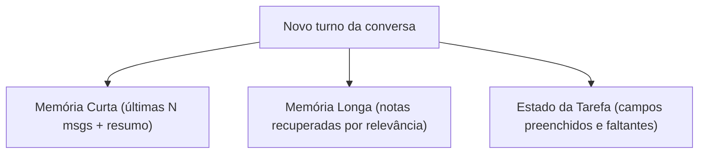

## Passo 1 · Leitura · Três tipos de memória em agentes conversacionais

Se enviarmos todo o histórico de uma conversa longa a cada chamada, o custo e a latência crescem linearmente a cada turno até estourar a janela de contexto. Por outro lado, se simplesmente descartarmos as mensagens antigas, o agente esquecerá o número USP ou o protocolo que o aluno informou no primeiro minuto!



Sistemas bem projetados separam a memória em três estruturas complementares:

1. **Memória de curto prazo com janela e resumo (`MemoriaCurta`):** mantém as últimas $N$ mensagens na íntegra e, sempre que uma mensagem antiga sai da janela, incorpora seus fatos essenciais a um `resumo` acumulado injetado no topo do contexto.
2. **Memória de longo prazo (`MemoriaLonga`):** armazena notas ou episódios com `texto`, `fonte` e carimbo de tempo (`passo`), recuperando sob demanda apenas os $k$ registros mais relevantes para a consulta atual.
3. **Estado estruturado da tarefa (`EstadoDaTarefa`):** quando o agente precisa coletar dados obrigatórios para abrir um requerimento (`ra`, `disciplina`, `justificativa`), não dependemos de reler o texto livre a cada turno — mantemos um dicionário validado que sabe exatamente quais campos já foram preenchidos e quais ainda estão `faltantes()`, podendo ser salvo e recarregado em JSON entre sessões.

Veja no visualizador como a janela deslizante de tamanho `2` resume as mensagens que saem da fila sem perder os dados informados:

```python visualizar
def resumir_simples(resumo_atual, removidas):
    trechos = [f"{m['role']}: {m['content']}" for m in removidas]
    novo = " | ".join(trechos)
    return f"{resumo_atual} | {novo}" if resumo_atual else novo

limite = 2
mensagens = []
resumo = ""

for papel, texto in [("user", "RA 123456"), ("assistant", "Qual disciplina?"), ("user", "MAC0110")]:
    mensagens.append({"role": papel, "content": texto})
    if len(mensagens) > limite:
        antigas = mensagens[:-limite]
        mensagens = mensagens[-limite:]
        resumo = resumir_simples(resumo, antigas)
```

## Passo 2 · Exercício · Estado estruturado da tarefa e campos faltantes

modo: ordenar

Ordene as linhas para implementar a classe `EstadoDaTarefa(obrigatorios)`, que guarda os campos obrigatórios na ordem recebida, ignora valores `None` ou strings vazias em `atualizar(dados)`, lista os campos obrigatórios ainda não preenchidos em `faltantes()` e informa em `completo()` se todos foram preenchidos.

### Instruções

1. Em `__init__(self, obrigatorios)`, armazene `self.obrigatorios = list(obrigatorios)` e `self.dados = {}`.
2. Em `atualizar(self, novos)`, percorra `novos.items()` e salve `self.dados[k] = v` apenas quando `v is not None` e `str(v).strip() != ""`.
3. Em `faltantes(self)`, retorne `[c for c in self.obrigatorios if c not in self.dados]` e, em `completo(self)`, retorne `len(self.faltantes()) == 0`.

### Solução

```python
class EstadoDaTarefa:
    def __init__(self, obrigatorios):
        self.obrigatorios = list(obrigatorios)
        self.dados = {}

    def atualizar(self, novos):
        for k, v in novos.items():
            if v is not None and str(v).strip() != "":
                self.dados[k] = v

    def faltantes(self):
        return [c for c in self.obrigatorios if c not in self.dados]

    def completo(self):
        return len(self.faltantes()) == 0
```

### Dicas

1. Filtre `if v is not None and str(v).strip() != "":` dentro de `atualizar` para que strings em branco não marquem um campo obrigatório como concluído.
2. `completo(self)` deve retornar `True` somente quando `len(self.faltantes()) == 0`.

### Verificação

```json
[
  {
    "id": "estado-progresso-ate-completar",
    "name": "Ignora valores vazios, lista faltantes na ordem e detecta quando está completo",
    "checkpoint": 3,
    "kind": "expr",
    "setup": "e = EstadoDaTarefa(['ra', 'disciplina', 'motivo']); e.atualizar({'ra': '112233', 'disciplina': '   '}); f1 = e.faltantes(); c1 = e.completo(); e.atualizar({'disciplina': 'MAC0110', 'motivo': 'Conflito de horario'}); f2 = e.faltantes(); c2 = e.completo()",
    "expr": "[f1, c1, f2, c2, e.dados['disciplina']]",
    "expected": [
      ["disciplina", "motivo"],
      false,
      [],
      true,
      "MAC0110"
    ]
  }
]
```

### Soluções erradas

```python name="Aceita string vazia ou apenas espaços como campo preenchido"
class EstadoDaTarefa:
    def __init__(self, obrigatorios):
        self.obrigatorios = list(obrigatorios)
        self.dados = {}

    def atualizar(self, novos):
        for k, v in novos.items():
            if v is not None:
                self.dados[k] = v

    def faltantes(self):
        return [c for c in self.obrigatorios if c not in self.dados]

    def completo(self):
        return len(self.faltantes()) == 0
```

```python name="Retorna True em completo() assim que qualquer campo é preenchido"
class EstadoDaTarefa:
    def __init__(self, obrigatorios):
        self.obrigatorios = list(obrigatorios)
        self.dados = {}

    def atualizar(self, novos):
        for k, v in novos.items():
            if v is not None and str(v).strip() != "":
                self.dados[k] = v

    def faltantes(self):
        return [c for c in self.obrigatorios if c not in self.dados]

    def completo(self):
        return len(self.dados) > 0
```

## Passo 3 · Exercício · Memória de curto prazo com janela e resumo

Implemente a classe `MemoriaCurta(limite, resumidor)` para manter no máximo `limite` mensagens recentes e resumir automaticamente as mensagens mais antigas que saírem da janela.

### Instruções

1. No construtor `__init__(self, limite, resumidor)`, guarde `self.limite = int(limite)`, `self.resumidor = resumidor`, `self.mensagens = []` e `self.resumo = ""`.
2. Em `adicionar(self, papel, conteudo)`, anexe `{"role": papel, "content": conteudo}` a `self.mensagens`. Se `len(self.mensagens) > self.limite`, separe as mensagens excedentes mais antigas (`removidas = self.mensagens[:-self.limite]`), mantenha apenas as mais recentes (`self.mensagens = self.mensagens[-self.limite:]`) e atualize `self.resumo = self.resumidor(self.resumo, removidas)`.
3. Em `contexto(self)`:
   - Se `self.resumo` não for vazio, devolva `[{"role": "system", "content": f"Resumo anterior: {self.resumo}"}] + list(self.mensagens)`.
   - Se `self.resumo` for vazio, devolva apenas `list(self.mensagens)`.

### Código inicial

```python
def resumidor_padrao(resumo_atual, removidas):
    partes = [f"{m['role']}: {m['content']}" for m in removidas]
    bloco = " | ".join(partes)
    return f"{resumo_atual} | {bloco}" if resumo_atual else bloco


class MemoriaCurta:
    def __init__(self, limite, resumidor=resumidor_padrao):
        # Inicialize limite, resumidor, mensagens e resumo
        pass

    def adicionar(self, papel, conteudo):
        # Adicione a mensagem e resuma as mais antigas se passar do limite
        pass

    def contexto(self):
        # Retorne a lista de mensagens precedida pelo resumo (quando existir)
        pass
```

### Solução

```python
def resumidor_padrao(resumo_atual, removidas):
    partes = [f"{m['role']}: {m['content']}" for m in removidas]
    bloco = " | ".join(partes)
    return f"{resumo_atual} | {bloco}" if resumo_atual else bloco


class MemoriaCurta:
    def __init__(self, limite, resumidor=resumidor_padrao):
        self.limite = int(limite)
        self.resumidor = resumidor
        self.mensagens = []
        self.resumo = ""

    def adicionar(self, papel, conteudo):
        self.mensagens.append({"role": papel, "content": conteudo})
        if len(self.mensagens) > self.limite:
            removidas = self.mensagens[: -self.limite]
            self.mensagens = self.mensagens[-self.limite :]
            self.resumo = self.resumidor(self.resumo, removidas)

    def contexto(self):
        if self.resumo:
            return [{"role": "system", "content": f"Resumo anterior: {self.resumo}"}] + list(self.mensagens)
        return list(self.mensagens)
```

### Dicas

1. Use `self.mensagens[:-self.limite]` para capturar as mensagens antigas que estão saindo da janela e `self.mensagens[-self.limite:]` para manter as `limite` mais novas.
2. Em `contexto()`, só inclua a mensagem `"role": "system"` quando `self.resumo` não estiver vazio.

### Verificação

```json
[
  {
    "id": "memoria-curta-dentro-e-fora-do-limite",
    "name": "Mantém mensagens sem resumo até o limite e resume as antigas ao ultrapassar",
    "checkpoint": 2,
    "kind": "expr",
    "setup": "m = MemoriaCurta(limite=2); m.adicionar('user', 'RA 9988'); m.adicionar('assistant', 'Ola'); ctx1 = m.contexto(); m.adicionar('user', 'Quero trancar MAC0110'); ctx2 = m.contexto()",
    "expr": "[len(ctx1), len(ctx2), ctx2[0], ctx2[1]['content'], ctx2[2]['content']]",
    "expected": [
      2,
      3,
      {
        "role": "system",
        "content": "Resumo anterior: user: RA 9988"
      },
      "Ola",
      "Quero trancar MAC0110"
    ]
  }
]
```

### Soluções erradas

```python name="Descarta as mensagens antigas sem atualizar o resumo"
class MemoriaCurta:
    def __init__(self, limite, resumidor=None):
        self.limite = int(limite)
        self.mensagens = []
        self.resumo = ""

    def adicionar(self, papel, conteudo):
        self.mensagens.append({"role": papel, "content": conteudo})
        if len(self.mensagens) > self.limite:
            self.mensagens = self.mensagens[-self.limite :]

    def contexto(self):
        return list(self.mensagens)
```

```python name="Remove as mensagens mais recentes em vez das mais antigas"
class MemoriaCurta:
    def __init__(self, limite, resumidor=None):
        self.limite = int(limite)
        self.resumidor = resumidor
        self.mensagens = []
        self.resumo = ""

    def adicionar(self, papel, conteudo):
        self.mensagens.append({"role": papel, "content": conteudo})
        if len(self.mensagens) > self.limite:
            removidas = self.mensagens[self.limite :]
            self.mensagens = self.mensagens[: self.limite]
            self.resumo = self.resumidor(self.resumo, removidas)

    def contexto(self):
        if self.resumo:
            return [{"role": "system", "content": f"Resumo anterior: {self.resumo}"}] + list(self.mensagens)
        return list(self.mensagens)
```

## Passo 4 · Exercício · Memória de longo prazo e persistência JSON

Implemente a classe `MemoriaLonga` (com busca por sobreposição lexical e desempate por recência) e as funções `salvar_estado` e `carregar_estado` para persistir o estado da tarefa em arquivo JSON.

### Instruções

1. Implemente `MemoriaLonga`:
   - `__init__(self)`: inicialize `self.notas = []`.
   - `lembrar(self, texto, fonte, passo)`: armazene `{"texto": texto, "fonte": fonte, "passo": int(passo)}` em `self.notas`.
   - `recordar(self, consulta, k=2)`:
     - Extraia o conjunto de palavras alfanuméricas minúsculas de `consulta` (`re.findall(r"[a-z0-9]+", consulta.lower())`).
     - Para cada nota, conte quantas palavras únicas da consulta aparecem no conjunto de palavras de `nota["texto"]`.
     - Selecione apenas as notas com pontuação $> 0$, ordene por `(-pontuacao, -nota["passo"])` (maior sobreposição primeiro; em caso de empate, o maior `passo` / mais recente primeiro) e devolva as top-`k` notas.
2. Implemente `salvar_estado(dados, obrigatorios, caminho)` que grava em `caminho` (UTF-8) um JSON com `{"dados": dados, "obrigatorios": list(obrigatorios)}`.
3. Implemente `carregar_estado(caminho)` que lê o JSON de `caminho` e devolve `{"dados": d["dados"], "faltantes": [c for c in d["obrigatorios"] if c not in d["dados"]]}`.

### Código inicial

```python
import json
import re


class MemoriaLonga:
    def __init__(self):
        # Inicialize a lista de notas
        pass

    def lembrar(self, texto, fonte, passo):
        # Salve a nota com texto, fonte e passo (int)
        pass

    def recordar(self, consulta, k=2):
        # Ordene as notas com sobreposição > 0 por (-score, -passo) e retorne as top-k
        pass


def salvar_estado(dados, obrigatorios, caminho):
    # Grave dados e obrigatorios em JSON no arquivo caminho
    pass


def carregar_estado(caminho):
    # Leia o JSON de caminho e devolva {"dados": ..., "faltantes": ...}
    pass
```

### Solução

```python
import json
import re


def _palavras(texto):
    return set(re.findall(r"[a-z0-9]+", texto.lower()))


class MemoriaLonga:
    def __init__(self):
        self.notas = []

    def lembrar(self, texto, fonte, passo):
        self.notas.append({"texto": texto, "fonte": fonte, "passo": int(passo)})

    def recordar(self, consulta, k=2):
        q_set = _palavras(consulta)
        if not q_set:
            return []
        candidatas = []
        for nota in self.notas:
            score = len(q_set & _palavras(nota["texto"]))
            if score > 0:
                candidatas.append((score, nota["passo"], nota))
        candidatas.sort(key=lambda item: (-item[0], -item[1]))
        return [item[2] for item in candidatas[:k]]


def salvar_estado(dados, obrigatorios, caminho):
    pacote = {"dados": dict(dados), "obrigatorios": list(obrigatorios)}
    with open(caminho, "w", encoding="utf-8") as f:
        json.dump(pacote, f, ensure_ascii=False)


def carregar_estado(caminho):
    with open(caminho, "r", encoding="utf-8") as f:
        pacote = json.load(f)
    dados = pacote.get("dados", {})
    obrigatorios = pacote.get("obrigatorios", [])
    faltantes = [c for c in obrigatorios if c not in dados]
    return {"dados": dados, "faltantes": faltantes}
```

### Dicas

1. Em `recordar`, ordene as tuplas `(score, nota["passo"], nota)` com `key=lambda item: (-item[0], -item[1])` para priorizar maior relevância e, nos empates, a nota mais recente.
2. Em `salvar_estado` e `carregar_estado`, use `json.dump` e `json.load` para preservar tanto `"dados"` quanto `"obrigatorios"`.

### Verificação

```json
[
  {
    "id": "memoria-longa-relevancia-e-recencia",
    "name": "Recupera notas relevantes desempatando pela nota mais recente",
    "checkpoint": 1,
    "kind": "expr",
    "setup": "ml = MemoriaLonga(); ml.lembrar('Aluno pediu trancamento de MAC0110', 'chat', 1); ml.lembrar('Aluno consultou cardapio', 'chat', 2); ml.lembrar('Confirmado trancamento de MAC0110 na secretaria', 'sistema', 5); rec = ml.recordar('trancamento MAC0110', k=2)",
    "expr": "[(r['fonte'], r['passo']) for r in rec]",
    "expected": [
      ["sistema", 5],
      ["chat", 1]
    ]
  },
  {
    "id": "persistencia-json-roundtrip",
    "name": "Salva e recarrega o estado em JSON preservando dados e campos faltantes",
    "checkpoint": 3,
    "kind": "expr",
    "setup": "salvar_estado({'ra': '12345'}, ['ra', 'disciplina', 'motivo'], 'estado_teste_n7.json')",
    "expr": "carregar_estado('estado_teste_n7.json')",
    "expected": {
      "dados": {
        "ra": "12345"
      },
      "faltantes": [
        "disciplina",
        "motivo"
      ]
    }
  }
]
```

### Soluções erradas

```python name="Desempata pela nota mais antiga em vez da mais recente"
import json
import re


class MemoriaLonga:
    def __init__(self):
        self.notas = []

    def lembrar(self, texto, fonte, passo):
        self.notas.append({"texto": texto, "fonte": fonte, "passo": int(passo)})

    def recordar(self, consulta, k=2):
        q_set = set(re.findall(r"[a-z0-9]+", consulta.lower()))
        cand = []
        for n in self.notas:
            s = len(q_set & set(re.findall(r"[a-z0-9]+", n["texto"].lower())))
            if s > 0:
                cand.append((s, n["passo"], n))
        cand.sort(key=lambda item: (-item[0], item[1]))
        return [item[2] for item in cand[:k]]


def salvar_estado(dados, obrigatorios, caminho):
    with open(caminho, "w", encoding="utf-8") as f:
        json.dump({"dados": dados, "obrigatorios": obrigatorios}, f)


def carregar_estado(caminho):
    with open(caminho, "r", encoding="utf-8") as f:
        p = json.load(f)
    return {"dados": p["dados"], "faltantes": []}
```

```python name="Retorna todas as notas sem filtrar score > 0 e perde a lista de faltantes"
import json


class MemoriaLonga:
    def __init__(self):
        self.notas = []

    def lembrar(self, texto, fonte, passo):
        self.notas.append({"texto": texto, "fonte": fonte, "passo": int(passo)})

    def recordar(self, consulta, k=2):
        return self.notas[:k]


def salvar_estado(dados, obrigatorios, caminho):
    with open(caminho, "w", encoding="utf-8") as f:
        json.dump(dados, f)


def carregar_estado(caminho):
    with open(caminho, "r", encoding="utf-8") as f:
        return {"dados": json.load(f), "faltantes": []}
```

## Passo 5 · Quiz · Memória curta, memória longa e estado

### Pergunta

Qual é o principal risco de usar um resumidor genérico ("resuma a conversa em uma frase") na memória de curto prazo de um agente de atendimento?

- [ ] Aumentar o número de dimensões do banco vetorial.
- [x] Omitir identificadores exatos informados pelo usuário nos primeiros turnos — como número de matrícula, código de disciplina ou número de protocolo —, obrigando o agente a pedi-los novamente.
- [ ] Impedir o uso de JSON na resposta final.
- [ ] Fazer o código Python consumir mais CPU durante o `json.dump`.

> Prompts de resumo para memória de agentes devem instruir explicitamente a preservação de códigos, datas, números de protocolo e decisões já tomadas.

### Pergunta

Por que manter um objeto `EstadoDaTarefa` separado do histórico de mensagens quando o agente precisa preencher um requerimento com vários campos obrigatórios?

- [ ] Porque dicionários Python não podem conter strings.
- [x] Porque permite validar deterministicamente quais campos já foram coletados e quais ainda faltam, sem depender de que o LLM releia dezenas de mensagens sem esquecer nada.
- [ ] Porque substitui a necessidade de ferramentas no agente.
- [ ] Porque impede o usuário de enviar mais de uma mensagem.

> Um estado estruturado transforma o acompanhamento de progresso em uma checagem simples e exata (`estado.faltantes()`), evitando perguntas repetidas ou envios incompletos.

### Pergunta

Do ponto de vista de privacidade e proteção de dados, que cuidado é indispensável ao gravar memórias de longo prazo de um agente em disco ou banco de dados?

- [ ] Gravar todas as senhas e documentos brutos do usuário para nunca precisar pedir de novo.
- [ ] Compartilhar a mesma instância global de memória entre todos os alunos logados.
- [x] Minimizar os dados armazenados, associar cada memória exclusivamente ao titular autenticado e aplicar prazo de retenção e possibilidade de exclusão.
- [ ] Desativar a codificação UTF-8 nos arquivos JSON.

> Memórias persistentes contêm dados pessoais e não podem vazar entre sessões de usuários distintos nem permanecer armazenadas indefinidamente sem finalidade.
