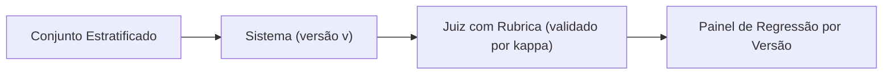

## Passo 1 · Leitura · Como medir qualidade sem se enganar: rubricas, vieses do juiz e kappa

Testar um assistente conversacional digitando 5 perguntas escolhidas a dedo (*vibe check*) é a receita clássica para quebrar casos críticos em produção sem perceber. Uma engenharia de IA rigorosa exige:

1. **Conjunto de avaliação estratificado:** deve cobrir todas as fatias reais do domínio — casos `"facil"`, `"dificil"`, `"adversarial"` (tentativas de confusão) e `"fora_de_escopo"` — e nunca reutilizar os mesmos exemplos que já estão dentro do prompt *few-shot*.
2. **Avaliação por rubrica (1 a 5) e vieses de LLM-como-juiz:** quando usamos um modelo para julgar respostas abertas, ele precisa de uma **rubrica explícita** (critérios objetivos para cada nota) e deve ser auditado contra dois vieses conhecidos:
   - **Viés de posição:** em comparações par a par $(A, B)$, juízes automáticos tendem a preferir a resposta que aparece em **primeiro lugar**. Testamos isso invertendo a ordem para $(B, A)$ e medindo a fração de pares em que o veredito muda.
   - **Viés de verbosidade:** preferir respostas longas mesmo quando são prolixas ou imprecisas.
3. **Concordância com humanos via $\kappa$ de Cohen:** medir apenas a porcentagem de concordância bruta ($p_o$) engana quando 90% das respostas são boas (chutar sempre `"aprovado"` já daria 90%). O coeficiente $\kappa$ de Cohen desconta a concordância esperada ao acaso ($p_e$):

$$\kappa = \frac{p_o - p_e}{1 - p_e}$$



Veja no visualizador como invertemos a ordem $(A, B) \rightarrow (B, A)$ para flagrar um juiz com viés de posição:

```python visualizar
def juiz_enviesado_na_primeira(pergunta, resp_1, resp_2):
    return "primeira"

pares = [
    ("Prazo de trancamento?", "Quinze dias [1]", "Talvez no mes que vem"),
    ("Minimo de creditos?", "Doze creditos [1]", "Depende"),
]

inconsistencias = 0
for p, a, b in pares:
    v1 = "A" if juiz_enviesado_na_primeira(p, a, b) == "primeira" else "B"
    v2 = "B" if juiz_enviesado_na_primeira(p, b, a) == "primeira" else "A"
    if v1 != v2:
        inconsistencias += 1
```

## Passo 2 · Exercício · Coeficiente kappa de Cohen

modo: lacunas

Complete `kappa_de_cohen(rotulos_a, rotulos_b)` para calcular a concordância entre dois avaliadores binários (`0` ou `1`), descontando a concordância esperada ao acaso.

### Instruções

1. Calcule a concordância observada `po` como a fração de posições `i` em que `rotulos_a[i] == rotulos_b[i]`.
2. Calcule as proporções de `1` e `0` em cada avaliador (`pa1`, `pb1`, `pa0 = 1.0 - pa1`, `pb0 = 1.0 - pb1`) e a concordância ao acaso `pe = pa1 * pb1 + pa0 * pb0`.
3. Se `1.0 - pe == 0`, retorne `1.0`; caso contrário, retorne `float((po - pe) / (1.0 - pe))`.

### Código inicial

```python
def kappa_de_cohen(rotulos_a, rotulos_b):
    n = len(rotulos_a)
    if n == 0:
        return 0.0
    po = sum(1 for a, b in zip(rotulos_a, rotulos_b) if a == ___) / n
    pa1 = sum(1 for a in rotulos_a if a == 1) / n
    pb1 = sum(1 for b in rotulos_b if b == 1) / n
    pa0 = 1.0 - pa1
    pb0 = 1.0 - pb1
    pe = pa1 * ___ + pa0 * pb0
    if abs(1.0 - pe) < 1e-12:
        return 1.0
    return float((po - ___) / (1.0 - pe))
```

### Solução

```python
def kappa_de_cohen(rotulos_a, rotulos_b):
    n = len(rotulos_a)
    if n == 0:
        return 0.0
    po = sum(1 for a, b in zip(rotulos_a, rotulos_b) if a == b) / n
    pa1 = sum(1 for a in rotulos_a if a == 1) / n
    pb1 = sum(1 for b in rotulos_b if b == 1) / n
    pa0 = 1.0 - pa1
    pb0 = 1.0 - pb1
    pe = pa1 * pb1 + pa0 * pb0
    if abs(1.0 - pe) < 1e-12:
        return 1.0
    return float((po - pe) / (1.0 - pe))
```

### Dicas

1. Na concordância observada `po`, conte os pares em que `a == b`.
2. A concordância ao acaso combina ambos dizendo `1` (`pa1 * pb1`) mais ambos dizendo `0` (`pa0 * pb0`).
3. A fórmula de Cohen é `(po - pe) / (1.0 - pe)`.

### Verificação

```json
[
  {
    "id": "kappa-moderado",
    "name": "Calcula kappa descontando a concordância esperada ao acaso",
    "checkpoint": 3,
    "kind": "call",
    "function": "kappa_de_cohen",
    "args": [
      [1, 1, 1, 0, 0, 1, 0, 1, 0, 0],
      [1, 1, 0, 0, 0, 1, 1, 1, 0, 0]
    ],
    "expected": 0.6,
    "tolerance": 1e-6
  },
  {
    "id": "kappa-acaso-zero",
    "name": "Retorna 0.0 quando a concordância observada é igual ao acaso",
    "checkpoint": 3,
    "kind": "call",
    "function": "kappa_de_cohen",
    "args": [
      [1, 1, 0, 0],
      [1, 0, 1, 0]
    ],
    "expected": 0.0,
    "tolerance": 1e-6
  }
]
```

### Soluções erradas

```python name="Retorna apenas a concordância bruta po sem descontar pe"
def kappa_de_cohen(rotulos_a, rotulos_b):
    n = len(rotulos_a)
    if n == 0:
        return 0.0
    return float(sum(1 for a, b in zip(rotulos_a, rotulos_b) if a == b) / n)
```

```python name="Soma pe em vez de subtrair no numerador"
def kappa_de_cohen(rotulos_a, rotulos_b):
    n = len(rotulos_a)
    po = sum(1 for a, b in zip(rotulos_a, rotulos_b) if a == b) / n
    pa1 = sum(1 for a in rotulos_a if a == 1) / n
    pb1 = sum(1 for b in rotulos_b if b == 1) / n
    pe = pa1 * pb1 + (1.0 - pa1) * (1.0 - pb1)
    return float((po + pe) / (1.0 - pe))
```

## Passo 3 · Exercício · Estratificação e detecção de viés de posição

Implemente `estratificar_conjunto(casos)` para verificar a cobertura das 4 categorias obrigatórias e `detectar_vies_de_posicao(juiz_par, pares)` para medir a inconsistência de um juiz quando invertemos a ordem das respostas.

### Instruções

1. Em `estratificar_conjunto(casos)`:
   - As 4 categorias obrigatórias são `("facil", "dificil", "adversarial", "fora_de_escopo")`.
   - Conte quantos itens de `casos` pertencem a cada categoria em um dicionário `contagens` (incluindo `0` para categorias ausentes).
   - Defina `completo = all(contagens[c] > 0 for c in ("facil", "dificil", "adversarial", "fora_de_escopo"))`.
   - Devolva `{"total": len(casos), "contagens": contagens, "completo": bool(completo)}`.
2. Em `detectar_vies_de_posicao(juiz_par, pares)`:
   - Cada item de `pares` é um dicionário `{"pergunta": str, "a": str, "b": str}`.
   - A função `juiz_par(pergunta, primeira, segunda)` devolve `"primeira"` se preferir o 1º argumento ou `"segunda"` se preferir o 2º argumento.
   - Chame `v1 = juiz_par(par["pergunta"], par["a"], par["b"])` (onde `"primeira"` significa que `A` venceu e `"segunda"` significa que `B` venceu).
   - Chame na ordem invertida `v2 = juiz_par(par["pergunta"], par["b"], par["a"])` (onde `"primeira"` agora significa que `B` venceu e `"segunda"` significa que `A` venceu!).
   - Conte em quantos pares o vencedor real (`"A"` ou `"B"`) mudou entre as duas chamadas e devolva a fração `inconsistentes / len(pares)` como `float` (ou `0.0` se `pares` for vazio).

### Código inicial

```python
CATEGORIAS_OBRIGATORIAS = ("facil", "dificil", "adversarial", "fora_de_escopo")


def estratificar_conjunto(casos):
    # Conte casos por categoria e indique se todas as 4 obrigatórias estão presentes
    pass


def detectar_vies_de_posicao(juiz_par, pares):
    # Compare o vencedor em (a, b) vs (b, a) e devolva a taxa de inconsistência
    pass
```

### Solução

```python
CATEGORIAS_OBRIGATORIAS = ("facil", "dificil", "adversarial", "fora_de_escopo")


def estratificar_conjunto(casos):
    contagens = {cat: 0 for cat in CATEGORIAS_OBRIGATORIAS}
    for c in casos:
        cat = c.get("categoria")
        contagens[cat] = contagens.get(cat, 0) + 1
    completo = all(contagens[cat] > 0 for cat in CATEGORIAS_OBRIGATORIAS)
    return {
        "total": len(casos),
        "contagens": contagens,
        "completo": bool(completo),
    }


def detectar_vies_de_posicao(juiz_par, pares):
    if not pares:
        return 0.0
    inconsistentes = 0
    for par in pares:
        p, a, b = par["pergunta"], par["a"], par["b"]
        vencedor_1 = "A" if juiz_par(p, a, b) == "primeira" else "B"
        vencedor_2 = "B" if juiz_par(p, b, a) == "primeira" else "A"
        if vencedor_1 != vencedor_2:
            inconsistentes += 1
    return float(inconsistentes / len(pares))
```

### Dicas

1. Na chamada invertida `juiz_par(p, b, a)`, `b` foi passado como primeiro argumento; portanto, se o juiz retornar `"primeira"`, ele escolheu `B`!
2. Se `vencedor_1 != vencedor_2`, o juiz mudou de opinião apenas por causa da posição.

### Verificação

```json
[
  {
    "id": "estratificacao-completa-e-incompleta",
    "name": "Verifica presença das 4 categorias obrigatórias no conjunto de avaliação",
    "checkpoint": 1,
    "kind": "expr",
    "expr": "[estratificar_conjunto([{'categoria': 'facil'}, {'categoria': 'dificil'}])['completo'], estratificar_conjunto([{'categoria': 'facil'}, {'categoria': 'dificil'}, {'categoria': 'adversarial'}, {'categoria': 'fora_de_escopo'}])]",
    "expected": [
      false,
      {
        "total": 4,
        "contagens": {
          "facil": 1,
          "dificil": 1,
          "adversarial": 1,
          "fora_de_escopo": 1
        },
        "completo": true
      }
    ]
  },
  {
    "id": "vies-posicao-juiz",
    "name": "Detecta 100% de viés em juiz que escolhe sempre a 1ª e 0% em juiz consistente",
    "checkpoint": 2,
    "kind": "expr",
    "setup": "pares = [{'pergunta': 'q1', 'a': 'resposta curta', 'b': 'resposta completa e citada [1]'}, {'pergunta': 'q2', 'a': 'citada [1]', 'b': 'vaga'}]",
    "expr": "[detectar_vies_de_posicao(lambda p, x, y: 'primeira', pares), detectar_vies_de_posicao(lambda p, x, y: 'primeira' if '[1]' in x else 'segunda', pares)]",
    "expected": [
      1.0,
      0.0
    ]
  }
]
```

### Soluções erradas

```python name="Compara as strings 'primeira'/'segunda' sem mapear de volta para A e B na ordem invertida"
CATEGORIAS_OBRIGATORIAS = ("facil", "dificil", "adversarial", "fora_de_escopo")


def estratificar_conjunto(casos):
    contagens = {cat: sum(1 for c in casos if c.get("categoria") == cat) for cat in CATEGORIAS_OBRIGATORIAS}
    return {"total": len(casos), "contagens": contagens, "completo": all(v > 0 for v in contagens.values())}


def detectar_vies_de_posicao(juiz_par, pares):
    inconsistentes = sum(1 for par in pares if juiz_par(par["pergunta"], par["a"], par["b"]) != juiz_par(par["pergunta"], par["b"], par["a"]))
    return float(inconsistentes / len(pares))
```

```python name="Considera o conjunto completo mesmo quando faltam categorias obrigatórias"
CATEGORIAS_OBRIGATORIAS = ("facil", "dificil", "adversarial", "fora_de_escopo")


def estratificar_conjunto(casos):
    contagens = {cat: sum(1 for c in casos if c.get("categoria") == cat) for cat in CATEGORIAS_OBRIGATORIAS}
    return {"total": len(casos), "contagens": contagens, "completo": len(casos) > 0}


def detectar_vies_de_posicao(juiz_par, pares):
    return 0.0
```

## Passo 4 · Exercício · Julgamento com rubrica e painel por versão

Implemente `julgar_com_rubrica(caso, resposta)` para atribuir uma nota de `1` a `5` baseada em critérios verificáveis e `painel_por_versao(historico_versoes)` para consolidar médias e apontar regressões individuais entre versões.

### Instruções

1. Em `julgar_com_rubrica(caso, resposta)`:
   - Comece com `nota = 1`.
   - Some `+2` se todos os termos de `caso["fatos_obrigatorios"]` (em minúsculas) aparecerem em `resposta.lower()`.
   - Some `+1` se `caso.get("exige_citacao", True)` for satisfeito (isto é, se `"["` e `"]"` aparecerem na `resposta`, ou se `exige_citacao` for `False`).
   - Some `+1` se nenhum termo de `caso.get("proibidos", [])` (em minúsculas) aparecer em `resposta.lower()`.
   - Devolva `{"nota": int(nota), "aprovado": bool(nota >= 4)}`.
2. Em `painel_por_versao(versoes)`:
   - `versoes` é uma lista ordenada de versões `[("v1", resultados_v1), ("v2", resultados_v2), ...]`, onde cada `resultados_vi` é uma lista de dicionários `{"id": str, "nota": int}`.
   - Para cada versão, calcule:
     - `"nota_media"`: média de `"nota"` em `float`
     - `"taxa_aprovacao"`: fração de itens com `nota >= 4` em `float`
     - `"regressoes"`: lista ordenada dos `"id"`s que estavam aprovados (`nota >= 4`) na versão **imediatamente anterior** e ficaram reprovados (`nota < 4`) na versão atual (para a primeira versão da lista, `"regressoes"` é `[]`).
   - Devolva a lista de dicionários `[{"versao": nome, "nota_media": ..., "taxa_aprovacao": ..., "regressoes": [...]}]`.

### Código inicial

```python
def julgar_com_rubrica(caso, resposta):
    # Calcule a nota de 1 a 5 segundo fatos_obrigatorios, exige_citacao e proibidos
    pass


def painel_por_versao(versoes):
    # Consolide nota_media, taxa_aprovacao e regressoes em relação à versão anterior
    pass
```

### Solução

```python
def julgar_com_rubrica(caso, resposta):
    texto = resposta.lower()
    nota = 1
    if all(f.lower() in texto for f in caso.get("fatos_obrigatorios", [])):
        nota += 2
    if not caso.get("exige_citacao", True) or ("[" in resposta and "]" in resposta):
        nota += 1
    if not any(p.lower() in texto for p in caso.get("proibidos", [])):
        nota += 1
    return {"nota": int(nota), "aprovado": bool(nota >= 4)}


def painel_por_versao(versoes):
    relatorio = []
    aprovados_anterior = set()
    for idx, (nome_versao, itens) in enumerate(versoes):
        n = len(itens)
        media = float(sum(i["nota"] for i in itens) / n) if n > 0 else 0.0
        aprovados_atual = {i["id"] for i in itens if i["nota"] >= 4}
        taxa = float(len(aprovados_atual) / n) if n > 0 else 0.0
        regressoes = sorted(aprovados_anterior - aprovados_atual) if idx > 0 else []
        relatorio.append(
            {
                "versao": nome_versao,
                "nota_media": media,
                "taxa_aprovacao": taxa,
                "regressoes": regressoes,
            }
        )
        aprovados_anterior = aprovados_atual
    return relatorio
```

### Dicas

1. Em `painel_por_versao`, guarde o conjunto `aprovados_atual = {i["id"] for i in itens if i["nota"] >= 4}` de cada versão.
2. As regressões da versão `idx > 0` são exatamente `sorted(aprovados_anterior - aprovados_atual)`.

### Verificação

```json
[
  {
    "id": "rubrica-pontuacao",
    "name": "Pontua resposta completa (5) e resposta sem citação e com termo proibido (3)",
    "checkpoint": 1,
    "kind": "expr",
    "setup": "caso = {'fatos_obrigatorios': ['15 dias', 'secretaria'], 'exige_citacao': True, 'proibidos': ['garantido']}",
    "expr": "[julgar_com_rubrica(caso, 'O prazo e de 15 dias na secretaria [1].'), julgar_com_rubrica(caso, 'O prazo de 15 dias na secretaria e garantido.')]",
    "expected": [
      {
        "nota": 5,
        "aprovado": true
      },
      {
        "nota": 3,
        "aprovado": false
      }
    ]
  },
  {
    "id": "painel-detecta-regressao",
    "name": "Identifica caso que passou na v1 e regrediu na v2 mesmo com média igual",
    "checkpoint": 2,
    "kind": "call",
    "function": "painel_por_versao",
    "args": [
      [
        [
          "v1",
          [
            {"id": "c1", "nota": 5},
            {"id": "c2", "nota": 4},
            {"id": "c3", "nota": 2}
          ]
        ],
        [
          "v2",
          [
            {"id": "c1", "nota": 5},
            {"id": "c2", "nota": 2},
            {"id": "c3", "nota": 4}
          ]
        ]
      ]
    ],
    "expected": [
      {
        "versao": "v1",
        "nota_media": 3.6666666666666665,
        "taxa_aprovacao": 0.6666666666666666,
        "regressoes": []
      },
      {
        "versao": "v2",
        "nota_media": 3.6666666666666665,
        "taxa_aprovacao": 0.6666666666666666,
        "regressoes": ["c2"]
      }
    ],
    "tolerance": 1e-6
  }
]
```

### Soluções erradas

```python name="Não identifica regressões individuais entre versões consecutivas"
def julgar_com_rubrica(caso, resposta):
    return {"nota": 5, "aprovado": True}


def painel_por_versao(versoes):
    res = []
    for nome, itens in versoes:
        n = len(itens)
        res.append(
            {
                "versao": nome,
                "nota_media": float(sum(i["nota"] for i in itens) / n),
                "taxa_aprovacao": float(sum(1 for i in itens if i["nota"] >= 4) / n),
                "regressoes": [],
            }
        )
    return res
```

```python name="Ignora termos proibidos na rubrica"
def julgar_com_rubrica(caso, resposta):
    texto = resposta.lower()
    nota = 2
    if all(f.lower() in texto for f in caso.get("fatos_obrigatorios", [])):
        nota += 2
    if "[" in resposta and "]" in resposta:
        nota += 1
    return {"nota": int(nota), "aprovado": bool(nota >= 4)}


def painel_por_versao(versoes):
    return []
```

## Passo 5 · Quiz · Rubricas, kappa e avaliação contínua

### Pergunta

O que significa obter um coeficiente $\kappa$ de Cohen próximo de $0{,}0$ ao comparar as notas de um LLM-como-juiz com as notas atribuídas por especialistas humanos?

- [ ] Que o juiz automático concorda perfeitamente com os humanos em todos os casos.
- [x] Que a concordância do juiz com os humanos não é melhor do que um sorteio aleatório respeitando as proporções marginais, tornando o juiz inadequado até que a rubrica seja calibrada.
- [ ] Que o conjunto de avaliação possui zero exemplos.
- [ ] Que a latência do juiz é zero.

> Um $\kappa \approx 0$ mostra que toda a concordância aparente ($p_o$) pode ser explicada apenas pelo acaso ($p_e$).

### Pergunta

Observe o resultado da função `painel_por_versao` no exercício anterior: tanto a `v1` quanto a `v2` tiveram exatamente a mesma `nota_media` ($3{,}67$) e a mesma `taxa_aprovacao` ($66{,}7\%$), mas o caso `c2` regrediu da nota `4` para `2`. Por que rastrear regressões por ID é indispensável?

- [ ] Porque a média aritmética em Python arredonda para baixo.
- [x] Porque médias agregadas podem permanecer idênticas quando um caso novo melhora e um caso crítico antigo quebra silenciosamente.
- [ ] Porque evita precisar de respostas de referência.
- [ ] Para apagar os casos reprovados do conjunto.

> Sem comparar caso a caso entre versões, uma melhoria em perguntas difíceis pode mascarar a quebra de uma funcionalidade básica que já funcionava na versão anterior.

### Pergunta

Por que você nunca deve incluir no conjunto de avaliação os mesmos exemplos que já estão copiados dentro do prompt *few-shot* do sistema?

- [ ] Porque exemplos repetidos aumentam a temperatura da geração.
- [x] Porque isso contamina a avaliação (vazamento entre treino/prompt e teste), inflando artificialmente a métrica sem medir a generalização para novas perguntas dos usuários.
- [ ] Porque o parser JSON rejeita textos repetidos.
- [ ] Porque impede o cálculo do $\kappa$ de Cohen.

> Assim como em aprendizado de máquina clássico não avaliamos no conjunto de treino, em engenharia de prompts os exemplos do prompt e os casos de teste devem ser disjuntos.
