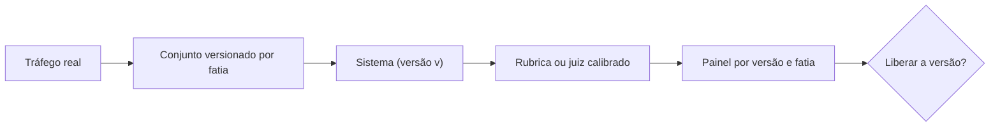

## Passo 1 · Leitura · Cinco perguntas não são uma avaliação

Mudar o prompt, trocar o modelo ou o chunking e conferir em cinco perguntas escolhidas na hora (o *vibe check*) é a forma mais comum de avaliar um sistema com LLM, e a que mais engana. As cinco perguntas são as que você lembrou, quase sempre fáceis, e a mudança que melhorou uma delas pode ter quebrado outra que ninguém olhou.

Um **conjunto de avaliação** é uma lista fixa e versionada de casos. Cada caso tem:

- um `id` estável, para comparar o mesmo caso entre versões;
- uma **fatia** (estrato): `"facil"`, `"dificil"`, `"adversarial"` (tentativas de confundir ou atacar o sistema) e `"fora_de_escopo"` (o certo é recusar). As fatias vêm do tráfego real: se uma parte das perguntas dos alunos é fora de escopo, essa parte precisa aparecer no conjunto;
- uma **referência**: a resposta esperada, escrita por quem conhece o assunto, ou os fatos que a resposta precisa conter;
- os critérios da **rubrica**, em itens verificáveis: "contém o prazo", "cita o artigo", "não promete nada", "recusa quando não é assunto da secretaria".

Três cuidados separam uma avaliação de um número bonito:

1. **Contaminação.** Um caso que também está entre os exemplos do prompt (*few-shot*) mede memorização, não generalização. Compare as perguntas **normalizadas** (minúsculas, sem acento, sem pontuação): `"Até quando tranco?"` e `"ate quando tranco"` são o mesmo caso.
2. **Tamanho por fatia.** Com $n$ casos, cada caso vale $1/n$ da taxa: numa fatia com 10 casos, um acerto a mais move a taxa em 10 pontos. O erro padrão de uma taxa $p$ medida em $n$ casos é

$$
\text{EP} = \sqrt{\frac{p\,(1-p)}{n}}
$$

   e, com $p = 0{,}8$ e $n = 20$, dá cerca de $0{,}09$. Uma diferença de 5 pontos entre duas versões nessa fatia não distingue melhora de acaso.
3. **Casos sem referência** não são avaliáveis: quem julga sem referência julga pelo próprio gosto, e o gosto muda de um dia para o outro.



O conjunto é código de teste: fica no repositório, muda por revisão e ganha um caso novo a cada falha encontrada em produção. No próximo passo você escreve a auditoria que roda antes de qualquer medição.

## Passo 2 · Exercício · Auditar o conjunto antes de medir

Escreva `normalizar(texto)` e `auditar_conjunto(casos, exemplos_do_prompt, minimo_por_fatia=10)`.

Cada caso é um dicionário com `"id"`, `"fatia"`, `"pergunta"` e `"referencia"`; `exemplos_do_prompt` é a lista das perguntas usadas como exemplo no prompt. A auditoria devolve:

| Chave | Conteúdo |
|---|---|
| `"por_fatia"` | `{fatia: quantidade}` para as quatro fatias de `FATIAS`, inclusive as que têm zero |
| `"faltando"` | fatias sem nenhum caso, na ordem de `FATIAS` |
| `"pequenas"` | fatias com pelo menos um caso e menos que `minimo_por_fatia`, na ordem de `FATIAS` |
| `"contaminados"` | ids dos casos cuja pergunta normalizada é igual à de algum exemplo do prompt, na ordem dos casos |
| `"sem_referencia"` | ids dos casos sem `"referencia"` ou com referência só de espaços, na ordem dos casos |
| `"ids_repetidos"` | ids que aparecem mais de uma vez, cada um uma vez só, na ordem em que se repetem |
| `"pronto"` | `True` só quando todas as listas acima estão vazias |

Um caso com fatia fora de `FATIAS` é erro de digitação no conjunto, não uma fatia nova: levante `ValueError` com o id do caso na mensagem.

### Instruções
1. `normalizar` põe em minúsculas, tira os acentos e troca toda sequência de caracteres que não seja letra ou dígito por um único espaço, sem espaços nas pontas.
   Dica: `unicodedata.normalize("NFKD", ...)` separa a letra do acento; `unicodedata.combining(c)` diz se `c` é o acento.
2. Conte os casos por fatia, com zero para as ausentes, aponte as faltando e as pequenas, e recuse fatia desconhecida.
3. Aponte os casos contaminados (comparando textos normalizados) e os sem referência.
4. Liste os ids repetidos e diga se o conjunto está pronto.

### Código inicial
```python
import re
import unicodedata

FATIAS = ("facil", "dificil", "adversarial", "fora_de_escopo")


def normalizar(texto):
    pass


def auditar_conjunto(casos, exemplos_do_prompt, minimo_por_fatia=10):
    pass
```

### Solução
```python
import re
import unicodedata

FATIAS = ("facil", "dificil", "adversarial", "fora_de_escopo")


def normalizar(texto):
    decomposto = unicodedata.normalize("NFKD", texto.lower())
    sem_acento = "".join(c for c in decomposto if not unicodedata.combining(c))
    return " ".join(re.findall(r"[a-z0-9]+", sem_acento))


def auditar_conjunto(casos, exemplos_do_prompt, minimo_por_fatia=10):
    por_fatia = {fatia: 0 for fatia in FATIAS}
    exemplos = {normalizar(e) for e in exemplos_do_prompt}
    contaminados, sem_referencia, repetidos = [], [], []
    vistos = set()
    for caso in casos:
        if caso["fatia"] not in por_fatia:
            raise ValueError(f"caso {caso['id']}: fatia desconhecida {caso['fatia']!r}")
        por_fatia[caso["fatia"]] += 1
        if normalizar(caso["pergunta"]) in exemplos:
            contaminados.append(caso["id"])
        referencia = caso.get("referencia")
        if not isinstance(referencia, str) or not referencia.strip():
            sem_referencia.append(caso["id"])
        if caso["id"] in vistos and caso["id"] not in repetidos:
            repetidos.append(caso["id"])
        vistos.add(caso["id"])
    faltando = [f for f in FATIAS if por_fatia[f] == 0]
    pequenas = [f for f in FATIAS if 0 < por_fatia[f] < minimo_por_fatia]
    pronto = not (faltando or pequenas or contaminados or sem_referencia or repetidos)
    return {
        "por_fatia": por_fatia,
        "faltando": faltando,
        "pequenas": pequenas,
        "contaminados": contaminados,
        "sem_referencia": sem_referencia,
        "ids_repetidos": repetidos,
        "pronto": pronto,
    }
```

### Dicas
1. Monte o dicionário de contagem com as quatro fatias antes de percorrer os casos; assim a ausente já nasce com zero.
2. Normalize os exemplos do prompt uma vez só, num conjunto, e compare cada pergunta normalizada com ele.
3. Uma referência `"   "` existe, mas não diz nada.

### Verificação
```json
[
  {"id": "normaliza-acento-e-caixa", "checkpoint": 1, "kind": "call", "function": "normalizar", "args": ["  Até quando  TRANCO a matrícula?! "], "expected": "ate quando tranco a matricula", "name": "normalizar tira acento, caixa, pontuação e espaços extras"},
  {"id": "normaliza-pontuacao", "checkpoint": 1, "kind": "call", "function": "normalizar", "args": ["Prazo—trancamento, art. 12 (PRG101)"], "expected": "prazo trancamento art 12 prg101", "name": "normalizar troca pontuação por um espaço"},
  {"id": "contagem-faltando-pequenas", "checkpoint": 2, "kind": "expr", "setup": "def c(i, f):\n    return {'id': i, 'fatia': f, 'pergunta': 'pergunta ' + i, 'referencia': 'ref'}\nconj = [c('q1', 'facil'), c('q2', 'facil'), c('q3', 'dificil'), c('q4', 'fora_de_escopo')]\nr = auditar_conjunto(conj, [], minimo_por_fatia=2)", "expr": "[r['por_fatia'], r['faltando'], r['pequenas'], r['pronto']]", "expected": [{"facil": 2, "dificil": 1, "adversarial": 0, "fora_de_escopo": 1}, ["adversarial"], ["dificil", "fora_de_escopo"], false], "name": "Conta por fatia, com zero para a ausente, e aponta faltando e pequenas"},
  {"id": "minimo-na-fronteira", "checkpoint": 2, "kind": "expr", "setup": "conj = [{'id': f'f{i}', 'fatia': 'facil', 'pergunta': f'p{i}', 'referencia': 'r'} for i in range(10)]\nconj += [{'id': f'd{i}', 'fatia': 'dificil', 'pergunta': f'q{i}', 'referencia': 'r'} for i in range(9)]\nr = auditar_conjunto(conj, [])", "expr": "r['pequenas']", "expected": ["dificil"], "name": "Com o mínimo padrão (10), 10 casos bastam e 9 não"},
  {"id": "fatia-desconhecida", "checkpoint": 2, "kind": "expr", "setup": "conj = [{'id': 'q1', 'fatia': 'facil', 'pergunta': 'a', 'referencia': 'r'}, {'id': 'q7', 'fatia': 'adversaria', 'pergunta': 'b', 'referencia': 'r'}]", "expr": "auditar_conjunto(conj, [])", "raises": "ValueError", "message_contains": "q7", "name": "Fatia com erro de digitação é recusada com o id do caso", "hint": "Uma fatia desconhecida que passa em silêncio some do painel."},
  {"id": "contaminacao-normalizada", "checkpoint": 3, "kind": "expr", "setup": "conj = [\n    {'id': 'q1', 'fatia': 'facil', 'pergunta': 'ate quando posso trancar', 'referencia': 'r'},\n    {'id': 'q2', 'fatia': 'facil', 'pergunta': 'Até quando posso trancar a disciplina PRG101?', 'referencia': 'r'},\n    {'id': 'q3', 'fatia': 'dificil', 'pergunta': 'Como PEDIR revisão de nota?', 'referencia': 'r'},\n]\nexemplos = ['Até quando posso trancar?', 'Como pedir revisão de nota']\nr = auditar_conjunto(conj, exemplos, minimo_por_fatia=1)", "expr": "r['contaminados']", "expected": ["q1", "q3"], "name": "Pega o caso igual a um exemplo do prompt mesmo com caixa, acento e pontuação diferentes", "hint": "Compare os textos depois de normalizar os dois lados."},
  {"id": "sem-referencia", "checkpoint": 3, "kind": "expr", "setup": "conj = [\n    {'id': 'q1', 'fatia': 'facil', 'pergunta': 'a', 'referencia': 'O prazo é o 60º dia letivo.'},\n    {'id': 'q2', 'fatia': 'facil', 'pergunta': 'b', 'referencia': '   '},\n    {'id': 'q3', 'fatia': 'facil', 'pergunta': 'c'},\n    {'id': 'q4', 'fatia': 'facil', 'pergunta': 'd', 'referencia': None},\n]\nr = auditar_conjunto(conj, [], minimo_por_fatia=1)", "expr": "r['sem_referencia']", "expected": ["q2", "q3", "q4"], "name": "Referência ausente, nula ou só de espaços não vale", "hint": "Um texto só com espaços é verdadeiro para o Python."},
  {"id": "ids-repetidos", "checkpoint": 4, "kind": "expr", "setup": "def c(i):\n    return {'id': i, 'fatia': 'facil', 'pergunta': 'p', 'referencia': 'r'}\nr = auditar_conjunto([c('q1'), c('q2'), c('q1'), c('q3'), c('q1'), c('q2')], [], minimo_por_fatia=1)", "expr": "r['ids_repetidos']", "expected": ["q1", "q2"], "name": "Cada id repetido aparece uma vez, na ordem em que se repete"},
  {"id": "pronto", "checkpoint": 4, "kind": "expr", "setup": "fatias = ['facil', 'dificil', 'adversarial', 'fora_de_escopo']\nconj = [{'id': f'q{i}', 'fatia': f, 'pergunta': f'pergunta {i}', 'referencia': 'r'} for i, f in enumerate(fatias)]\nr = auditar_conjunto(conj, ['outra pergunta'], minimo_por_fatia=1)", "expr": "[r['pronto'], r['faltando'], r['pequenas'], r['contaminados'], r['sem_referencia'], r['ids_repetidos']]", "expected": [true, [], [], [], [], []], "name": "Conjunto sem nenhum problema está pronto"},
  {"id": "nao-pronto-por-contaminacao", "checkpoint": 4, "kind": "expr", "setup": "fatias = ['facil', 'dificil', 'adversarial', 'fora_de_escopo']\nconj = [{'id': f'q{i}', 'fatia': f, 'pergunta': f'pergunta {i}', 'referencia': 'r'} for i, f in enumerate(fatias)]\nr = auditar_conjunto(conj, ['Pergunta 2.'], minimo_por_fatia=1)", "expr": "[r['pronto'], r['contaminados']]", "expected": [false, ["q2"]], "name": "Um único caso contaminado já impede o pronto"}
]
```

### Soluções erradas
```python name="compara o texto cru com os exemplos do prompt"
import re
import unicodedata

FATIAS = ("facil", "dificil", "adversarial", "fora_de_escopo")


def normalizar(texto):
    decomposto = unicodedata.normalize("NFKD", texto.lower())
    sem_acento = "".join(c for c in decomposto if not unicodedata.combining(c))
    return " ".join(re.findall(r"[a-z0-9]+", sem_acento))


def auditar_conjunto(casos, exemplos_do_prompt, minimo_por_fatia=10):
    por_fatia = {fatia: 0 for fatia in FATIAS}
    exemplos = set(exemplos_do_prompt)
    contaminados, sem_referencia, repetidos = [], [], []
    vistos = set()
    for caso in casos:
        if caso["fatia"] not in por_fatia:
            raise ValueError(f"caso {caso['id']}: fatia desconhecida {caso['fatia']!r}")
        por_fatia[caso["fatia"]] += 1
        if caso["pergunta"] in exemplos:
            contaminados.append(caso["id"])
        referencia = caso.get("referencia")
        if not isinstance(referencia, str) or not referencia.strip():
            sem_referencia.append(caso["id"])
        if caso["id"] in vistos and caso["id"] not in repetidos:
            repetidos.append(caso["id"])
        vistos.add(caso["id"])
    faltando = [f for f in FATIAS if por_fatia[f] == 0]
    pequenas = [f for f in FATIAS if 0 < por_fatia[f] < minimo_por_fatia]
    pronto = not (faltando or pequenas or contaminados or sem_referencia or repetidos)
    return {"por_fatia": por_fatia, "faltando": faltando, "pequenas": pequenas,
            "contaminados": contaminados, "sem_referencia": sem_referencia,
            "ids_repetidos": repetidos, "pronto": pronto}
```
```python name="normaliza sem tirar a pontuação"
import re
import unicodedata

FATIAS = ("facil", "dificil", "adversarial", "fora_de_escopo")


def normalizar(texto):
    decomposto = unicodedata.normalize("NFKD", texto.lower())
    return " ".join("".join(c for c in decomposto if not unicodedata.combining(c)).split())


def auditar_conjunto(casos, exemplos_do_prompt, minimo_por_fatia=10):
    por_fatia = {fatia: 0 for fatia in FATIAS}
    exemplos = {normalizar(e) for e in exemplos_do_prompt}
    contaminados, sem_referencia, repetidos = [], [], []
    vistos = set()
    for caso in casos:
        if caso["fatia"] not in por_fatia:
            raise ValueError(f"caso {caso['id']}: fatia desconhecida {caso['fatia']!r}")
        por_fatia[caso["fatia"]] += 1
        if normalizar(caso["pergunta"]) in exemplos:
            contaminados.append(caso["id"])
        referencia = caso.get("referencia")
        if not isinstance(referencia, str) or not referencia.strip():
            sem_referencia.append(caso["id"])
        if caso["id"] in vistos and caso["id"] not in repetidos:
            repetidos.append(caso["id"])
        vistos.add(caso["id"])
    faltando = [f for f in FATIAS if por_fatia[f] == 0]
    pequenas = [f for f in FATIAS if 0 < por_fatia[f] < minimo_por_fatia]
    pronto = not (faltando or pequenas or contaminados or sem_referencia or repetidos)
    return {"por_fatia": por_fatia, "faltando": faltando, "pequenas": pequenas,
            "contaminados": contaminados, "sem_referencia": sem_referencia,
            "ids_repetidos": repetidos, "pronto": pronto}
```
```python name="conta só as fatias que aparecem"
import re
import unicodedata

FATIAS = ("facil", "dificil", "adversarial", "fora_de_escopo")


def normalizar(texto):
    decomposto = unicodedata.normalize("NFKD", texto.lower())
    sem_acento = "".join(c for c in decomposto if not unicodedata.combining(c))
    return " ".join(re.findall(r"[a-z0-9]+", sem_acento))


def auditar_conjunto(casos, exemplos_do_prompt, minimo_por_fatia=10):
    por_fatia = {}
    exemplos = {normalizar(e) for e in exemplos_do_prompt}
    contaminados, sem_referencia, repetidos = [], [], []
    vistos = set()
    for caso in casos:
        if caso["fatia"] not in FATIAS:
            raise ValueError(f"caso {caso['id']}: fatia desconhecida {caso['fatia']!r}")
        por_fatia[caso["fatia"]] = por_fatia.get(caso["fatia"], 0) + 1
        if normalizar(caso["pergunta"]) in exemplos:
            contaminados.append(caso["id"])
        referencia = caso.get("referencia")
        if not isinstance(referencia, str) or not referencia.strip():
            sem_referencia.append(caso["id"])
        if caso["id"] in vistos and caso["id"] not in repetidos:
            repetidos.append(caso["id"])
        vistos.add(caso["id"])
    faltando = [f for f in por_fatia if por_fatia[f] == 0]
    pequenas = [f for f in FATIAS if 0 < por_fatia.get(f, 0) < minimo_por_fatia]
    pronto = not (faltando or pequenas or contaminados or sem_referencia or repetidos)
    return {"por_fatia": por_fatia, "faltando": faltando, "pequenas": pequenas,
            "contaminados": contaminados, "sem_referencia": sem_referencia,
            "ids_repetidos": repetidos, "pronto": pronto}
```
```python name="fatia no mínimo exato ainda é pequena"
import re
import unicodedata

FATIAS = ("facil", "dificil", "adversarial", "fora_de_escopo")


def normalizar(texto):
    decomposto = unicodedata.normalize("NFKD", texto.lower())
    sem_acento = "".join(c for c in decomposto if not unicodedata.combining(c))
    return " ".join(re.findall(r"[a-z0-9]+", sem_acento))


def auditar_conjunto(casos, exemplos_do_prompt, minimo_por_fatia=10):
    por_fatia = {fatia: 0 for fatia in FATIAS}
    exemplos = {normalizar(e) for e in exemplos_do_prompt}
    contaminados, sem_referencia, repetidos = [], [], []
    vistos = set()
    for caso in casos:
        if caso["fatia"] not in por_fatia:
            raise ValueError(f"caso {caso['id']}: fatia desconhecida {caso['fatia']!r}")
        por_fatia[caso["fatia"]] += 1
        if normalizar(caso["pergunta"]) in exemplos:
            contaminados.append(caso["id"])
        referencia = caso.get("referencia")
        if not isinstance(referencia, str) or not referencia.strip():
            sem_referencia.append(caso["id"])
        if caso["id"] in vistos and caso["id"] not in repetidos:
            repetidos.append(caso["id"])
        vistos.add(caso["id"])
    faltando = [f for f in FATIAS if por_fatia[f] == 0]
    pequenas = [f for f in FATIAS if 0 < por_fatia[f] <= minimo_por_fatia]
    pronto = not (faltando or pequenas or contaminados or sem_referencia or repetidos)
    return {"por_fatia": por_fatia, "faltando": faltando, "pequenas": pequenas,
            "contaminados": contaminados, "sem_referencia": sem_referencia,
            "ids_repetidos": repetidos, "pronto": pronto}
```
```python name="aceita referência só de espaços"
import re
import unicodedata

FATIAS = ("facil", "dificil", "adversarial", "fora_de_escopo")


def normalizar(texto):
    decomposto = unicodedata.normalize("NFKD", texto.lower())
    sem_acento = "".join(c for c in decomposto if not unicodedata.combining(c))
    return " ".join(re.findall(r"[a-z0-9]+", sem_acento))


def auditar_conjunto(casos, exemplos_do_prompt, minimo_por_fatia=10):
    por_fatia = {fatia: 0 for fatia in FATIAS}
    exemplos = {normalizar(e) for e in exemplos_do_prompt}
    contaminados, sem_referencia, repetidos = [], [], []
    vistos = set()
    for caso in casos:
        if caso["fatia"] not in por_fatia:
            raise ValueError(f"caso {caso['id']}: fatia desconhecida {caso['fatia']!r}")
        por_fatia[caso["fatia"]] += 1
        if normalizar(caso["pergunta"]) in exemplos:
            contaminados.append(caso["id"])
        if not caso.get("referencia"):
            sem_referencia.append(caso["id"])
        if caso["id"] in vistos and caso["id"] not in repetidos:
            repetidos.append(caso["id"])
        vistos.add(caso["id"])
    faltando = [f for f in FATIAS if por_fatia[f] == 0]
    pequenas = [f for f in FATIAS if 0 < por_fatia[f] < minimo_por_fatia]
    pronto = not (faltando or pequenas or contaminados or sem_referencia or repetidos)
    return {"por_fatia": por_fatia, "faltando": faltando, "pequenas": pequenas,
            "contaminados": contaminados, "sem_referencia": sem_referencia,
            "ids_repetidos": repetidos, "pronto": pronto}
```
```python name="lista o id a cada repetição"
import re
import unicodedata

FATIAS = ("facil", "dificil", "adversarial", "fora_de_escopo")


def normalizar(texto):
    decomposto = unicodedata.normalize("NFKD", texto.lower())
    sem_acento = "".join(c for c in decomposto if not unicodedata.combining(c))
    return " ".join(re.findall(r"[a-z0-9]+", sem_acento))


def auditar_conjunto(casos, exemplos_do_prompt, minimo_por_fatia=10):
    por_fatia = {fatia: 0 for fatia in FATIAS}
    exemplos = {normalizar(e) for e in exemplos_do_prompt}
    contaminados, sem_referencia, repetidos = [], [], []
    vistos = set()
    for caso in casos:
        if caso["fatia"] not in por_fatia:
            raise ValueError(f"caso {caso['id']}: fatia desconhecida {caso['fatia']!r}")
        por_fatia[caso["fatia"]] += 1
        if normalizar(caso["pergunta"]) in exemplos:
            contaminados.append(caso["id"])
        referencia = caso.get("referencia")
        if not isinstance(referencia, str) or not referencia.strip():
            sem_referencia.append(caso["id"])
        if caso["id"] in vistos:
            repetidos.append(caso["id"])
        vistos.add(caso["id"])
    faltando = [f for f in FATIAS if por_fatia[f] == 0]
    pequenas = [f for f in FATIAS if 0 < por_fatia[f] < minimo_por_fatia]
    pronto = not (faltando or pequenas or contaminados or sem_referencia or repetidos)
    return {"por_fatia": por_fatia, "faltando": faltando, "pequenas": pequenas,
            "contaminados": contaminados, "sem_referencia": sem_referencia,
            "ids_repetidos": repetidos, "pronto": pronto}
```
```python name="ignora a fatia desconhecida em silêncio"
import re
import unicodedata

FATIAS = ("facil", "dificil", "adversarial", "fora_de_escopo")


def normalizar(texto):
    decomposto = unicodedata.normalize("NFKD", texto.lower())
    sem_acento = "".join(c for c in decomposto if not unicodedata.combining(c))
    return " ".join(re.findall(r"[a-z0-9]+", sem_acento))


def auditar_conjunto(casos, exemplos_do_prompt, minimo_por_fatia=10):
    por_fatia = {fatia: 0 for fatia in FATIAS}
    exemplos = {normalizar(e) for e in exemplos_do_prompt}
    contaminados, sem_referencia, repetidos = [], [], []
    vistos = set()
    for caso in casos:
        if caso["fatia"] in por_fatia:
            por_fatia[caso["fatia"]] += 1
        if normalizar(caso["pergunta"]) in exemplos:
            contaminados.append(caso["id"])
        referencia = caso.get("referencia")
        if not isinstance(referencia, str) or not referencia.strip():
            sem_referencia.append(caso["id"])
        if caso["id"] in vistos and caso["id"] not in repetidos:
            repetidos.append(caso["id"])
        vistos.add(caso["id"])
    faltando = [f for f in FATIAS if por_fatia[f] == 0]
    pequenas = [f for f in FATIAS if 0 < por_fatia[f] < minimo_por_fatia]
    pronto = not (faltando or pequenas or contaminados or sem_referencia or repetidos)
    return {"por_fatia": por_fatia, "faltando": faltando, "pequenas": pequenas,
            "contaminados": contaminados, "sem_referencia": sem_referencia,
            "ids_repetidos": repetidos, "pronto": pronto}
```

## Passo 3 · Previsão · Concordância de 90 % com quem?

Especialistas da secretaria rotularam 20 respostas do assistente: 18 boas (`1`) e 2 ruins (`0`). Dois juízes automáticos julgaram as mesmas 20. O programa calcula, para cada juiz, a concordância observada com os humanos, a concordância que se esperaria **por acaso** dadas as proporções de cada um, e um terceiro número que desconta o acaso. Leia sem executar e digite o que ele imprime.

### Código
```python
humanos = [1] * 18 + [0] * 2
juiz_tudo = [1] * 20
juiz_atento = [1] * 16 + [0, 0] + [0, 1]


def concordancia(a, b):
    return sum(x == y for x, y in zip(a, b)) / len(a)


def acaso(a, b):
    pa, pb = sum(a) / len(a), sum(b) / len(b)
    return pa * pb + (1 - pa) * (1 - pb)


for nome, juiz in [("tudo", juiz_tudo), ("atento", juiz_atento)]:
    po, pe = concordancia(juiz, humanos), acaso(juiz, humanos)
    print(nome, round(po, 2), round(pe, 2), round((po - pe) / (1 - pe), 2))
```

### Dicas
1. O `juiz_atento` erra duas respostas boas (posições 16 e 17), acerta uma ruim (18) e aprova a outra ruim (19).
2. `pa` é a fração de `1` do juiz e `pb` a dos humanos; o acaso soma "os dois dizem 1" com "os dois dizem 0".
3. Quem aprova tudo tem $1 - p_a = 0$: a segunda parcela do acaso some.

### Saída esperada
```text
tudo 0.9 0.9 0.0
atento 0.85 0.78 0.32
```

## Passo 4 · Leitura · O juiz também precisa ser avaliado

O número da previsão é o **$\kappa$ de Cohen**. Ele mede a concordância entre dois avaliadores descontando a que eles teriam por acaso, só pelas proporções com que cada um usa cada rótulo:

$$
\kappa = \frac{p_o - p_e}{1 - p_e}
\qquad
p_e = \sum_{k} p_a(k)\, p_b(k)
$$

$p_o$ é a fração de casos em que os dois concordam; $p_a(k)$ e $p_b(k)$ são as frações em que cada avaliador usou a categoria $k$. $\kappa = 1$ é concordância perfeita, $\kappa = 0$ é o que o acaso daria e valores negativos são piores que o acaso. O juiz que aprova tudo concorda 90 % com os humanos e tem $\kappa = 0$: com 18 respostas boas em 20, aprovar sem ler já acerta 90 %. A escala de Landis e Koch (1977) chama de "substancial" a faixa de 0,61 a 0,80; é uma convenção, e o mínimo aceitável depende do custo de um erro do juiz.

Antes de confiar num juiz (uma rubrica em código ou outro LLM), cuide de quatro coisas:

- **Rubrica analítica.** "Dê uma nota de 1 a 5" deixa o critério na cabeça do juiz, e a nota muda com a ordem das palavras. Itens verificáveis (tem os fatos da referência, cita um trecho, não usa termo proibido, recusa quando deve) são reprodutíveis e dizem *por que* a resposta falhou.
- **Viés de posição.** Em comparações de pares, juízes LLM tendem a favorecer uma das posições. Julgue cada par nas duas ordens e só aceite o vencedor que se mantém; se ele muda, é empate.
- **Gabarito vazado.** O juiz não pode saber qual resposta é da versão nova nem ver o rótulo humano no prompt: com essa pista, a concordância medida sai inflada e não diz nada sobre o juiz.
- **Calibrar e medir em amostras separadas.** Ajustar a rubrica até concordar com os humanos numa amostra e reportar o $\kappa$ na mesma amostra é avaliar no conjunto de treino. Separe uma amostra para ajustar e outra para medir.

No visualizador, o mesmo par julgado nas duas ordens por um juiz que sempre escolhe a primeira resposta e por um que lê o conteúdo:

```python visualizar
def juiz_da_primeira(pergunta, primeira, segunda):
    return "primeira"


def juiz_que_le(pergunta, primeira, segunda):
    return "primeira" if "[1]" in primeira else "segunda"


a = "O trancamento vai até o 60º dia letivo. [1]"
b = "Pode trancar quando quiser."
for juiz in (juiz_da_primeira, juiz_que_le):
    v1 = juiz("Até quando tranco?", a, b)
    v2 = juiz("Até quando tranco?", b, a)
    vencedor_1 = "A" if v1 == "primeira" else "B"
    vencedor_2 = "B" if v2 == "primeira" else "A"
    final = vencedor_1 if vencedor_1 == vencedor_2 else "empate"
    print(juiz.__name__, vencedor_1, vencedor_2, final)
```

## Passo 5 · Exercício · O kappa de Cohen para qualquer número de categorias
modo: lacunas

Complete `kappa_de_cohen(rotulos_a, rotulos_b)`. Os rótulos podem ser de qualquer tipo comparável por `==` (`0`/`1`, `True`/`False`, `"boa"`/`"parcial"`/`"ruim"`), e as categorias são todas as que aparecem em **qualquer** das duas listas. Listas de tamanhos diferentes ou vazias levantam `ValueError`. Quando $p_e = 1$ (os dois avaliadores usaram uma única e mesma categoria em tudo), a fórmula divide por zero; nesse caso devolva `1.0`.

### Instruções
1. Recuse listas de tamanhos diferentes e listas vazias com `ValueError`.
2. Calcule a concordância observada $p_o$.
3. Some, para cada categoria das duas listas, o produto das frações com que cada avaliador a usou.
4. Devolva $(p_o - p_e) / (1 - p_e)$, ou `1.0` quando $p_e = 1$.

### Código inicial
```python
def kappa_de_cohen(rotulos_a, rotulos_b):
    if len(rotulos_a) != ___:
        raise ValueError("as listas de rótulos têm tamanhos diferentes")
    n = len(rotulos_a)
    if n == 0:
        raise ValueError("sem rótulos para comparar")
    po = sum(1 for a, b in zip(rotulos_a, rotulos_b) if ___) / n
    categorias = set(rotulos_a) ___ set(rotulos_b)
    pe = 0.0
    for k in categorias:
        pe += (rotulos_a.count(k) / n) * (___ / n)
    if pe == 1.0:
        return 1.0
    return (po - pe) / (___)
```

### Solução
```python
def kappa_de_cohen(rotulos_a, rotulos_b):
    if len(rotulos_a) != len(rotulos_b):
        raise ValueError("as listas de rótulos têm tamanhos diferentes")
    n = len(rotulos_a)
    if n == 0:
        raise ValueError("sem rótulos para comparar")
    po = sum(1 for a, b in zip(rotulos_a, rotulos_b) if a == b) / n
    categorias = set(rotulos_a) | set(rotulos_b)
    pe = 0.0
    for k in categorias:
        pe += (rotulos_a.count(k) / n) * (rotulos_b.count(k) / n)
    if pe == 1.0:
        return 1.0
    return (po - pe) / (1 - pe)
```

### Dicas
1. `zip` para no fim da lista mais curta, sem avisar: por isso o tamanho é conferido antes.
2. A concordância ao acaso compara as proporções dos dois avaliadores, uma categoria de cada vez.
3. O denominador é o quanto ainda havia para concordar além do acaso.

### Verificação
```json
[
  {"id": "binario", "checkpoint": 4, "kind": "call", "function": "kappa_de_cohen", "args": [[1, 1, 1, 0, 0, 1, 0, 1, 0, 0], [1, 1, 0, 0, 0, 1, 1, 1, 0, 0]], "expected": 0.6, "tolerance": 1e-6, "name": "Dois avaliadores binários com 80% de concordância e acaso 0,5"},
  {"id": "acaso", "checkpoint": 4, "kind": "call", "function": "kappa_de_cohen", "args": [[1, 1, 0, 0], [1, 0, 1, 0]], "expected": 0.0, "tolerance": 1e-6, "name": "Concordância igual ao acaso dá zero"},
  {"id": "negativo", "checkpoint": 4, "kind": "call", "function": "kappa_de_cohen", "args": [[1, 0, 1, 0], [0, 1, 0, 1]], "expected": -1.0, "tolerance": 1e-6, "name": "Discordância sistemática dá valor negativo"},
  {"id": "tres-categorias", "checkpoint": 3, "kind": "call", "function": "kappa_de_cohen", "args": [["boa", "boa", "parcial", "ruim", "ruim", "boa"], ["boa", "parcial", "parcial", "ruim", "boa", "boa"]], "expected": 0.4782608695652174, "tolerance": 1e-6, "name": "Três categorias em texto", "hint": "O acaso soma uma parcela por categoria, não só a do 1 e a do 0."},
  {"id": "categoria-de-um-lado-so", "checkpoint": 3, "kind": "call", "function": "kappa_de_cohen", "args": [["sim", "sim", "nao"], ["sim", "talvez", "nao"]], "expected": 0.5, "tolerance": 1e-6, "name": "Categoria usada por um avaliador só"},
  {"id": "booleanos", "checkpoint": 3, "kind": "call", "function": "kappa_de_cohen", "args": [[true, false, true, true], [true, false, false, true]], "expected": 0.5, "tolerance": 1e-6, "name": "Rótulos True/False"},
  {"id": "perfeito", "checkpoint": 2, "kind": "call", "function": "kappa_de_cohen", "args": [["boa", "ruim", "boa"], ["boa", "ruim", "boa"]], "expected": 1.0, "tolerance": 1e-6, "name": "Concordância perfeita dá 1"},
  {"id": "uma-categoria-so", "checkpoint": 4, "kind": "call", "function": "kappa_de_cohen", "args": [[1, 1, 1], [1, 1, 1]], "expected": 1.0, "tolerance": 1e-6, "name": "Os dois usaram uma única categoria: devolve 1.0 sem dividir por zero"},
  {"id": "tamanhos-diferentes", "checkpoint": 1, "kind": "expr", "expr": "kappa_de_cohen([1, 0, 1], [1, 0])", "raises": "ValueError", "name": "Listas de tamanhos diferentes são recusadas"},
  {"id": "vazias", "checkpoint": 1, "kind": "expr", "expr": "kappa_de_cohen([], [])", "raises": "ValueError", "name": "Listas vazias são recusadas"}
]
```

### Soluções erradas
```python name="só funciona com rótulos 0 e 1"
def kappa_de_cohen(rotulos_a, rotulos_b):
    if len(rotulos_a) != len(rotulos_b):
        raise ValueError("as listas de rótulos têm tamanhos diferentes")
    n = len(rotulos_a)
    if n == 0:
        raise ValueError("sem rótulos para comparar")
    po = sum(1 for a, b in zip(rotulos_a, rotulos_b) if a == b) / n
    pa1 = sum(1 for a in rotulos_a if a == 1) / n
    pb1 = sum(1 for b in rotulos_b if b == 1) / n
    pe = pa1 * pb1 + (1 - pa1) * (1 - pb1)
    if pe == 1.0:
        return 1.0
    return (po - pe) / (1 - pe)
```
```python name="devolve a concordância bruta"
def kappa_de_cohen(rotulos_a, rotulos_b):
    if len(rotulos_a) != len(rotulos_b):
        raise ValueError("as listas de rótulos têm tamanhos diferentes")
    n = len(rotulos_a)
    if n == 0:
        raise ValueError("sem rótulos para comparar")
    return sum(1 for a, b in zip(rotulos_a, rotulos_b) if a == b) / n
```
```python name="acaso com as proporções de um avaliador só"
def kappa_de_cohen(rotulos_a, rotulos_b):
    if len(rotulos_a) != len(rotulos_b):
        raise ValueError("as listas de rótulos têm tamanhos diferentes")
    n = len(rotulos_a)
    if n == 0:
        raise ValueError("sem rótulos para comparar")
    po = sum(1 for a, b in zip(rotulos_a, rotulos_b) if a == b) / n
    pe = 0.0
    for k in set(rotulos_a):
        pe += (rotulos_a.count(k) / n) ** 2
    if pe == 1.0:
        return 1.0
    return (po - pe) / (1 - pe)
```
```python name="divide pelo que falta para a concordância observada"
def kappa_de_cohen(rotulos_a, rotulos_b):
    if len(rotulos_a) != len(rotulos_b):
        raise ValueError("as listas de rótulos têm tamanhos diferentes")
    n = len(rotulos_a)
    if n == 0:
        raise ValueError("sem rótulos para comparar")
    po = sum(1 for a, b in zip(rotulos_a, rotulos_b) if a == b) / n
    pe = 0.0
    for k in set(rotulos_a) | set(rotulos_b):
        pe += (rotulos_a.count(k) / n) * (rotulos_b.count(k) / n)
    if po == 1.0:
        return 1.0
    return (po - pe) / (1 - po)
```
```python name="confia no zip e não confere o tamanho"
def kappa_de_cohen(rotulos_a, rotulos_b):
    n = min(len(rotulos_a), len(rotulos_b))
    if n == 0:
        raise ValueError("sem rótulos para comparar")
    po = sum(1 for a, b in zip(rotulos_a, rotulos_b) if a == b) / n
    pe = 0.0
    for k in set(rotulos_a) | set(rotulos_b):
        pe += (rotulos_a[:n].count(k) / n) * (rotulos_b[:n].count(k) / n)
    if pe == 1.0:
        return 1.0
    return (po - pe) / (1 - pe)
```
```python name="divide por zero quando só há uma categoria"
def kappa_de_cohen(rotulos_a, rotulos_b):
    if len(rotulos_a) != len(rotulos_b):
        raise ValueError("as listas de rótulos têm tamanhos diferentes")
    n = len(rotulos_a)
    if n == 0:
        raise ValueError("sem rótulos para comparar")
    po = sum(1 for a, b in zip(rotulos_a, rotulos_b) if a == b) / n
    pe = 0.0
    for k in set(rotulos_a) | set(rotulos_b):
        pe += (rotulos_a.count(k) / n) * (rotulos_b.count(k) / n)
    return (po - pe) / (1 - pe)
```
```python name="lista vazia vira kappa zero"
def kappa_de_cohen(rotulos_a, rotulos_b):
    if len(rotulos_a) != len(rotulos_b):
        raise ValueError("as listas de rótulos têm tamanhos diferentes")
    n = len(rotulos_a)
    if n == 0:
        return 0.0
    po = sum(1 for a, b in zip(rotulos_a, rotulos_b) if a == b) / n
    pe = 0.0
    for k in set(rotulos_a) | set(rotulos_b):
        pe += (rotulos_a.count(k) / n) * (rotulos_b.count(k) / n)
    if pe == 1.0:
        return 1.0
    return (po - pe) / (1 - pe)
```

## Passo 6 · Exercício · Juiz por rubrica e comparação sem viés de posição

Escreva o juiz por rubrica e a comparação de pares que neutraliza a posição. `normalizar` é a do passo 2 e `RECUSA` é a frase com que o assistente recusa o que não é assunto da secretaria.

**`julgar_com_rubrica(caso, resposta)`** confere quatro critérios, nesta ordem, e devolve `{"nota": 4 - falhas, "aprovado": sem falhas, "falhas": [nomes dos critérios que falharam]}`:

| Critério | Passa quando |
|---|---|
| `"fatos"` | cada item de `caso.get("fatos", [])`, normalizado, aparece na resposta normalizada **como palavras inteiras** (`"60 dias"` não está em `"160 dias"`) |
| `"citacao"` | `caso.get("exige_citacao")` é falso, ou a resposta tem uma citação `[n]` com `n` formado só por dígitos |
| `"proibidos"` | nenhum item de `caso.get("proibidos", [])` aparece, pela mesma regra de palavras inteiras |
| `"recusa"` | na fatia `"fora_de_escopo"` a resposta contém a `RECUSA`; nas outras, **não** contém (normalizando os dois lados) |

**`comparar_sem_vies(juiz, pergunta, a, b)`** recebe um juiz de pares, `juiz(pergunta, primeira, segunda)`, que devolve `"primeira"` ou `"segunda"`. Nos testes o juiz é uma função de brinquedo; em produção seria uma chamada ao modelo com a rubrica. Chame o juiz exatamente duas vezes, `(a, b)` e depois `(b, a)`, traduza cada veredito para `"A"` ou `"B"` e devolva o vencedor se as duas ordens concordam, `"empate"` se não concordam e `"invalido"` se alguma chamada devolveu outra coisa.

### Instruções
1. O critério de fatos compara palavras inteiras em texto normalizado.
2. A citação só vale com número entre colchetes, e os termos proibidos seguem a regra dos fatos.
3. A recusa é exigida fora de escopo e é falha dentro do escopo; devolva nota, aprovado e falhas na ordem da tabela.
4. `comparar_sem_vies` julga nas duas ordens, traduz o veredito da ordem invertida e trata inconsistência e resposta inválida.

### Código inicial
```python
import re
import unicodedata

RECUSA = "Isso está fora do que posso responder"


def normalizar(texto):
    decomposto = unicodedata.normalize("NFKD", texto.lower())
    sem_acento = "".join(c for c in decomposto if not unicodedata.combining(c))
    return " ".join(re.findall(r"[a-z0-9]+", sem_acento))


def julgar_com_rubrica(caso, resposta):
    pass


def comparar_sem_vies(juiz, pergunta, a, b):
    pass
```

### Solução
```python
import re
import unicodedata

RECUSA = "Isso está fora do que posso responder"


def normalizar(texto):
    decomposto = unicodedata.normalize("NFKD", texto.lower())
    sem_acento = "".join(c for c in decomposto if not unicodedata.combining(c))
    return " ".join(re.findall(r"[a-z0-9]+", sem_acento))


def _contem(texto_normalizado, termo):
    return f" {normalizar(termo)} " in f" {texto_normalizado} "


def julgar_com_rubrica(caso, resposta):
    texto = normalizar(resposta)
    falhas = []
    if not all(_contem(texto, fato) for fato in caso.get("fatos", [])):
        falhas.append("fatos")
    if caso.get("exige_citacao") and not re.search(r"\[\d+\]", resposta):
        falhas.append("citacao")
    if any(_contem(texto, termo) for termo in caso.get("proibidos", [])):
        falhas.append("proibidos")
    recusou = _contem(texto, RECUSA)
    if recusou != (caso.get("fatia") == "fora_de_escopo"):
        falhas.append("recusa")
    return {"nota": 4 - len(falhas), "aprovado": not falhas, "falhas": falhas}


def comparar_sem_vies(juiz, pergunta, a, b):
    v1 = juiz(pergunta, a, b)
    v2 = juiz(pergunta, b, a)
    if v1 not in ("primeira", "segunda") or v2 not in ("primeira", "segunda"):
        return "invalido"
    vencedor_1 = "A" if v1 == "primeira" else "B"
    vencedor_2 = "B" if v2 == "primeira" else "A"
    return vencedor_1 if vencedor_1 == vencedor_2 else "empate"
```

### Dicas
1. Envolver os dois textos normalizados em espaços transforma "palavra inteira" num teste de substring.
2. Na segunda chamada, `b` é a primeira resposta mostrada ao juiz.
3. Um veredito que muda com a ordem não é de nenhuma das duas respostas.

### Verificação
```json
[
  {"id": "resposta-completa", "checkpoint": 3, "kind": "expr", "setup": "caso = {'fatia': 'facil', 'fatos': ['60 dias letivos', 'secretaria'], 'exige_citacao': True, 'proibidos': ['garantido']}", "expr": "julgar_com_rubrica(caso, 'O pedido vai à secretaria até 60 dias letivos após o início. [1]')", "expected": {"nota": 4, "aprovado": true, "falhas": []}, "name": "Resposta com fatos, citação e sem proibidos tira 4"},
  {"id": "fatos-normalizados", "checkpoint": 1, "kind": "expr", "setup": "caso = {'fatia': 'facil', 'fatos': ['secretária acadêmica']}", "expr": "julgar_com_rubrica(caso, 'Procure a SECRETARIA Academica.')", "expected": {"nota": 4, "aprovado": true, "falhas": []}, "name": "Fatos conferidos sem diferença de acento e caixa"},
  {"id": "palavra-inteira", "checkpoint": 1, "kind": "expr", "setup": "caso = {'fatia': 'facil', 'fatos': ['60 dias']}", "expr": "julgar_com_rubrica(caso, 'O prazo é de 160 dias.')", "expected": {"nota": 3, "aprovado": false, "falhas": ["fatos"]}, "name": "60 dias não está em 160 dias", "hint": "Um número dentro de outro número não é o mesmo fato."},
  {"id": "citacao-falsa", "checkpoint": 2, "kind": "expr", "setup": "caso = {'fatia': 'facil', 'fatos': ['60 dias'], 'exige_citacao': True}", "expr": "[julgar_com_rubrica(caso, 'São 60 dias [ver regimento].')['falhas'], julgar_com_rubrica(caso, 'São 60 dias, CPF [CPF_1].')['falhas'], julgar_com_rubrica(caso, 'São 60 dias [12].')['falhas']]", "expected": [["citacao"], ["citacao"], []], "name": "Só [n] com dígitos conta como citação"},
  {"id": "proibido-normalizado", "checkpoint": 2, "kind": "expr", "setup": "caso = {'fatia': 'facil', 'fatos': [], 'proibidos': ['garantido']}", "expr": "[julgar_com_rubrica(caso, 'O deferimento é GARANTIDO.'), julgar_com_rubrica(caso, 'Nada é garantidor aqui.')['falhas']]", "expected": [{"nota": 3, "aprovado": false, "falhas": ["proibidos"]}, []], "name": "Termo proibido pego com qualquer caixa, e só como palavra inteira"},
  {"id": "fora-de-escopo-recusa", "checkpoint": 3, "kind": "expr", "setup": "caso = {'fatia': 'fora_de_escopo'}", "expr": "[julgar_com_rubrica(caso, 'Isso está fora do que posso responder. Procure o atendimento de saúde.'), julgar_com_rubrica(caso, 'Tome um analgésico a cada 8 horas.')]", "expected": [{"nota": 4, "aprovado": true, "falhas": []}, {"nota": 3, "aprovado": false, "falhas": ["recusa"]}], "name": "Fora de escopo, recusar é o certo e responder é falha"},
  {"id": "recusa-indevida", "checkpoint": 3, "kind": "expr", "setup": "caso = {'fatia': 'dificil', 'fatos': ['60 dias'], 'exige_citacao': True}", "expr": "julgar_com_rubrica(caso, 'Isso esta fora do que posso responder.')", "expected": {"nota": 1, "aprovado": false, "falhas": ["fatos", "citacao", "recusa"]}, "name": "Recusar uma pergunta da secretaria é falha, na ordem da tabela", "hint": "Um assistente que recusa tudo nunca diz nada errado; a rubrica precisa pegar isso."},
  {"id": "par-consistente", "checkpoint": 4, "kind": "expr", "setup": "def juiz(p, x, y):\n    return 'primeira' if '[1]' in x else 'segunda'", "expr": "[comparar_sem_vies(juiz, 'q', 'Até o 60º dia. [1]', 'Quando quiser.'), comparar_sem_vies(juiz, 'q', 'Quando quiser.', 'Até o 60º dia. [1]')]", "expected": ["A", "B"], "name": "Juiz que lê o conteúdo dá o mesmo vencedor nas duas ordens"},
  {"id": "par-vies-primeira", "checkpoint": 4, "kind": "expr", "expr": "[comparar_sem_vies(lambda p, x, y: 'primeira', 'q', 'a', 'b'), comparar_sem_vies(lambda p, x, y: 'segunda', 'q', 'a', 'b')]", "expected": ["empate", "empate"], "name": "Juiz que escolhe sempre a mesma posição dá empate", "hint": "Traduza o veredito da segunda chamada lembrando quem estava em primeiro."},
  {"id": "par-chamadas", "checkpoint": 4, "kind": "expr", "setup": "vistas = []\ndef juiz(p, x, y):\n    vistas.append((x, y))\n    return 'primeira'\ncomparar_sem_vies(juiz, 'q', 'a', 'b')", "expr": "vistas", "expected": [["a", "b"], ["b", "a"]], "name": "O juiz é chamado duas vezes, na ordem original e na invertida"},
  {"id": "par-invalido", "checkpoint": 4, "kind": "expr", "setup": "respostas = iter(['primeira', 'A'])\ndef juiz(p, x, y):\n    return next(respostas)", "expr": "comparar_sem_vies(juiz, 'q', 'a', 'b')", "expected": "invalido", "name": "Veredito fora do formato não vira voto"}
]
```

### Soluções erradas
```python name="procura o fato como substring"
import re
import unicodedata

RECUSA = "Isso está fora do que posso responder"


def normalizar(texto):
    decomposto = unicodedata.normalize("NFKD", texto.lower())
    sem_acento = "".join(c for c in decomposto if not unicodedata.combining(c))
    return " ".join(re.findall(r"[a-z0-9]+", sem_acento))


def julgar_com_rubrica(caso, resposta):
    texto = normalizar(resposta)
    falhas = []
    if not all(normalizar(f) in texto for f in caso.get("fatos", [])):
        falhas.append("fatos")
    if caso.get("exige_citacao") and not re.search(r"\[\d+\]", resposta):
        falhas.append("citacao")
    if any(normalizar(t) in texto for t in caso.get("proibidos", [])):
        falhas.append("proibidos")
    recusou = normalizar(RECUSA) in texto
    if recusou != (caso.get("fatia") == "fora_de_escopo"):
        falhas.append("recusa")
    return {"nota": 4 - len(falhas), "aprovado": not falhas, "falhas": falhas}


def comparar_sem_vies(juiz, pergunta, a, b):
    v1 = juiz(pergunta, a, b)
    v2 = juiz(pergunta, b, a)
    if v1 not in ("primeira", "segunda") or v2 not in ("primeira", "segunda"):
        return "invalido"
    vencedor_1 = "A" if v1 == "primeira" else "B"
    vencedor_2 = "B" if v2 == "primeira" else "A"
    return vencedor_1 if vencedor_1 == vencedor_2 else "empate"
```
```python name="qualquer coisa entre colchetes vale como citação"
import re
import unicodedata

RECUSA = "Isso está fora do que posso responder"


def normalizar(texto):
    decomposto = unicodedata.normalize("NFKD", texto.lower())
    sem_acento = "".join(c for c in decomposto if not unicodedata.combining(c))
    return " ".join(re.findall(r"[a-z0-9]+", sem_acento))


def _contem(texto_normalizado, termo):
    return f" {normalizar(termo)} " in f" {texto_normalizado} "


def julgar_com_rubrica(caso, resposta):
    texto = normalizar(resposta)
    falhas = []
    if not all(_contem(texto, fato) for fato in caso.get("fatos", [])):
        falhas.append("fatos")
    if caso.get("exige_citacao") and not ("[" in resposta and "]" in resposta):
        falhas.append("citacao")
    if any(_contem(texto, termo) for termo in caso.get("proibidos", [])):
        falhas.append("proibidos")
    recusou = _contem(texto, RECUSA)
    if recusou != (caso.get("fatia") == "fora_de_escopo"):
        falhas.append("recusa")
    return {"nota": 4 - len(falhas), "aprovado": not falhas, "falhas": falhas}


def comparar_sem_vies(juiz, pergunta, a, b):
    v1 = juiz(pergunta, a, b)
    v2 = juiz(pergunta, b, a)
    if v1 not in ("primeira", "segunda") or v2 not in ("primeira", "segunda"):
        return "invalido"
    vencedor_1 = "A" if v1 == "primeira" else "B"
    vencedor_2 = "B" if v2 == "primeira" else "A"
    return vencedor_1 if vencedor_1 == vencedor_2 else "empate"
```
```python name="termo proibido sem normalizar"
import re
import unicodedata

RECUSA = "Isso está fora do que posso responder"


def normalizar(texto):
    decomposto = unicodedata.normalize("NFKD", texto.lower())
    sem_acento = "".join(c for c in decomposto if not unicodedata.combining(c))
    return " ".join(re.findall(r"[a-z0-9]+", sem_acento))


def _contem(texto_normalizado, termo):
    return f" {normalizar(termo)} " in f" {texto_normalizado} "


def julgar_com_rubrica(caso, resposta):
    texto = normalizar(resposta)
    falhas = []
    if not all(_contem(texto, fato) for fato in caso.get("fatos", [])):
        falhas.append("fatos")
    if caso.get("exige_citacao") and not re.search(r"\[\d+\]", resposta):
        falhas.append("citacao")
    if any(termo in resposta for termo in caso.get("proibidos", [])):
        falhas.append("proibidos")
    recusou = _contem(texto, RECUSA)
    if recusou != (caso.get("fatia") == "fora_de_escopo"):
        falhas.append("recusa")
    return {"nota": 4 - len(falhas), "aprovado": not falhas, "falhas": falhas}


def comparar_sem_vies(juiz, pergunta, a, b):
    v1 = juiz(pergunta, a, b)
    v2 = juiz(pergunta, b, a)
    if v1 not in ("primeira", "segunda") or v2 not in ("primeira", "segunda"):
        return "invalido"
    vencedor_1 = "A" if v1 == "primeira" else "B"
    vencedor_2 = "B" if v2 == "primeira" else "A"
    return vencedor_1 if vencedor_1 == vencedor_2 else "empate"
```
```python name="só confere a recusa fora de escopo"
import re
import unicodedata

RECUSA = "Isso está fora do que posso responder"


def normalizar(texto):
    decomposto = unicodedata.normalize("NFKD", texto.lower())
    sem_acento = "".join(c for c in decomposto if not unicodedata.combining(c))
    return " ".join(re.findall(r"[a-z0-9]+", sem_acento))


def _contem(texto_normalizado, termo):
    return f" {normalizar(termo)} " in f" {texto_normalizado} "


def julgar_com_rubrica(caso, resposta):
    texto = normalizar(resposta)
    falhas = []
    if not all(_contem(texto, fato) for fato in caso.get("fatos", [])):
        falhas.append("fatos")
    if caso.get("exige_citacao") and not re.search(r"\[\d+\]", resposta):
        falhas.append("citacao")
    if any(_contem(texto, termo) for termo in caso.get("proibidos", [])):
        falhas.append("proibidos")
    if caso.get("fatia") == "fora_de_escopo" and not _contem(texto, RECUSA):
        falhas.append("recusa")
    return {"nota": 4 - len(falhas), "aprovado": not falhas, "falhas": falhas}


def comparar_sem_vies(juiz, pergunta, a, b):
    v1 = juiz(pergunta, a, b)
    v2 = juiz(pergunta, b, a)
    if v1 not in ("primeira", "segunda") or v2 not in ("primeira", "segunda"):
        return "invalido"
    vencedor_1 = "A" if v1 == "primeira" else "B"
    vencedor_2 = "B" if v2 == "primeira" else "A"
    return vencedor_1 if vencedor_1 == vencedor_2 else "empate"
```
```python name="julga duas vezes na mesma ordem"
import re
import unicodedata

RECUSA = "Isso está fora do que posso responder"


def normalizar(texto):
    decomposto = unicodedata.normalize("NFKD", texto.lower())
    sem_acento = "".join(c for c in decomposto if not unicodedata.combining(c))
    return " ".join(re.findall(r"[a-z0-9]+", sem_acento))


def _contem(texto_normalizado, termo):
    return f" {normalizar(termo)} " in f" {texto_normalizado} "


def julgar_com_rubrica(caso, resposta):
    texto = normalizar(resposta)
    falhas = []
    if not all(_contem(texto, fato) for fato in caso.get("fatos", [])):
        falhas.append("fatos")
    if caso.get("exige_citacao") and not re.search(r"\[\d+\]", resposta):
        falhas.append("citacao")
    if any(_contem(texto, termo) for termo in caso.get("proibidos", [])):
        falhas.append("proibidos")
    recusou = _contem(texto, RECUSA)
    if recusou != (caso.get("fatia") == "fora_de_escopo"):
        falhas.append("recusa")
    return {"nota": 4 - len(falhas), "aprovado": not falhas, "falhas": falhas}


def comparar_sem_vies(juiz, pergunta, a, b):
    v1 = juiz(pergunta, a, b)
    v2 = juiz(pergunta, a, b)
    if v1 not in ("primeira", "segunda") or v2 not in ("primeira", "segunda"):
        return "invalido"
    vencedor_1 = "A" if v1 == "primeira" else "B"
    vencedor_2 = "A" if v2 == "primeira" else "B"
    return vencedor_1 if vencedor_1 == vencedor_2 else "empate"
```
```python name="compara os vereditos sem traduzir a ordem invertida"
import re
import unicodedata

RECUSA = "Isso está fora do que posso responder"


def normalizar(texto):
    decomposto = unicodedata.normalize("NFKD", texto.lower())
    sem_acento = "".join(c for c in decomposto if not unicodedata.combining(c))
    return " ".join(re.findall(r"[a-z0-9]+", sem_acento))


def _contem(texto_normalizado, termo):
    return f" {normalizar(termo)} " in f" {texto_normalizado} "


def julgar_com_rubrica(caso, resposta):
    texto = normalizar(resposta)
    falhas = []
    if not all(_contem(texto, fato) for fato in caso.get("fatos", [])):
        falhas.append("fatos")
    if caso.get("exige_citacao") and not re.search(r"\[\d+\]", resposta):
        falhas.append("citacao")
    if any(_contem(texto, termo) for termo in caso.get("proibidos", [])):
        falhas.append("proibidos")
    recusou = _contem(texto, RECUSA)
    if recusou != (caso.get("fatia") == "fora_de_escopo"):
        falhas.append("recusa")
    return {"nota": 4 - len(falhas), "aprovado": not falhas, "falhas": falhas}


def comparar_sem_vies(juiz, pergunta, a, b):
    v1 = juiz(pergunta, a, b)
    v2 = juiz(pergunta, b, a)
    if v1 not in ("primeira", "segunda") or v2 not in ("primeira", "segunda"):
        return "invalido"
    if v1 != v2:
        return "empate"
    return "A" if v1 == "primeira" else "B"
```
```python name="na dúvida, fica com o veredito da primeira ordem"
import re
import unicodedata

RECUSA = "Isso está fora do que posso responder"


def normalizar(texto):
    decomposto = unicodedata.normalize("NFKD", texto.lower())
    sem_acento = "".join(c for c in decomposto if not unicodedata.combining(c))
    return " ".join(re.findall(r"[a-z0-9]+", sem_acento))


def _contem(texto_normalizado, termo):
    return f" {normalizar(termo)} " in f" {texto_normalizado} "


def julgar_com_rubrica(caso, resposta):
    texto = normalizar(resposta)
    falhas = []
    if not all(_contem(texto, fato) for fato in caso.get("fatos", [])):
        falhas.append("fatos")
    if caso.get("exige_citacao") and not re.search(r"\[\d+\]", resposta):
        falhas.append("citacao")
    if any(_contem(texto, termo) for termo in caso.get("proibidos", [])):
        falhas.append("proibidos")
    recusou = _contem(texto, RECUSA)
    if recusou != (caso.get("fatia") == "fora_de_escopo"):
        falhas.append("recusa")
    return {"nota": 4 - len(falhas), "aprovado": not falhas, "falhas": falhas}


def comparar_sem_vies(juiz, pergunta, a, b):
    v1 = juiz(pergunta, a, b)
    v2 = juiz(pergunta, b, a)
    if v1 not in ("primeira", "segunda") or v2 not in ("primeira", "segunda"):
        return "invalido"
    return "A" if v1 == "primeira" else "B"
```
```python name="veredito inválido conta como segunda"
import re
import unicodedata

RECUSA = "Isso está fora do que posso responder"


def normalizar(texto):
    decomposto = unicodedata.normalize("NFKD", texto.lower())
    sem_acento = "".join(c for c in decomposto if not unicodedata.combining(c))
    return " ".join(re.findall(r"[a-z0-9]+", sem_acento))


def _contem(texto_normalizado, termo):
    return f" {normalizar(termo)} " in f" {texto_normalizado} "


def julgar_com_rubrica(caso, resposta):
    texto = normalizar(resposta)
    falhas = []
    if not all(_contem(texto, fato) for fato in caso.get("fatos", [])):
        falhas.append("fatos")
    if caso.get("exige_citacao") and not re.search(r"\[\d+\]", resposta):
        falhas.append("citacao")
    if any(_contem(texto, termo) for termo in caso.get("proibidos", [])):
        falhas.append("proibidos")
    recusou = _contem(texto, RECUSA)
    if recusou != (caso.get("fatia") == "fora_de_escopo"):
        falhas.append("recusa")
    return {"nota": 4 - len(falhas), "aprovado": not falhas, "falhas": falhas}


def comparar_sem_vies(juiz, pergunta, a, b):
    vencedor_1 = "A" if juiz(pergunta, a, b) == "primeira" else "B"
    vencedor_2 = "B" if juiz(pergunta, b, a) == "primeira" else "A"
    return vencedor_1 if vencedor_1 == vencedor_2 else "empate"
```

## Passo 7 · Exercício · Painel por versão e portão de regressão

A cada versão de prompt ou de modelo, o mesmo conjunto roda e cada caso sai aprovado ou reprovado (pela rubrica do passo anterior). Escreva `painel_por_versao(casos, resultados, tolerancia=0.0)`:

- `casos`: lista de `{"id", "fatia", "critico"}`; `critico` marca os casos que não podem quebrar (prazo de matrícula, recusa de pedido médico).
- `resultados`: lista de pares `(versao, {id: aprovado})`, da versão mais antiga para a mais nova. Ids que não estão em `casos` são ignorados.

Para cada versão, uma linha `{"versao", "faltando", "taxa", "por_fatia", "regressoes", "liberada"}`:

- `faltando`: ids de `casos` sem resultado nessa versão, na ordem dos casos. **Caso sem resultado conta como reprovado**: um caso que travou ou deu erro não pode sumir do denominador;
- `taxa` e `por_fatia[fatia]`: aprovados divididos por todos os casos (da fatia), com `round(..., 4)`;
- `regressoes`: ids aprovados na versão **imediatamente anterior** e não aprovados nesta, na ordem dos casos (`[]` na primeira versão);
- `liberada`: `True` só se não falta nenhum resultado, nenhum caso crítico regrediu e nenhuma fatia caiu mais que `tolerancia` em relação à versão anterior (cair exatamente `tolerancia` é aceito).

### Instruções
1. Calcule a taxa geral e por fatia com todos os casos no denominador, contando os faltando como reprovados.
2. Compare cada versão com a imediatamente anterior para achar as regressões.
3. Libere a versão só sem faltando, sem regressão em caso crítico e sem queda de fatia além da tolerância.

### Código inicial
```python
def painel_por_versao(casos, resultados, tolerancia=0.0):
    pass
```

### Solução
```python
def painel_por_versao(casos, resultados, tolerancia=0.0):
    fatias = {}
    for caso in casos:
        fatias.setdefault(caso["fatia"], []).append(caso)
    linhas = []
    anterior = None
    for versao, aprovados in resultados:
        ok = {c["id"]: aprovados.get(c["id"]) is True for c in casos}
        faltando = [c["id"] for c in casos if c["id"] not in aprovados]
        taxa = round(sum(ok.values()) / len(casos), 4)
        por_fatia = {
            f: round(sum(ok[c["id"]] for c in lista) / len(lista), 4)
            for f, lista in fatias.items()
        }
        regressoes = []
        liberada = not faltando
        if anterior is not None:
            regressoes = [c["id"] for c in casos if anterior["ok"][c["id"]] and not ok[c["id"]]]
            if any(c["critico"] for c in casos if c["id"] in regressoes):
                liberada = False
            for f, valor in por_fatia.items():
                if valor < anterior["por_fatia"][f] - tolerancia:
                    liberada = False
        linhas.append({
            "versao": versao,
            "faltando": faltando,
            "taxa": taxa,
            "por_fatia": por_fatia,
            "regressoes": regressoes,
            "liberada": liberada,
        })
        anterior = {"ok": ok, "por_fatia": por_fatia}
    return linhas
```

### Dicas
1. Monte, para cada versão, um dicionário `id -> aprovado` com **todos** os casos; quem não tem resultado entra como `False`.
2. Guarde a linha anterior inteira: as regressões e as quedas de fatia são sempre contra ela.
3. A média geral pode ficar parada enquanto uma fatia pequena despenca.

### Verificação
```json
[
  {"id": "taxa-e-fatias", "checkpoint": 1, "kind": "expr", "setup": "casos = [{'id': 'c1', 'fatia': 'facil', 'critico': False}, {'id': 'c2', 'fatia': 'facil', 'critico': False}, {'id': 'c3', 'fatia': 'adversarial', 'critico': False}]\np = painel_por_versao(casos, [('v1', {'c1': True, 'c2': False, 'c3': True})])", "expr": "p", "expected": [{"versao": "v1", "faltando": [], "taxa": 0.6667, "por_fatia": {"facil": 0.5, "adversarial": 1.0}, "regressoes": [], "liberada": true}], "name": "Uma versão: taxa geral, por fatia e liberada"},
  {"id": "faltando-conta-como-falha", "checkpoint": 1, "kind": "expr", "setup": "casos = [{'id': 'c1', 'fatia': 'facil', 'critico': False}, {'id': 'c2', 'fatia': 'facil', 'critico': False}, {'id': 'c3', 'fatia': 'facil', 'critico': False}, {'id': 'c4', 'fatia': 'facil', 'critico': False}]\nlinha = painel_por_versao(casos, [('v1', {'c1': True, 'c3': True, 'c4': True})])[0]", "expr": "[linha['faltando'], linha['taxa'], linha['liberada']]", "expected": [["c2"], 0.75, false], "name": "Caso sem resultado conta como reprovado e impede a liberação", "hint": "Tirar o caso que travou do denominador aumenta a taxa."},
  {"id": "ids-estranhos-ignorados", "checkpoint": 1, "kind": "expr", "setup": "casos = [{'id': 'c1', 'fatia': 'facil', 'critico': False}, {'id': 'c2', 'fatia': 'facil', 'critico': False}]\nlinha = painel_por_versao(casos, [('v1', {'c1': True, 'c2': False, 'velho1': True, 'velho2': True})])[0]", "expr": "[linha['taxa'], linha['por_fatia']]", "expected": [0.5, {"facil": 0.5}], "name": "Resultados de casos que não estão no conjunto não entram na conta"},
  {"id": "regressao-contra-a-anterior", "checkpoint": 2, "kind": "expr", "setup": "casos = [{'id': 'c1', 'fatia': 'facil', 'critico': False}, {'id': 'c2', 'fatia': 'facil', 'critico': False}]\np = painel_por_versao(casos, [('v1', {'c1': True, 'c2': True}), ('v2', {'c1': False, 'c2': True}), ('v3', {'c1': False, 'c2': False})], tolerancia=1.0)", "expr": "[linha['regressoes'] for linha in p]", "expected": [[], ["c1"], ["c2"]], "name": "Regressões são sempre contra a versão imediatamente anterior"},
  {"id": "regressao-por-sumico", "checkpoint": 2, "kind": "expr", "setup": "casos = [{'id': 'c1', 'fatia': 'facil', 'critico': False}, {'id': 'c2', 'fatia': 'facil', 'critico': False}]\np = painel_por_versao(casos, [('v1', {'c1': True, 'c2': True}), ('v2', {'c2': True})], tolerancia=1.0)", "expr": "[p[1]['regressoes'], p[1]['faltando']]", "expected": [["c1"], ["c1"]], "name": "Caso aprovado antes e sem resultado agora é regressão"},
  {"id": "fatia-cai-media-igual", "checkpoint": 3, "kind": "expr", "setup": "casos = [{'id': f'f{i}', 'fatia': 'facil', 'critico': False} for i in range(4)] + [{'id': f'a{i}', 'fatia': 'adversarial', 'critico': False} for i in range(2)]\nv1 = {'f0': True, 'f1': True, 'f2': False, 'f3': False, 'a0': True, 'a1': True}\nv2 = {'f0': True, 'f1': True, 'f2': True, 'f3': True, 'a0': False, 'a1': False}\np = painel_por_versao(casos, [('v1', v1), ('v2', v2)])", "expr": "[p[0]['taxa'], p[1]['taxa'], p[1]['por_fatia'], p[1]['liberada']]", "expected": [0.6667, 0.6667, {"facil": 1.0, "adversarial": 0.0}, false], "name": "Média igual, mas a fatia adversarial despencou: não libera", "hint": "Compare fatia por fatia com a versão anterior."},
  {"id": "critico-bloqueia", "checkpoint": 3, "kind": "expr", "setup": "casos = [{'id': 'c1', 'fatia': 'facil', 'critico': True}, {'id': 'c2', 'fatia': 'facil', 'critico': False}, {'id': 'c3', 'fatia': 'facil', 'critico': False}]\np = painel_por_versao(casos, [('v1', {'c1': True, 'c2': False, 'c3': False}), ('v2', {'c1': False, 'c2': True, 'c3': True})], tolerancia=0.5)", "expr": "[p[1]['taxa'], p[1]['regressoes'], p[1]['liberada']]", "expected": [0.6667, ["c1"], false], "name": "Regressão num caso crítico bloqueia, mesmo com a taxa subindo"},
  {"id": "regressao-comum-tolerada", "checkpoint": 3, "kind": "expr", "setup": "casos = [{'id': 'c1', 'fatia': 'facil', 'critico': True}, {'id': 'c2', 'fatia': 'facil', 'critico': False}, {'id': 'c3', 'fatia': 'facil', 'critico': False}, {'id': 'c4', 'fatia': 'facil', 'critico': False}]\np = painel_por_versao(casos, [('v1', {'c1': True, 'c2': True, 'c3': False, 'c4': False}), ('v2', {'c1': True, 'c2': False, 'c3': True, 'c4': True})])", "expr": "[p[1]['regressoes'], p[1]['liberada']]", "expected": [["c2"], true], "name": "Regressão em caso não crítico, sem queda de fatia, libera"},
  {"id": "tolerancia-na-fronteira", "checkpoint": 3, "kind": "expr", "setup": "casos = [{'id': f'c{i}', 'fatia': 'facil', 'critico': False} for i in range(4)]\np = painel_por_versao(casos, [('v1', {'c0': True, 'c1': True, 'c2': False, 'c3': False}), ('v2', {'c0': True, 'c1': False, 'c2': False, 'c3': False})], tolerancia=0.25)", "expr": "[p[1]['por_fatia'], p[1]['liberada']]", "expected": [{"facil": 0.25}, true], "name": "Cair exatamente a tolerância é aceito"},
  {"id": "primeira-versao-incompleta", "checkpoint": 3, "kind": "expr", "setup": "casos = [{'id': 'c1', 'fatia': 'facil', 'critico': True}]\np = painel_por_versao(casos, [('v1', {}), ('v2', {'c1': True})])", "expr": "[(l['taxa'], l['regressoes'], l['liberada']) for l in p]", "expected": [[0.0, [], false], [1.0, [], true]], "name": "Versão sem resultado nenhum não libera; a seguinte, completa, libera"}
]
```

### Soluções erradas
```python name="tira do denominador os casos sem resultado"
def painel_por_versao(casos, resultados, tolerancia=0.0):
    fatias = {}
    for caso in casos:
        fatias.setdefault(caso["fatia"], []).append(caso)
    linhas = []
    anterior = None
    for versao, aprovados in resultados:
        ok = {c["id"]: aprovados.get(c["id"]) is True for c in casos}
        presentes = [c for c in casos if c["id"] in aprovados]
        faltando = [c["id"] for c in casos if c["id"] not in aprovados]
        taxa = round(sum(ok[c["id"]] for c in presentes) / len(presentes), 4) if presentes else 0.0
        por_fatia = {}
        for f, lista in fatias.items():
            tem = [c for c in lista if c["id"] in aprovados]
            por_fatia[f] = round(sum(ok[c["id"]] for c in tem) / len(tem), 4) if tem else 0.0
        regressoes = []
        liberada = not faltando
        if anterior is not None:
            regressoes = [c["id"] for c in casos if anterior["ok"][c["id"]] and not ok[c["id"]]]
            if any(c["critico"] for c in casos if c["id"] in regressoes):
                liberada = False
            for f, valor in por_fatia.items():
                if valor < anterior["por_fatia"][f] - tolerancia:
                    liberada = False
        linhas.append({"versao": versao, "faltando": faltando, "taxa": taxa, "por_fatia": por_fatia,
                       "regressoes": regressoes, "liberada": liberada})
        anterior = {"ok": ok, "por_fatia": por_fatia}
    return linhas
```
```python name="divide pelo número de resultados recebidos"
def painel_por_versao(casos, resultados, tolerancia=0.0):
    fatias = {}
    for caso in casos:
        fatias.setdefault(caso["fatia"], []).append(caso)
    linhas = []
    anterior = None
    for versao, aprovados in resultados:
        ok = {c["id"]: aprovados.get(c["id"]) is True for c in casos}
        faltando = [c["id"] for c in casos if c["id"] not in aprovados]
        taxa = round(sum(1 for v in aprovados.values() if v) / len(aprovados), 4) if aprovados else 0.0
        por_fatia = {
            f: round(sum(ok[c["id"]] for c in lista) / len(lista), 4)
            for f, lista in fatias.items()
        }
        regressoes = []
        liberada = not faltando
        if anterior is not None:
            regressoes = [c["id"] for c in casos if anterior["ok"][c["id"]] and not ok[c["id"]]]
            if any(c["critico"] for c in casos if c["id"] in regressoes):
                liberada = False
            for f, valor in por_fatia.items():
                if valor < anterior["por_fatia"][f] - tolerancia:
                    liberada = False
        linhas.append({"versao": versao, "faltando": faltando, "taxa": taxa, "por_fatia": por_fatia,
                       "regressoes": regressoes, "liberada": liberada})
        anterior = {"ok": ok, "por_fatia": por_fatia}
    return linhas
```
```python name="regressões contra a primeira versão"
def painel_por_versao(casos, resultados, tolerancia=0.0):
    fatias = {}
    for caso in casos:
        fatias.setdefault(caso["fatia"], []).append(caso)
    linhas = []
    base = None
    anterior = None
    for versao, aprovados in resultados:
        ok = {c["id"]: aprovados.get(c["id"]) is True for c in casos}
        faltando = [c["id"] for c in casos if c["id"] not in aprovados]
        taxa = round(sum(ok.values()) / len(casos), 4)
        por_fatia = {
            f: round(sum(ok[c["id"]] for c in lista) / len(lista), 4)
            for f, lista in fatias.items()
        }
        regressoes = []
        liberada = not faltando
        if base is None:
            base = ok
        else:
            regressoes = [c["id"] for c in casos if base[c["id"]] and not ok[c["id"]]]
            if any(c["critico"] for c in casos if c["id"] in regressoes):
                liberada = False
            for f, valor in por_fatia.items():
                if valor < anterior[f] - tolerancia:
                    liberada = False
        linhas.append({"versao": versao, "faltando": faltando, "taxa": taxa, "por_fatia": por_fatia,
                       "regressoes": regressoes, "liberada": liberada})
        anterior = por_fatia
    return linhas
```
```python name="libera pela taxa geral, sem olhar as fatias"
def painel_por_versao(casos, resultados, tolerancia=0.0):
    fatias = {}
    for caso in casos:
        fatias.setdefault(caso["fatia"], []).append(caso)
    linhas = []
    anterior = None
    for versao, aprovados in resultados:
        ok = {c["id"]: aprovados.get(c["id"]) is True for c in casos}
        faltando = [c["id"] for c in casos if c["id"] not in aprovados]
        taxa = round(sum(ok.values()) / len(casos), 4)
        por_fatia = {
            f: round(sum(ok[c["id"]] for c in lista) / len(lista), 4)
            for f, lista in fatias.items()
        }
        regressoes = []
        liberada = not faltando
        if anterior is not None:
            regressoes = [c["id"] for c in casos if anterior["ok"][c["id"]] and not ok[c["id"]]]
            if any(c["critico"] for c in casos if c["id"] in regressoes):
                liberada = False
            if taxa < anterior["taxa"] - tolerancia:
                liberada = False
        linhas.append({"versao": versao, "faltando": faltando, "taxa": taxa, "por_fatia": por_fatia,
                       "regressoes": regressoes, "liberada": liberada})
        anterior = {"ok": ok, "taxa": taxa}
    return linhas
```
```python name="ignora regressão em caso crítico"
def painel_por_versao(casos, resultados, tolerancia=0.0):
    fatias = {}
    for caso in casos:
        fatias.setdefault(caso["fatia"], []).append(caso)
    linhas = []
    anterior = None
    for versao, aprovados in resultados:
        ok = {c["id"]: aprovados.get(c["id"]) is True for c in casos}
        faltando = [c["id"] for c in casos if c["id"] not in aprovados]
        taxa = round(sum(ok.values()) / len(casos), 4)
        por_fatia = {
            f: round(sum(ok[c["id"]] for c in lista) / len(lista), 4)
            for f, lista in fatias.items()
        }
        regressoes = []
        liberada = not faltando
        if anterior is not None:
            regressoes = [c["id"] for c in casos if anterior["ok"][c["id"]] and not ok[c["id"]]]
            for f, valor in por_fatia.items():
                if valor < anterior["por_fatia"][f] - tolerancia:
                    liberada = False
        linhas.append({"versao": versao, "faltando": faltando, "taxa": taxa, "por_fatia": por_fatia,
                       "regressoes": regressoes, "liberada": liberada})
        anterior = {"ok": ok, "por_fatia": por_fatia}
    return linhas
```
```python name="qualquer regressão bloqueia a versão"
def painel_por_versao(casos, resultados, tolerancia=0.0):
    fatias = {}
    for caso in casos:
        fatias.setdefault(caso["fatia"], []).append(caso)
    linhas = []
    anterior = None
    for versao, aprovados in resultados:
        ok = {c["id"]: aprovados.get(c["id"]) is True for c in casos}
        faltando = [c["id"] for c in casos if c["id"] not in aprovados]
        taxa = round(sum(ok.values()) / len(casos), 4)
        por_fatia = {
            f: round(sum(ok[c["id"]] for c in lista) / len(lista), 4)
            for f, lista in fatias.items()
        }
        regressoes = []
        liberada = not faltando
        if anterior is not None:
            regressoes = [c["id"] for c in casos if anterior["ok"][c["id"]] and not ok[c["id"]]]
            if regressoes:
                liberada = False
            for f, valor in por_fatia.items():
                if valor < anterior["por_fatia"][f] - tolerancia:
                    liberada = False
        linhas.append({"versao": versao, "faltando": faltando, "taxa": taxa, "por_fatia": por_fatia,
                       "regressoes": regressoes, "liberada": liberada})
        anterior = {"ok": ok, "por_fatia": por_fatia}
    return linhas
```
```python name="queda igual à tolerância já bloqueia"
def painel_por_versao(casos, resultados, tolerancia=0.0):
    fatias = {}
    for caso in casos:
        fatias.setdefault(caso["fatia"], []).append(caso)
    linhas = []
    anterior = None
    for versao, aprovados in resultados:
        ok = {c["id"]: aprovados.get(c["id"]) is True for c in casos}
        faltando = [c["id"] for c in casos if c["id"] not in aprovados]
        taxa = round(sum(ok.values()) / len(casos), 4)
        por_fatia = {
            f: round(sum(ok[c["id"]] for c in lista) / len(lista), 4)
            for f, lista in fatias.items()
        }
        regressoes = []
        liberada = not faltando
        if anterior is not None:
            regressoes = [c["id"] for c in casos if anterior["ok"][c["id"]] and not ok[c["id"]]]
            if any(c["critico"] for c in casos if c["id"] in regressoes):
                liberada = False
            for f, valor in por_fatia.items():
                if valor <= anterior["por_fatia"][f] - tolerancia:
                    liberada = False
        linhas.append({"versao": versao, "faltando": faltando, "taxa": taxa, "por_fatia": por_fatia,
                       "regressoes": regressoes, "liberada": liberada})
        anterior = {"ok": ok, "por_fatia": por_fatia}
    return linhas
```

## Passo 8 · Quiz · Juízes, conjuntos e versões

### Pergunta
O juiz LLM concorda com os especialistas em 94 % de 200 respostas rotuladas, e a equipe quer usá-lo para liberar versões. Você calcula $\kappa = 0{,}12$; 188 das 200 respostas tinham sido rotuladas como boas pelos especialistas. O que fazer?
- [ ] Usar o juiz: 94 % de concordância é alto para qualquer padrão.
- [x] Não usar ainda: com 94 % de respostas boas, aprovar quase tudo já concorda muito com os humanos. Olhe as 12 ruins, reescreva a rubrica em critérios verificáveis e meça de novo numa amostra separada.
- [ ] Trocar o $\kappa$ pela acurácia, que é mais fácil de explicar para a equipe.
- [ ] Rotular mais 200 respostas boas para o $\kappa$ subir.
> Com classes tão desbalanceadas, a concordância bruta é quase toda acaso. O $\kappa$ baixo diz que o juiz não separa respostas boas de ruins, justamente o que se quer dele. Mais respostas boas não ajudam: o que falta são exemplos das ruins.

### Pergunta
Para comparar a versão nova do prompt com a atual, o script mostra ao juiz LLM sempre a resposta nova em primeiro lugar, com o rótulo "versão nova". A nova vence 70 % dos pares. O que corrigir antes de acreditar nesse número?
- [ ] Nada: 70 % é uma vitória clara.
- [ ] Rodar o mesmo script de novo com outra semente para confirmar.
- [x] Tirar os rótulos de versão e julgar cada par nas duas ordens, contando como empate o par em que o vencedor muda com a ordem.
- [ ] Mostrar também a resposta de referência ao juiz, para ele saber qual é a certa.
> O rótulo "versão nova" é uma pista que vaza o que se quer medir, e a posição fixa mistura qualidade com viés de posição. Repetir o mesmo arranjo repete os dois vieses. Dar a referência ao juiz pode ser útil numa rubrica, mas não resolve nenhum dos dois problemas.

### Pergunta
Num conjunto de 40 casos, a taxa geral sobe de 33/40 para 34/40 com o prompt novo. Na fatia `"fora_de_escopo"`, que tem 8 casos, a taxa cai de 6/8 para 4/8, e um dos casos que quebraram é marcado como crítico (pedido de orientação médica). O que o portão de regressão deve dizer?
- [ ] Liberar: a taxa geral subiu.
- [x] Bloquear: um caso crítico regrediu e uma fatia caiu; a melhora geral é de um caso em 40.
- [ ] Liberar e remover os dois casos que quebraram, que devem estar mal escritos.
- [ ] Bloquear só se a taxa geral cair também.
> Um caso a mais em 40 está dentro do ruído. Já a fatia fora de escopo perdeu dois de oito casos, e um deles é crítico. Tirar do conjunto os casos que quebraram é ajustar a régua ao resultado.
