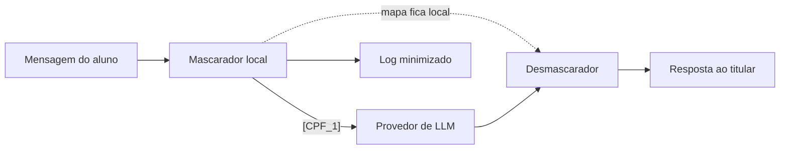

## Passo 1 · Leitura · Onde o dado pessoal entra, e onde ele fica

Um aluno escreve ao assistente: "Meu CPF é 529.982.247-25, estive internado e perdi a prova, posso trancar?". Numa linha, ele entregou um **dado pessoal** e um **dado pessoal sensível**. A Lei Geral de Proteção de Dados (Lei nº 13.709/2018) define, no art. 5º:

- **dado pessoal** (inciso I): informação relacionada a pessoa natural identificada ou identificável: nome, CPF, RA, e-mail, telefone, e também o que identifica em conjunto;
- **dado pessoal sensível** (inciso II): origem racial ou étnica, convicção religiosa, opinião política, filiação a sindicato ou a organização religiosa, filosófica ou política, dado referente à saúde ou à vida sexual, dado genético ou biométrico, quando vinculado a uma pessoa;
- **dado anonimizado** (inciso III): o que não permite identificar o titular, considerando os meios técnicos razoáveis disponíveis. Pelo art. 12, ele deixa de ser dado pessoal, salvo quando a anonimização puder ser revertida.

Num sistema com LLM, aquela linha não fica num lugar só. Ela vai no prompt para o provedor, cai no log da aplicação, no cache, na memória de longo prazo do agente, às vezes no índice vetorial e no conjunto de avaliação montado a partir de conversas reais. Cada cópia é uma cópia a proteger, a apagar no prazo e a encontrar quando o titular pedir.



Duas técnicas com nomes parecidos:

- **Pseudonimização**: trocar o dado por um marcador (`[CPF_1]`) ou por um código, guardando à parte o que permite voltar. É o que deixa o provedor responder sem ver o CPF. Como é reversível para quem tem o mapa ou a chave, o dado **continua sendo pessoal**.
- **Anonimização**: tirar a possibilidade de identificar. Apagar o nome não basta: curso, ano de ingresso e cidade, juntos, podem apontar uma pessoa só. Esses campos são **quase-identificadores**, e a próxima previsão mostra o problema.

No visualizador, a pseudonimização numa passada só pelo texto, com o mapa guardado localmente:

```python visualizar
import re

PADRAO = re.compile(r"(?P<CPF>\d{3}\.\d{3}\.\d{3}-\d{2})|(?P<EMAIL>[\w.+-]+@[\w-]+(?:\.[\w-]+)+)")
texto = "CPF 529.982.247-25, e-mail ana@aluno.example; confirme o 529.982.247-25."
mapa = {}


def trocar(achado):
    valor = achado.group(0)
    for tag, guardado in mapa.items():
        if guardado == valor:
            return tag
    n = sum(1 for tag in mapa if tag.startswith("[" + achado.lastgroup)) + 1
    tag = f"[{achado.lastgroup}_{n}]"
    mapa[tag] = valor
    return tag


mascarado = PADRAO.sub(trocar, texto)
print(mascarado)
print(mapa)
```

## Passo 2 · Previsão · Sem nome, mas não anônimo

A secretaria quer publicar uma tabela "anônima" de notas: tirou nome, RA e CPF e deixou curso, ano de ingresso e cidade. O programa conta quantas pessoas há em cada combinação desses três campos. Um grupo de tamanho 1 é uma pessoa identificável por quem conhece esses três fatos sobre ela; o menor tamanho de grupo é o $k$ do **$k$-anonimato**. Leia e digite o que ele imprime.

### Código
```python
registros = [
    {"curso": "Estatística", "ingresso": 2023, "cidade": "Campinas", "nota": 7.5},
    {"curso": "Estatística", "ingresso": 2023, "cidade": "Campinas", "nota": 6.0},
    {"curso": "Estatística", "ingresso": 2024, "cidade": "Santos", "nota": 9.0},
    {"curso": "Computação", "ingresso": 2023, "cidade": "Campinas", "nota": 8.0},
    {"curso": "Computação", "ingresso": 2023, "cidade": "Campinas", "nota": 5.5},
    {"curso": "Computação", "ingresso": 2023, "cidade": "Campinas", "nota": 7.0},
    {"curso": "Física", "ingresso": 2022, "cidade": "Sorocaba", "nota": 4.0},
]


def grupos(campos):
    contagem = {}
    for r in registros:
        chave = tuple(r[c] for c in campos)
        contagem[chave] = contagem.get(chave, 0) + 1
    return contagem


tres = grupos(["curso", "ingresso", "cidade"])
print("grupos:", len(tres), "k =", min(tres.values()))
for chave, n in tres.items():
    if n == 1:
        print("único:", chave)
so_curso = grupos(["curso"])
print("só curso: k =", min(so_curso.values()), so_curso)
```

### Dicas
1. Agrupe as linhas iguais nos três campos: Estatística/2023/Campinas aparece duas vezes.
2. `print` de uma tupla mostra os textos entre aspas simples.
3. Tirar dois campos diminui os grupos, mas um curso com uma pessoa só continua com uma pessoa só.

### Saída esperada
```text
grupos: 4 k = 1
único: ('Estatística', 2024, 'Santos')
único: ('Física', 2022, 'Sorocaba')
só curso: k = 1 {('Estatística',): 3, ('Computação',): 3, ('Física',): 1}
```

## Passo 3 · Exercício · Detectar CPF de verdade, e-mail e telefone
modo: lacunas

Uma expressão regular de CPF sozinha acusa qualquer número de 11 dígitos: protocolo, código de barras, RA longo. O CPF tem dois **dígitos verificadores**, e conferi-los derruba a maior parte dos falsos positivos:

- multiplique os 9 primeiros dígitos pelos pesos 10, 9, …, 2 e some; o primeiro dígito verificador é `(soma * 10) % 11`, e o resultado 10 vira 0;
- repita com os 10 primeiros dígitos e os pesos 11, 10, …, 2 para o segundo;
- números com os 11 dígitos iguais (`111.111.111-11`) passam na conta, mas não são CPFs válidos.

A regex aceita o CPF com ou sem pontuação e não pode começar nem terminar no meio de um número maior (`(?<!\d)` e `(?!\d)`). Complete as lacunas de `cpf_valido(digitos)` e de `detectar_dados_pessoais(texto)`, que devolve `{"cpf": [...], "email": [...], "telefone": [...]}` na ordem em que aparecem, com cada CPF escrito como no texto.

### Instruções
1. Recuse sequências que não têm 11 dígitos ou que repetem um único dígito.
2. Calcule os dois dígitos verificadores com os pesos decrescentes, transformando 10 em 0.
3. Só entram na resposta os CPFs que passam na verificação, além de todos os e-mails e telefones.

### Código inicial
```python
import re

CPF = re.compile(r"(?<!\d)(\d{3})\.?(\d{3})\.?(\d{3})-?(\d{2})(?!\d)")
EMAIL = re.compile(r"[\w.+-]+@[\w-]+(?:\.[\w-]+)+")
TELEFONE = re.compile(r"\(\d{2}\)\s?9?\d{4}-\d{4}")


def cpf_valido(digitos):
    if len(digitos) != 11 or len(set(digitos)) == ___:
        return False
    numeros = [int(d) for d in digitos]
    for tamanho in (9, 10):
        soma = sum(n * peso for n, peso in zip(numeros[:tamanho], range(___, 1, -1)))
        dv = (soma * 10) % 11 % ___
        if dv != numeros[___]:
            return False
    return True


def detectar_dados_pessoais(texto):
    cpfs = [m.group(0) for m in CPF.finditer(texto) if cpf_valido("".join(___))]
    return {"cpf": cpfs, "email": EMAIL.findall(texto), "telefone": TELEFONE.findall(texto)}
```

### Solução
```python
import re

CPF = re.compile(r"(?<!\d)(\d{3})\.?(\d{3})\.?(\d{3})-?(\d{2})(?!\d)")
EMAIL = re.compile(r"[\w.+-]+@[\w-]+(?:\.[\w-]+)+")
TELEFONE = re.compile(r"\(\d{2}\)\s?9?\d{4}-\d{4}")


def cpf_valido(digitos):
    if len(digitos) != 11 or len(set(digitos)) == 1:
        return False
    numeros = [int(d) for d in digitos]
    for tamanho in (9, 10):
        soma = sum(n * peso for n, peso in zip(numeros[:tamanho], range(tamanho + 1, 1, -1)))
        dv = (soma * 10) % 11 % 10
        if dv != numeros[tamanho]:
            return False
    return True


def detectar_dados_pessoais(texto):
    cpfs = [m.group(0) for m in CPF.finditer(texto) if cpf_valido("".join(m.groups()))]
    return {"cpf": cpfs, "email": EMAIL.findall(texto), "telefone": TELEFONE.findall(texto)}
```

### Dicas
1. Um conjunto com os dígitos de `111.111.111-11` tem um elemento só.
2. Para os 9 primeiros dígitos o maior peso é 10; para os 10 primeiros, 11.
3. Os grupos da regex são os pedaços de dígitos, sem os pontos e o hífen.

### Verificação
```json
[
  {"id": "valido", "checkpoint": 2, "kind": "expr", "expr": "[cpf_valido('52998224725'), cpf_valido('52998224724'), cpf_valido('52998224735')]", "expected": [true, false, false], "name": "cpf_valido confere os dois dígitos verificadores"},
  {"id": "resto-dez", "checkpoint": 2, "kind": "expr", "expr": "[cpf_valido('12345678909'), cpf_valido('39053344705'), cpf_valido('98765432100')]", "expected": [true, true, true], "name": "Quando a conta dá 10, o dígito é 0", "hint": "O resto da divisão por 11 pode ser 10, que não é um dígito."},
  {"id": "repetidos", "checkpoint": 1, "kind": "expr", "expr": "[cpf_valido('11111111111'), cpf_valido('00000000000'), cpf_valido('5299822472')]", "expected": [false, false, false], "name": "Dígitos todos iguais ou tamanho errado não são CPF"},
  {"id": "formatado-e-cru", "checkpoint": 3, "kind": "call", "function": "detectar_dados_pessoais", "args": ["CPF 529.982.247-25 e, do responsável, 12345678909."], "expected": {"cpf": ["529.982.247-25", "12345678909"], "email": [], "telefone": []}, "name": "Acha o CPF com e sem pontuação, como foi escrito"},
  {"id": "dv-errado", "checkpoint": 3, "kind": "call", "function": "detectar_dados_pessoais", "args": ["Protocolo 529.982.247-26 aberto."], "expected": {"cpf": [], "email": [], "telefone": []}, "name": "Número com cara de CPF e dígito errado não é acusado"},
  {"id": "dentro-de-numero", "checkpoint": 3, "kind": "call", "function": "detectar_dados_pessoais", "args": ["Boleto 529982247250001, vencimento amanhã."], "expected": {"cpf": [], "email": [], "telefone": []}, "name": "Onze dígitos dentro de um número maior não são CPF"},
  {"id": "tres-tipos", "checkpoint": 3, "kind": "call", "function": "detectar_dados_pessoais", "args": ["Sou a Ana (CPF 390.533.447-05), escreva para ana.lima@aluno.example ou ligue (11) 98765-4321 / (19) 3521-1234."], "expected": {"cpf": ["390.533.447-05"], "email": ["ana.lima@aluno.example"], "telefone": ["(11) 98765-4321", "(19) 3521-1234"]}, "name": "CPF, e-mail e dois telefones, na ordem do texto"},
  {"id": "sem-dados", "checkpoint": 3, "kind": "call", "function": "detectar_dados_pessoais", "args": ["Até quando posso trancar PRG101?"], "expected": {"cpf": [], "email": [], "telefone": []}, "name": "Sem dado pessoal, listas vazias"},
  {"id": "repetido-no-texto", "checkpoint": 3, "kind": "call", "function": "detectar_dados_pessoais", "args": ["111.111.111-11 não, o certo é 529.982.247-25; repito: 529.982.247-25"], "expected": {"cpf": ["529.982.247-25", "529.982.247-25"], "email": [], "telefone": []}, "name": "CPF de dígitos repetidos ignorado; ocorrências repetidas mantidas"}
]
```

### Soluções erradas
```python name="só a regex, sem dígito verificador"
import re

CPF = re.compile(r"(?<!\d)(\d{3})\.?(\d{3})\.?(\d{3})-?(\d{2})(?!\d)")
EMAIL = re.compile(r"[\w.+-]+@[\w-]+(?:\.[\w-]+)+")
TELEFONE = re.compile(r"\(\d{2}\)\s?9?\d{4}-\d{4}")


def cpf_valido(digitos):
    return len(digitos) == 11 and digitos.isdigit()


def detectar_dados_pessoais(texto):
    cpfs = [m.group(0) for m in CPF.finditer(texto) if cpf_valido("".join(m.groups()))]
    return {"cpf": cpfs, "email": EMAIL.findall(texto), "telefone": TELEFONE.findall(texto)}
```
```python name="aceita dígitos todos iguais"
import re

CPF = re.compile(r"(?<!\d)(\d{3})\.?(\d{3})\.?(\d{3})-?(\d{2})(?!\d)")
EMAIL = re.compile(r"[\w.+-]+@[\w-]+(?:\.[\w-]+)+")
TELEFONE = re.compile(r"\(\d{2}\)\s?9?\d{4}-\d{4}")


def cpf_valido(digitos):
    if len(digitos) != 11:
        return False
    numeros = [int(d) for d in digitos]
    for tamanho in (9, 10):
        soma = sum(n * peso for n, peso in zip(numeros[:tamanho], range(tamanho + 1, 1, -1)))
        dv = (soma * 10) % 11 % 10
        if dv != numeros[tamanho]:
            return False
    return True


def detectar_dados_pessoais(texto):
    cpfs = [m.group(0) for m in CPF.finditer(texto) if cpf_valido("".join(m.groups()))]
    return {"cpf": cpfs, "email": EMAIL.findall(texto), "telefone": TELEFONE.findall(texto)}
```
```python name="pesos começando um abaixo"
import re

CPF = re.compile(r"(?<!\d)(\d{3})\.?(\d{3})\.?(\d{3})-?(\d{2})(?!\d)")
EMAIL = re.compile(r"[\w.+-]+@[\w-]+(?:\.[\w-]+)+")
TELEFONE = re.compile(r"\(\d{2}\)\s?9?\d{4}-\d{4}")


def cpf_valido(digitos):
    if len(digitos) != 11 or len(set(digitos)) == 1:
        return False
    numeros = [int(d) for d in digitos]
    for tamanho in (9, 10):
        soma = sum(n * peso for n, peso in zip(numeros[:tamanho], range(tamanho, 0, -1)))
        dv = (soma * 10) % 11 % 10
        if dv != numeros[tamanho]:
            return False
    return True


def detectar_dados_pessoais(texto):
    cpfs = [m.group(0) for m in CPF.finditer(texto) if cpf_valido("".join(m.groups()))]
    return {"cpf": cpfs, "email": EMAIL.findall(texto), "telefone": TELEFONE.findall(texto)}
```
```python name="esquece que resto 10 vira 0"
import re

CPF = re.compile(r"(?<!\d)(\d{3})\.?(\d{3})\.?(\d{3})-?(\d{2})(?!\d)")
EMAIL = re.compile(r"[\w.+-]+@[\w-]+(?:\.[\w-]+)+")
TELEFONE = re.compile(r"\(\d{2}\)\s?9?\d{4}-\d{4}")


def cpf_valido(digitos):
    if len(digitos) != 11 or len(set(digitos)) == 1:
        return False
    numeros = [int(d) for d in digitos]
    for tamanho in (9, 10):
        soma = sum(n * peso for n, peso in zip(numeros[:tamanho], range(tamanho + 1, 1, -1)))
        dv = (soma * 10) % 11
        if dv != numeros[tamanho]:
            return False
    return True


def detectar_dados_pessoais(texto):
    cpfs = [m.group(0) for m in CPF.finditer(texto) if cpf_valido("".join(m.groups()))]
    return {"cpf": cpfs, "email": EMAIL.findall(texto), "telefone": TELEFONE.findall(texto)}
```
```python name="regex sem fronteira de número"
import re

CPF = re.compile(r"(\d{3})\.?(\d{3})\.?(\d{3})-?(\d{2})")
EMAIL = re.compile(r"[\w.+-]+@[\w-]+(?:\.[\w-]+)+")
TELEFONE = re.compile(r"\(\d{2}\)\s?9?\d{4}-\d{4}")


def cpf_valido(digitos):
    if len(digitos) != 11 or len(set(digitos)) == 1:
        return False
    numeros = [int(d) for d in digitos]
    for tamanho in (9, 10):
        soma = sum(n * peso for n, peso in zip(numeros[:tamanho], range(tamanho + 1, 1, -1)))
        dv = (soma * 10) % 11 % 10
        if dv != numeros[tamanho]:
            return False
    return True


def detectar_dados_pessoais(texto):
    cpfs = [m.group(0) for m in CPF.finditer(texto) if cpf_valido("".join(m.groups()))]
    return {"cpf": cpfs, "email": EMAIL.findall(texto), "telefone": TELEFONE.findall(texto)}
```
```python name="só reconhece o CPF formatado"
import re

CPF = re.compile(r"(?<!\d)(\d{3})\.(\d{3})\.(\d{3})-(\d{2})(?!\d)")
EMAIL = re.compile(r"[\w.+-]+@[\w-]+(?:\.[\w-]+)+")
TELEFONE = re.compile(r"\(\d{2}\)\s?9?\d{4}-\d{4}")


def cpf_valido(digitos):
    if len(digitos) != 11 or len(set(digitos)) == 1:
        return False
    numeros = [int(d) for d in digitos]
    for tamanho in (9, 10):
        soma = sum(n * peso for n, peso in zip(numeros[:tamanho], range(tamanho + 1, 1, -1)))
        dv = (soma * 10) % 11 % 10
        if dv != numeros[tamanho]:
            return False
    return True


def detectar_dados_pessoais(texto):
    cpfs = [m.group(0) for m in CPF.finditer(texto) if cpf_valido("".join(m.groups()))]
    return {"cpf": cpfs, "email": EMAIL.findall(texto), "telefone": TELEFONE.findall(texto)}
```

## Passo 4 · Exercício · Pseudonimizar a conversa inteira

Escreva `mascarar(texto, mapa=None)` e `desmascarar(texto, mapa)`. `PADRAO` já tem um grupo com nome por categoria (`CPF`, `EMAIL`, `TEL`), e `achado.lastgroup` diz qual casou.

- `mascarar` troca cada ocorrência por `[CATEGORIA_n]` numa **única passada** (`PADRAO.sub` com uma função). Trocar valor por valor com `str.replace` estraga o texto quando um valor está dentro de outro: em `ana@aluno.example e joana@aluno.example`, trocar o primeiro e-mail primeiro deixa `jo[EMAIL_1]`.
- O mesmo valor recebe sempre o mesmo marcador. A numeração é por categoria, a partir de 1.
- `mapa` é o da conversa até agora (`{marcador: valor}`): valores já vistos reaproveitam o marcador, e os novos continuam a numeração da categoria. O mapa recebido não é alterado; devolva `(texto_mascarado, mapa_novo)`.
- `desmascarar` troca de volta cada marcador que está no mapa. Um marcador que não está no mapa (o modelo pode inventar `[CPF_9]`) fica como está.

O mapa nunca sai da máquina da aplicação: ele não vai no prompt nem no log.

### Instruções
1. Uma passada só, com marcador por categoria e o mesmo marcador para o mesmo valor.
2. Continue a numeração a partir do mapa recebido, sem alterá-lo.
3. `desmascarar` restaura só os marcadores conhecidos.

### Código inicial
```python
import re

PADRAO = re.compile(
    r"(?P<CPF>(?<!\d)\d{3}\.?\d{3}\.?\d{3}-?\d{2}(?!\d))"
    r"|(?P<EMAIL>[\w.+-]+@[\w-]+(?:\.[\w-]+)+)"
    r"|(?P<TEL>\(\d{2}\)\s?9?\d{4}-\d{4})"
)
MARCADOR = re.compile(r"\[(?:CPF|EMAIL|TEL)_\d+\]")


def mascarar(texto, mapa=None):
    pass


def desmascarar(texto, mapa):
    pass
```

### Solução
```python
import re

PADRAO = re.compile(
    r"(?P<CPF>(?<!\d)\d{3}\.?\d{3}\.?\d{3}-?\d{2}(?!\d))"
    r"|(?P<EMAIL>[\w.+-]+@[\w-]+(?:\.[\w-]+)+)"
    r"|(?P<TEL>\(\d{2}\)\s?9?\d{4}-\d{4})"
)
MARCADOR = re.compile(r"\[(?:CPF|EMAIL|TEL)_\d+\]")


def mascarar(texto, mapa=None):
    novo = dict(mapa or {})
    inverso = {valor: tag for tag, valor in novo.items()}

    def trocar(achado):
        valor, categoria = achado.group(0), achado.lastgroup
        if valor not in inverso:
            n = sum(1 for tag in novo if tag.startswith(f"[{categoria}_")) + 1
            inverso[valor] = f"[{categoria}_{n}]"
            novo[inverso[valor]] = valor
        return inverso[valor]

    return PADRAO.sub(trocar, texto), novo


def desmascarar(texto, mapa):
    return MARCADOR.sub(lambda m: mapa.get(m.group(0), m.group(0)), texto)
```

### Dicas
1. Monte também o mapa inverso, `{valor: marcador}`, para achar o marcador de um valor já visto.
2. O próximo número de uma categoria é um a mais que a quantidade de marcadores dela no mapa.
3. `MARCADOR.sub` aceita uma função, e `dict.get` aceita um valor padrão.

### Verificação
```json
[
  {"id": "tres-categorias", "checkpoint": 1, "kind": "call", "function": "mascarar", "args": ["CPF 529.982.247-25, e-mail ana@aluno.example, tel (11) 98765-4321."], "expected": ["CPF [CPF_1], e-mail [EMAIL_1], tel [TEL_1].", {"[CPF_1]": "529.982.247-25", "[EMAIL_1]": "ana@aluno.example", "[TEL_1]": "(11) 98765-4321"}], "name": "Um marcador por categoria, numerado a partir de 1"},
  {"id": "mesmo-valor", "checkpoint": 1, "kind": "call", "function": "mascarar", "args": ["CPF 529.982.247-25 do titular, 12345678909 do responsável; confirme 529.982.247-25"], "expected": ["CPF [CPF_1] do titular, [CPF_2] do responsável; confirme [CPF_1]", {"[CPF_1]": "529.982.247-25", "[CPF_2]": "12345678909"}], "name": "O mesmo CPF recebe o mesmo marcador"},
  {"id": "valor-dentro-de-outro", "checkpoint": 1, "kind": "call", "function": "mascarar", "args": ["Copie ana@aluno.example e joana@aluno.example"], "expected": ["Copie [EMAIL_1] e [EMAIL_2]", {"[EMAIL_1]": "ana@aluno.example", "[EMAIL_2]": "joana@aluno.example"}], "name": "Um e-mail que contém outro não é mutilado", "hint": "Troque tudo numa passada só pelo texto."},
  {"id": "continua-conversa", "checkpoint": 2, "kind": "expr", "setup": "mapa = {'[CPF_1]': '529.982.247-25', '[EMAIL_1]': 'ana@aluno.example'}", "expr": "mascarar('O 529.982.247-25 de novo, e agora o 12345678909 e bia@aluno.example', mapa)", "expected": ["O [CPF_1] de novo, e agora o [CPF_2] e [EMAIL_2]", {"[CPF_1]": "529.982.247-25", "[EMAIL_1]": "ana@aluno.example", "[CPF_2]": "12345678909", "[EMAIL_2]": "bia@aluno.example"}], "name": "Na mesma conversa, valores vistos reaproveitam o marcador e os novos continuam a numeração"},
  {"id": "nao-altera-mapa", "checkpoint": 2, "kind": "expr", "setup": "mapa = {'[CPF_1]': '529.982.247-25'}\nmascarar('novo: 12345678909', mapa)", "expr": "mapa", "expected": {"[CPF_1]": "529.982.247-25"}, "name": "O mapa recebido não é alterado"},
  {"id": "sem-dado", "checkpoint": 2, "kind": "expr", "expr": "[mascarar('Até quando tranco?'), mascarar('Até quando tranco?', {'[TEL_1]': '(11) 3091-1234'})]", "expected": [["Até quando tranco?", {}], ["Até quando tranco?", {"[TEL_1]": "(11) 3091-1234"}]], "name": "Sem dado pessoal, o texto não muda"},
  {"id": "ida-e-volta", "checkpoint": 3, "kind": "expr", "setup": "t = 'Ana (CPF 390.533.447-05, ana@aluno.example) e Joana (joana@aluno.example, (19) 3521-1234); de novo 390.533.447-05.'\nm, mp = mascarar(t)", "expr": "[desmascarar(m, mp) == t, '390' in m, 'ana@' in m]", "expected": [true, false, false], "name": "Mascarar e desmascarar devolve o texto original, e o mascarado não tem os dados"},
  {"id": "marcador-inventado", "checkpoint": 3, "kind": "call", "function": "desmascarar", "args": ["Confirmado para [CPF_1]; o [CPF_9] não existe.", {"[CPF_1]": "529.982.247-25"}], "expected": "Confirmado para 529.982.247-25; o [CPF_9] não existe.", "name": "Marcador desconhecido fica como está"},
  {"id": "desmascara-resposta", "checkpoint": 3, "kind": "call", "function": "desmascarar", "args": ["Enviei o protocolo para [EMAIL_1] e [EMAIL_2]. [1]", {"[EMAIL_1]": "ana@aluno.example", "[EMAIL_2]": "joana@aluno.example"}], "expected": "Enviei o protocolo para ana@aluno.example e joana@aluno.example. [1]", "name": "Restaura os marcadores da resposta e mantém a citação [1]"}
]
```

### Soluções erradas
```python name="troca valor por valor com replace"
import re

PADRAO = re.compile(
    r"(?P<CPF>(?<!\d)\d{3}\.?\d{3}\.?\d{3}-?\d{2}(?!\d))"
    r"|(?P<EMAIL>[\w.+-]+@[\w-]+(?:\.[\w-]+)+)"
    r"|(?P<TEL>\(\d{2}\)\s?9?\d{4}-\d{4})"
)
MARCADOR = re.compile(r"\[(?:CPF|EMAIL|TEL)_\d+\]")


def mascarar(texto, mapa=None):
    novo = dict(mapa or {})
    inverso = {valor: tag for tag, valor in novo.items()}
    resultado = texto
    for achado in PADRAO.finditer(texto):
        valor, categoria = achado.group(0), achado.lastgroup
        if valor not in inverso:
            n = sum(1 for tag in novo if tag.startswith(f"[{categoria}_")) + 1
            inverso[valor] = f"[{categoria}_{n}]"
            novo[inverso[valor]] = valor
        resultado = resultado.replace(valor, inverso[valor])
    return resultado, novo


def desmascarar(texto, mapa):
    return MARCADOR.sub(lambda m: mapa.get(m.group(0), m.group(0)), texto)
```
```python name="recomeça a numeração a cada mensagem"
import re

PADRAO = re.compile(
    r"(?P<CPF>(?<!\d)\d{3}\.?\d{3}\.?\d{3}-?\d{2}(?!\d))"
    r"|(?P<EMAIL>[\w.+-]+@[\w-]+(?:\.[\w-]+)+)"
    r"|(?P<TEL>\(\d{2}\)\s?9?\d{4}-\d{4})"
)
MARCADOR = re.compile(r"\[(?:CPF|EMAIL|TEL)_\d+\]")


def mascarar(texto, mapa=None):
    novo = dict(mapa or {})
    vistos = {}

    def trocar(achado):
        valor, categoria = achado.group(0), achado.lastgroup
        if valor not in vistos:
            n = sum(1 for tag in vistos.values() if tag.startswith(f"[{categoria}_")) + 1
            vistos[valor] = f"[{categoria}_{n}]"
            novo[vistos[valor]] = valor
        return vistos[valor]

    return PADRAO.sub(trocar, texto), novo


def desmascarar(texto, mapa):
    return MARCADOR.sub(lambda m: mapa.get(m.group(0), m.group(0)), texto)
```
```python name="altera o mapa recebido"
import re

PADRAO = re.compile(
    r"(?P<CPF>(?<!\d)\d{3}\.?\d{3}\.?\d{3}-?\d{2}(?!\d))"
    r"|(?P<EMAIL>[\w.+-]+@[\w-]+(?:\.[\w-]+)+)"
    r"|(?P<TEL>\(\d{2}\)\s?9?\d{4}-\d{4})"
)
MARCADOR = re.compile(r"\[(?:CPF|EMAIL|TEL)_\d+\]")


def mascarar(texto, mapa=None):
    novo = mapa if mapa is not None else {}
    inverso = {valor: tag for tag, valor in novo.items()}

    def trocar(achado):
        valor, categoria = achado.group(0), achado.lastgroup
        if valor not in inverso:
            n = sum(1 for tag in novo if tag.startswith(f"[{categoria}_")) + 1
            inverso[valor] = f"[{categoria}_{n}]"
            novo[inverso[valor]] = valor
        return inverso[valor]

    return PADRAO.sub(trocar, texto), novo


def desmascarar(texto, mapa):
    return MARCADOR.sub(lambda m: mapa.get(m.group(0), m.group(0)), texto)
```
```python name="numeração única para todas as categorias"
import re

PADRAO = re.compile(
    r"(?P<CPF>(?<!\d)\d{3}\.?\d{3}\.?\d{3}-?\d{2}(?!\d))"
    r"|(?P<EMAIL>[\w.+-]+@[\w-]+(?:\.[\w-]+)+)"
    r"|(?P<TEL>\(\d{2}\)\s?9?\d{4}-\d{4})"
)
MARCADOR = re.compile(r"\[(?:CPF|EMAIL|TEL)_\d+\]")


def mascarar(texto, mapa=None):
    novo = dict(mapa or {})
    inverso = {valor: tag for tag, valor in novo.items()}

    def trocar(achado):
        valor, categoria = achado.group(0), achado.lastgroup
        if valor not in inverso:
            inverso[valor] = f"[{categoria}_{len(novo) + 1}]"
            novo[inverso[valor]] = valor
        return inverso[valor]

    return PADRAO.sub(trocar, texto), novo


def desmascarar(texto, mapa):
    return MARCADOR.sub(lambda m: mapa.get(m.group(0), m.group(0)), texto)
```
```python name="um marcador novo a cada ocorrência"
import re

PADRAO = re.compile(
    r"(?P<CPF>(?<!\d)\d{3}\.?\d{3}\.?\d{3}-?\d{2}(?!\d))"
    r"|(?P<EMAIL>[\w.+-]+@[\w-]+(?:\.[\w-]+)+)"
    r"|(?P<TEL>\(\d{2}\)\s?9?\d{4}-\d{4})"
)
MARCADOR = re.compile(r"\[(?:CPF|EMAIL|TEL)_\d+\]")


def mascarar(texto, mapa=None):
    novo = dict(mapa or {})

    def trocar(achado):
        categoria = achado.lastgroup
        n = sum(1 for tag in novo if tag.startswith(f"[{categoria}_")) + 1
        tag = f"[{categoria}_{n}]"
        novo[tag] = achado.group(0)
        return tag

    return PADRAO.sub(trocar, texto), novo


def desmascarar(texto, mapa):
    return MARCADOR.sub(lambda m: mapa.get(m.group(0), m.group(0)), texto)
```
```python name="apaga o marcador desconhecido"
import re

PADRAO = re.compile(
    r"(?P<CPF>(?<!\d)\d{3}\.?\d{3}\.?\d{3}-?\d{2}(?!\d))"
    r"|(?P<EMAIL>[\w.+-]+@[\w-]+(?:\.[\w-]+)+)"
    r"|(?P<TEL>\(\d{2}\)\s?9?\d{4}-\d{4})"
)
MARCADOR = re.compile(r"\[(?:CPF|EMAIL|TEL)_\d+\]")


def mascarar(texto, mapa=None):
    novo = dict(mapa or {})
    inverso = {valor: tag for tag, valor in novo.items()}

    def trocar(achado):
        valor, categoria = achado.group(0), achado.lastgroup
        if valor not in inverso:
            n = sum(1 for tag in novo if tag.startswith(f"[{categoria}_")) + 1
            inverso[valor] = f"[{categoria}_{n}]"
            novo[inverso[valor]] = valor
        return inverso[valor]

    return PADRAO.sub(trocar, texto), novo


def desmascarar(texto, mapa):
    return MARCADOR.sub(lambda m: mapa.get(m.group(0), ""), texto)
```

## Passo 5 · Leitura · Da lei às decisões de projeto

A LGPD não fala de prompts, mas os princípios e direitos dela viram decisões de código. O mapa abaixo não é parecer jurídico: na instituição, o projeto se acerta com o **encarregado** pelo tratamento de dados pessoais (art. 41).

| Requisito | Decisão de projeto |
|---|---|
| Finalidade e necessidade (art. 6º, I e III) | cada fluxo declara para que existe; o dado que não serve à finalidade não entra no prompt nem no log |
| Base legal (art. 7º; para dado sensível, art. 11) | cada fluxo registra a sua base; a lista do art. 11 é mais restrita: legítimo interesse, por exemplo, não está nela |
| Direitos do titular (art. 18) | acesso, correção e eliminação alcançam **todas** as cópias: log, memória do agente, índice vetorial, conjunto de avaliação |
| Decisões automatizadas (art. 20) | quem é afetado por decisão tomada só com base em tratamento automatizado pode pedir revisão; o sistema precisa de um canal para isso |
| Transferência internacional (art. 33) | um provedor de LLM fora do país exige uma das hipóteses do art. 33, como cláusulas contratuais, decidida antes de mandar o primeiro prompt |
| Registro e segurança (arts. 37 e 46) | registro das operações de tratamento; medidas técnicas para proteger os dados |

Três escolhas técnicas aparecem em quase todo projeto:

- **Log por lista de permitidos.** Grave só os campos que têm uso (momento, rota, status, latência, finalidade). Uma lista de proibidos ("tira o campo `cpf`") deixa passar o CPF que o aluno digitou no campo de observação, e o próximo campo que alguém criar.
- **Pseudônimo com chave.** Para contar pedidos por usuário sem guardar o RA, use um HMAC com uma chave guardada fora do log. Um SHA-256 sem chave não protege: os RAs possíveis são poucos, e o hash de todos eles se calcula num computador comum. Com a chave, a aplicação ainda acha os registros de quem pede eliminação, calculando o pseudônimo a partir do RA do pedido.
- **Retenção por finalidade.** A lei não fixa prazos em dias: o tratamento termina quando a finalidade foi alcançada ou o dado deixou de ser necessário (art. 15), ressalvadas as hipóteses do art. 16 para guardar. Cada finalidade tem o seu prazo; registro de finalidade sem prazo definido não tem motivo para ficar.

## Passo 6 · Exercício · Log minimizado e retenção

Escreva três funções. `mascarar` é a do passo 4.

- `pseudonimo(ra, chave)`: os 16 primeiros caracteres hexadecimais do HMAC-SHA256 do RA (em UTF-8) com a `chave` (bytes): `hmac.new(chave, ..., hashlib.sha256).hexdigest()[:16]`.
- `log_minimizado(evento, chave)`: um registro só com os campos de `CAMPOS_DO_LOG` que estiverem no evento, mais `"usuario"` (o pseudônimo do `"ra"`) e `"pergunta"` (o texto mascarado, sem o mapa). Nenhum outro campo do evento passa.
- `aplicar_retencao(registros, hoje, prazos, pedidos_de_eliminacao, chave)`: `hoje` e o começo de `"momento"` são datas `AAAA-MM-DD`; `prazos` mapeia finalidade para dias; `pedidos_de_eliminacao` é uma lista de **RAs**. Cada registro é eliminado por um motivo, nesta ordem: `"titular"` (o usuário pediu eliminação), `"sem_prazo"` (a finalidade não tem prazo definido) ou `"prazo"` (a idade em dias passou do prazo; idade igual ao prazo fica). Devolva `{"mantidos": [...], "eliminados": {"titular": n, "sem_prazo": n, "prazo": n}}`, com os mantidos na ordem original.

### Instruções
1. O pseudônimo é um HMAC com chave, não um hash simples.
2. O log é montado por lista de permitidos, com o usuário pseudonimizado e a pergunta mascarada.
3. A retenção usa o prazo da finalidade do registro, mantém a idade igual ao prazo e elimina a finalidade sem prazo.
4. Os pedidos de eliminação chegam com o RA e alcançam os registros pseudonimizados; conte cada eliminação pelo primeiro motivo.

### Código inicial
```python
import hashlib
import hmac
import re
from datetime import date

PADRAO = re.compile(
    r"(?P<CPF>(?<!\d)\d{3}\.?\d{3}\.?\d{3}-?\d{2}(?!\d))"
    r"|(?P<EMAIL>[\w.+-]+@[\w-]+(?:\.[\w-]+)+)"
    r"|(?P<TEL>\(\d{2}\)\s?9?\d{4}-\d{4})"
)
MARCADOR = re.compile(r"\[(?:CPF|EMAIL|TEL)_\d+\]")


def mascarar(texto, mapa=None):
    novo = dict(mapa or {})
    inverso = {valor: tag for tag, valor in novo.items()}

    def trocar(achado):
        valor, categoria = achado.group(0), achado.lastgroup
        if valor not in inverso:
            n = sum(1 for tag in novo if tag.startswith(f"[{categoria}_")) + 1
            inverso[valor] = f"[{categoria}_{n}]"
            novo[inverso[valor]] = valor
        return inverso[valor]

    return PADRAO.sub(trocar, texto), novo


def desmascarar(texto, mapa):
    return MARCADOR.sub(lambda m: mapa.get(m.group(0), m.group(0)), texto)


CAMPOS_DO_LOG = ("momento", "rota", "status", "latencia_ms", "finalidade")


def pseudonimo(ra, chave):
    pass


def log_minimizado(evento, chave):
    pass


def aplicar_retencao(registros, hoje, prazos, pedidos_de_eliminacao, chave):
    pass
```

### Solução
```python
import hashlib
import hmac
import re
from datetime import date

PADRAO = re.compile(
    r"(?P<CPF>(?<!\d)\d{3}\.?\d{3}\.?\d{3}-?\d{2}(?!\d))"
    r"|(?P<EMAIL>[\w.+-]+@[\w-]+(?:\.[\w-]+)+)"
    r"|(?P<TEL>\(\d{2}\)\s?9?\d{4}-\d{4})"
)
MARCADOR = re.compile(r"\[(?:CPF|EMAIL|TEL)_\d+\]")


def mascarar(texto, mapa=None):
    novo = dict(mapa or {})
    inverso = {valor: tag for tag, valor in novo.items()}

    def trocar(achado):
        valor, categoria = achado.group(0), achado.lastgroup
        if valor not in inverso:
            n = sum(1 for tag in novo if tag.startswith(f"[{categoria}_")) + 1
            inverso[valor] = f"[{categoria}_{n}]"
            novo[inverso[valor]] = valor
        return inverso[valor]

    return PADRAO.sub(trocar, texto), novo


def desmascarar(texto, mapa):
    return MARCADOR.sub(lambda m: mapa.get(m.group(0), m.group(0)), texto)


CAMPOS_DO_LOG = ("momento", "rota", "status", "latencia_ms", "finalidade")


def pseudonimo(ra, chave):
    return hmac.new(chave, ra.encode("utf-8"), hashlib.sha256).hexdigest()[:16]


def log_minimizado(evento, chave):
    registro = {campo: evento[campo] for campo in CAMPOS_DO_LOG if campo in evento}
    registro["usuario"] = pseudonimo(evento["ra"], chave)
    registro["pergunta"] = mascarar(evento["pergunta"])[0]
    return registro


def aplicar_retencao(registros, hoje, prazos, pedidos_de_eliminacao, chave):
    alvos = {pseudonimo(ra, chave) for ra in pedidos_de_eliminacao}
    dia = date.fromisoformat(hoje)
    mantidos = []
    eliminados = {"titular": 0, "sem_prazo": 0, "prazo": 0}
    for registro in registros:
        if registro["usuario"] in alvos:
            eliminados["titular"] += 1
        elif registro.get("finalidade") not in prazos:
            eliminados["sem_prazo"] += 1
        elif (dia - date.fromisoformat(registro["momento"][:10])).days > prazos[registro["finalidade"]]:
            eliminados["prazo"] += 1
        else:
            mantidos.append(registro)
    return {"mantidos": mantidos, "eliminados": eliminados}
```

### Dicas
1. Monte o registro a partir de `CAMPOS_DO_LOG`, e não a partir do evento.
2. O log tem pseudônimos; o pedido tem RAs. Transforme um no outro.
3. A diferença entre duas datas tem o atributo `.days`.

### Verificação
```json
[
  {"id": "pseudonimo-hmac", "checkpoint": 1, "kind": "expr", "expr": "[pseudonimo('2024001', b'chave-de-teste'), pseudonimo('2024002', b'chave-de-teste')]", "expected": ["b06d0f656bbdbd49", "249abad69f607c90"], "name": "Pseudônimo é o HMAC-SHA256 do RA com a chave", "hint": "hashlib.sha256 sozinho não usa a chave."},
  {"id": "pseudonimo-depende-da-chave", "checkpoint": 1, "kind": "expr", "expr": "[pseudonimo('2024001', b'chave-de-teste') == pseudonimo('2024001', b'chave-de-teste'), pseudonimo('2024001', b'chave-de-teste') == pseudonimo('2024001', b'outra-chave'), len(pseudonimo('2024001', b'k'))]", "expected": [true, false, 16], "name": "Mesmo RA e mesma chave, mesmo pseudônimo; outra chave, outro"},
  {"id": "log-por-permitidos", "checkpoint": 2, "kind": "expr", "setup": "ev = {'momento': '2026-03-10T14:02:00', 'rota': '/perguntar', 'status': 200, 'latencia_ms': 840, 'finalidade': 'atendimento', 'ra': '2024001', 'nome': 'Ana Lima', 'cpf': '529.982.247-25', 'observacao': 'meu CPF é 529.982.247-25', 'pergunta': 'Posso trancar?'}", "expr": "log_minimizado(ev, b'chave-de-teste')", "expected": {"momento": "2026-03-10T14:02:00", "rota": "/perguntar", "status": 200, "latencia_ms": 840, "finalidade": "atendimento", "usuario": "b06d0f656bbdbd49", "pergunta": "Posso trancar?"}, "name": "Só os campos permitidos, o pseudônimo e a pergunta", "hint": "Campos que ninguém previu também não podem passar."},
  {"id": "log-pergunta-mascarada", "checkpoint": 2, "kind": "expr", "setup": "ev = {'momento': '2026-03-10', 'finalidade': 'atendimento', 'ra': '2024002', 'pergunta': 'Sou 12345678909, escreva para bia@aluno.example'}", "expr": "log_minimizado(ev, b'chave-de-teste')", "expected": {"momento": "2026-03-10", "finalidade": "atendimento", "usuario": "249abad69f607c90", "pergunta": "Sou [CPF_1], escreva para [EMAIL_1]"}, "name": "A pergunta vai mascarada e só com os campos que existem no evento"},
  {"id": "retencao-por-finalidade", "checkpoint": 3, "kind": "expr", "setup": "regs = [\n    {'momento': '2026-05-01', 'finalidade': 'atendimento', 'usuario': 'u1'},\n    {'momento': '2026-05-01', 'finalidade': 'auditoria', 'usuario': 'u2'},\n    {'momento': '2026-06-25', 'finalidade': 'atendimento', 'usuario': 'u3'},\n]\nr = aplicar_retencao(regs, '2026-06-30', {'atendimento': 30, 'auditoria': 180}, [], b'k')", "expr": "[[x['usuario'] for x in r['mantidos']], r['eliminados']]", "expected": [["u2", "u3"], {"titular": 0, "sem_prazo": 0, "prazo": 1}], "name": "Cada registro usa o prazo da sua finalidade"},
  {"id": "retencao-fronteira", "checkpoint": 3, "kind": "expr", "setup": "regs = [{'momento': '2026-05-31T23:59:00', 'finalidade': 'atendimento', 'usuario': 'u1'}, {'momento': '2026-05-30', 'finalidade': 'atendimento', 'usuario': 'u2'}]\nr = aplicar_retencao(regs, '2026-06-30', {'atendimento': 30}, [], b'k')", "expr": "[[x['usuario'] for x in r['mantidos']], r['eliminados']['prazo']]", "expected": [["u1"], 1], "name": "Idade igual ao prazo fica; um dia a mais sai"},
  {"id": "sem-prazo", "checkpoint": 3, "kind": "expr", "setup": "regs = [{'momento': '2026-06-29', 'finalidade': 'treinar_modelo', 'usuario': 'u1'}, {'momento': '2026-06-29', 'usuario': 'u2'}, {'momento': '2026-06-29', 'finalidade': 'atendimento', 'usuario': 'u3'}]\nr = aplicar_retencao(regs, '2026-06-30', {'atendimento': 30}, [], b'k')", "expr": "[[x['usuario'] for x in r['mantidos']], r['eliminados']]", "expected": [["u3"], {"titular": 0, "sem_prazo": 2, "prazo": 0}], "name": "Finalidade sem prazo definido não fica guardada"},
  {"id": "pedido-pelo-ra", "checkpoint": 4, "kind": "expr", "setup": "regs = [\n    {'momento': '2026-06-29', 'finalidade': 'atendimento', 'usuario': 'b06d0f656bbdbd49'},\n    {'momento': '2026-06-29', 'finalidade': 'atendimento', 'usuario': '249abad69f607c90'},\n    {'momento': '2026-06-20', 'finalidade': 'atendimento', 'usuario': 'b06d0f656bbdbd49'},\n]\nr = aplicar_retencao(regs, '2026-06-30', {'atendimento': 30}, ['2024001'], b'chave-de-teste')", "expr": "[[x['usuario'] for x in r['mantidos']], r['eliminados']]", "expected": [["249abad69f607c90"], {"titular": 2, "sem_prazo": 0, "prazo": 0}], "name": "O pedido chega com o RA e apaga os registros do pseudônimo dele", "hint": "Compare pseudônimo com pseudônimo."},
  {"id": "ordem-dos-motivos", "checkpoint": 4, "kind": "expr", "setup": "regs = [\n    {'momento': '2025-01-01', 'finalidade': 'atendimento', 'usuario': 'b06d0f656bbdbd49'},\n    {'momento': '2025-01-01', 'finalidade': 'sem_regra', 'usuario': 'x'},\n    {'momento': '2025-01-01', 'finalidade': 'atendimento', 'usuario': 'y'},\n]\nr = aplicar_retencao(regs, '2026-06-30', {'atendimento': 30}, ['2024001'], b'chave-de-teste')", "expr": "r", "expected": {"mantidos": [], "eliminados": {"titular": 1, "sem_prazo": 1, "prazo": 1}}, "name": "Cada eliminação conta só pelo primeiro motivo: titular, sem prazo, prazo"}
]
```

### Soluções erradas
```python name="hash sem chave"
import hashlib
import hmac
import re
from datetime import date

PADRAO = re.compile(
    r"(?P<CPF>(?<!\d)\d{3}\.?\d{3}\.?\d{3}-?\d{2}(?!\d))"
    r"|(?P<EMAIL>[\w.+-]+@[\w-]+(?:\.[\w-]+)+)"
    r"|(?P<TEL>\(\d{2}\)\s?9?\d{4}-\d{4})"
)
MARCADOR = re.compile(r"\[(?:CPF|EMAIL|TEL)_\d+\]")


def mascarar(texto, mapa=None):
    novo = dict(mapa or {})
    inverso = {valor: tag for tag, valor in novo.items()}

    def trocar(achado):
        valor, categoria = achado.group(0), achado.lastgroup
        if valor not in inverso:
            n = sum(1 for tag in novo if tag.startswith(f"[{categoria}_")) + 1
            inverso[valor] = f"[{categoria}_{n}]"
            novo[inverso[valor]] = valor
        return inverso[valor]

    return PADRAO.sub(trocar, texto), novo


def desmascarar(texto, mapa):
    return MARCADOR.sub(lambda m: mapa.get(m.group(0), m.group(0)), texto)


CAMPOS_DO_LOG = ("momento", "rota", "status", "latencia_ms", "finalidade")


def pseudonimo(ra, chave):
    return hashlib.sha256(ra.encode("utf-8")).hexdigest()[:16]


def log_minimizado(evento, chave):
    registro = {campo: evento[campo] for campo in CAMPOS_DO_LOG if campo in evento}
    registro["usuario"] = pseudonimo(evento["ra"], chave)
    registro["pergunta"] = mascarar(evento["pergunta"])[0]
    return registro


def aplicar_retencao(registros, hoje, prazos, pedidos_de_eliminacao, chave):
    alvos = {pseudonimo(ra, chave) for ra in pedidos_de_eliminacao}
    dia = date.fromisoformat(hoje)
    mantidos = []
    eliminados = {"titular": 0, "sem_prazo": 0, "prazo": 0}
    for registro in registros:
        if registro["usuario"] in alvos:
            eliminados["titular"] += 1
        elif registro.get("finalidade") not in prazos:
            eliminados["sem_prazo"] += 1
        elif (dia - date.fromisoformat(registro["momento"][:10])).days > prazos[registro["finalidade"]]:
            eliminados["prazo"] += 1
        else:
            mantidos.append(registro)
    return {"mantidos": mantidos, "eliminados": eliminados}
```
```python name="lista de proibidos no log"
import hashlib
import hmac
import re
from datetime import date

PADRAO = re.compile(
    r"(?P<CPF>(?<!\d)\d{3}\.?\d{3}\.?\d{3}-?\d{2}(?!\d))"
    r"|(?P<EMAIL>[\w.+-]+@[\w-]+(?:\.[\w-]+)+)"
    r"|(?P<TEL>\(\d{2}\)\s?9?\d{4}-\d{4})"
)
MARCADOR = re.compile(r"\[(?:CPF|EMAIL|TEL)_\d+\]")


def mascarar(texto, mapa=None):
    novo = dict(mapa or {})
    inverso = {valor: tag for tag, valor in novo.items()}

    def trocar(achado):
        valor, categoria = achado.group(0), achado.lastgroup
        if valor not in inverso:
            n = sum(1 for tag in novo if tag.startswith(f"[{categoria}_")) + 1
            inverso[valor] = f"[{categoria}_{n}]"
            novo[inverso[valor]] = valor
        return inverso[valor]

    return PADRAO.sub(trocar, texto), novo


def desmascarar(texto, mapa):
    return MARCADOR.sub(lambda m: mapa.get(m.group(0), m.group(0)), texto)


CAMPOS_DO_LOG = ("momento", "rota", "status", "latencia_ms", "finalidade")


def pseudonimo(ra, chave):
    return hmac.new(chave, ra.encode("utf-8"), hashlib.sha256).hexdigest()[:16]


def log_minimizado(evento, chave):
    registro = {k: v for k, v in evento.items() if k not in ("ra", "cpf", "nome", "pergunta")}
    registro["usuario"] = pseudonimo(evento["ra"], chave)
    registro["pergunta"] = mascarar(evento["pergunta"])[0]
    return registro


def aplicar_retencao(registros, hoje, prazos, pedidos_de_eliminacao, chave):
    alvos = {pseudonimo(ra, chave) for ra in pedidos_de_eliminacao}
    dia = date.fromisoformat(hoje)
    mantidos = []
    eliminados = {"titular": 0, "sem_prazo": 0, "prazo": 0}
    for registro in registros:
        if registro["usuario"] in alvos:
            eliminados["titular"] += 1
        elif registro.get("finalidade") not in prazos:
            eliminados["sem_prazo"] += 1
        elif (dia - date.fromisoformat(registro["momento"][:10])).days > prazos[registro["finalidade"]]:
            eliminados["prazo"] += 1
        else:
            mantidos.append(registro)
    return {"mantidos": mantidos, "eliminados": eliminados}
```
```python name="grava a pergunta como veio"
import hashlib
import hmac
import re
from datetime import date

PADRAO = re.compile(
    r"(?P<CPF>(?<!\d)\d{3}\.?\d{3}\.?\d{3}-?\d{2}(?!\d))"
    r"|(?P<EMAIL>[\w.+-]+@[\w-]+(?:\.[\w-]+)+)"
    r"|(?P<TEL>\(\d{2}\)\s?9?\d{4}-\d{4})"
)
MARCADOR = re.compile(r"\[(?:CPF|EMAIL|TEL)_\d+\]")


def mascarar(texto, mapa=None):
    novo = dict(mapa or {})
    inverso = {valor: tag for tag, valor in novo.items()}

    def trocar(achado):
        valor, categoria = achado.group(0), achado.lastgroup
        if valor not in inverso:
            n = sum(1 for tag in novo if tag.startswith(f"[{categoria}_")) + 1
            inverso[valor] = f"[{categoria}_{n}]"
            novo[inverso[valor]] = valor
        return inverso[valor]

    return PADRAO.sub(trocar, texto), novo


def desmascarar(texto, mapa):
    return MARCADOR.sub(lambda m: mapa.get(m.group(0), m.group(0)), texto)


CAMPOS_DO_LOG = ("momento", "rota", "status", "latencia_ms", "finalidade")


def pseudonimo(ra, chave):
    return hmac.new(chave, ra.encode("utf-8"), hashlib.sha256).hexdigest()[:16]


def log_minimizado(evento, chave):
    registro = {campo: evento[campo] for campo in CAMPOS_DO_LOG if campo in evento}
    registro["usuario"] = pseudonimo(evento["ra"], chave)
    registro["pergunta"] = evento["pergunta"]
    return registro


def aplicar_retencao(registros, hoje, prazos, pedidos_de_eliminacao, chave):
    alvos = {pseudonimo(ra, chave) for ra in pedidos_de_eliminacao}
    dia = date.fromisoformat(hoje)
    mantidos = []
    eliminados = {"titular": 0, "sem_prazo": 0, "prazo": 0}
    for registro in registros:
        if registro["usuario"] in alvos:
            eliminados["titular"] += 1
        elif registro.get("finalidade") not in prazos:
            eliminados["sem_prazo"] += 1
        elif (dia - date.fromisoformat(registro["momento"][:10])).days > prazos[registro["finalidade"]]:
            eliminados["prazo"] += 1
        else:
            mantidos.append(registro)
    return {"mantidos": mantidos, "eliminados": eliminados}
```
```python name="um prazo só para todas as finalidades"
import hashlib
import hmac
import re
from datetime import date

PADRAO = re.compile(
    r"(?P<CPF>(?<!\d)\d{3}\.?\d{3}\.?\d{3}-?\d{2}(?!\d))"
    r"|(?P<EMAIL>[\w.+-]+@[\w-]+(?:\.[\w-]+)+)"
    r"|(?P<TEL>\(\d{2}\)\s?9?\d{4}-\d{4})"
)
MARCADOR = re.compile(r"\[(?:CPF|EMAIL|TEL)_\d+\]")


def mascarar(texto, mapa=None):
    novo = dict(mapa or {})
    inverso = {valor: tag for tag, valor in novo.items()}

    def trocar(achado):
        valor, categoria = achado.group(0), achado.lastgroup
        if valor not in inverso:
            n = sum(1 for tag in novo if tag.startswith(f"[{categoria}_")) + 1
            inverso[valor] = f"[{categoria}_{n}]"
            novo[inverso[valor]] = valor
        return inverso[valor]

    return PADRAO.sub(trocar, texto), novo


def desmascarar(texto, mapa):
    return MARCADOR.sub(lambda m: mapa.get(m.group(0), m.group(0)), texto)


CAMPOS_DO_LOG = ("momento", "rota", "status", "latencia_ms", "finalidade")


def pseudonimo(ra, chave):
    return hmac.new(chave, ra.encode("utf-8"), hashlib.sha256).hexdigest()[:16]


def log_minimizado(evento, chave):
    registro = {campo: evento[campo] for campo in CAMPOS_DO_LOG if campo in evento}
    registro["usuario"] = pseudonimo(evento["ra"], chave)
    registro["pergunta"] = mascarar(evento["pergunta"])[0]
    return registro


def aplicar_retencao(registros, hoje, prazos, pedidos_de_eliminacao, chave):
    alvos = {pseudonimo(ra, chave) for ra in pedidos_de_eliminacao}
    dia = date.fromisoformat(hoje)
    prazo = min(prazos.values()) if prazos else 0
    mantidos = []
    eliminados = {"titular": 0, "sem_prazo": 0, "prazo": 0}
    for registro in registros:
        if registro["usuario"] in alvos:
            eliminados["titular"] += 1
        elif registro.get("finalidade") not in prazos:
            eliminados["sem_prazo"] += 1
        elif (dia - date.fromisoformat(registro["momento"][:10])).days > prazo:
            eliminados["prazo"] += 1
        else:
            mantidos.append(registro)
    return {"mantidos": mantidos, "eliminados": eliminados}
```
```python name="elimina no dia exato do prazo"
import hashlib
import hmac
import re
from datetime import date

PADRAO = re.compile(
    r"(?P<CPF>(?<!\d)\d{3}\.?\d{3}\.?\d{3}-?\d{2}(?!\d))"
    r"|(?P<EMAIL>[\w.+-]+@[\w-]+(?:\.[\w-]+)+)"
    r"|(?P<TEL>\(\d{2}\)\s?9?\d{4}-\d{4})"
)
MARCADOR = re.compile(r"\[(?:CPF|EMAIL|TEL)_\d+\]")


def mascarar(texto, mapa=None):
    novo = dict(mapa or {})
    inverso = {valor: tag for tag, valor in novo.items()}

    def trocar(achado):
        valor, categoria = achado.group(0), achado.lastgroup
        if valor not in inverso:
            n = sum(1 for tag in novo if tag.startswith(f"[{categoria}_")) + 1
            inverso[valor] = f"[{categoria}_{n}]"
            novo[inverso[valor]] = valor
        return inverso[valor]

    return PADRAO.sub(trocar, texto), novo


def desmascarar(texto, mapa):
    return MARCADOR.sub(lambda m: mapa.get(m.group(0), m.group(0)), texto)


CAMPOS_DO_LOG = ("momento", "rota", "status", "latencia_ms", "finalidade")


def pseudonimo(ra, chave):
    return hmac.new(chave, ra.encode("utf-8"), hashlib.sha256).hexdigest()[:16]


def log_minimizado(evento, chave):
    registro = {campo: evento[campo] for campo in CAMPOS_DO_LOG if campo in evento}
    registro["usuario"] = pseudonimo(evento["ra"], chave)
    registro["pergunta"] = mascarar(evento["pergunta"])[0]
    return registro


def aplicar_retencao(registros, hoje, prazos, pedidos_de_eliminacao, chave):
    alvos = {pseudonimo(ra, chave) for ra in pedidos_de_eliminacao}
    dia = date.fromisoformat(hoje)
    mantidos = []
    eliminados = {"titular": 0, "sem_prazo": 0, "prazo": 0}
    for registro in registros:
        if registro["usuario"] in alvos:
            eliminados["titular"] += 1
        elif registro.get("finalidade") not in prazos:
            eliminados["sem_prazo"] += 1
        elif (dia - date.fromisoformat(registro["momento"][:10])).days >= prazos[registro["finalidade"]]:
            eliminados["prazo"] += 1
        else:
            mantidos.append(registro)
    return {"mantidos": mantidos, "eliminados": eliminados}
```
```python name="guarda o que não tem prazo definido"
import hashlib
import hmac
import re
from datetime import date

PADRAO = re.compile(
    r"(?P<CPF>(?<!\d)\d{3}\.?\d{3}\.?\d{3}-?\d{2}(?!\d))"
    r"|(?P<EMAIL>[\w.+-]+@[\w-]+(?:\.[\w-]+)+)"
    r"|(?P<TEL>\(\d{2}\)\s?9?\d{4}-\d{4})"
)
MARCADOR = re.compile(r"\[(?:CPF|EMAIL|TEL)_\d+\]")


def mascarar(texto, mapa=None):
    novo = dict(mapa or {})
    inverso = {valor: tag for tag, valor in novo.items()}

    def trocar(achado):
        valor, categoria = achado.group(0), achado.lastgroup
        if valor not in inverso:
            n = sum(1 for tag in novo if tag.startswith(f"[{categoria}_")) + 1
            inverso[valor] = f"[{categoria}_{n}]"
            novo[inverso[valor]] = valor
        return inverso[valor]

    return PADRAO.sub(trocar, texto), novo


def desmascarar(texto, mapa):
    return MARCADOR.sub(lambda m: mapa.get(m.group(0), m.group(0)), texto)


CAMPOS_DO_LOG = ("momento", "rota", "status", "latencia_ms", "finalidade")


def pseudonimo(ra, chave):
    return hmac.new(chave, ra.encode("utf-8"), hashlib.sha256).hexdigest()[:16]


def log_minimizado(evento, chave):
    registro = {campo: evento[campo] for campo in CAMPOS_DO_LOG if campo in evento}
    registro["usuario"] = pseudonimo(evento["ra"], chave)
    registro["pergunta"] = mascarar(evento["pergunta"])[0]
    return registro


def aplicar_retencao(registros, hoje, prazos, pedidos_de_eliminacao, chave):
    alvos = {pseudonimo(ra, chave) for ra in pedidos_de_eliminacao}
    dia = date.fromisoformat(hoje)
    mantidos = []
    eliminados = {"titular": 0, "sem_prazo": 0, "prazo": 0}
    for registro in registros:
        prazo = prazos.get(registro.get("finalidade"))
        if registro["usuario"] in alvos:
            eliminados["titular"] += 1
        elif prazo is not None and (dia - date.fromisoformat(registro["momento"][:10])).days > prazo:
            eliminados["prazo"] += 1
        else:
            mantidos.append(registro)
    return {"mantidos": mantidos, "eliminados": eliminados}
```
```python name="procura o RA do pedido direto no log"
import hashlib
import hmac
import re
from datetime import date

PADRAO = re.compile(
    r"(?P<CPF>(?<!\d)\d{3}\.?\d{3}\.?\d{3}-?\d{2}(?!\d))"
    r"|(?P<EMAIL>[\w.+-]+@[\w-]+(?:\.[\w-]+)+)"
    r"|(?P<TEL>\(\d{2}\)\s?9?\d{4}-\d{4})"
)
MARCADOR = re.compile(r"\[(?:CPF|EMAIL|TEL)_\d+\]")


def mascarar(texto, mapa=None):
    novo = dict(mapa or {})
    inverso = {valor: tag for tag, valor in novo.items()}

    def trocar(achado):
        valor, categoria = achado.group(0), achado.lastgroup
        if valor not in inverso:
            n = sum(1 for tag in novo if tag.startswith(f"[{categoria}_")) + 1
            inverso[valor] = f"[{categoria}_{n}]"
            novo[inverso[valor]] = valor
        return inverso[valor]

    return PADRAO.sub(trocar, texto), novo


def desmascarar(texto, mapa):
    return MARCADOR.sub(lambda m: mapa.get(m.group(0), m.group(0)), texto)


CAMPOS_DO_LOG = ("momento", "rota", "status", "latencia_ms", "finalidade")


def pseudonimo(ra, chave):
    return hmac.new(chave, ra.encode("utf-8"), hashlib.sha256).hexdigest()[:16]


def log_minimizado(evento, chave):
    registro = {campo: evento[campo] for campo in CAMPOS_DO_LOG if campo in evento}
    registro["usuario"] = pseudonimo(evento["ra"], chave)
    registro["pergunta"] = mascarar(evento["pergunta"])[0]
    return registro


def aplicar_retencao(registros, hoje, prazos, pedidos_de_eliminacao, chave):
    alvos = set(pedidos_de_eliminacao)
    dia = date.fromisoformat(hoje)
    mantidos = []
    eliminados = {"titular": 0, "sem_prazo": 0, "prazo": 0}
    for registro in registros:
        if registro["usuario"] in alvos:
            eliminados["titular"] += 1
        elif registro.get("finalidade") not in prazos:
            eliminados["sem_prazo"] += 1
        elif (dia - date.fromisoformat(registro["momento"][:10])).days > prazos[registro["finalidade"]]:
            eliminados["prazo"] += 1
        else:
            mantidos.append(registro)
    return {"mantidos": mantidos, "eliminados": eliminados}
```

## Passo 7 · Exercício · Auditar um fluxo de tratamento

Antes de ligar um fluxo novo (o assistente, um painel, uma triagem automática), a equipe preenche uma ficha. Escreva `auditar_tratamento(fluxo)`, que devolve a lista de pendências, nesta ordem:

| Pendência | Quando |
|---|---|
| `"sem_finalidade"` | `finalidade` ausente ou só de espaços |
| `"base_legal_invalida"` | a `base_legal` não está na lista aplicável: `BASES_SENSIVEIS` se algum item de `dados` está em `DADOS_SENSIVEIS`, senão `BASES_LEGAIS` |
| `"transferencia_sem_mecanismo"` | `provedor_no_exterior` verdadeiro e `mecanismo_transferencia` vazio ou ausente |
| `"sem_canal_de_revisao"` | `decisao_automatizada` verdadeira e `canal_de_revisao` vazio ou ausente |
| `"sem_prazo_de_retencao"` | `retencao_dias` ausente, `None` ou menor que 1 |
| `"log_com_dado_pessoal"` | `logs_com_texto_bruto` verdadeiro |

As listas são as hipóteses dos arts. 7º e 11, com nomes curtos. Note o que **não** está em `BASES_SENSIVEIS`.

### Instruções
1. Exija finalidade com texto.
2. Escolha a lista de bases pela presença de qualquer dado sensível.
3. Cobre o mecanismo de transferência e o canal de revisão só quando eles se aplicam.
4. Exija prazo de retenção positivo e logs sem texto bruto.

### Código inicial
```python
BASES_LEGAIS = {
    "consentimento", "obrigacao_legal", "politicas_publicas", "pesquisa", "contrato",
    "exercicio_de_direitos", "protecao_da_vida", "tutela_da_saude", "legitimo_interesse",
    "protecao_do_credito",
}
BASES_SENSIVEIS = {
    "consentimento", "obrigacao_legal", "politicas_publicas", "pesquisa",
    "exercicio_de_direitos", "protecao_da_vida", "tutela_da_saude", "prevencao_a_fraude",
}
DADOS_SENSIVEIS = {
    "origem_racial", "religiao", "opiniao_politica", "filiacao_sindical",
    "saude", "vida_sexual", "genetico", "biometrico",
}


def auditar_tratamento(fluxo):
    pass
```

### Solução
```python
BASES_LEGAIS = {
    "consentimento", "obrigacao_legal", "politicas_publicas", "pesquisa", "contrato",
    "exercicio_de_direitos", "protecao_da_vida", "tutela_da_saude", "legitimo_interesse",
    "protecao_do_credito",
}
BASES_SENSIVEIS = {
    "consentimento", "obrigacao_legal", "politicas_publicas", "pesquisa",
    "exercicio_de_direitos", "protecao_da_vida", "tutela_da_saude", "prevencao_a_fraude",
}
DADOS_SENSIVEIS = {
    "origem_racial", "religiao", "opiniao_politica", "filiacao_sindical",
    "saude", "vida_sexual", "genetico", "biometrico",
}


def auditar_tratamento(fluxo):
    pendencias = []
    if not str(fluxo.get("finalidade") or "").strip():
        pendencias.append("sem_finalidade")
    sensivel = any(d in DADOS_SENSIVEIS for d in fluxo.get("dados", []))
    bases = BASES_SENSIVEIS if sensivel else BASES_LEGAIS
    if fluxo.get("base_legal") not in bases:
        pendencias.append("base_legal_invalida")
    if fluxo.get("provedor_no_exterior") and not fluxo.get("mecanismo_transferencia"):
        pendencias.append("transferencia_sem_mecanismo")
    if fluxo.get("decisao_automatizada") and not fluxo.get("canal_de_revisao"):
        pendencias.append("sem_canal_de_revisao")
    retencao = fluxo.get("retencao_dias")
    if retencao is None or retencao < 1:
        pendencias.append("sem_prazo_de_retencao")
    if fluxo.get("logs_com_texto_bruto"):
        pendencias.append("log_com_dado_pessoal")
    return pendencias
```

### Dicas
1. Uma finalidade `"   "` não diz para que o dado serve.
2. Basta um dado sensível no fluxo para valer a lista mais restrita.
3. Ter provedor no exterior não é pendência; não ter o mecanismo é.

### Verificação
```json
[
  {"id": "fluxo-em-ordem", "checkpoint": 4, "kind": "call", "function": "auditar_tratamento", "args": [{"finalidade": "responder dúvidas sobre o regimento", "base_legal": "politicas_publicas", "dados": ["ra", "pergunta"], "provedor_no_exterior": true, "mecanismo_transferencia": "clausulas_contratuais", "decisao_automatizada": false, "retencao_dias": 30, "logs_com_texto_bruto": false}], "expected": [], "name": "Fluxo completo não tem pendência"},
  {"id": "finalidade-em-branco", "checkpoint": 1, "kind": "expr", "expr": "[auditar_tratamento({'finalidade': '   ', 'base_legal': 'contrato', 'dados': [], 'retencao_dias': 10}), auditar_tratamento({'base_legal': 'contrato', 'dados': [], 'retencao_dias': 10})]", "expected": [["sem_finalidade"], ["sem_finalidade"]], "name": "Finalidade só de espaços ou ausente é pendência"},
  {"id": "sensivel-legitimo-interesse", "checkpoint": 2, "kind": "call", "function": "auditar_tratamento", "args": [{"finalidade": "triagem de pedidos de trancamento", "base_legal": "legitimo_interesse", "dados": ["ra", "saude"], "retencao_dias": 90}], "expected": ["base_legal_invalida"], "name": "Legítimo interesse não serve para dado de saúde", "hint": "Com dado sensível, a lista de bases é outra."},
  {"id": "nao-sensivel-legitimo-interesse", "checkpoint": 2, "kind": "call", "function": "auditar_tratamento", "args": [{"finalidade": "estatística de uso", "base_legal": "legitimo_interesse", "dados": ["rota", "latencia"], "retencao_dias": 90}], "expected": [], "name": "Sem dado sensível, a lista geral vale"},
  {"id": "biometria", "checkpoint": 2, "kind": "expr", "expr": "[auditar_tratamento({'finalidade': 'entrada no laboratório', 'base_legal': 'contrato', 'dados': ['biometrico'], 'retencao_dias': 30}), auditar_tratamento({'finalidade': 'entrada no laboratório', 'base_legal': 'prevencao_a_fraude', 'dados': ['biometrico'], 'retencao_dias': 30})]", "expected": [["base_legal_invalida"], []], "name": "Qualquer dado sensível troca a lista, não só saúde"},
  {"id": "base-ausente", "checkpoint": 2, "kind": "call", "function": "auditar_tratamento", "args": [{"finalidade": "atendimento", "dados": [], "retencao_dias": 30}], "expected": ["base_legal_invalida"], "name": "Sem base legal registrada é pendência"},
  {"id": "transferencia", "checkpoint": 3, "kind": "expr", "setup": "base = {'finalidade': 'atendimento', 'base_legal': 'contrato', 'dados': [], 'retencao_dias': 30, 'provedor_no_exterior': True}", "expr": "[auditar_tratamento(base), auditar_tratamento({**base, 'mecanismo_transferencia': 'clausulas_contratuais'}), auditar_tratamento({**base, 'provedor_no_exterior': False})]", "expected": [["transferencia_sem_mecanismo"], [], []], "name": "Provedor no exterior exige mecanismo; no país, não"},
  {"id": "revisao", "checkpoint": 3, "kind": "expr", "setup": "base = {'finalidade': 'deferir pedidos de bolsa', 'base_legal': 'politicas_publicas', 'dados': [], 'retencao_dias': 365}", "expr": "[auditar_tratamento({**base, 'decisao_automatizada': True}), auditar_tratamento({**base, 'decisao_automatizada': True, 'canal_de_revisao': 'formulário de revisão na secretaria'}), auditar_tratamento({**base, 'decisao_automatizada': False})]", "expected": [["sem_canal_de_revisao"], [], []], "name": "Decisão automatizada exige canal de revisão; sem ela, não"},
  {"id": "retencao-e-log", "checkpoint": 4, "kind": "expr", "setup": "base = {'finalidade': 'atendimento', 'base_legal': 'contrato', 'dados': []}", "expr": "[auditar_tratamento({**base, 'retencao_dias': 0}), auditar_tratamento({**base, 'retencao_dias': None}), auditar_tratamento({**base, 'retencao_dias': 1, 'logs_com_texto_bruto': True})]", "expected": [["sem_prazo_de_retencao"], ["sem_prazo_de_retencao"], ["log_com_dado_pessoal"]], "name": "Prazo zero ou ausente é pendência, e log com texto bruto também"},
  {"id": "tudo-errado", "checkpoint": 4, "kind": "call", "function": "auditar_tratamento", "args": [{"dados": ["saude"], "base_legal": "contrato", "provedor_no_exterior": true, "decisao_automatizada": true, "logs_com_texto_bruto": true}], "expected": ["sem_finalidade", "base_legal_invalida", "transferencia_sem_mecanismo", "sem_canal_de_revisao", "sem_prazo_de_retencao", "log_com_dado_pessoal"], "name": "Todas as pendências, na ordem da tabela"}
]
```

### Soluções erradas
```python name="uma lista de bases só, com ou sem dado sensível"
BASES_LEGAIS = {
    "consentimento", "obrigacao_legal", "politicas_publicas", "pesquisa", "contrato",
    "exercicio_de_direitos", "protecao_da_vida", "tutela_da_saude", "legitimo_interesse",
    "protecao_do_credito",
}
BASES_SENSIVEIS = {
    "consentimento", "obrigacao_legal", "politicas_publicas", "pesquisa",
    "exercicio_de_direitos", "protecao_da_vida", "tutela_da_saude", "prevencao_a_fraude",
}
DADOS_SENSIVEIS = {
    "origem_racial", "religiao", "opiniao_politica", "filiacao_sindical",
    "saude", "vida_sexual", "genetico", "biometrico",
}


def auditar_tratamento(fluxo):
    pendencias = []
    if not str(fluxo.get("finalidade") or "").strip():
        pendencias.append("sem_finalidade")
    if fluxo.get("base_legal") not in BASES_LEGAIS | BASES_SENSIVEIS:
        pendencias.append("base_legal_invalida")
    if fluxo.get("provedor_no_exterior") and not fluxo.get("mecanismo_transferencia"):
        pendencias.append("transferencia_sem_mecanismo")
    if fluxo.get("decisao_automatizada") and not fluxo.get("canal_de_revisao"):
        pendencias.append("sem_canal_de_revisao")
    retencao = fluxo.get("retencao_dias")
    if retencao is None or retencao < 1:
        pendencias.append("sem_prazo_de_retencao")
    if fluxo.get("logs_com_texto_bruto"):
        pendencias.append("log_com_dado_pessoal")
    return pendencias
```
```python name="só saúde conta como sensível"
BASES_LEGAIS = {
    "consentimento", "obrigacao_legal", "politicas_publicas", "pesquisa", "contrato",
    "exercicio_de_direitos", "protecao_da_vida", "tutela_da_saude", "legitimo_interesse",
    "protecao_do_credito",
}
BASES_SENSIVEIS = {
    "consentimento", "obrigacao_legal", "politicas_publicas", "pesquisa",
    "exercicio_de_direitos", "protecao_da_vida", "tutela_da_saude", "prevencao_a_fraude",
}
DADOS_SENSIVEIS = {
    "origem_racial", "religiao", "opiniao_politica", "filiacao_sindical",
    "saude", "vida_sexual", "genetico", "biometrico",
}


def auditar_tratamento(fluxo):
    pendencias = []
    if not str(fluxo.get("finalidade") or "").strip():
        pendencias.append("sem_finalidade")
    bases = BASES_SENSIVEIS if "saude" in fluxo.get("dados", []) else BASES_LEGAIS
    if fluxo.get("base_legal") not in bases:
        pendencias.append("base_legal_invalida")
    if fluxo.get("provedor_no_exterior") and not fluxo.get("mecanismo_transferencia"):
        pendencias.append("transferencia_sem_mecanismo")
    if fluxo.get("decisao_automatizada") and not fluxo.get("canal_de_revisao"):
        pendencias.append("sem_canal_de_revisao")
    retencao = fluxo.get("retencao_dias")
    if retencao is None or retencao < 1:
        pendencias.append("sem_prazo_de_retencao")
    if fluxo.get("logs_com_texto_bruto"):
        pendencias.append("log_com_dado_pessoal")
    return pendencias
```
```python name="aceita finalidade só de espaços"
BASES_LEGAIS = {
    "consentimento", "obrigacao_legal", "politicas_publicas", "pesquisa", "contrato",
    "exercicio_de_direitos", "protecao_da_vida", "tutela_da_saude", "legitimo_interesse",
    "protecao_do_credito",
}
BASES_SENSIVEIS = {
    "consentimento", "obrigacao_legal", "politicas_publicas", "pesquisa",
    "exercicio_de_direitos", "protecao_da_vida", "tutela_da_saude", "prevencao_a_fraude",
}
DADOS_SENSIVEIS = {
    "origem_racial", "religiao", "opiniao_politica", "filiacao_sindical",
    "saude", "vida_sexual", "genetico", "biometrico",
}


def auditar_tratamento(fluxo):
    pendencias = []
    if not fluxo.get("finalidade"):
        pendencias.append("sem_finalidade")
    sensivel = any(d in DADOS_SENSIVEIS for d in fluxo.get("dados", []))
    bases = BASES_SENSIVEIS if sensivel else BASES_LEGAIS
    if fluxo.get("base_legal") not in bases:
        pendencias.append("base_legal_invalida")
    if fluxo.get("provedor_no_exterior") and not fluxo.get("mecanismo_transferencia"):
        pendencias.append("transferencia_sem_mecanismo")
    if fluxo.get("decisao_automatizada") and not fluxo.get("canal_de_revisao"):
        pendencias.append("sem_canal_de_revisao")
    retencao = fluxo.get("retencao_dias")
    if retencao is None or retencao < 1:
        pendencias.append("sem_prazo_de_retencao")
    if fluxo.get("logs_com_texto_bruto"):
        pendencias.append("log_com_dado_pessoal")
    return pendencias
```
```python name="provedor no exterior é sempre pendência"
BASES_LEGAIS = {
    "consentimento", "obrigacao_legal", "politicas_publicas", "pesquisa", "contrato",
    "exercicio_de_direitos", "protecao_da_vida", "tutela_da_saude", "legitimo_interesse",
    "protecao_do_credito",
}
BASES_SENSIVEIS = {
    "consentimento", "obrigacao_legal", "politicas_publicas", "pesquisa",
    "exercicio_de_direitos", "protecao_da_vida", "tutela_da_saude", "prevencao_a_fraude",
}
DADOS_SENSIVEIS = {
    "origem_racial", "religiao", "opiniao_politica", "filiacao_sindical",
    "saude", "vida_sexual", "genetico", "biometrico",
}


def auditar_tratamento(fluxo):
    pendencias = []
    if not str(fluxo.get("finalidade") or "").strip():
        pendencias.append("sem_finalidade")
    sensivel = any(d in DADOS_SENSIVEIS for d in fluxo.get("dados", []))
    bases = BASES_SENSIVEIS if sensivel else BASES_LEGAIS
    if fluxo.get("base_legal") not in bases:
        pendencias.append("base_legal_invalida")
    if fluxo.get("provedor_no_exterior"):
        pendencias.append("transferencia_sem_mecanismo")
    if fluxo.get("decisao_automatizada") and not fluxo.get("canal_de_revisao"):
        pendencias.append("sem_canal_de_revisao")
    retencao = fluxo.get("retencao_dias")
    if retencao is None or retencao < 1:
        pendencias.append("sem_prazo_de_retencao")
    if fluxo.get("logs_com_texto_bruto"):
        pendencias.append("log_com_dado_pessoal")
    return pendencias
```
```python name="exige canal de revisão em todo fluxo"
BASES_LEGAIS = {
    "consentimento", "obrigacao_legal", "politicas_publicas", "pesquisa", "contrato",
    "exercicio_de_direitos", "protecao_da_vida", "tutela_da_saude", "legitimo_interesse",
    "protecao_do_credito",
}
BASES_SENSIVEIS = {
    "consentimento", "obrigacao_legal", "politicas_publicas", "pesquisa",
    "exercicio_de_direitos", "protecao_da_vida", "tutela_da_saude", "prevencao_a_fraude",
}
DADOS_SENSIVEIS = {
    "origem_racial", "religiao", "opiniao_politica", "filiacao_sindical",
    "saude", "vida_sexual", "genetico", "biometrico",
}


def auditar_tratamento(fluxo):
    pendencias = []
    if not str(fluxo.get("finalidade") or "").strip():
        pendencias.append("sem_finalidade")
    sensivel = any(d in DADOS_SENSIVEIS for d in fluxo.get("dados", []))
    bases = BASES_SENSIVEIS if sensivel else BASES_LEGAIS
    if fluxo.get("base_legal") not in bases:
        pendencias.append("base_legal_invalida")
    if fluxo.get("provedor_no_exterior") and not fluxo.get("mecanismo_transferencia"):
        pendencias.append("transferencia_sem_mecanismo")
    if not fluxo.get("canal_de_revisao"):
        pendencias.append("sem_canal_de_revisao")
    retencao = fluxo.get("retencao_dias")
    if retencao is None or retencao < 1:
        pendencias.append("sem_prazo_de_retencao")
    if fluxo.get("logs_com_texto_bruto"):
        pendencias.append("log_com_dado_pessoal")
    return pendencias
```
```python name="retenção zero passa como prazo"
BASES_LEGAIS = {
    "consentimento", "obrigacao_legal", "politicas_publicas", "pesquisa", "contrato",
    "exercicio_de_direitos", "protecao_da_vida", "tutela_da_saude", "legitimo_interesse",
    "protecao_do_credito",
}
BASES_SENSIVEIS = {
    "consentimento", "obrigacao_legal", "politicas_publicas", "pesquisa",
    "exercicio_de_direitos", "protecao_da_vida", "tutela_da_saude", "prevencao_a_fraude",
}
DADOS_SENSIVEIS = {
    "origem_racial", "religiao", "opiniao_politica", "filiacao_sindical",
    "saude", "vida_sexual", "genetico", "biometrico",
}


def auditar_tratamento(fluxo):
    pendencias = []
    if not str(fluxo.get("finalidade") or "").strip():
        pendencias.append("sem_finalidade")
    sensivel = any(d in DADOS_SENSIVEIS for d in fluxo.get("dados", []))
    bases = BASES_SENSIVEIS if sensivel else BASES_LEGAIS
    if fluxo.get("base_legal") not in bases:
        pendencias.append("base_legal_invalida")
    if fluxo.get("provedor_no_exterior") and not fluxo.get("mecanismo_transferencia"):
        pendencias.append("transferencia_sem_mecanismo")
    if fluxo.get("decisao_automatizada") and not fluxo.get("canal_de_revisao"):
        pendencias.append("sem_canal_de_revisao")
    if fluxo.get("retencao_dias") is None:
        pendencias.append("sem_prazo_de_retencao")
    if fluxo.get("logs_com_texto_bruto"):
        pendencias.append("log_com_dado_pessoal")
    return pendencias
```

## Passo 8 · Quiz · Privacidade em decisões reais

### Pergunta
Para "anonimizar" os logs antes de mandá-los a uma empresa de análise, a equipe troca cada RA por `sha256(ra)` e mantém curso, turma e horário de cada pergunta. O que está errado?
- [ ] Nada: SHA-256 é irreversível, então os logs ficaram anônimos.
- [x] O hash sem chave de um RA se reverte calculando o hash de todos os RAs possíveis, e curso, turma e horário juntos ainda apontam pessoas: o dado continua pessoal.
- [ ] Só a escolha do algoritmo: com SHA-512 os logs ficariam anônimos.
- [ ] O problema é só o horário; sem ele, os logs seriam anônimos.
> Hash sem chave de um identificador com poucos valores possíveis é reversível por força bruta, e um algoritmo maior não muda isso. Mesmo com o RA protegido, quase-identificadores combinados podem reidentificar. Tirar um campo pode não bastar, como a previsão mostrou com o curso de uma pessoa só.

### Pergunta
Uma aluna pede a eliminação dos dados dela. A equipe apaga o cadastro e as conversas no banco principal. O que costuma ficar para trás num sistema com LLM?
- [ ] Nada: o banco principal é a fonte de tudo.
- [ ] Só os backups, que nenhuma lei menciona.
- [x] As cópias derivadas: logs, a memória de longo prazo do agente, os trechos no índice vetorial e os casos tirados de conversas reais no conjunto de avaliação.
- [ ] Os pesos do provedor de LLM, que precisam ser retreinados a cada pedido.
> Cada lugar por onde o dado passou é uma cópia. Logs pseudonimizados com chave ainda permitem achar os registros dela. Se alguma cópia precisar ficar por obrigação legal, isso é decisão registrada, não esquecimento. Chamadas de inferência a um modelo não alteram os pesos dele; o que o contrato com o provedor diz sobre guardar e usar os prompts é outra pergunta, a acertar antes.

### Pergunta
Um sistema lê atestados médicos anexados a pedidos de trancamento e decide sozinho se o pedido é deferido. A equipe registrou "legítimo interesse" como base legal e não previu como contestar a decisão. Quais pendências a ficha de auditoria deve apontar?
- [ ] Nenhuma: legítimo interesse cobre qualquer tratamento da instituição.
- [ ] Só a falta de consentimento, a única base possível para atestados.
- [x] Base legal inválida para dado de saúde, que é sensível, e falta de canal para o aluno pedir revisão de uma decisão tomada só por tratamento automatizado.
- [ ] Só a falta de canal de revisão; a base legal não importa quando a decisão é automática.
> Atestado médico é dado referente à saúde, sensível pelo art. 5º, II, e as bases do art. 11 não incluem legítimo interesse. Consentimento é uma das bases do art. 11, não a única. E o art. 20 garante pedir a revisão de decisões tomadas unicamente com base em tratamento automatizado.
