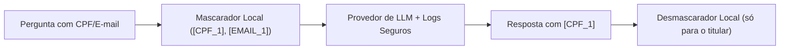

## Passo 1 · Leitura · LGPD na prática para quem constrói sistemas com LLM

Ao digitar uma dúvida num assistente da universidade, é comum que o aluno inclua seu **CPF**, **e-mail**, **telefone** ou até um atestado médico (**dado pessoal sensível** segundo o art. 5º, II da Lei Geral de Proteção de Dados — Lei nº 13.709/2018). Se a aplicação simplesmente concatenar essa mensagem e enviá-la a uma API externa (e gravá-la em arquivos de log e caches), dados pessoais terão sido compartilhados sem necessidade.



Quatro princípios da **LGPD** traduzem-se diretamente em código de engenharia de IA:

1. **Finalidade e Base Legal (arts. 6º e 7º):** todo tratamento precisa de propósito legítimo, específico e de uma base legal definida (como execução de políticas públicas/obrigações acadêmicas ou consentimento específico).
2. **Necessidade / Minimização (art. 6º, III):** coletar e transmitir apenas o estritamente necessário. O modelo de linguagem não precisa saber os 11 dígitos reais de um CPF para explicar uma regra de trancamento — aplicamos **pseudonimização/mascaramento reversível** (`[CPF_1]`, `[EMAIL_1]`) localmente **antes** de chamar o LLM ou gravar logs, restaurando o valor apenas na tela do próprio titular quando necessário.
3. **Retenção limitada e Direito de Eliminação (arts. 15, 16 e 18):** históricos, caches e memórias de longo prazo devem ter prazo máximo de retenção (`max_dias`) e atender prontamente a pedidos de exclusão do titular.
4. **Revisão de decisões automatizadas (art. 20):** o titular tem direito a solicitar a revisão de decisões tomadas unicamente com base em tratamento automatizado que afetem seus interesses (como indeferimento automático de bolsa ou matrícula).

Veja no visualizador como o mascaramento reversível substitui dados pessoais por marcadores enumerados mantendo um mapa local:

```python visualizar
import re

texto = "Meu CPF e 123.456.789-00 e meu email e aluna@usp.br."
mapa = {}
mascarado = texto

for i, cpf in enumerate(dict.fromkeys(re.findall(r"\d{3}\.\d{3}\.\d{3}-\d{2}", mascarado)), start=1):
    tag = f"[CPF_{i}]"
    mapa[tag] = cpf
    mascarado = mascarado.replace(cpf, tag)

for i, em in enumerate(dict.fromkeys(re.findall(r"[\w.+-]+@[\w-]+\.[\w.-]+", mascarado)), start=1):
    tag = f"[EMAIL_{i}]"
    mapa[tag] = em
    mascarado = mascarado.replace(em, tag)
```

## Passo 2 · Previsão · O que vai para o log e para o provedor após o mascaramento

Analise o código abaixo e determine qual será a string mascarada e quantas chaves terá o dicionário `mapa` quando o mesmo CPF aparece duas vezes na mensagem.

### Código

```python
import re

msg = "CPF 111.222.333-44 do titular e CPF 999.888.777-66 do responsavel (confirme 111.222.333-44)."
cpfs_unicos = list(dict.fromkeys(re.findall(r"\d{3}\.\d{3}\.\d{3}-\d{2}", msg)))

mapa = {}
protegida = msg
for idx, valor in enumerate(cpfs_unicos, start=1):
    marcador = f"[CPF_{idx}]"
    mapa[marcador] = valor
    protegida = protegida.replace(valor, marcador)

print("Mascarada:", protegida)
print("Chaves:", sorted(mapa.keys()))
```

### Dicas

1. `dict.fromkeys(...)` preserva a ordem da primeira aparição sem duplicatas: `['111.222.333-44', '999.888.777-66']`.
2. `protegida.replace('111.222.333-44', '[CPF_1]')` substitui as duas ocorrências do primeiro CPF pelo mesmo marcador `[CPF_1]`.

### Saída esperada

```text
Mascarada: CPF [CPF_1] do titular e CPF [CPF_2] do responsavel (confirme [CPF_1]).
Chaves: ['[CPF_1]', '[CPF_2]']
```

## Passo 3 · Exercício · Detectando CPF, e-mail e telefone

modo: lacunas

Complete `detectar_dados_pessoais(texto)` para localizar todos os CPFs, e-mails e telefones presentes em uma string, mantendo a ordem em que aparecem.

### Instruções

1. Use o padrão `r"\d{3}\.\d{3}\.\d{3}-\d{2}"` para extrair CPFs na chave `"cpf"`.
2. Use o padrão `r"[a-zA-Z0-9_.+-]+@[a-zA-Z0-9-]+\.[a-zA-Z0-9-.]+"` (sem ponto final solto usando `r"[a-zA-Z0-9_.+-]+@[a-zA-Z0-9-]+\.[a-zA-Z0-9-]+"` ou `rstrip(".")`) para e-mails na chave `"email"`.
3. Use o padrão `r"\(\d{2}\)\s?\d{4,5}-\d{4}"` para telefones na chave `"telefone"`.

### Código inicial

```python
import re


def detectar_dados_pessoais(texto):
    cpfs = re.findall(r"\d{3}\.\d{3}\.___-\d{2}", texto)
    emails = re.findall(r"[a-zA-Z0-9_.+-]+@[a-zA-Z0-9-]+\.[a-zA-Z0-9-]+", texto)
    telefones = re.findall(r"\(\d{2}\)\s?\d{4,5}-\d{4}", texto)
    return {
        "cpf": ___,
        "email": emails,
        "telefone": ___,
    }
```

### Solução

```python
import re


def detectar_dados_pessoais(texto):
    cpfs = re.findall(r"\d{3}\.\d{3}\.\d{3}-\d{2}", texto)
    emails = re.findall(r"[a-zA-Z0-9_.+-]+@[a-zA-Z0-9-]+\.[a-zA-Z0-9-]+", texto)
    telefones = re.findall(r"\(\d{2}\)\s?\d{4,5}-\d{4}", texto)
    return {
        "cpf": cpfs,
        "email": emails,
        "telefone": telefones,
    }
```

### Dicas

1. O terceiro bloco antes do hífen no CPF também possui 3 dígitos (`\d{3}`).
2. Preencha o dicionário de retorno com as variáveis `cpfs` e `telefones`.

### Verificação

```json
[
  {
    "id": "detecta-tres-tipos",
    "name": "Extrai CPF, e-mail e telefone do texto da mensagem",
    "checkpoint": 2,
    "kind": "call",
    "function": "detectar_dados_pessoais",
    "args": [
      "Aluno CPF 123.456.789-01, email joao.silva@usp.br e celular (11) 98765-4321"
    ],
    "expected": {
      "cpf": ["123.456.789-01"],
      "email": ["joao.silva@usp.br"],
      "telefone": ["(11) 98765-4321"]
    }
  }
]
```

### Soluções erradas

```python name="Captura apenas 2 dígitos no terceiro bloco do CPF"
import re


def detectar_dados_pessoais(texto):
    return {
        "cpf": re.findall(r"\d{3}\.\d{3}\.\d{2}-\d{2}", texto),
        "email": re.findall(r"[a-zA-Z0-9_.+-]+@[a-zA-Z0-9-]+\.[a-zA-Z0-9-]+", texto),
        "telefone": re.findall(r"\(\d{2}\)\s?\d{4,5}-\d{4}", texto),
    }
```

```python name="Troca as listas de cpf e telefone no dicionário retornado"
import re


def detectar_dados_pessoais(texto):
    cpfs = re.findall(r"\d{3}\.\d{3}\.\d{3}-\d{2}", texto)
    emails = re.findall(r"[a-zA-Z0-9_.+-]+@[a-zA-Z0-9-]+\.[a-zA-Z0-9-]+", texto)
    telefones = re.findall(r"\(\d{2}\)\s?\d{4,5}-\d{4}", texto)
    return {
        "cpf": telefones,
        "email": emails,
        "telefone": cpfs,
    }
```

## Passo 4 · Exercício · Mascaramento reversível (roundtrip)

Implemente `mascarar(texto)` e `desmascarar(texto_mascarado, mapa)` para substituir CPFs, e-mails e telefones por marcadores numerados antes da chamada externa e restaurá-los localmente na volta.

### Instruções

1. Em `mascarar(texto)`:
   - Detecte CPFs (`\d{3}\.\d{3}\.\d{3}-\d{2}`), e-mails (`[a-zA-Z0-9_.+-]+@[a-zA-Z0-9-]+\.[a-zA-Z0-9-]+`) e telefones (`\(\d{2}\)\s?\d{4,5}-\d{4}`).
   - Para cada categoria `(prefixo, padrao)` na ordem `("CPF", padrao_cpf)`, `("EMAIL", padrao_email)`, `("TEL", padrao_tel)`:
     - Obtenha os valores únicos na ordem de aparição (`list(dict.fromkeys(re.findall(padrao, resultado)))`).
     - Para `i, valor` começando em `1`, crie `tag = f"[{prefixo}_{i}]"`, guarde `mapa[tag] = valor` e substitua `valor` por `tag` em `resultado`.
   - Devolva a tupla `(resultado, mapa)`.
2. Em `desmascarar(texto_mascarado, mapa)`:
   - Percorra `tag, valor` em `mapa.items()` e substitua `tag` de volta por `valor`, retornando o texto restaurado.

### Código inicial

```python
import re

PADROES = [
    ("CPF", r"\d{3}\.\d{3}\.\d{3}-\d{2}"),
    ("EMAIL", r"[a-zA-Z0-9_.+-]+@[a-zA-Z0-9-]+\.[a-zA-Z0-9-]+"),
    ("TEL", r"\(\d{2}\)\s?\d{4,5}-\d{4}"),
]


def mascarar(texto):
    # Substitua cada CPF, EMAIL e TEL único por [CPF_1], [EMAIL_1], [TEL_1]... e devolva (texto_mascarado, mapa)
    pass


def desmascarar(texto_mascarado, mapa):
    # Restaure os marcadores usando o dicionário mapa
    pass
```

### Solução

```python
import re

PADROES = [
    ("CPF", r"\d{3}\.\d{3}\.\d{3}-\d{2}"),
    ("EMAIL", r"[a-zA-Z0-9_.+-]+@[a-zA-Z0-9-]+\.[a-zA-Z0-9-]+"),
    ("TEL", r"\(\d{2}\)\s?\d{4,5}-\d{4}"),
]


def mascarar(texto):
    resultado = texto
    mapa = {}
    for prefixo, padrao in PADROES:
        unicos = list(dict.fromkeys(re.findall(padrao, resultado)))
        for idx, valor in enumerate(unicos, start=1):
            tag = f"[{prefixo}_{idx}]"
            mapa[tag] = valor
            resultado = resultado.replace(valor, tag)
    return resultado, mapa


def desmascarar(texto_mascarado, mapa):
    restaurado = texto_mascarado
    for tag, valor in mapa.items():
        restaurado = restaurado.replace(tag, valor)
    return restaurado
```

### Dicas

1. Use `list(dict.fromkeys(re.findall(padrao, resultado)))` para numerar valores únicos sem criar duas tags diferentes para o mesmo CPF.
2. Em `desmascarar`, aplique `restaurado.replace(tag, valor)` para cada par de `mapa.items()`.

### Verificação

```json
[
  {
    "id": "mascarar-e-roundtrip",
    "name": "Remove todos os dados pessoais no texto mascarado e restaura exatamente no roundtrip",
    "checkpoint": 2,
    "kind": "expr",
    "setup": "original = 'CPF 111.222.333-44, email ana@usp.br, tel (11) 91234-5678 e novamente 111.222.333-44'; masc, mp = mascarar(original); rest = desmascarar(masc, mp)",
    "expr": "[masc, '111.222.333-44' in masc, 'ana@usp.br' in masc, rest == original]",
    "expected": [
      "CPF [CPF_1], email [EMAIL_1], tel [TEL_1] e novamente [CPF_1]",
      false,
      false,
      true
    ]
  }
]
```

### Soluções erradas

```python name="Usa o mesmo marcador [CPF_1] para CPFs diferentes sobrescrevendo o mapa"
import re

PADROES = [
    ("CPF", r"\d{3}\.\d{3}\.\d{3}-\d{2}"),
    ("EMAIL", r"[a-zA-Z0-9_.+-]+@[a-zA-Z0-9-]+\.[a-zA-Z0-9-]+"),
    ("TEL", r"\(\d{2}\)\s?\d{4,5}-\d{4}"),
]


def mascarar(texto):
    resultado = texto
    mapa = {}
    for prefixo, padrao in PADROES:
        for valor in re.findall(padrao, resultado):
            tag = f"[{prefixo}_1]"
            mapa[tag] = valor
            resultado = resultado.replace(valor, tag)
    return resultado, mapa


def desmascarar(texto_mascarado, mapa):
    return texto_mascarado
```

```python name="Devolve o texto original sem mascarar os dados pessoais"
def mascarar(texto):
    return texto, {}


def desmascarar(texto_mascarado, mapa):
    return texto_mascarado
```

## Passo 5 · Exercício · Política de retenção e classificação de tratamento LGPD

Implemente `aplicar_retencao(registros, max_dias, dia_atual, pedidos_exclusao)` para expurgar registros vencidos ou cuja eliminação foi solicitada pelo titular, e `auditar_tratamento(config)` para apontar pendências de conformidade com a LGPD.

### Instruções

1. Em `aplicar_retencao(registros, max_dias, dia_atual, pedidos_exclusao)`:
   - Cada item de `registros` é um dicionário `{"id_titular": str, "dia": int, "conteudo": str}` (onde `"dia"` é o dia inteiro em que foi gravado).
   - Remova qualquer registro em que `reg["id_titular"]` pertença a `pedidos_exclusao` **ou** em que `(dia_atual - reg["dia"]) > max_dias`.
   - Devolva a lista com os registros mantidos na ordem original.
2. Em `auditar_tratamento(config)`:
   - `config` é um dicionário descrevendo o sistema. Adicione à lista de pendências:
     - `"sem_base_legal"` se `not config.get("base_legal")`
     - `"sem_finalidade"` se `not config.get("finalidade")`
     - `"dados_sensiveis_sem_protecao"` se `config.get("usa_dados_sensiveis", False)` e `not config.get("protecao_especifica", False)`
     - `"log_sem_mascaramento"` se `not config.get("mascara_logs", False)`
   - Devolva a lista de pendências na ordem verificada acima.

### Código inicial

```python
def aplicar_retencao(registros, max_dias, dia_atual, pedidos_exclusao):
    # Remova registros expirados (> max_dias) ou de titulares em pedidos_exclusao
    pass


def auditar_tratamento(config):
    # Verifique base_legal, finalidade, dados sensíveis e mascaramento de logs
    pass
```

### Solução

```python
def aplicar_retencao(registros, max_dias, dia_atual, pedidos_exclusao):
    excluir = set(pedidos_exclusao)
    mantidos = []
    for reg in registros:
        if reg["id_titular"] in excluir:
            continue
        if (dia_atual - reg["dia"]) > max_dias:
            continue
        mantidos.append(reg)
    return mantidos


def auditar_tratamento(config):
    pendencias = []
    if not config.get("base_legal"):
        pendencias.append("sem_base_legal")
    if not config.get("finalidade"):
        pendencias.append("sem_finalidade")
    if config.get("usa_dados_sensiveis", False) and not config.get("protecao_especifica", False):
        pendencias.append("dados_sensiveis_sem_protecao")
    if not config.get("mascara_logs", False):
        pendencias.append("log_sem_mascaramento")
    return pendencias
```

### Dicas

1. Em `aplicar_retencao`, um registro com `dia_atual - reg["dia"] == max_dias` ainda está dentro do prazo (`<= max_dias`) e deve ser mantido, a menos que o titular esteja em `pedidos_exclusao`.
2. Em `auditar_tratamento`, quando todas as exigências são cumpridas, a lista devolvida é `[]`.

### Verificação

```json
[
  {
    "id": "retencao-e-exclusao",
    "name": "Remove registros mais antigos que max_dias e registros de titulares que pediram exclusão",
    "checkpoint": 1,
    "kind": "call",
    "function": "aplicar_retencao",
    "args": [
      [
        {"id_titular": "u1", "dia": 10, "conteudo": "antigo"},
        {"id_titular": "u2", "dia": 85, "conteudo": "pediu exclusao"},
        {"id_titular": "u3", "dia": 75, "conteudo": "valido"}
      ],
      30,
      100,
      ["u2"]
    ],
    "expected": [
      {"id_titular": "u3", "dia": 75, "conteudo": "valido"}
    ]
  },
  {
    "id": "auditoria-lgpd",
    "name": "Identifica pendências de conformidade e aprova configuração completa",
    "checkpoint": 2,
    "kind": "expr",
    "expr": "[auditar_tratamento({'base_legal': '', 'finalidade': 'atendimento', 'usa_dados_sensiveis': True, 'protecao_especifica': False, 'mascara_logs': False}), auditar_tratamento({'base_legal': 'execucao_de_politica_publica', 'finalidade': 'atendimento_academico', 'usa_dados_sensiveis': False, 'protecao_especifica': False, 'mascara_logs': True})]",
    "expected": [
      ["sem_base_legal", "dados_sensiveis_sem_protecao", "log_sem_mascaramento"],
      []
    ]
  }
]
```

### Soluções erradas

```python name="Ignora a lista pedidos_exclusao e filtra apenas pela data"
def aplicar_retencao(registros, max_dias, dia_atual, pedidos_exclusao):
    return [r for r in registros if (dia_atual - r["dia"]) <= max_dias]


def auditar_tratamento(config):
    return []
```

```python name="Aceita logs sem mascaramento e dados sensíveis desprotegidos"
def aplicar_retencao(registros, max_dias, dia_atual, pedidos_exclusao):
    excluir = set(pedidos_exclusao)
    return [r for r in registros if r["id_titular"] not in excluir and (dia_atual - r["dia"]) <= max_dias]


def auditar_tratamento(config):
    pendencias = []
    if not config.get("base_legal"):
        pendencias.append("sem_base_legal")
    if not config.get("finalidade"):
        pendencias.append("sem_finalidade")
    return pendencias
```

## Passo 6 · Quiz · LGPD, minimização e decisões automatizadas

### Pergunta

Por que o mascaramento de CPF, e-mail e telefone deve ser aplicado **antes** de enviar o prompt ao provedor externo de LLM e **antes** de gravar os logs, e não apenas na hora de exibir a resposta na tela do usuário?

- [ ] Porque marcadores como `[CPF_1]` consomem mais tokens que os números originais.
- [x] Porque mascarar apenas na interface gráfica deixa os dados pessoais expostos no tráfego enviado a terceiros, nos bancos de logs e no cache de prompts.
- [ ] Porque os provedores de LLM rejeitam números com pontos e hífens.
- [ ] Porque a função `.replace()` só funciona antes da chamada HTTP.

> Uma vez que o dado pessoal em texto claro saiu para o provedor externo ou foi persistido nos logs sem necessidade, a exposição já ocorreu; a minimização precisa acontecer na entrada do pipeline.

### Pergunta

O que assegura o artigo 20 da LGPD em relação a sistemas de IA que tomam decisões automatizadas (como classificar ou indeferir pedidos de alunos)?

- [ ] Que toda decisão tomada por inteligência artificial é irrevogável.
- [x] O direito do titular de solicitar a revisão de decisões tomadas unicamente com base em tratamento automatizado de dados pessoais que afetem seus interesses, além de informações claras sobre os critérios utilizados.
- [ ] A obrigação de publicar o código-fonte de todos os modelos sob licença MIT.
- [ ] A proibição de usar bancos de dados em território nacional.

> Sistemas que impactam direitos ou interesses de estudantes e cidadãos devem oferecer transparência sobre os critérios e canal efetivo de revisão humana.

### Pergunta

Segundo a LGPD (art. 5º, I e II), qual das opções abaixo exemplifica um **dado pessoal sensível** que exige proteção jurídica e técnica ainda mais restrita do que um dado pessoal comum?

- [ ] O código da disciplina `MAC0110`.
- [ ] O horário público de funcionamento da secretaria.
- [x] Informações referentes à saúde (como laudos e atestados médicos anexados a um pedido de trancamento), origem racial ou étnica, convicção religiosa ou dado biométrico.
- [ ] O nome público do instituto da universidade.

> Dados relativos à saúde (muito comuns em justificativas de abono ou trancamento médico) são dados pessoais sensíveis (art. 5º, II e art. 11 da LGPD) e jamais devem ser enviados indiscriminadamente a LLMs genéricos.
