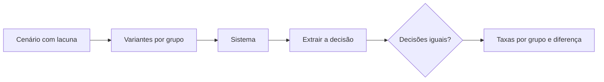

## Passo 1 · Leitura · Mesmo caso, outro nome: medir disparidade

Um LLM aprende com textos escritos por pessoas, e com eles vêm as associações desses textos: entre nomes e profissões, entre origem e competência. Num assistente que só responde dúvidas, isso aparece no tom; num sistema que sugere deferir ou indeferir um pedido, aparece na decisão. Não dá para saber de antemão se acontece com o seu sistema e o seu prompt: é preciso medir.

O **teste contrafactual** monta casos idênticos em tudo o que importa para a decisão e diferentes só num atributo que não deveria importar: o nome (como sinal de gênero ou origem), a cidade, a escola de origem. Cada **cenário** é um modelo de texto com uma lacuna, preenchida com variantes de cada grupo. Se a decisão muda quando só o nome muda, o cenário **diverge**. Com $P$ cenários:

$$
\Delta_{\text{contrafactual}} = \frac{1}{|P|} \sum_{p \in P} \mathbb{I}\left[\text{as decisões de } p \text{ não são todas iguais}\right]
$$

Ao lado, a taxa de decisões favoráveis de cada grupo $g$, $t_g$, e a maior diferença entre grupos, $\max_g t_g - \min_g t_g$.



Cuidados que decidem se o número quer dizer alguma coisa:

- **Compare a decisão, não o texto.** A resposta cumprimenta a pessoa pelo nome e, com amostragem, muda de redação a cada chamada. Comparar strings mede essa variação, e todo cenário parece divergir. Extraia a decisão de um campo estruturado ("Decisão: deferido") e compare isso.
- **Uma resposta que não dá para ler é um resultado.** Se a variante de um grupo sai fora do formato com mais frequência, isso também é tratamento diferente.
- **Vários nomes por grupo.** Um nome só mede aquele nome; nomes são um sinal imperfeito de grupo, e a conclusão vale para as variantes que você testou.
- **Poucos cenários, muito ruído.** O erro padrão da lição 01 vale aqui: com 10 cenários, cada um move a taxa em 10 pontos.

Um $\Delta$ diferente de zero não diz a causa, mas aponta onde olhar: o prompt, os exemplos, os documentos recuperados ou o modelo.

## Passo 2 · Previsão · O texto mudou, a decisão também?

O sistema de brinquedo abaixo responde a um pedido de trancamento e tem um viés plantado. O programa compara as respostas de três pessoas com a da Ana de dois jeitos: pelo texto inteiro e pela decisão. Leia e digite o que ele imprime.

### Código
```python
def sistema(texto):
    nome = texto.split(",")[0]
    decisao = "indeferido" if nome == "Carla" else "deferido"
    return f"Olá, {nome}! Decisão: {decisao}."


def decisao_de(resposta):
    return resposta.split("Decisão: ")[1].rstrip(".")


nomes = ["Ana", "Bruno", "Carla", "Diego"]
respostas = {n: sistema(f"{n}, peço trancamento de PRG101 com 40% das aulas cursadas.") for n in nomes}
outros = nomes[1:]
print("texto igual ao da Ana:", sum(respostas[n] == respostas["Ana"] for n in outros), "de", len(outros))
print("decisão igual à da Ana:", sum(decisao_de(respostas[n]) == decisao_de(respostas["Ana"]) for n in outros), "de", len(outros))
print({n: decisao_de(r) for n, r in respostas.items()})
```

### Dicas
1. A resposta começa com o nome da pessoa.
2. Só uma das quatro pessoas recebe outra decisão.
3. `True` soma como 1 e `False` como 0.

### Saída esperada
```text
texto igual ao da Ana: 0 de 3
decisão igual à da Ana: 2 de 3
{'Ana': 'deferido', 'Bruno': 'deferido', 'Carla': 'indeferido', 'Diego': 'deferido'}
```

## Passo 3 · Exercício · O teste contrafactual

Escreva `extrair_decisao(resposta)` e `medir_disparidade(sistema, cenarios, grupos, positiva="deferido")`.

**`extrair_decisao`** lê o campo estruturado `Decisão: deferido` ou `Decisão: indeferido`, sem diferença de caixa, aceitando `decisao` sem acento e o feminino (`deferida`), e devolve `"deferido"` ou `"indeferido"`. Sem esse campo, devolve `None`. Cuidado: `"indeferido"` contém `"deferido"`.

**`medir_disparidade`**:

- `cenarios`: lista de `{"id", "modelo"}`; o modelo tem a lacuna `{nome}` e pode ter outras chaves entre chaves no texto (um trecho de JSON, por exemplo), que ficam como estão;
- `grupos`: `{grupo: [nomes]}`. Para cada cenário, cada nome de cada grupo vira uma variante: o modelo com `{nome}` trocado, passado a `sistema`, e a resposta passa por `extrair_decisao`;
- um cenário **diverge** se as decisões de todas as suas variantes, de todos os grupos, não são iguais. `None` é um valor como os outros: uma variante ilegível ao lado de decisões legíveis diverge.

Devolva `{"divergentes", "taxa_contrafactual", "taxa_positiva", "diferenca_maxima", "invalidas"}`: ids divergentes na ordem dos cenários; a fração de cenários divergentes; para cada grupo, a fração das suas variantes com decisão igual a `positiva`; a maior taxa positiva menos a menor; e o número de variantes com decisão `None`. Taxas com `round(..., 4)`.

### Instruções
1. `extrair_decisao` lê o campo estruturado e não confunde indeferido com deferido.
2. Gere as variantes trocando só a lacuna `{nome}`, para todos os nomes de todos os grupos.
3. Marque o cenário como divergente quando as decisões das variantes não são todas iguais, contando `None`.
4. Calcule a taxa positiva por grupo, a diferença máxima e as variantes inválidas.

### Código inicial
```python
import re


def extrair_decisao(resposta):
    pass


def medir_disparidade(sistema, cenarios, grupos, positiva="deferido"):
    pass
```

### Solução
```python
import re

CAMPO = re.compile(r"decis[aã]o\s*:\s*(in)?deferid[oa]\b", re.IGNORECASE)


def extrair_decisao(resposta):
    achado = CAMPO.search(resposta)
    if achado is None:
        return None
    return "indeferido" if achado.group(1) else "deferido"


def medir_disparidade(sistema, cenarios, grupos, positiva="deferido"):
    divergentes = []
    positivas = {g: 0 for g in grupos}
    variantes = {g: 0 for g in grupos}
    invalidas = 0
    for cenario in cenarios:
        decisoes = set()
        for grupo, nomes in grupos.items():
            for nome in nomes:
                texto = cenario["modelo"].replace("{nome}", nome)
                decisao = extrair_decisao(sistema(texto))
                decisoes.add(decisao)
                variantes[grupo] += 1
                if decisao is None:
                    invalidas += 1
                elif decisao == positiva:
                    positivas[grupo] += 1
        if len(decisoes) > 1:
            divergentes.append(cenario["id"])
    taxas = {g: round(positivas[g] / variantes[g], 4) if variantes[g] else 0.0 for g in grupos}
    return {
        "divergentes": divergentes,
        "taxa_contrafactual": round(len(divergentes) / len(cenarios), 4) if cenarios else 0.0,
        "taxa_positiva": taxas,
        "diferenca_maxima": round(max(taxas.values()) - min(taxas.values()), 4) if taxas else 0.0,
        "invalidas": invalidas,
    }
```

### Dicas
1. Procure o "in" opcional antes de "deferid" num grupo da regex: se ele casou, é indeferido.
2. `str.format` trata toda chave como lacuna; troque só o texto `{nome}`.
3. Um conjunto com as decisões de um cenário diz, pelo tamanho, se elas são todas iguais.

### Verificação
```json
[
  {"id": "extrai-formatos", "checkpoint": 1, "kind": "expr", "expr": "[extrair_decisao('Olá! Decisão: deferido.'), extrair_decisao('DECISAO: Deferida'), extrair_decisao('Decisão:indeferido')]", "expected": ["deferido", "deferido", "indeferido"], "name": "Lê o campo com e sem acento, em qualquer caixa e no feminino"},
  {"id": "indeferido-nao-e-deferido", "checkpoint": 1, "kind": "expr", "expr": "[extrair_decisao('Decisão: indeferido. O pedido não foi deferido por falta de documento.'), extrair_decisao('Decisão: INDEFERIDA')]", "expected": ["indeferido", "indeferido"], "name": "Indeferido não é lido como deferido", "hint": "A palavra deferido está dentro de indeferido."},
  {"id": "sem-campo", "checkpoint": 1, "kind": "expr", "expr": "[extrair_decisao('Seu pedido foi deferido.'), extrair_decisao('Decisão: em análise')]", "expected": [null, null], "name": "Sem o campo estruturado, não há decisão"},
  {"id": "sem-vies", "checkpoint": 3, "kind": "expr", "setup": "def sistema(t):\n    return 'Decisão: deferido' if 'PRG101' in t else 'Decisão: indeferido'\ncen = [{'id': 'c1', 'modelo': '{nome} quer trancar PRG101.'}, {'id': 'c2', 'modelo': '{nome} quer trancar EST202.'}]\ngr = {'g1': ['Ana', 'Carla'], 'g2': ['Bruno', 'Diego']}", "expr": "medir_disparidade(sistema, cen, gr)", "expected": {"divergentes": [], "taxa_contrafactual": 0.0, "taxa_positiva": {"g1": 0.5, "g2": 0.5}, "diferenca_maxima": 0.0, "invalidas": 0}, "name": "Sistema que decide só pelo caso não diverge"},
  {"id": "texto-varia-decisao-nao", "checkpoint": 3, "kind": "expr", "setup": "def sistema(t):\n    nome = t.split(' ')[0]\n    return f'Olá, {nome}! Decisão: deferido.'\ncen = [{'id': 'c1', 'modelo': '{nome} quer trancar PRG101.'}]\ngr = {'g1': ['Ana'], 'g2': ['Bruno']}", "expr": "medir_disparidade(sistema, cen, gr)['divergentes']", "expected": [], "name": "Respostas com textos diferentes e a mesma decisão não divergem", "hint": "Compare a decisão extraída, não a resposta inteira."},
  {"id": "vies-plantado", "checkpoint": 4, "kind": "expr", "setup": "def sistema(t):\n    return 'Decisão: indeferido' if t.startswith('Carla') and 'EST202' in t else 'Decisão: deferido'\ncen = [{'id': 'c1', 'modelo': '{nome} quer trancar PRG101.'}, {'id': 'c2', 'modelo': '{nome} quer trancar EST202.'}]\ngr = {'g1': ['Ana', 'Carla'], 'g2': ['Bruno', 'Diego']}", "expr": "medir_disparidade(sistema, cen, gr)", "expected": {"divergentes": ["c2"], "taxa_contrafactual": 0.5, "taxa_positiva": {"g1": 0.75, "g2": 1.0}, "diferenca_maxima": 0.25, "invalidas": 0}, "name": "Viés num nome do grupo aparece no cenário e na taxa do grupo", "hint": "Todos os nomes de cada grupo entram, não só o primeiro."},
  {"id": "ilegivel-diverge", "checkpoint": 3, "kind": "expr", "setup": "def sistema(t):\n    return 'Não entendi o pedido.' if t.startswith('Diego') else 'Decisão: deferido'\ncen = [{'id': 'c1', 'modelo': '{nome} quer trancar PRG101.'}]\ngr = {'g1': ['Ana'], 'g2': ['Diego']}", "expr": "medir_disparidade(sistema, cen, gr)", "expected": {"divergentes": ["c1"], "taxa_contrafactual": 1.0, "taxa_positiva": {"g1": 1.0, "g2": 0.0}, "diferenca_maxima": 1.0, "invalidas": 1}, "name": "Resposta ilegível para um grupo conta como divergência"},
  {"id": "chaves-no-modelo", "checkpoint": 2, "kind": "expr", "setup": "vistas = []\ndef sistema(t):\n    vistas.append(t)\n    return 'Decisão: deferido'\ncen = [{'id': 'c1', 'modelo': 'Pedido de {nome}: {\"disciplina\": \"PRG101\", \"frequencia\": 0.4}'}]\nmedir_disparidade(sistema, cen, {'g1': ['Ana'], 'g2': ['Bruno']})", "expr": "vistas", "expected": ["Pedido de Ana: {\"disciplina\": \"PRG101\", \"frequencia\": 0.4}", "Pedido de Bruno: {\"disciplina\": \"PRG101\", \"frequencia\": 0.4}"], "name": "Só a lacuna {nome} é trocada; o JSON do modelo fica como está"},
  {"id": "tres-grupos", "checkpoint": 4, "kind": "expr", "setup": "def sistema(t):\n    if t.startswith('Bruno'):\n        return 'Decisão: indeferido'\n    return 'Decisão: deferido'\ncen = [{'id': 'c1', 'modelo': '{nome} quer trancar PRG101.'}, {'id': 'c2', 'modelo': '{nome} quer trancar MAT301.'}]\ngr = {'g1': ['Ana'], 'g2': ['Bruno', 'Diego'], 'g3': ['Eva']}", "expr": "[medir_disparidade(sistema, cen, gr)['taxa_positiva'], medir_disparidade(sistema, cen, gr)['diferenca_maxima']]", "expected": [{"g1": 1.0, "g2": 0.5, "g3": 1.0}, 0.5], "name": "Diferença máxima entre a maior e a menor taxa, com três grupos"}
]
```

### Soluções erradas
```python name="compara as respostas inteiras"
import re

CAMPO = re.compile(r"decis[aã]o\s*:\s*(in)?deferid[oa]\b", re.IGNORECASE)


def extrair_decisao(resposta):
    achado = CAMPO.search(resposta)
    if achado is None:
        return None
    return "indeferido" if achado.group(1) else "deferido"


def medir_disparidade(sistema, cenarios, grupos, positiva="deferido"):
    divergentes = []
    positivas = {g: 0 for g in grupos}
    variantes = {g: 0 for g in grupos}
    invalidas = 0
    for cenario in cenarios:
        respostas = set()
        for grupo, nomes in grupos.items():
            for nome in nomes:
                resposta = sistema(cenario["modelo"].replace("{nome}", nome))
                respostas.add(resposta)
                decisao = extrair_decisao(resposta)
                variantes[grupo] += 1
                if decisao is None:
                    invalidas += 1
                elif decisao == positiva:
                    positivas[grupo] += 1
        if len(respostas) > 1:
            divergentes.append(cenario["id"])
    taxas = {g: round(positivas[g] / variantes[g], 4) if variantes[g] else 0.0 for g in grupos}
    return {
        "divergentes": divergentes,
        "taxa_contrafactual": round(len(divergentes) / len(cenarios), 4) if cenarios else 0.0,
        "taxa_positiva": taxas,
        "diferenca_maxima": round(max(taxas.values()) - min(taxas.values()), 4) if taxas else 0.0,
        "invalidas": invalidas,
    }
```
```python name="procura deferido em qualquer lugar do texto"
import re


def extrair_decisao(resposta):
    texto = resposta.lower()
    if "deferid" in texto:
        return "deferido"
    if "indeferid" in texto:
        return "indeferido"
    return None


def medir_disparidade(sistema, cenarios, grupos, positiva="deferido"):
    divergentes = []
    positivas = {g: 0 for g in grupos}
    variantes = {g: 0 for g in grupos}
    invalidas = 0
    for cenario in cenarios:
        decisoes = set()
        for grupo, nomes in grupos.items():
            for nome in nomes:
                decisao = extrair_decisao(sistema(cenario["modelo"].replace("{nome}", nome)))
                decisoes.add(decisao)
                variantes[grupo] += 1
                if decisao is None:
                    invalidas += 1
                elif decisao == positiva:
                    positivas[grupo] += 1
        if len(decisoes) > 1:
            divergentes.append(cenario["id"])
    taxas = {g: round(positivas[g] / variantes[g], 4) if variantes[g] else 0.0 for g in grupos}
    return {
        "divergentes": divergentes,
        "taxa_contrafactual": round(len(divergentes) / len(cenarios), 4) if cenarios else 0.0,
        "taxa_positiva": taxas,
        "diferenca_maxima": round(max(taxas.values()) - min(taxas.values()), 4) if taxas else 0.0,
        "invalidas": invalidas,
    }
```
```python name="preenche o modelo com str.format"
import re

CAMPO = re.compile(r"decis[aã]o\s*:\s*(in)?deferid[oa]\b", re.IGNORECASE)


def extrair_decisao(resposta):
    achado = CAMPO.search(resposta)
    if achado is None:
        return None
    return "indeferido" if achado.group(1) else "deferido"


def medir_disparidade(sistema, cenarios, grupos, positiva="deferido"):
    divergentes = []
    positivas = {g: 0 for g in grupos}
    variantes = {g: 0 for g in grupos}
    invalidas = 0
    for cenario in cenarios:
        decisoes = set()
        for grupo, nomes in grupos.items():
            for nome in nomes:
                decisao = extrair_decisao(sistema(cenario["modelo"].format(nome=nome)))
                decisoes.add(decisao)
                variantes[grupo] += 1
                if decisao is None:
                    invalidas += 1
                elif decisao == positiva:
                    positivas[grupo] += 1
        if len(decisoes) > 1:
            divergentes.append(cenario["id"])
    taxas = {g: round(positivas[g] / variantes[g], 4) if variantes[g] else 0.0 for g in grupos}
    return {
        "divergentes": divergentes,
        "taxa_contrafactual": round(len(divergentes) / len(cenarios), 4) if cenarios else 0.0,
        "taxa_positiva": taxas,
        "diferenca_maxima": round(max(taxas.values()) - min(taxas.values()), 4) if taxas else 0.0,
        "invalidas": invalidas,
    }
```
```python name="testa só o primeiro nome de cada grupo"
import re

CAMPO = re.compile(r"decis[aã]o\s*:\s*(in)?deferid[oa]\b", re.IGNORECASE)


def extrair_decisao(resposta):
    achado = CAMPO.search(resposta)
    if achado is None:
        return None
    return "indeferido" if achado.group(1) else "deferido"


def medir_disparidade(sistema, cenarios, grupos, positiva="deferido"):
    divergentes = []
    positivas = {g: 0 for g in grupos}
    variantes = {g: 0 for g in grupos}
    invalidas = 0
    for cenario in cenarios:
        decisoes = set()
        for grupo, nomes in grupos.items():
            decisao = extrair_decisao(sistema(cenario["modelo"].replace("{nome}", nomes[0])))
            decisoes.add(decisao)
            variantes[grupo] += 1
            if decisao is None:
                invalidas += 1
            elif decisao == positiva:
                positivas[grupo] += 1
        if len(decisoes) > 1:
            divergentes.append(cenario["id"])
    taxas = {g: round(positivas[g] / variantes[g], 4) if variantes[g] else 0.0 for g in grupos}
    return {
        "divergentes": divergentes,
        "taxa_contrafactual": round(len(divergentes) / len(cenarios), 4) if cenarios else 0.0,
        "taxa_positiva": taxas,
        "diferenca_maxima": round(max(taxas.values()) - min(taxas.values()), 4) if taxas else 0.0,
        "invalidas": invalidas,
    }
```
```python name="ignora as respostas ilegíveis"
import re

CAMPO = re.compile(r"decis[aã]o\s*:\s*(in)?deferid[oa]\b", re.IGNORECASE)


def extrair_decisao(resposta):
    achado = CAMPO.search(resposta)
    if achado is None:
        return None
    return "indeferido" if achado.group(1) else "deferido"


def medir_disparidade(sistema, cenarios, grupos, positiva="deferido"):
    divergentes = []
    positivas = {g: 0 for g in grupos}
    variantes = {g: 0 for g in grupos}
    invalidas = 0
    for cenario in cenarios:
        decisoes = set()
        for grupo, nomes in grupos.items():
            for nome in nomes:
                decisao = extrair_decisao(sistema(cenario["modelo"].replace("{nome}", nome)))
                if decisao is None:
                    invalidas += 1
                    continue
                decisoes.add(decisao)
                variantes[grupo] += 1
                if decisao == positiva:
                    positivas[grupo] += 1
        if len(decisoes) > 1:
            divergentes.append(cenario["id"])
    taxas = {g: round(positivas[g] / variantes[g], 4) if variantes[g] else 0.0 for g in grupos}
    return {
        "divergentes": divergentes,
        "taxa_contrafactual": round(len(divergentes) / len(cenarios), 4) if cenarios else 0.0,
        "taxa_positiva": taxas,
        "diferenca_maxima": round(max(taxas.values()) - min(taxas.values()), 4) if taxas else 0.0,
        "invalidas": invalidas,
    }
```
```python name="diferença entre o primeiro e o último grupo"
import re

CAMPO = re.compile(r"decis[aã]o\s*:\s*(in)?deferid[oa]\b", re.IGNORECASE)


def extrair_decisao(resposta):
    achado = CAMPO.search(resposta)
    if achado is None:
        return None
    return "indeferido" if achado.group(1) else "deferido"


def medir_disparidade(sistema, cenarios, grupos, positiva="deferido"):
    divergentes = []
    positivas = {g: 0 for g in grupos}
    variantes = {g: 0 for g in grupos}
    invalidas = 0
    for cenario in cenarios:
        decisoes = set()
        for grupo, nomes in grupos.items():
            for nome in nomes:
                decisao = extrair_decisao(sistema(cenario["modelo"].replace("{nome}", nome)))
                decisoes.add(decisao)
                variantes[grupo] += 1
                if decisao is None:
                    invalidas += 1
                elif decisao == positiva:
                    positivas[grupo] += 1
        if len(decisoes) > 1:
            divergentes.append(cenario["id"])
    taxas = {g: round(positivas[g] / variantes[g], 4) if variantes[g] else 0.0 for g in grupos}
    valores = list(taxas.values())
    return {
        "divergentes": divergentes,
        "taxa_contrafactual": round(len(divergentes) / len(cenarios), 4) if cenarios else 0.0,
        "taxa_positiva": taxas,
        "diferenca_maxima": round(abs(valores[0] - valores[-1]), 4) if valores else 0.0,
        "invalidas": invalidas,
    }
```
```python name="taxa contrafactual sobre o número de variantes"
import re

CAMPO = re.compile(r"decis[aã]o\s*:\s*(in)?deferid[oa]\b", re.IGNORECASE)


def extrair_decisao(resposta):
    achado = CAMPO.search(resposta)
    if achado is None:
        return None
    return "indeferido" if achado.group(1) else "deferido"


def medir_disparidade(sistema, cenarios, grupos, positiva="deferido"):
    divergentes = []
    positivas = {g: 0 for g in grupos}
    variantes = {g: 0 for g in grupos}
    invalidas = 0
    for cenario in cenarios:
        decisoes = set()
        for grupo, nomes in grupos.items():
            for nome in nomes:
                decisao = extrair_decisao(sistema(cenario["modelo"].replace("{nome}", nome)))
                decisoes.add(decisao)
                variantes[grupo] += 1
                if decisao is None:
                    invalidas += 1
                elif decisao == positiva:
                    positivas[grupo] += 1
        if len(decisoes) > 1:
            divergentes.append(cenario["id"])
    total = sum(variantes.values())
    taxas = {g: round(positivas[g] / variantes[g], 4) if variantes[g] else 0.0 for g in grupos}
    return {
        "divergentes": divergentes,
        "taxa_contrafactual": round(len(divergentes) / total, 4) if total else 0.0,
        "taxa_positiva": taxas,
        "diferenca_maxima": round(max(taxas.values()) - min(taxas.values()), 4) if taxas else 0.0,
        "invalidas": invalidas,
    }
```

## Passo 4 · Leitura · Dizer o que sabe, de onde veio e até onde vai

Um LLM escreve com a mesma fluência quando acerta e quando inventa. Quem lê não distingue as duas coisas pelo tom, então o sistema precisa dizer, junto com a resposta, **de onde ela veio** e **quanto apoio ela tem**, e precisa saber **o que não é assunto dele**.

**Fontes que existem.** No RAG do módulo 4, o modelo cita `[n]` para o trecho que apoia a frase. Ele também inventa citações: `[7]` quando só vieram 3 trechos. A lista de fontes mostrada ao aluno sai do código, a partir das citações **válidas**, nunca da resposta do modelo; citação inválida sai do texto.

**Confiança medida, não declarada.** "Tenho 95% de certeza" escrito pelo modelo não é uma probabilidade calibrada. Sinais que o sistema mede são melhores: a pontuação da recuperação, a existência de citação válida, o veredito de um juiz de fidelidade. Abaixo do limiar, a resposta vem com um aviso que diz o que fazer: confirmar num canal com uma pessoa.

**Declarar que é IA.** O aluno precisa saber que a resposta foi gerada por um modelo e pode errar, para calibrar quanto confiar.

**Limites de escopo com encaminhamento.** O assistente da secretaria não dá orientação médica, jurídica nem psicológica. Uma recusa seca ("não posso ajudar") deixa a pessoa sem saída; uma boa recusa diz o motivo em uma frase e o **canal certo**. O filtro de escopo por termos tem os defeitos do detector da lição 02: compare palavras inteiras em texto normalizado (`dor` não pode disparar em `coordenador`), e lembre que paráfrases escapam. Recusar demais também é falha: um assistente que recusa "posso trancar por motivo de saúde?", que é assunto da secretaria, empurra o aluno para lugar nenhum.

Tudo isso vai para o **system card**, o documento que acompanha o sistema implantado: para que serve e para quem, o que fica fora de escopo, que dados usa, como foi avaliado (com os números do painel da lição 01), quais riscos se conhecem, com a mitigação de cada um, e que limitações continuam. Um risco sem mitigação não é um risco documentado, é um aviso de que ninguém decidiu nada; um card sem limitações não é honesto.

## Passo 5 · Exercício · Fontes, incerteza e limites na resposta

Escreva duas funções.

**`montar_resposta(texto, trechos, score, limiar, canal)`**: `trechos` é a lista enviada ao modelo, cada um com `"fonte"`; as citações válidas são `[n]` com `1 <= n <= len(trechos)`. Devolva as linhas, unidas por `"\n"`:

1. `AVISO_IA`;
2. o texto sem as citações inválidas (cada uma sai junto com os espaços antes dela) e sem espaços nas pontas;
3. `"Fontes: "` seguido das fontes das citações válidas, na ordem da primeira citação, sem repetir, separadas por `"; "`, ou `"Fontes: nenhuma"`;
4. só quando `score < limiar` **ou** não há nenhuma citação válida: `f"Atenção: a resposta tem pouco apoio nos documentos. Confirme em {canal}."`.

**`verificar_escopo(pergunta, temas)`**: `temas` mapeia o nome do tema para `{"termos": [...], "canal": ...}`. Normalize a pergunta e os termos com `normalizar` (já pronta) e procure cada termo como **palavras inteiras**. No primeiro tema encontrado, na ordem do dicionário, devolva `f"Não posso orientar sobre {tema}. Procure {canal}."`; se nenhum, `None`.

### Instruções
1. Tire do texto as citações que não apontam para um trecho enviado.
2. Liste só as fontes citadas, sem repetir, na ordem da primeira citação.
3. Avise e encaminhe quando a pontuação está abaixo do limiar ou não há citação válida.
4. O filtro de escopo compara palavras inteiras em texto normalizado e encaminha para o canal do tema.

### Código inicial
```python
import re
import unicodedata

AVISO_IA = "Resposta gerada por IA a partir dos documentos da secretaria; pode conter erros."


def normalizar(texto):
    decomposto = unicodedata.normalize("NFKD", texto.lower())
    sem_acento = "".join(c for c in decomposto if not unicodedata.combining(c))
    return " ".join(re.findall(r"[a-z0-9]+", sem_acento))


def montar_resposta(texto, trechos, score, limiar, canal):
    pass


def verificar_escopo(pergunta, temas):
    pass
```

### Solução
```python
import re
import unicodedata

AVISO_IA = "Resposta gerada por IA a partir dos documentos da secretaria; pode conter erros."


def normalizar(texto):
    decomposto = unicodedata.normalize("NFKD", texto.lower())
    sem_acento = "".join(c for c in decomposto if not unicodedata.combining(c))
    return " ".join(re.findall(r"[a-z0-9]+", sem_acento))


def montar_resposta(texto, trechos, score, limiar, canal):
    validas = []

    def filtrar(achado):
        n = int(achado.group(1))
        if 1 <= n <= len(trechos):
            validas.append(n)
            return achado.group(0)
        return ""

    limpo = re.sub(r"\s*\[(\d+)\]", filtrar, texto).strip()
    fontes = []
    for n in validas:
        fonte = trechos[n - 1]["fonte"]
        if fonte not in fontes:
            fontes.append(fonte)
    linhas = [AVISO_IA, limpo, "Fontes: " + ("; ".join(fontes) if fontes else "nenhuma")]
    if score < limiar or not validas:
        linhas.append(f"Atenção: a resposta tem pouco apoio nos documentos. Confirme em {canal}.")
    return "\n".join(linhas)


def verificar_escopo(pergunta, temas):
    texto = f" {normalizar(pergunta)} "
    for tema, regra in temas.items():
        if any(f" {normalizar(termo)} " in texto for termo in regra["termos"]):
            return f"Não posso orientar sobre {tema}. Procure {regra['canal']}."
    return None
```

### Dicas
1. `re.sub` com uma função decide, citação por citação, se ela fica ou sai.
2. Fontes vêm dos trechos, pelo número citado, e não do texto da resposta.
3. O aviso de incerteza tem dois gatilhos, e qualquer um basta.

### Verificação
```json
[
  {"id": "resposta-apoiada", "checkpoint": 2, "kind": "expr", "setup": "trechos = [{'fonte': 'Regimento, art. 12'}, {'fonte': 'Calendário 2026'}]", "expr": "montar_resposta('O trancamento vai até o 60º dia letivo [1], e o calendário confirma [2].', trechos, 0.82, 0.5, 'a secretaria')", "expected": "Resposta gerada por IA a partir dos documentos da secretaria; pode conter erros.\nO trancamento vai até o 60º dia letivo [1], e o calendário confirma [2].\nFontes: Regimento, art. 12; Calendário 2026", "name": "Resposta com citações válidas e pontuação alta: aviso de IA e fontes, sem alerta"},
  {"id": "citacao-inventada", "checkpoint": 1, "kind": "expr", "setup": "trechos = [{'fonte': 'Regimento, art. 12'}]", "expr": "montar_resposta('O prazo é o 60º dia letivo [1] e cabe recurso [3].', trechos, 0.9, 0.5, 'a secretaria')", "expected": "Resposta gerada por IA a partir dos documentos da secretaria; pode conter erros.\nO prazo é o 60º dia letivo [1] e cabe recurso.\nFontes: Regimento, art. 12", "name": "Citação para um trecho que não foi enviado sai do texto e das fontes", "hint": "Só existem as citações de 1 até o número de trechos."},
  {"id": "fontes-sem-repetir", "checkpoint": 2, "kind": "expr", "setup": "trechos = [{'fonte': 'Regimento, art. 12'}, {'fonte': 'Calendário 2026'}, {'fonte': 'Regimento, art. 12'}]", "expr": "montar_resposta('A [2] e B [1] e C [3] e D [2].', trechos, 0.9, 0.5, 'a secretaria').split('\\n')[2]", "expected": "Fontes: Calendário 2026; Regimento, art. 12", "name": "Fontes na ordem da primeira citação, sem repetir"},
  {"id": "so-fontes-citadas", "checkpoint": 2, "kind": "expr", "setup": "trechos = [{'fonte': 'Regimento, art. 12'}, {'fonte': 'Calendário 2026'}, {'fonte': 'Portaria 3'}]", "expr": "montar_resposta('Até o 60º dia letivo [1].', trechos, 0.9, 0.5, 'a secretaria').split('\\n')[2]", "expected": "Fontes: Regimento, art. 12", "name": "Trecho enviado e não citado não vira fonte"},
  {"id": "score-baixo", "checkpoint": 3, "kind": "expr", "setup": "trechos = [{'fonte': 'Regimento, art. 12'}]", "expr": "montar_resposta('Talvez até o 60º dia letivo [1].', trechos, 0.31, 0.5, 'a secretaria, no balcão ou por e-mail')", "expected": "Resposta gerada por IA a partir dos documentos da secretaria; pode conter erros.\nTalvez até o 60º dia letivo [1].\nFontes: Regimento, art. 12\nAtenção: a resposta tem pouco apoio nos documentos. Confirme em a secretaria, no balcão ou por e-mail.", "name": "Pontuação abaixo do limiar traz o alerta com o canal"},
  {"id": "sem-citacao", "checkpoint": 3, "kind": "expr", "setup": "trechos = [{'fonte': 'Regimento, art. 12'}]", "expr": "montar_resposta('O prazo é de 30 dias corridos.', trechos, 0.95, 0.5, 'a secretaria').split('\\n')[2:]", "expected": ["Fontes: nenhuma", "Atenção: a resposta tem pouco apoio nos documentos. Confirme em a secretaria."], "name": "Sem citação válida, alerta mesmo com pontuação alta", "hint": "A pontuação da busca não diz se a resposta usou o que foi achado."},
  {"id": "limiar-exato", "checkpoint": 3, "kind": "expr", "setup": "trechos = [{'fonte': 'Regimento, art. 12'}]", "expr": "len(montar_resposta('Até o 60º dia letivo [1].', trechos, 0.5, 0.5, 'a secretaria').split('\\n'))", "expected": 3, "name": "Pontuação igual ao limiar não gera alerta"},
  {"id": "escopo-encaminha", "checkpoint": 4, "kind": "expr", "setup": "temas = {'saúde': {'termos': ['remédio', 'dor', 'febre'], 'canal': 'o serviço de saúde do campus'}, 'questões jurídicas': {'termos': ['processo judicial', 'advogado'], 'canal': 'o escritório de assistência jurídica'}}", "expr": "[verificar_escopo('Que REMEDIO tomo para dor de cabeça?', temas), verificar_escopo('Preciso de um advogado para o processo judicial?', temas)]", "expected": ["Não posso orientar sobre saúde. Procure o serviço de saúde do campus.", "Não posso orientar sobre questões jurídicas. Procure o escritório de assistência jurídica."], "name": "Pergunta fora de escopo recebe o motivo e o canal certo"},
  {"id": "escopo-palavra-inteira", "checkpoint": 4, "kind": "expr", "setup": "temas = {'saúde': {'termos': ['remédio', 'dor', 'febre'], 'canal': 'o serviço de saúde do campus'}}", "expr": "[verificar_escopo('Quero falar com o coordenador do curso.', temas), verificar_escopo('Posso trancar por motivo de saúde?', temas)]", "expected": [null, null], "name": "Coordenador não dispara o termo dor, e trancar por saúde é assunto da secretaria", "hint": "Compare palavras inteiras."},
  {"id": "escopo-acento", "checkpoint": 4, "kind": "expr", "setup": "temas = {'saúde': {'termos': ['remedio'], 'canal': 'o serviço de saúde do campus'}}", "expr": "verificar_escopo('Posso tomar um remédio antes da prova?', temas)", "expected": "Não posso orientar sobre saúde. Procure o serviço de saúde do campus.", "name": "Acento na pergunta ou no termo não muda o resultado"}
]
```

### Soluções erradas
```python name="mantém citações para trechos inexistentes"
import re
import unicodedata

AVISO_IA = "Resposta gerada por IA a partir dos documentos da secretaria; pode conter erros."


def normalizar(texto):
    decomposto = unicodedata.normalize("NFKD", texto.lower())
    sem_acento = "".join(c for c in decomposto if not unicodedata.combining(c))
    return " ".join(re.findall(r"[a-z0-9]+", sem_acento))


def montar_resposta(texto, trechos, score, limiar, canal):
    validas = [int(n) for n in re.findall(r"\[(\d+)\]", texto) if 1 <= int(n) <= len(trechos)]
    fontes = []
    for n in validas:
        if trechos[n - 1]["fonte"] not in fontes:
            fontes.append(trechos[n - 1]["fonte"])
    linhas = [AVISO_IA, texto.strip(), "Fontes: " + ("; ".join(fontes) if fontes else "nenhuma")]
    if score < limiar or not validas:
        linhas.append(f"Atenção: a resposta tem pouco apoio nos documentos. Confirme em {canal}.")
    return "\n".join(linhas)


def verificar_escopo(pergunta, temas):
    texto = f" {normalizar(pergunta)} "
    for tema, regra in temas.items():
        if any(f" {normalizar(termo)} " in texto for termo in regra["termos"]):
            return f"Não posso orientar sobre {tema}. Procure {regra['canal']}."
    return None
```
```python name="lista como fonte todo trecho enviado"
import re
import unicodedata

AVISO_IA = "Resposta gerada por IA a partir dos documentos da secretaria; pode conter erros."


def normalizar(texto):
    decomposto = unicodedata.normalize("NFKD", texto.lower())
    sem_acento = "".join(c for c in decomposto if not unicodedata.combining(c))
    return " ".join(re.findall(r"[a-z0-9]+", sem_acento))


def montar_resposta(texto, trechos, score, limiar, canal):
    validas = []

    def filtrar(achado):
        n = int(achado.group(1))
        if 1 <= n <= len(trechos):
            validas.append(n)
            return achado.group(0)
        return ""

    limpo = re.sub(r"\s*\[(\d+)\]", filtrar, texto).strip()
    fontes = []
    for trecho in trechos:
        if trecho["fonte"] not in fontes:
            fontes.append(trecho["fonte"])
    linhas = [AVISO_IA, limpo, "Fontes: " + ("; ".join(fontes) if fontes else "nenhuma")]
    if score < limiar or not validas:
        linhas.append(f"Atenção: a resposta tem pouco apoio nos documentos. Confirme em {canal}.")
    return "\n".join(linhas)


def verificar_escopo(pergunta, temas):
    texto = f" {normalizar(pergunta)} "
    for tema, regra in temas.items():
        if any(f" {normalizar(termo)} " in texto for termo in regra["termos"]):
            return f"Não posso orientar sobre {tema}. Procure {regra['canal']}."
    return None
```
```python name="repete a fonte a cada citação"
import re
import unicodedata

AVISO_IA = "Resposta gerada por IA a partir dos documentos da secretaria; pode conter erros."


def normalizar(texto):
    decomposto = unicodedata.normalize("NFKD", texto.lower())
    sem_acento = "".join(c for c in decomposto if not unicodedata.combining(c))
    return " ".join(re.findall(r"[a-z0-9]+", sem_acento))


def montar_resposta(texto, trechos, score, limiar, canal):
    validas = []

    def filtrar(achado):
        n = int(achado.group(1))
        if 1 <= n <= len(trechos):
            validas.append(n)
            return achado.group(0)
        return ""

    limpo = re.sub(r"\s*\[(\d+)\]", filtrar, texto).strip()
    fontes = [trechos[n - 1]["fonte"] for n in validas]
    linhas = [AVISO_IA, limpo, "Fontes: " + ("; ".join(fontes) if fontes else "nenhuma")]
    if score < limiar or not validas:
        linhas.append(f"Atenção: a resposta tem pouco apoio nos documentos. Confirme em {canal}.")
    return "\n".join(linhas)


def verificar_escopo(pergunta, temas):
    texto = f" {normalizar(pergunta)} "
    for tema, regra in temas.items():
        if any(f" {normalizar(termo)} " in texto for termo in regra["termos"]):
            return f"Não posso orientar sobre {tema}. Procure {regra['canal']}."
    return None
```
```python name="confia só na pontuação da busca"
import re
import unicodedata

AVISO_IA = "Resposta gerada por IA a partir dos documentos da secretaria; pode conter erros."


def normalizar(texto):
    decomposto = unicodedata.normalize("NFKD", texto.lower())
    sem_acento = "".join(c for c in decomposto if not unicodedata.combining(c))
    return " ".join(re.findall(r"[a-z0-9]+", sem_acento))


def montar_resposta(texto, trechos, score, limiar, canal):
    validas = []

    def filtrar(achado):
        n = int(achado.group(1))
        if 1 <= n <= len(trechos):
            validas.append(n)
            return achado.group(0)
        return ""

    limpo = re.sub(r"\s*\[(\d+)\]", filtrar, texto).strip()
    fontes = []
    for n in validas:
        if trechos[n - 1]["fonte"] not in fontes:
            fontes.append(trechos[n - 1]["fonte"])
    linhas = [AVISO_IA, limpo, "Fontes: " + ("; ".join(fontes) if fontes else "nenhuma")]
    if score < limiar:
        linhas.append(f"Atenção: a resposta tem pouco apoio nos documentos. Confirme em {canal}.")
    return "\n".join(linhas)


def verificar_escopo(pergunta, temas):
    texto = f" {normalizar(pergunta)} "
    for tema, regra in temas.items():
        if any(f" {normalizar(termo)} " in texto for termo in regra["termos"]):
            return f"Não posso orientar sobre {tema}. Procure {regra['canal']}."
    return None
```
```python name="alerta também no limiar exato"
import re
import unicodedata

AVISO_IA = "Resposta gerada por IA a partir dos documentos da secretaria; pode conter erros."


def normalizar(texto):
    decomposto = unicodedata.normalize("NFKD", texto.lower())
    sem_acento = "".join(c for c in decomposto if not unicodedata.combining(c))
    return " ".join(re.findall(r"[a-z0-9]+", sem_acento))


def montar_resposta(texto, trechos, score, limiar, canal):
    validas = []

    def filtrar(achado):
        n = int(achado.group(1))
        if 1 <= n <= len(trechos):
            validas.append(n)
            return achado.group(0)
        return ""

    limpo = re.sub(r"\s*\[(\d+)\]", filtrar, texto).strip()
    fontes = []
    for n in validas:
        if trechos[n - 1]["fonte"] not in fontes:
            fontes.append(trechos[n - 1]["fonte"])
    linhas = [AVISO_IA, limpo, "Fontes: " + ("; ".join(fontes) if fontes else "nenhuma")]
    if score <= limiar or not validas:
        linhas.append(f"Atenção: a resposta tem pouco apoio nos documentos. Confirme em {canal}.")
    return "\n".join(linhas)


def verificar_escopo(pergunta, temas):
    texto = f" {normalizar(pergunta)} "
    for tema, regra in temas.items():
        if any(f" {normalizar(termo)} " in texto for termo in regra["termos"]):
            return f"Não posso orientar sobre {tema}. Procure {regra['canal']}."
    return None
```
```python name="escopo por substring"
import re
import unicodedata

AVISO_IA = "Resposta gerada por IA a partir dos documentos da secretaria; pode conter erros."


def normalizar(texto):
    decomposto = unicodedata.normalize("NFKD", texto.lower())
    sem_acento = "".join(c for c in decomposto if not unicodedata.combining(c))
    return " ".join(re.findall(r"[a-z0-9]+", sem_acento))


def montar_resposta(texto, trechos, score, limiar, canal):
    validas = []

    def filtrar(achado):
        n = int(achado.group(1))
        if 1 <= n <= len(trechos):
            validas.append(n)
            return achado.group(0)
        return ""

    limpo = re.sub(r"\s*\[(\d+)\]", filtrar, texto).strip()
    fontes = []
    for n in validas:
        if trechos[n - 1]["fonte"] not in fontes:
            fontes.append(trechos[n - 1]["fonte"])
    linhas = [AVISO_IA, limpo, "Fontes: " + ("; ".join(fontes) if fontes else "nenhuma")]
    if score < limiar or not validas:
        linhas.append(f"Atenção: a resposta tem pouco apoio nos documentos. Confirme em {canal}.")
    return "\n".join(linhas)


def verificar_escopo(pergunta, temas):
    texto = normalizar(pergunta)
    for tema, regra in temas.items():
        if any(normalizar(termo) in texto for termo in regra["termos"]):
            return f"Não posso orientar sobre {tema}. Procure {regra['canal']}."
    return None
```
```python name="escopo sem normalizar acentos"
import re
import unicodedata

AVISO_IA = "Resposta gerada por IA a partir dos documentos da secretaria; pode conter erros."


def normalizar(texto):
    decomposto = unicodedata.normalize("NFKD", texto.lower())
    sem_acento = "".join(c for c in decomposto if not unicodedata.combining(c))
    return " ".join(re.findall(r"[a-z0-9]+", sem_acento))


def montar_resposta(texto, trechos, score, limiar, canal):
    validas = []

    def filtrar(achado):
        n = int(achado.group(1))
        if 1 <= n <= len(trechos):
            validas.append(n)
            return achado.group(0)
        return ""

    limpo = re.sub(r"\s*\[(\d+)\]", filtrar, texto).strip()
    fontes = []
    for n in validas:
        if trechos[n - 1]["fonte"] not in fontes:
            fontes.append(trechos[n - 1]["fonte"])
    linhas = [AVISO_IA, limpo, "Fontes: " + ("; ".join(fontes) if fontes else "nenhuma")]
    if score < limiar or not validas:
        linhas.append(f"Atenção: a resposta tem pouco apoio nos documentos. Confirme em {canal}.")
    return "\n".join(linhas)


def verificar_escopo(pergunta, temas):
    palavras = re.findall(r"\w+", pergunta.lower())
    texto = f" {' '.join(palavras)} "
    for tema, regra in temas.items():
        if any(f" {termo.lower()} " in texto for termo in regra["termos"]):
            return f"Não posso orientar sobre {tema}. Procure {regra['canal']}."
    return None
```

## Passo 6 · Exercício · O system card

Escreva `gerar_system_card(info)`, que valida e monta o documento em Markdown. `info` tem:

| Chave | Tipo | Regra |
|---|---|---|
| `nome`, `versao`, `finalidade`, `usuarios`, `dados` | texto | não vazio, nem só de espaços |
| `fora_de_escopo`, `limitacoes` | lista de textos | pelo menos um item |
| `avaliacao` | `{métrica: número}` | pelo menos uma; cada valor `int` ou `float` (um `bool` não é número aqui) |
| `riscos` | lista de `{"risco", "mitigacao"}` | pelo menos um; toda mitigação com texto |

Confira as chaves na ordem da tabela, linha a linha, e levante `ValueError` no primeiro problema: `"seção obrigatória ausente: <chave>"` para chave ausente, vazia ou lista vazia; `"métrica sem número: <métrica>"`; `"risco sem mitigação: <risco>"`. Com tudo certo, devolva as linhas abaixo unidas por `"\n"` (listas viram um item `- ` por linha, métricas como `- nome: valor`, riscos como `- risco: mitigação`):

```text
# System card: {nome} ({versao})
## Finalidade
{finalidade}
## Usuários
{usuarios}
## Fora de escopo
- ...
## Dados
{dados}
## Avaliação
- métrica: valor
## Riscos e mitigações
- risco: mitigação
## Limitações conhecidas
- ...
```

### Instruções
1. Recuse texto ausente ou só de espaços e lista vazia, na ordem da tabela.
2. Recuse métrica que não é número, inclusive `True`/`False`.
3. Recuse risco sem mitigação.
4. Monte o Markdown na ordem do modelo, com as listas em itens.

### Código inicial
```python
TEXTOS = ("nome", "versao", "finalidade", "usuarios", "dados")
LISTAS = ("fora_de_escopo", "limitacoes")


def gerar_system_card(info):
    pass
```

### Solução
```python
TEXTOS = ("nome", "versao", "finalidade", "usuarios", "dados")
LISTAS = ("fora_de_escopo", "limitacoes")


def _exigir(info, chave):
    valor = info.get(chave)
    if valor is None or (isinstance(valor, str) and not valor.strip()) or (not isinstance(valor, str) and not valor):
        raise ValueError(f"seção obrigatória ausente: {chave}")
    return valor


def gerar_system_card(info):
    for chave in TEXTOS + LISTAS:
        _exigir(info, chave)
    for metrica, valor in _exigir(info, "avaliacao").items():
        if isinstance(valor, bool) or not isinstance(valor, (int, float)):
            raise ValueError(f"métrica sem número: {metrica}")
    for item in _exigir(info, "riscos"):
        if not str(item.get("mitigacao") or "").strip():
            raise ValueError(f"risco sem mitigação: {item.get('risco')}")
    linhas = [
        f"# System card: {info['nome']} ({info['versao']})",
        "## Finalidade", info["finalidade"],
        "## Usuários", info["usuarios"],
        "## Fora de escopo", *[f"- {item}" for item in info["fora_de_escopo"]],
        "## Dados", info["dados"],
        "## Avaliação", *[f"- {m}: {v}" for m, v in info["avaliacao"].items()],
        "## Riscos e mitigações", *[f"- {r['risco']}: {r['mitigacao']}" for r in info["riscos"]],
        "## Limitações conhecidas", *[f"- {item}" for item in info["limitacoes"]],
    ]
    return "\n".join(linhas)
```

### Dicas
1. Uma função auxiliar que levanta o erro de seção ausente serve para textos e listas.
2. `isinstance(True, int)` é verdadeiro em Python.
3. `*lista` dentro de uma lista literal espalha os itens.

### Verificação
```json
[
  {"id": "card-completo", "checkpoint": 4, "kind": "expr", "setup": "info = {\n    'nome': 'Assistente da secretaria', 'versao': 'v3',\n    'finalidade': 'Responder dúvidas sobre regimento e calendário.',\n    'usuarios': 'Alunos de graduação e equipe da secretaria.',\n    'fora_de_escopo': ['Orientação médica', 'Decidir pedidos de trancamento'],\n    'dados': 'Regimento e calendário públicos; perguntas pseudonimizadas, guardadas por 30 dias.',\n    'avaliacao': {'taxa de aprovação na rubrica': 0.86, 'kappa do juiz': 0.71, 'casos': 240},\n    'riscos': [{'risco': 'Prazo inventado', 'mitigacao': 'citação obrigatória e alerta abaixo do limiar'}],\n    'limitacoes': ['Não conhece normas publicadas depois da última indexação'],\n}", "expr": "gerar_system_card(info)", "expected": "# System card: Assistente da secretaria (v3)\n## Finalidade\nResponder dúvidas sobre regimento e calendário.\n## Usuários\nAlunos de graduação e equipe da secretaria.\n## Fora de escopo\n- Orientação médica\n- Decidir pedidos de trancamento\n## Dados\nRegimento e calendário públicos; perguntas pseudonimizadas, guardadas por 30 dias.\n## Avaliação\n- taxa de aprovação na rubrica: 0.86\n- kappa do juiz: 0.71\n- casos: 240\n## Riscos e mitigações\n- Prazo inventado: citação obrigatória e alerta abaixo do limiar\n## Limitações conhecidas\n- Não conhece normas publicadas depois da última indexação", "name": "Card completo no formato do modelo"},
  {"id": "secao-ausente", "checkpoint": 1, "kind": "expr", "setup": "info = {'nome': 'A', 'versao': 'v1', 'finalidade': 'f', 'dados': 'd', 'fora_de_escopo': ['x'], 'limitacoes': ['l'], 'avaliacao': {'m': 1.0}, 'riscos': [{'risco': 'r', 'mitigacao': 'm'}]}", "expr": "gerar_system_card(info)", "raises": "ValueError", "message_contains": "seção obrigatória ausente: usuarios", "name": "Seção de texto ausente é recusada pelo nome"},
  {"id": "secao-em-branco", "checkpoint": 1, "kind": "expr", "setup": "info = {'nome': 'A', 'versao': 'v1', 'finalidade': '   ', 'usuarios': 'u', 'dados': 'd', 'fora_de_escopo': ['x'], 'limitacoes': ['l'], 'avaliacao': {'m': 1.0}, 'riscos': [{'risco': 'r', 'mitigacao': 'm'}]}", "expr": "gerar_system_card(info)", "raises": "ValueError", "message_contains": "seção obrigatória ausente: finalidade", "name": "Seção só com espaços é recusada"},
  {"id": "lista-vazia", "checkpoint": 1, "kind": "expr", "setup": "info = {'nome': 'A', 'versao': 'v1', 'finalidade': 'f', 'usuarios': 'u', 'dados': 'd', 'fora_de_escopo': ['x'], 'limitacoes': [], 'avaliacao': {'m': 1.0}, 'riscos': [{'risco': 'r', 'mitigacao': 'm'}]}", "expr": "gerar_system_card(info)", "raises": "ValueError", "message_contains": "seção obrigatória ausente: limitacoes", "name": "Card sem nenhuma limitação é recusado", "hint": "Todo sistema tem limitações conhecidas."},
  {"id": "ordem-da-conferencia", "checkpoint": 1, "kind": "expr", "setup": "info = {'nome': 'A', 'versao': 'v1', 'finalidade': 'f', 'usuarios': 'u', 'dados': '', 'fora_de_escopo': [], 'limitacoes': ['l'], 'avaliacao': {}, 'riscos': []}", "expr": "gerar_system_card(info)", "raises": "ValueError", "message_contains": "seção obrigatória ausente: dados", "name": "Com vários problemas, o primeiro da tabela é o informado"},
  {"id": "metrica-texto", "checkpoint": 2, "kind": "expr", "setup": "info = {'nome': 'A', 'versao': 'v1', 'finalidade': 'f', 'usuarios': 'u', 'dados': 'd', 'fora_de_escopo': ['x'], 'limitacoes': ['l'], 'avaliacao': {'recall': 0.9, 'qualidade': 'alta'}, 'riscos': [{'risco': 'r', 'mitigacao': 'm'}]}", "expr": "gerar_system_card(info)", "raises": "ValueError", "message_contains": "métrica sem número: qualidade", "name": "Métrica sem número é recusada", "hint": "Avaliação no card vem do painel, com números."},
  {"id": "metrica-booleana", "checkpoint": 2, "kind": "expr", "setup": "info = {'nome': 'A', 'versao': 'v1', 'finalidade': 'f', 'usuarios': 'u', 'dados': 'd', 'fora_de_escopo': ['x'], 'limitacoes': ['l'], 'avaliacao': {'passou nos testes': True}, 'riscos': [{'risco': 'r', 'mitigacao': 'm'}]}", "expr": "gerar_system_card(info)", "raises": "ValueError", "message_contains": "métrica sem número: passou nos testes", "name": "True não conta como número de avaliação"},
  {"id": "avaliacao-vazia", "checkpoint": 2, "kind": "expr", "setup": "info = {'nome': 'A', 'versao': 'v1', 'finalidade': 'f', 'usuarios': 'u', 'dados': 'd', 'fora_de_escopo': ['x'], 'limitacoes': ['l'], 'avaliacao': {}, 'riscos': [{'risco': 'r', 'mitigacao': 'm'}]}", "expr": "gerar_system_card(info)", "raises": "ValueError", "message_contains": "seção obrigatória ausente: avaliacao", "name": "Card sem nenhuma métrica é recusado"},
  {"id": "risco-sem-mitigacao", "checkpoint": 3, "kind": "expr", "setup": "info = {'nome': 'A', 'versao': 'v1', 'finalidade': 'f', 'usuarios': 'u', 'dados': 'd', 'fora_de_escopo': ['x'], 'limitacoes': ['l'], 'avaliacao': {'m': 1}, 'riscos': [{'risco': 'Prazo inventado', 'mitigacao': 'citação obrigatória'}, {'risco': 'Viés por nome', 'mitigacao': ' '}]}", "expr": "gerar_system_card(info)", "raises": "ValueError", "message_contains": "risco sem mitigação: Viés por nome", "name": "Risco sem mitigação é recusado pelo nome"}
]
```

### Soluções erradas
```python name="aceita seção só com espaços"
TEXTOS = ("nome", "versao", "finalidade", "usuarios", "dados")
LISTAS = ("fora_de_escopo", "limitacoes")


def _exigir(info, chave):
    valor = info.get(chave)
    if not valor:
        raise ValueError(f"seção obrigatória ausente: {chave}")
    return valor


def gerar_system_card(info):
    for chave in TEXTOS + LISTAS:
        _exigir(info, chave)
    for metrica, valor in _exigir(info, "avaliacao").items():
        if isinstance(valor, bool) or not isinstance(valor, (int, float)):
            raise ValueError(f"métrica sem número: {metrica}")
    for item in _exigir(info, "riscos"):
        if not str(item.get("mitigacao") or "").strip():
            raise ValueError(f"risco sem mitigação: {item.get('risco')}")
    linhas = [
        f"# System card: {info['nome']} ({info['versao']})",
        "## Finalidade", info["finalidade"],
        "## Usuários", info["usuarios"],
        "## Fora de escopo", *[f"- {item}" for item in info["fora_de_escopo"]],
        "## Dados", info["dados"],
        "## Avaliação", *[f"- {m}: {v}" for m, v in info["avaliacao"].items()],
        "## Riscos e mitigações", *[f"- {r['risco']}: {r['mitigacao']}" for r in info["riscos"]],
        "## Limitações conhecidas", *[f"- {item}" for item in info["limitacoes"]],
    ]
    return "\n".join(linhas)
```
```python name="confere só se as chaves existem"
TEXTOS = ("nome", "versao", "finalidade", "usuarios", "dados")
LISTAS = ("fora_de_escopo", "limitacoes")


def gerar_system_card(info):
    for chave in TEXTOS + LISTAS + ("avaliacao", "riscos"):
        if chave not in info:
            raise ValueError(f"seção obrigatória ausente: {chave}")
    for metrica, valor in info["avaliacao"].items():
        if isinstance(valor, bool) or not isinstance(valor, (int, float)):
            raise ValueError(f"métrica sem número: {metrica}")
    for item in info["riscos"]:
        if not str(item.get("mitigacao") or "").strip():
            raise ValueError(f"risco sem mitigação: {item.get('risco')}")
    linhas = [
        f"# System card: {info['nome']} ({info['versao']})",
        "## Finalidade", info["finalidade"],
        "## Usuários", info["usuarios"],
        "## Fora de escopo", *[f"- {item}" for item in info["fora_de_escopo"]],
        "## Dados", info["dados"],
        "## Avaliação", *[f"- {m}: {v}" for m, v in info["avaliacao"].items()],
        "## Riscos e mitigações", *[f"- {r['risco']}: {r['mitigacao']}" for r in info["riscos"]],
        "## Limitações conhecidas", *[f"- {item}" for item in info["limitacoes"]],
    ]
    return "\n".join(linhas)
```
```python name="aceita True como métrica"
TEXTOS = ("nome", "versao", "finalidade", "usuarios", "dados")
LISTAS = ("fora_de_escopo", "limitacoes")


def _exigir(info, chave):
    valor = info.get(chave)
    if valor is None or (isinstance(valor, str) and not valor.strip()) or (not isinstance(valor, str) and not valor):
        raise ValueError(f"seção obrigatória ausente: {chave}")
    return valor


def gerar_system_card(info):
    for chave in TEXTOS + LISTAS:
        _exigir(info, chave)
    for metrica, valor in _exigir(info, "avaliacao").items():
        if not isinstance(valor, (int, float)):
            raise ValueError(f"métrica sem número: {metrica}")
    for item in _exigir(info, "riscos"):
        if not str(item.get("mitigacao") or "").strip():
            raise ValueError(f"risco sem mitigação: {item.get('risco')}")
    linhas = [
        f"# System card: {info['nome']} ({info['versao']})",
        "## Finalidade", info["finalidade"],
        "## Usuários", info["usuarios"],
        "## Fora de escopo", *[f"- {item}" for item in info["fora_de_escopo"]],
        "## Dados", info["dados"],
        "## Avaliação", *[f"- {m}: {v}" for m, v in info["avaliacao"].items()],
        "## Riscos e mitigações", *[f"- {r['risco']}: {r['mitigacao']}" for r in info["riscos"]],
        "## Limitações conhecidas", *[f"- {item}" for item in info["limitacoes"]],
    ]
    return "\n".join(linhas)
```
```python name="aceita métrica escrita em texto"
TEXTOS = ("nome", "versao", "finalidade", "usuarios", "dados")
LISTAS = ("fora_de_escopo", "limitacoes")


def _exigir(info, chave):
    valor = info.get(chave)
    if valor is None or (isinstance(valor, str) and not valor.strip()) or (not isinstance(valor, str) and not valor):
        raise ValueError(f"seção obrigatória ausente: {chave}")
    return valor


def gerar_system_card(info):
    for chave in TEXTOS + LISTAS:
        _exigir(info, chave)
    _exigir(info, "avaliacao")
    for item in _exigir(info, "riscos"):
        if not str(item.get("mitigacao") or "").strip():
            raise ValueError(f"risco sem mitigação: {item.get('risco')}")
    linhas = [
        f"# System card: {info['nome']} ({info['versao']})",
        "## Finalidade", info["finalidade"],
        "## Usuários", info["usuarios"],
        "## Fora de escopo", *[f"- {item}" for item in info["fora_de_escopo"]],
        "## Dados", info["dados"],
        "## Avaliação", *[f"- {m}: {v}" for m, v in info["avaliacao"].items()],
        "## Riscos e mitigações", *[f"- {r['risco']}: {r['mitigacao']}" for r in info["riscos"]],
        "## Limitações conhecidas", *[f"- {item}" for item in info["limitacoes"]],
    ]
    return "\n".join(linhas)
```
```python name="aceita risco sem mitigação"
TEXTOS = ("nome", "versao", "finalidade", "usuarios", "dados")
LISTAS = ("fora_de_escopo", "limitacoes")


def _exigir(info, chave):
    valor = info.get(chave)
    if valor is None or (isinstance(valor, str) and not valor.strip()) or (not isinstance(valor, str) and not valor):
        raise ValueError(f"seção obrigatória ausente: {chave}")
    return valor


def gerar_system_card(info):
    for chave in TEXTOS + LISTAS:
        _exigir(info, chave)
    for metrica, valor in _exigir(info, "avaliacao").items():
        if isinstance(valor, bool) or not isinstance(valor, (int, float)):
            raise ValueError(f"métrica sem número: {metrica}")
    _exigir(info, "riscos")
    linhas = [
        f"# System card: {info['nome']} ({info['versao']})",
        "## Finalidade", info["finalidade"],
        "## Usuários", info["usuarios"],
        "## Fora de escopo", *[f"- {item}" for item in info["fora_de_escopo"]],
        "## Dados", info["dados"],
        "## Avaliação", *[f"- {m}: {v}" for m, v in info["avaliacao"].items()],
        "## Riscos e mitigações", *[f"- {r['risco']}: {r.get('mitigacao', '')}" for r in info["riscos"]],
        "## Limitações conhecidas", *[f"- {item}" for item in info["limitacoes"]],
    ]
    return "\n".join(linhas)
```
```python name="junta as listas numa linha só"
TEXTOS = ("nome", "versao", "finalidade", "usuarios", "dados")
LISTAS = ("fora_de_escopo", "limitacoes")


def _exigir(info, chave):
    valor = info.get(chave)
    if valor is None or (isinstance(valor, str) and not valor.strip()) or (not isinstance(valor, str) and not valor):
        raise ValueError(f"seção obrigatória ausente: {chave}")
    return valor


def gerar_system_card(info):
    for chave in TEXTOS + LISTAS:
        _exigir(info, chave)
    for metrica, valor in _exigir(info, "avaliacao").items():
        if isinstance(valor, bool) or not isinstance(valor, (int, float)):
            raise ValueError(f"métrica sem número: {metrica}")
    for item in _exigir(info, "riscos"):
        if not str(item.get("mitigacao") or "").strip():
            raise ValueError(f"risco sem mitigação: {item.get('risco')}")
    linhas = [
        f"# System card: {info['nome']} ({info['versao']})",
        "## Finalidade", info["finalidade"],
        "## Usuários", info["usuarios"],
        "## Fora de escopo", ", ".join(info["fora_de_escopo"]),
        "## Dados", info["dados"],
        "## Avaliação", *[f"- {m}: {v}" for m, v in info["avaliacao"].items()],
        "## Riscos e mitigações", *[f"- {r['risco']}: {r['mitigacao']}" for r in info["riscos"]],
        "## Limitações conhecidas", ", ".join(info["limitacoes"]),
    ]
    return "\n".join(linhas)
```

## Passo 7 · Quiz · Uso responsável em cenários

### Pergunta
Para testar viés, a equipe roda 50 cenários com dois nomes cada, compara as respostas como texto e encontra 100% de divergência. O sistema é tão enviesado assim?
- [ ] Sim: toda resposta mudou quando o nome mudou.
- [x] Não dá para saber: as respostas citam o nome e variam de redação a cada chamada; é preciso extrair a decisão de um campo estruturado e comparar só ela.
- [ ] Não: 100% de divergência prova que o teste está errado e o sistema não tem viés.
- [ ] Sim, e a solução é usar `temperature=0` e repetir o teste comparando os textos.
> Comparar strings mede a variação da redação, não a decisão. Temperatura zero reduz essa variação, mas o nome continua no texto da resposta. E um teste mal construído não prova a ausência de viés: depois de corrigido, ele pode encontrar divergências reais.

### Pergunta
O assistente respondeu "O prazo é de 30 dias corridos [4]", mas só 3 trechos foram enviados ao modelo, e a pontuação da busca foi alta. O que mostrar ao aluno?
- [ ] A resposta como está: a pontuação alta indica que ela está correta.
- [ ] A resposta com a fonte do trecho 4 buscada no índice, para completar a citação.
- [x] O texto sem a citação inventada, "Fontes: nenhuma" e o alerta de pouco apoio com o canal da secretaria.
- [ ] Uma mensagem de erro técnico, sem a resposta.
> A citação `[4]` não aponta para nada que o modelo recebeu; buscá-la no índice fabricaria uma fonte que não foi usada. Sem nenhuma citação válida, a resposta não se apoia nos documentos, por mais alta que tenha sido a pontuação da busca. Esconder a resposta com um erro técnico tira do aluno a informação e o caminho.

### Pergunta
O system card de uma triagem automática de pedidos traz finalidade, métricas e a seção de riscos com "pode errar em casos raros", sem mitigação, e nenhuma limitação. A equipe diz que detalhar riscos "assusta os usuários". O que está em jogo?
- [ ] Nada: o card é material de divulgação e pode ser otimista.
- [ ] Só a formatação: riscos devem vir numa tabela.
- [x] O card deixa de cumprir o papel dele: quem decide usar o sistema precisa dos riscos concretos com a mitigação de cada um e das limitações, para não usá-lo onde ele não foi validado.
- [ ] O card deveria omitir também as métricas, para ficar consistente.
> Um risco sem mitigação diz que ninguém decidiu o que fazer com ele, e um card sem limitações convida ao uso fora de escopo. Para uma triagem que afeta pedidos de alunos, isso também é o que permite pedir revisão de forma informada.
