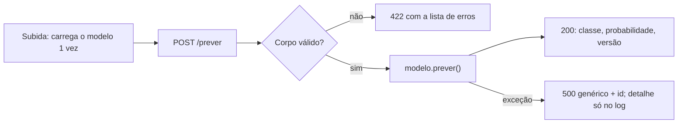

## Passo 1 · Leitura · Da função ao serviço HTTP

Treinar um modelo é metade do trabalho; a outra metade é deixá-lo disponível para outros sistemas com um contrato estável. Um **serviço de inferência** é um processo de longa duração que escuta requisições HTTP. Um contrato mínimo tem três rotas:

| Rota | Para quê | Resposta |
|---|---|---|
| `POST /prever` | recebe as entradas em JSON e devolve a previsão | `200` com classe, probabilidade e versão do modelo |
| `GET /saude` | o orquestrador (Docker, Kubernetes) pergunta se o processo está pronto | `200` só depois que o modelo carregou |
| `GET /versao` | quem chama descobre qual modelo está respondendo | `200` com a versão |

O orquestrador usa `/saude` para decidir quando mandar tráfego: um processo que ainda está carregando o modelo não deve receber requisições de previsão.

Em Python, o caminho mais comum é o **FastAPI** rodando sobre o servidor ASGI **uvicorn**:

```python
# Ilustração: FastAPI de verdade (não roda no executor do curso)
from contextlib import asynccontextmanager
from fastapi import FastAPI
from pydantic import BaseModel, Field

class Entrada(BaseModel):
    frequencia: float = Field(ge=0, le=1)
    media: float = Field(ge=0, le=10)

@asynccontextmanager
async def lifespan(app):
    app.state.modelo = carregar_modelo("modelos/evasao-2.1.0.bin")  # uma vez, na subida
    yield

app = FastAPI(lifespan=lifespan)

@app.post("/prever")
def prever(entrada: Entrada):
    return {**app.state.modelo.prever(entrada), "versao": "2.1.0"}
```

O FastAPI lê as anotações de tipo para validar o corpo (devolve `422` com a lista de erros quando algo não bate) e para gerar a documentação OpenAPI, servida em `/docs` e `/openapi.json`. O `lifespan` roda uma vez, quando o processo sobe: é ali que o modelo é carregado.

**O que muda neste curso.** O executor dos exercícios não tem FastAPI, uvicorn nem rede: não dá para subir um servidor, e a lição não vai fingir que sobe. Você vai escrever a parte que contém as decisões, os **handlers**, como funções puras: recebem o corpo já decodificado e devolvem `(status, corpo)`. Um roteador pequeno, `MiniAPI`, liga método e caminho ao handler. É o mesmo comportamento que um teste com o `TestClient` do FastAPI exercita; o framework acrescenta o transporte HTTP, a conversão de JSON e a documentação.



## Passo 2 · Previsão · Carregar uma vez ou a cada requisição

O programa simula o custo de carregar o artefato (800 ms, número fictício) e o de uma previsão (5 ms) com um relógio falso, que só anda quando o código manda. Compare as duas estratégias depois de três requisições e digite a saída.

### Código
```python
class Relogio:
    def __init__(self):
        self.ms = 0


relogio = Relogio()
carregamentos = 0


def carregar_modelo():
    global carregamentos
    carregamentos += 1
    relogio.ms += 800
    return {"peso": 2.0}


def prever(modelo, x):
    relogio.ms += 5
    return modelo["peso"] * x


def handler_que_carrega(x):
    modelo = carregar_modelo()
    return prever(modelo, x)


def criar_handler():
    modelo = carregar_modelo()

    def handler(x):
        return prever(modelo, x)

    return handler


for x in [1, 2, 3]:
    handler_que_carrega(x)
print("a cada requisição:", carregamentos, "carregamentos,", relogio.ms, "ms")

carregamentos = 0
relogio.ms = 0
handler = criar_handler()
saidas = [handler(x) for x in [1, 2, 3]]
print("uma vez:", carregamentos, "carregamento,", relogio.ms, "ms")
print(saidas)
```

### Dicas
1. Em `handler_que_carrega`, cada chamada paga o carregamento e a previsão.
2. Em `criar_handler`, o carregamento acontece antes de existir o `handler`; as chamadas seguintes só pagam a previsão.

### Saída esperada
```text
a cada requisição: 3 carregamentos, 2415 ms
uma vez: 1 carregamento, 815 ms
[2.0, 4.0, 6.0]
```

## Passo 3 · Exercício · Validar o corpo da requisição
modo: lacunas

O handler de `/prever` não pode confiar no corpo que chega. Complete `validar_entrada(corpo, esquema)`, que devolve a lista de **todos** os erros (lista vazia = corpo válido), como o FastAPI faz no `422`. O `esquema` liga cada campo obrigatório ao intervalo aceito `(minimo, maximo)`; `None` num dos lados quer dizer "sem limite". Todo campo do esquema é numérico.

Códigos de erro, nesta ordem: `"objeto_esperado"` (o corpo não é um dicionário; campo `""`), e, para cada campo do esquema, na ordem do esquema, `"ausente"`, `"tipo"` (não é `int` nem `float`; `bool` também é recusado), `"nao_finito"` (`NaN` ou infinito, que o `json.loads` do Python aceita) ou `"fora_do_intervalo"`. Por último, um `"desconhecido"` para cada campo que não está no esquema, em ordem alfabética.

### Instruções
1. Recuse o corpo que não é um dicionário com um único erro `objeto_esperado`.
   Dica: o `return` já está escrito; olhe as lacunas de baixo.
2. Recuse `bool` antes do teste de número: em Python, `True` também é um `int`.
3. Recuse `NaN` e infinito antes de comparar com o intervalo.
   Dica: o módulo `math` tem uma função que responde "é um número finito?".
4. Compare com os limites só quando eles não são `None`.
5. Aponte os campos que não estão no esquema, em ordem alfabética.

### Código inicial
```python
import math

ESQUEMA = {"frequencia": (0.0, 1.0), "media": (0.0, 10.0), "creditos": (0, None)}


def validar_entrada(corpo, esquema):
    if not isinstance(corpo, dict):
        return [{"campo": "", "erro": "objeto_esperado"}]
    erros = []
    for campo, (minimo, maximo) in esquema.items():
        if campo not in corpo:
            erros.append({"campo": campo, "erro": "ausente"})
            continue
        valor = corpo[campo]
        if isinstance(valor, ___) or not isinstance(valor, (int, float)):
            erros.append({"campo": campo, "erro": "tipo"})
        elif not math.___(valor):
            erros.append({"campo": campo, "erro": "nao_finito"})
        elif (___ is not None and valor < minimo) or (maximo is not None and valor > ___):
            erros.append({"campo": campo, "erro": "fora_do_intervalo"})
    for campo in sorted(set(corpo) - set(___)):
        erros.append({"campo": campo, "erro": "desconhecido"})
    return erros
```

### Solução
```python
import math

ESQUEMA = {"frequencia": (0.0, 1.0), "media": (0.0, 10.0), "creditos": (0, None)}


def validar_entrada(corpo, esquema):
    if not isinstance(corpo, dict):
        return [{"campo": "", "erro": "objeto_esperado"}]
    erros = []
    for campo, (minimo, maximo) in esquema.items():
        if campo not in corpo:
            erros.append({"campo": campo, "erro": "ausente"})
            continue
        valor = corpo[campo]
        if isinstance(valor, bool) or not isinstance(valor, (int, float)):
            erros.append({"campo": campo, "erro": "tipo"})
        elif not math.isfinite(valor):
            erros.append({"campo": campo, "erro": "nao_finito"})
        elif (minimo is not None and valor < minimo) or (maximo is not None and valor > maximo):
            erros.append({"campo": campo, "erro": "fora_do_intervalo"})
    for campo in sorted(set(corpo) - set(esquema)):
        erros.append({"campo": campo, "erro": "desconhecido"})
    return erros
```

### Dicas
1. `isinstance(True, int)` devolve `True`: o teste do `bool` precisa vir antes.
2. `NaN` não é menor nem maior que nada: `NaN < 0` e `NaN > 10` são ambos falsos. Sem um teste próprio, ele passa por um campo sem limite.
3. A diferença entre os conjuntos de chaves do corpo e do esquema dá os campos sobrando.

### Verificação
```json
[
  { "id": "valido", "checkpoint": 1, "kind": "expr",
    "expr": "validar_entrada({'frequencia': 0.85, 'media': 7.5, 'creditos': 20}, ESQUEMA)",
    "expected": [], "name": "Corpo válido devolve lista vazia" },
  { "id": "nao-objeto", "checkpoint": 1, "kind": "expr",
    "expr": "[validar_entrada([0.8, 7.0, 20], ESQUEMA), validar_entrada(None, ESQUEMA)]",
    "expected": [[{"campo": "", "erro": "objeto_esperado"}], [{"campo": "", "erro": "objeto_esperado"}]],
    "name": "Lista ou null no lugar do objeto", "hint": "Confira o tipo do corpo antes de procurar campos nele." },
  { "id": "ausente", "checkpoint": 1, "kind": "expr",
    "expr": "validar_entrada({'frequencia': 0.85, 'creditos': 20}, ESQUEMA)",
    "expected": [{"campo": "media", "erro": "ausente"}], "name": "Campo obrigatório ausente" },
  { "id": "bool", "checkpoint": 2, "kind": "expr",
    "expr": "validar_entrada({'frequencia': True, 'media': 7.0, 'creditos': 20}, ESQUEMA)",
    "expected": [{"campo": "frequencia", "erro": "tipo"}], "name": "true no lugar de número é erro de tipo",
    "hint": "Em Python, bool é subclasse de int." },
  { "id": "texto", "checkpoint": 2, "kind": "expr",
    "expr": "validar_entrada({'frequencia': 0.9, 'media': '7.5', 'creditos': 20}, ESQUEMA)",
    "expected": [{"campo": "media", "erro": "tipo"}], "name": "Número em texto não é convertido em silêncio",
    "hint": "O contrato diz número; quem manda texto recebe 422, não uma conversão escondida." },
  { "id": "int-em-float", "checkpoint": 2, "kind": "expr",
    "expr": "validar_entrada({'frequencia': 1, 'media': 7, 'creditos': 20}, ESQUEMA)",
    "expected": [], "name": "Inteiro vale num campo de número decimal", "hint": "O JSON escreve 7.0 como 7." },
  { "id": "nan-sem-limite", "checkpoint": 3, "kind": "expr",
    "expr": "validar_entrada({'frequencia': 0.9, 'media': 7.0, 'creditos': float('nan')}, ESQUEMA)",
    "expected": [{"campo": "creditos", "erro": "nao_finito"}], "name": "NaN num campo sem limite superior",
    "hint": "Compare NaN com qualquer número e veja o que acontece." },
  { "id": "infinito", "checkpoint": 3, "kind": "expr",
    "expr": "validar_entrada({'frequencia': 0.9, 'media': float('inf'), 'creditos': float('-inf')}, ESQUEMA)",
    "expected": [{"campo": "media", "erro": "nao_finito"}, {"campo": "creditos", "erro": "nao_finito"}],
    "name": "Infinito positivo e negativo" },
  { "id": "intervalo", "checkpoint": 4, "kind": "expr",
    "expr": "[validar_entrada({'frequencia': 1.0, 'media': 10.0, 'creditos': 0}, ESQUEMA), validar_entrada({'frequencia': -0.1, 'media': 10.5, 'creditos': 999}, ESQUEMA)]",
    "expected": [[], [{"campo": "frequencia", "erro": "fora_do_intervalo"}, {"campo": "media", "erro": "fora_do_intervalo"}]],
    "name": "Limites inclusivos; fora deles é erro; creditos não tem máximo" },
  { "id": "todos-os-erros", "checkpoint": 4, "kind": "expr",
    "expr": "validar_entrada({'media': False, 'creditos': -3}, ESQUEMA)",
    "expected": [{"campo": "frequencia", "erro": "ausente"}, {"campo": "media", "erro": "tipo"}, {"campo": "creditos", "erro": "fora_do_intervalo"}],
    "name": "Devolve todos os erros, na ordem do esquema", "hint": "Não pare no primeiro erro: o cliente quer corrigir tudo de uma vez." },
  { "id": "desconhecidos", "checkpoint": 5, "kind": "expr",
    "expr": "validar_entrada({'turma': 'B', 'frequencia': 0.9, 'media': 7.0, 'creditos': 20, 'aluno': 'Ana'}, ESQUEMA)",
    "expected": [{"campo": "aluno", "erro": "desconhecido"}, {"campo": "turma", "erro": "desconhecido"}],
    "name": "Campos fora do esquema, em ordem alfabética" }
]
```

### Soluções erradas
```python name="aceita bool como número"
import math

ESQUEMA = {"frequencia": (0.0, 1.0), "media": (0.0, 10.0), "creditos": (0, None)}


def validar_entrada(corpo, esquema):
    if not isinstance(corpo, dict):
        return [{"campo": "", "erro": "objeto_esperado"}]
    erros = []
    for campo, (minimo, maximo) in esquema.items():
        if campo not in corpo:
            erros.append({"campo": campo, "erro": "ausente"})
            continue
        valor = corpo[campo]
        if not isinstance(valor, (int, float)):
            erros.append({"campo": campo, "erro": "tipo"})
        elif not math.isfinite(valor):
            erros.append({"campo": campo, "erro": "nao_finito"})
        elif (minimo is not None and valor < minimo) or (maximo is not None and valor > maximo):
            erros.append({"campo": campo, "erro": "fora_do_intervalo"})
    for campo in sorted(set(corpo) - set(esquema)):
        erros.append({"campo": campo, "erro": "desconhecido"})
    return erros
```
```python name="converte com float() em vez de checar o tipo"
import math

ESQUEMA = {"frequencia": (0.0, 1.0), "media": (0.0, 10.0), "creditos": (0, None)}


def validar_entrada(corpo, esquema):
    if not isinstance(corpo, dict):
        return [{"campo": "", "erro": "objeto_esperado"}]
    erros = []
    for campo, (minimo, maximo) in esquema.items():
        if campo not in corpo:
            erros.append({"campo": campo, "erro": "ausente"})
            continue
        try:
            valor = float(corpo[campo])
        except (TypeError, ValueError):
            erros.append({"campo": campo, "erro": "tipo"})
            continue
        if not math.isfinite(valor):
            erros.append({"campo": campo, "erro": "nao_finito"})
        elif (minimo is not None and valor < minimo) or (maximo is not None and valor > maximo):
            erros.append({"campo": campo, "erro": "fora_do_intervalo"})
    for campo in sorted(set(corpo) - set(esquema)):
        erros.append({"campo": campo, "erro": "desconhecido"})
    return erros
```
```python name="sem teste de finito: NaN passa onde não há limite"
ESQUEMA = {"frequencia": (0.0, 1.0), "media": (0.0, 10.0), "creditos": (0, None)}


def validar_entrada(corpo, esquema):
    if not isinstance(corpo, dict):
        return [{"campo": "", "erro": "objeto_esperado"}]
    erros = []
    for campo, (minimo, maximo) in esquema.items():
        if campo not in corpo:
            erros.append({"campo": campo, "erro": "ausente"})
            continue
        valor = corpo[campo]
        if isinstance(valor, bool) or not isinstance(valor, (int, float)):
            erros.append({"campo": campo, "erro": "tipo"})
        elif (minimo is not None and valor < minimo) or (maximo is not None and valor > maximo):
            erros.append({"campo": campo, "erro": "fora_do_intervalo"})
    for campo in sorted(set(corpo) - set(esquema)):
        erros.append({"campo": campo, "erro": "desconhecido"})
    return erros
```
```python name="para no primeiro erro"
import math

ESQUEMA = {"frequencia": (0.0, 1.0), "media": (0.0, 10.0), "creditos": (0, None)}


def validar_entrada(corpo, esquema):
    if not isinstance(corpo, dict):
        return [{"campo": "", "erro": "objeto_esperado"}]
    for campo, (minimo, maximo) in esquema.items():
        if campo not in corpo:
            return [{"campo": campo, "erro": "ausente"}]
        valor = corpo[campo]
        if isinstance(valor, bool) or not isinstance(valor, (int, float)):
            return [{"campo": campo, "erro": "tipo"}]
        if not math.isfinite(valor):
            return [{"campo": campo, "erro": "nao_finito"}]
        if (minimo is not None and valor < minimo) or (maximo is not None and valor > maximo):
            return [{"campo": campo, "erro": "fora_do_intervalo"}]
    for campo in sorted(set(corpo) - set(esquema)):
        return [{"campo": campo, "erro": "desconhecido"}]
    return []
```
```python name="ignora campos fora do esquema"
import math

ESQUEMA = {"frequencia": (0.0, 1.0), "media": (0.0, 10.0), "creditos": (0, None)}


def validar_entrada(corpo, esquema):
    if not isinstance(corpo, dict):
        return [{"campo": "", "erro": "objeto_esperado"}]
    erros = []
    for campo, (minimo, maximo) in esquema.items():
        if campo not in corpo:
            erros.append({"campo": campo, "erro": "ausente"})
            continue
        valor = corpo[campo]
        if isinstance(valor, bool) or not isinstance(valor, (int, float)):
            erros.append({"campo": campo, "erro": "tipo"})
        elif not math.isfinite(valor):
            erros.append({"campo": campo, "erro": "nao_finito"})
        elif (minimo is not None and valor < minimo) or (maximo is not None and valor > maximo):
            erros.append({"campo": campo, "erro": "fora_do_intervalo"})
    return erros
```
```python name="compara com o intervalo antes de checar o tipo"
import math

ESQUEMA = {"frequencia": (0.0, 1.0), "media": (0.0, 10.0), "creditos": (0, None)}


def validar_entrada(corpo, esquema):
    if not isinstance(corpo, dict):
        return [{"campo": "", "erro": "objeto_esperado"}]
    erros = []
    for campo, (minimo, maximo) in esquema.items():
        if campo not in corpo:
            erros.append({"campo": campo, "erro": "ausente"})
            continue
        valor = corpo[campo]
        if (minimo is not None and valor < minimo) or (maximo is not None and valor > maximo):
            erros.append({"campo": campo, "erro": "fora_do_intervalo"})
        elif isinstance(valor, bool) or not isinstance(valor, (int, float)):
            erros.append({"campo": campo, "erro": "tipo"})
        elif not math.isfinite(valor):
            erros.append({"campo": campo, "erro": "nao_finito"})
    for campo in sorted(set(corpo) - set(esquema)):
        erros.append({"campo": campo, "erro": "desconhecido"})
    return erros
```
```python name="exige float e recusa inteiro"
import math

ESQUEMA = {"frequencia": (0.0, 1.0), "media": (0.0, 10.0), "creditos": (0, None)}


def validar_entrada(corpo, esquema):
    if not isinstance(corpo, dict):
        return [{"campo": "", "erro": "objeto_esperado"}]
    erros = []
    for campo, (minimo, maximo) in esquema.items():
        if campo not in corpo:
            erros.append({"campo": campo, "erro": "ausente"})
            continue
        valor = corpo[campo]
        if type(valor) is not float:
            erros.append({"campo": campo, "erro": "tipo"})
        elif not math.isfinite(valor):
            erros.append({"campo": campo, "erro": "nao_finito"})
        elif (minimo is not None and valor < minimo) or (maximo is not None and valor > maximo):
            erros.append({"campo": campo, "erro": "fora_do_intervalo"})
    for campo in sorted(set(corpo) - set(esquema)):
        erros.append({"campo": campo, "erro": "desconhecido"})
    return erros
```

## Passo 4 · Leitura · Erros padronizados e o ciclo de vida do serviço

Quem chama a API decide o que fazer pelo **código de status**, então cada falha precisa do código certo:

| Situação | Status | Corpo |
|---|---|---|
| caminho que não existe | `404` | `{"erro": "rota não encontrada"}` |
| o caminho existe, o método não (`GET /prever`) | `405` | `{"erro": "método não permitido"}` |
| corpo inválido | `422` | a lista com **todos** os erros |
| falha inesperada no servidor | `500` | frase fixa e um `id` |

Erros **esperados** (entrada inválida, recurso inexistente) são levantados pelo handler com uma exceção própria e viram a resposta com aquele status: no FastAPI é `HTTPException(status_code=..., detail=...)`; aqui será `ErroHTTP(status, detalhe)`. Qualquer **outra** exceção é defeito do servidor: o cliente recebe `500` com uma frase fixa e um identificador de correlação, e o detalhe (tipo, mensagem, caminho de arquivo e, às vezes, um segredo que estava na mensagem) vai só para o log interno, com o mesmo `id`. O suporte encontra o erro pelo `id` sem que nada vaze. Atenção à ordem dos `except`: `ErroHTTP` também é uma `Exception`, então precisa ser tratado antes.

Três decisões de ciclo de vida que costumam dar problema:

1. **Carregar uma vez, por serviço.** Desserializar o artefato custa caro; fazer isso a cada requisição multiplica a latência. O exagero oposto também quebra: um cache global no módulo, compartilhado por todos os serviços criados no mesmo processo, faz o serviço da versão 2 responder com o modelo da versão 1.
2. **Workers.** `uvicorn app:app --workers 4` sobe quatro processos; cada um roda o próprio `lifespan` e guarda a própria cópia do modelo. A memória cresce com o número de workers.
3. **Versão em toda resposta e em todo log.** Sem ela, ninguém consegue dizer qual modelo produziu a previsão de que alguém está reclamando.

Uma regra sem exceção: o serviço recebe **dados** (JSON validado), nunca objetos serializados. `pickle.loads` em bytes vindos da rede executa o código que o remetente quiser; artefatos `pickle` ou `joblib` só saem do armazenamento interno, depois de conferido o hash (lição 02).

Para empacotar o serviço, um `Dockerfile` enxuto basta. A imagem fixa a versão do Python e as dependências; a documentação OpenAPI continua sendo gerada pelo FastAPI na subida:

```dockerfile
FROM python:3.12-slim
WORKDIR /app
COPY requirements.txt .
RUN pip install --no-cache-dir -r requirements.txt
COPY app.py modelos/ ./
EXPOSE 8000
CMD ["uvicorn", "app:app", "--host", "0.0.0.0", "--port", "8000", "--workers", "2"]
```

## Passo 5 · Exercício · O roteador MiniAPI

Escreva o roteador que os próximos passos vão usar. Ele guarda as rotas por `(metodo, caminho)`, despacha cada chamada e transforma exceções em respostas, como o FastAPI faz por baixo. `gerar_id` é uma função que devolve o próximo identificador de correlação; ela vem de fora para que o teste controle os ids.

### Instruções
1. `rota(metodo, caminho)` devolve um decorador que registra a função e **devolve a própria função**, para ela continuar testável sozinha. Registrar de novo o mesmo `(metodo, caminho)` levanta `ValueError`.
2. `chamar(metodo, caminho, corpo=None)` devolve `(404, {"erro": "rota não encontrada"})` quando nenhum método tem aquele caminho e `(405, {"erro": "método não permitido"})` quando o caminho existe com outro método.
3. O retorno do handler, `(status, corpo)`, volta sem mudanças. Um `ErroHTTP` levantado pelo handler vira `(erro.status, {"erro": erro.detalhe})`, sem log.
4. Qualquer outra exceção vira `(500, {"erro": "erro interno", "id": id})`, com `id = gerar_id()`, e acrescenta a `logs_internos` o registro `{"id": id, "rota": "POST /prever", "erro": "TipoDaExcecao: mensagem"}`.
   Dica: o detalhe da exceção só aparece no log, nunca na resposta.

### Código inicial
```python
class ErroHTTP(Exception):
    def __init__(self, status, detalhe):
        super().__init__(str(detalhe))
        self.status = status
        self.detalhe = detalhe


class MiniAPI:
    def __init__(self, gerar_id):
        self.rotas = {}
        self.logs_internos = []
        self.gerar_id = gerar_id

    def rota(self, metodo, caminho):
        pass

    def chamar(self, metodo, caminho, corpo=None):
        pass
```

### Solução
```python
class ErroHTTP(Exception):
    def __init__(self, status, detalhe):
        super().__init__(str(detalhe))
        self.status = status
        self.detalhe = detalhe


class MiniAPI:
    def __init__(self, gerar_id):
        self.rotas = {}
        self.logs_internos = []
        self.gerar_id = gerar_id

    def rota(self, metodo, caminho):
        def registrar(handler):
            chave = (metodo, caminho)
            if chave in self.rotas:
                raise ValueError(f"rota já registrada: {metodo} {caminho}")
            self.rotas[chave] = handler
            return handler

        return registrar

    def chamar(self, metodo, caminho, corpo=None):
        handler = self.rotas.get((metodo, caminho))
        if handler is None:
            if any(c == caminho for _, c in self.rotas):
                return 405, {"erro": "método não permitido"}
            return 404, {"erro": "rota não encontrada"}
        try:
            return handler(corpo)
        except ErroHTTP as erro:
            return erro.status, {"erro": erro.detalhe}
        except Exception as erro:
            ident = self.gerar_id()
            self.logs_internos.append(
                {"id": ident, "rota": f"{metodo} {caminho}", "erro": f"{type(erro).__name__}: {erro}"}
            )
            return 500, {"erro": "erro interno", "id": ident}
```

### Dicas
1. Para distinguir `404` de `405`, procure o caminho entre as chaves registradas, com qualquer método.
2. Um decorador com argumento é uma função que devolve outra função; a de dentro recebe o handler.
3. `except` é testado de cima para baixo e a primeira cláusula compatível vence.

### Verificação
```json
[
  { "id": "decorador-devolve", "checkpoint": 1, "kind": "expr",
    "setup": "app = MiniAPI(lambda: 'e1')\ndef h(c):\n    return 200, {'ok': True}\nr = app.rota('GET', '/x')(h)",
    "expr": "[r is h, app.chamar('GET', '/x')]", "expected": [true, [200, {"ok": true}]],
    "name": "O decorador registra e devolve a própria função", "hint": "Sem o return, o nome decorado passa a valer None." },
  { "id": "duplicada", "checkpoint": 1, "kind": "expr",
    "setup": "app = MiniAPI(lambda: 'e1')\napp.rota('GET', '/x')(lambda c: (200, {}))",
    "expr": "app.rota('GET', '/x')(lambda c: (200, {'outra': True}))", "raises": "ValueError",
    "name": "Registrar a mesma rota duas vezes é erro", "hint": "Sobrescrever em silêncio esconde um handler." },
  { "id": "mesmo-caminho-dois-metodos", "checkpoint": 1, "kind": "expr",
    "setup": "app = MiniAPI(lambda: 'e1')\napp.rota('GET', '/notas')(lambda c: (200, {'lista': []}))\napp.rota('POST', '/notas')(lambda c: (201, {'criada': c}))",
    "expr": "[app.chamar('GET', '/notas'), app.chamar('POST', '/notas', {'n': 7})]",
    "expected": [[200, {"lista": []}], [201, {"criada": {"n": 7}}]], "name": "GET e POST no mesmo caminho" },
  { "id": "404", "checkpoint": 2, "kind": "expr",
    "setup": "app = MiniAPI(lambda: 'e1')\napp.rota('POST', '/prever')(lambda c: (200, {}))",
    "expr": "app.chamar('GET', '/nada')", "expected": [404, {"erro": "rota não encontrada"}], "name": "Caminho inexistente dá 404" },
  { "id": "405", "checkpoint": 2, "kind": "expr",
    "setup": "app = MiniAPI(lambda: 'e1')\napp.rota('POST', '/prever')(lambda c: (200, {}))",
    "expr": "app.chamar('GET', '/prever')", "expected": [405, {"erro": "método não permitido"}],
    "name": "Caminho certo com método errado dá 405", "hint": "O caminho existe; só o método não." },
  { "id": "corpo-repassado", "checkpoint": 3, "kind": "expr",
    "setup": "app = MiniAPI(lambda: 'e1')\napp.rota('POST', '/eco')(lambda c: (200, {'recebi': c}))",
    "expr": "app.chamar('POST', '/eco', {'a': [1, 2]})", "expected": [200, {"recebi": {"a": [1, 2]}}],
    "name": "O corpo chega ao handler e a resposta volta sem mudanças" },
  { "id": "erro-http", "checkpoint": 3, "kind": "expr",
    "setup": "app = MiniAPI(lambda: 'e1')\ndef h(c):\n    raise ErroHTTP(422, [{'campo': 'media', 'erro': 'ausente'}])\napp.rota('POST', '/prever')(h)\nr = app.chamar('POST', '/prever', {})",
    "expr": "[r, app.logs_internos]", "expected": [[422, {"erro": [{"campo": "media", "erro": "ausente"}]}], []],
    "name": "ErroHTTP vira a resposta com o status dele, sem log",
    "hint": "ErroHTTP também é Exception: a ordem das cláusulas importa." },
  { "id": "500-generico", "checkpoint": 4, "kind": "expr",
    "setup": "app = MiniAPI(lambda: 'req-7')\ndef h(c):\n    raise RuntimeError('falha lendo /srv/modelos/v2.bin token=abc123')\napp.rota('POST', '/prever')(h)\nr = app.chamar('POST', '/prever', {})",
    "expr": "[r, 'abc123' in str(r)]", "expected": [[500, {"erro": "erro interno", "id": "req-7"}], false],
    "name": "Exceção inesperada vira 500 genérico com id", "hint": "Nada da mensagem da exceção vai para o cliente." },
  { "id": "500-log", "checkpoint": 4, "kind": "expr",
    "setup": "app = MiniAPI(lambda: 'req-7')\ndef h(c):\n    raise RuntimeError('falha lendo /srv/modelos/v2.bin token=abc123')\napp.rota('POST', '/prever')(h)\napp.chamar('POST', '/prever', {})",
    "expr": "app.logs_internos",
    "expected": [{"id": "req-7", "rota": "POST /prever", "erro": "RuntimeError: falha lendo /srv/modelos/v2.bin token=abc123"}],
    "name": "O log interno guarda id, rota e o detalhe da exceção",
    "hint": "O mesmo id da resposta precisa estar no log, senão o suporte não acha o erro." },
  { "id": "ids-por-falha", "checkpoint": 4, "kind": "expr",
    "setup": "ids = iter(['e1', 'e2', 'e3'])\napp = MiniAPI(lambda: next(ids))\napp.rota('GET', '/ok')(lambda c: (200, {}))\napp.rota('GET', '/quebra')(lambda c: 1 / 0)\na = app.chamar('GET', '/quebra')\nb = app.chamar('GET', '/ok')\nc = app.chamar('GET', '/quebra')",
    "expr": "[a[1]['id'], b, c[1]['id'], [r['id'] for r in app.logs_internos]]",
    "expected": ["e1", [200, {}], "e2", ["e1", "e2"]], "name": "Cada falha tem o próprio id, no log e na resposta" }
]
```

### Soluções erradas
```python name="405 tratado como 404"
class ErroHTTP(Exception):
    def __init__(self, status, detalhe):
        super().__init__(str(detalhe))
        self.status = status
        self.detalhe = detalhe


class MiniAPI:
    def __init__(self, gerar_id):
        self.rotas = {}
        self.logs_internos = []
        self.gerar_id = gerar_id

    def rota(self, metodo, caminho):
        def registrar(handler):
            if (metodo, caminho) in self.rotas:
                raise ValueError("rota já registrada")
            self.rotas[(metodo, caminho)] = handler
            return handler

        return registrar

    def chamar(self, metodo, caminho, corpo=None):
        handler = self.rotas.get((metodo, caminho))
        if handler is None:
            return 404, {"erro": "rota não encontrada"}
        try:
            return handler(corpo)
        except ErroHTTP as erro:
            return erro.status, {"erro": erro.detalhe}
        except Exception as erro:
            ident = self.gerar_id()
            self.logs_internos.append({"id": ident, "rota": f"{metodo} {caminho}", "erro": f"{type(erro).__name__}: {erro}"})
            return 500, {"erro": "erro interno", "id": ident}
```
```python name="except Exception antes do ErroHTTP"
class ErroHTTP(Exception):
    def __init__(self, status, detalhe):
        super().__init__(str(detalhe))
        self.status = status
        self.detalhe = detalhe


class MiniAPI:
    def __init__(self, gerar_id):
        self.rotas = {}
        self.logs_internos = []
        self.gerar_id = gerar_id

    def rota(self, metodo, caminho):
        def registrar(handler):
            if (metodo, caminho) in self.rotas:
                raise ValueError("rota já registrada")
            self.rotas[(metodo, caminho)] = handler
            return handler

        return registrar

    def chamar(self, metodo, caminho, corpo=None):
        handler = self.rotas.get((metodo, caminho))
        if handler is None:
            if any(c == caminho for _, c in self.rotas):
                return 405, {"erro": "método não permitido"}
            return 404, {"erro": "rota não encontrada"}
        try:
            return handler(corpo)
        except Exception as erro:
            ident = self.gerar_id()
            self.logs_internos.append({"id": ident, "rota": f"{metodo} {caminho}", "erro": f"{type(erro).__name__}: {erro}"})
            return 500, {"erro": "erro interno", "id": ident}
        except ErroHTTP as erro:
            return erro.status, {"erro": erro.detalhe}
```
```python name="devolve a mensagem da exceção no 500"
class ErroHTTP(Exception):
    def __init__(self, status, detalhe):
        super().__init__(str(detalhe))
        self.status = status
        self.detalhe = detalhe


class MiniAPI:
    def __init__(self, gerar_id):
        self.rotas = {}
        self.logs_internos = []
        self.gerar_id = gerar_id

    def rota(self, metodo, caminho):
        def registrar(handler):
            if (metodo, caminho) in self.rotas:
                raise ValueError("rota já registrada")
            self.rotas[(metodo, caminho)] = handler
            return handler

        return registrar

    def chamar(self, metodo, caminho, corpo=None):
        handler = self.rotas.get((metodo, caminho))
        if handler is None:
            if any(c == caminho for _, c in self.rotas):
                return 405, {"erro": "método não permitido"}
            return 404, {"erro": "rota não encontrada"}
        try:
            return handler(corpo)
        except ErroHTTP as erro:
            return erro.status, {"erro": erro.detalhe}
        except Exception as erro:
            ident = self.gerar_id()
            detalhe = f"{type(erro).__name__}: {erro}"
            self.logs_internos.append({"id": ident, "rota": f"{metodo} {caminho}", "erro": detalhe})
            return 500, {"erro": detalhe, "id": ident}
```
```python name="loga sem o id da resposta"
class ErroHTTP(Exception):
    def __init__(self, status, detalhe):
        super().__init__(str(detalhe))
        self.status = status
        self.detalhe = detalhe


class MiniAPI:
    def __init__(self, gerar_id):
        self.rotas = {}
        self.logs_internos = []
        self.gerar_id = gerar_id

    def rota(self, metodo, caminho):
        def registrar(handler):
            if (metodo, caminho) in self.rotas:
                raise ValueError("rota já registrada")
            self.rotas[(metodo, caminho)] = handler
            return handler

        return registrar

    def chamar(self, metodo, caminho, corpo=None):
        handler = self.rotas.get((metodo, caminho))
        if handler is None:
            if any(c == caminho for _, c in self.rotas):
                return 405, {"erro": "método não permitido"}
            return 404, {"erro": "rota não encontrada"}
        try:
            return handler(corpo)
        except ErroHTTP as erro:
            return erro.status, {"erro": erro.detalhe}
        except Exception as erro:
            self.logs_internos.append({"rota": f"{metodo} {caminho}", "erro": f"{type(erro).__name__}: {erro}"})
            return 500, {"erro": "erro interno", "id": self.gerar_id()}
```
```python name="rota repetida sobrescreve em silêncio"
class ErroHTTP(Exception):
    def __init__(self, status, detalhe):
        super().__init__(str(detalhe))
        self.status = status
        self.detalhe = detalhe


class MiniAPI:
    def __init__(self, gerar_id):
        self.rotas = {}
        self.logs_internos = []
        self.gerar_id = gerar_id

    def rota(self, metodo, caminho):
        def registrar(handler):
            self.rotas[(metodo, caminho)] = handler
            return handler

        return registrar

    def chamar(self, metodo, caminho, corpo=None):
        handler = self.rotas.get((metodo, caminho))
        if handler is None:
            if any(c == caminho for _, c in self.rotas):
                return 405, {"erro": "método não permitido"}
            return 404, {"erro": "rota não encontrada"}
        try:
            return handler(corpo)
        except ErroHTTP as erro:
            return erro.status, {"erro": erro.detalhe}
        except Exception as erro:
            ident = self.gerar_id()
            self.logs_internos.append({"id": ident, "rota": f"{metodo} {caminho}", "erro": f"{type(erro).__name__}: {erro}"})
            return 500, {"erro": "erro interno", "id": ident}
```
```python name="decorador não devolve a função"
class ErroHTTP(Exception):
    def __init__(self, status, detalhe):
        super().__init__(str(detalhe))
        self.status = status
        self.detalhe = detalhe


class MiniAPI:
    def __init__(self, gerar_id):
        self.rotas = {}
        self.logs_internos = []
        self.gerar_id = gerar_id

    def rota(self, metodo, caminho):
        def registrar(handler):
            if (metodo, caminho) in self.rotas:
                raise ValueError("rota já registrada")
            self.rotas[(metodo, caminho)] = handler

        return registrar

    def chamar(self, metodo, caminho, corpo=None):
        handler = self.rotas.get((metodo, caminho))
        if handler is None:
            if any(c == caminho for _, c in self.rotas):
                return 405, {"erro": "método não permitido"}
            return 404, {"erro": "rota não encontrada"}
        try:
            return handler(corpo)
        except ErroHTTP as erro:
            return erro.status, {"erro": erro.detalhe}
        except Exception as erro:
            ident = self.gerar_id()
            self.logs_internos.append({"id": ident, "rota": f"{metodo} {caminho}", "erro": f"{type(erro).__name__}: {erro}"})
            return 500, {"erro": "erro interno", "id": ident}
```

## Passo 6 · Exercício · O serviço de predição

Agora junte tudo. O arquivo `servico_base.py` traz o `MiniAPI`, o `ErroHTTP` e o `validar_entrada` dos passos anteriores, prontos, e um `ModeloEvasao` de brinquedo (uma regressão logística com pesos fixos) que conta as próprias chamadas em `chamadas`. Escreva `criar_servico(carregar_modelo, versao, gerar_id)` em `main.py`: ele faz o papel do `lifespan` e das rotas do FastAPI.

### Instruções
1. Chame `carregar_modelo()` exatamente uma vez, dentro de `criar_servico`, antes de registrar as rotas, e crie `app = MiniAPI(gerar_id)`. Nada de cache no nível do módulo: cada serviço tem o próprio modelo.
2. Registre `GET /saude`, que devolve `(200, {"status": "ok", "versao": versao})`, e `GET /versao`, que devolve `(200, {"versao": versao})`.
3. Registre `POST /prever`: valide o corpo com `validar_entrada(corpo, ESQUEMA)` **antes** de tocar no modelo; se houver erros, levante `ErroHTTP(422, erros)`.
4. Com o corpo válido, chame `modelo.prever(corpo)` e devolva `(200, {"classe": ..., "probabilidade": ..., "versao": versao})`. Devolva `app`.
   Dica: exceções do modelo não precisam de `try`: o `MiniAPI` já as transforma em `500`.

### Código inicial
```python
from servico_base import ESQUEMA, ErroHTTP, MiniAPI, ModeloEvasao, validar_entrada


def criar_servico(carregar_modelo, versao, gerar_id):
    pass
```
```python path=servico_base.py
"""Peças prontas dos passos 3 e 5 e um modelo de brinquedo."""
import math

ESQUEMA = {"frequencia": (0.0, 1.0), "media": (0.0, 10.0), "creditos": (0, None)}


def validar_entrada(corpo, esquema):
    if not isinstance(corpo, dict):
        return [{"campo": "", "erro": "objeto_esperado"}]
    erros = []
    for campo, (minimo, maximo) in esquema.items():
        if campo not in corpo:
            erros.append({"campo": campo, "erro": "ausente"})
            continue
        valor = corpo[campo]
        if isinstance(valor, bool) or not isinstance(valor, (int, float)):
            erros.append({"campo": campo, "erro": "tipo"})
        elif not math.isfinite(valor):
            erros.append({"campo": campo, "erro": "nao_finito"})
        elif (minimo is not None and valor < minimo) or (maximo is not None and valor > maximo):
            erros.append({"campo": campo, "erro": "fora_do_intervalo"})
    for campo in sorted(set(corpo) - set(esquema)):
        erros.append({"campo": campo, "erro": "desconhecido"})
    return erros


class ErroHTTP(Exception):
    def __init__(self, status, detalhe):
        super().__init__(str(detalhe))
        self.status = status
        self.detalhe = detalhe


class MiniAPI:
    def __init__(self, gerar_id):
        self.rotas = {}
        self.logs_internos = []
        self.gerar_id = gerar_id

    def rota(self, metodo, caminho):
        def registrar(handler):
            chave = (metodo, caminho)
            if chave in self.rotas:
                raise ValueError(f"rota já registrada: {metodo} {caminho}")
            self.rotas[chave] = handler
            return handler

        return registrar

    def chamar(self, metodo, caminho, corpo=None):
        handler = self.rotas.get((metodo, caminho))
        if handler is None:
            if any(c == caminho for _, c in self.rotas):
                return 405, {"erro": "método não permitido"}
            return 404, {"erro": "rota não encontrada"}
        try:
            return handler(corpo)
        except ErroHTTP as erro:
            return erro.status, {"erro": erro.detalhe}
        except Exception as erro:
            ident = self.gerar_id()
            self.logs_internos.append(
                {"id": ident, "rota": f"{metodo} {caminho}", "erro": f"{type(erro).__name__}: {erro}"}
            )
            return 500, {"erro": "erro interno", "id": ident}


class ModeloEvasao:
    """Risco de evasão por regressão logística com pesos fixos (brinquedo)."""

    def __init__(self, vies=5.0, pesos=(-4.0, -0.5, -0.05)):
        self.vies = vies
        self.pesos = pesos
        self.chamadas = 0

    def prever(self, entrada):
        self.chamadas += 1
        z = (self.vies + self.pesos[0] * entrada["frequencia"]
             + self.pesos[1] * entrada["media"] + self.pesos[2] * entrada["creditos"])
        p = 1 / (1 + math.exp(-z))
        return {"classe": int(p >= 0.5), "probabilidade": round(p, 4)}
```

### Solução
```python
from servico_base import ESQUEMA, ErroHTTP, MiniAPI, ModeloEvasao, validar_entrada


def criar_servico(carregar_modelo, versao, gerar_id):
    modelo = carregar_modelo()
    app = MiniAPI(gerar_id)

    @app.rota("GET", "/saude")
    def saude(corpo):
        return 200, {"status": "ok", "versao": versao}

    @app.rota("GET", "/versao")
    def ler_versao(corpo):
        return 200, {"versao": versao}

    @app.rota("POST", "/prever")
    def prever(corpo):
        erros = validar_entrada(corpo, ESQUEMA)
        if erros:
            raise ErroHTTP(422, erros)
        previsao = modelo.prever(corpo)
        return 200, {"classe": previsao["classe"], "probabilidade": previsao["probabilidade"], "versao": versao}

    return app
```
```python path=servico_base.py
"""Peças prontas dos passos 3 e 5 e um modelo de brinquedo."""
import math

ESQUEMA = {"frequencia": (0.0, 1.0), "media": (0.0, 10.0), "creditos": (0, None)}


def validar_entrada(corpo, esquema):
    if not isinstance(corpo, dict):
        return [{"campo": "", "erro": "objeto_esperado"}]
    erros = []
    for campo, (minimo, maximo) in esquema.items():
        if campo not in corpo:
            erros.append({"campo": campo, "erro": "ausente"})
            continue
        valor = corpo[campo]
        if isinstance(valor, bool) or not isinstance(valor, (int, float)):
            erros.append({"campo": campo, "erro": "tipo"})
        elif not math.isfinite(valor):
            erros.append({"campo": campo, "erro": "nao_finito"})
        elif (minimo is not None and valor < minimo) or (maximo is not None and valor > maximo):
            erros.append({"campo": campo, "erro": "fora_do_intervalo"})
    for campo in sorted(set(corpo) - set(esquema)):
        erros.append({"campo": campo, "erro": "desconhecido"})
    return erros


class ErroHTTP(Exception):
    def __init__(self, status, detalhe):
        super().__init__(str(detalhe))
        self.status = status
        self.detalhe = detalhe


class MiniAPI:
    def __init__(self, gerar_id):
        self.rotas = {}
        self.logs_internos = []
        self.gerar_id = gerar_id

    def rota(self, metodo, caminho):
        def registrar(handler):
            chave = (metodo, caminho)
            if chave in self.rotas:
                raise ValueError(f"rota já registrada: {metodo} {caminho}")
            self.rotas[chave] = handler
            return handler

        return registrar

    def chamar(self, metodo, caminho, corpo=None):
        handler = self.rotas.get((metodo, caminho))
        if handler is None:
            if any(c == caminho for _, c in self.rotas):
                return 405, {"erro": "método não permitido"}
            return 404, {"erro": "rota não encontrada"}
        try:
            return handler(corpo)
        except ErroHTTP as erro:
            return erro.status, {"erro": erro.detalhe}
        except Exception as erro:
            ident = self.gerar_id()
            self.logs_internos.append(
                {"id": ident, "rota": f"{metodo} {caminho}", "erro": f"{type(erro).__name__}: {erro}"}
            )
            return 500, {"erro": "erro interno", "id": ident}


class ModeloEvasao:
    """Risco de evasão por regressão logística com pesos fixos (brinquedo)."""

    def __init__(self, vies=5.0, pesos=(-4.0, -0.5, -0.05)):
        self.vies = vies
        self.pesos = pesos
        self.chamadas = 0

    def prever(self, entrada):
        self.chamadas += 1
        z = (self.vies + self.pesos[0] * entrada["frequencia"]
             + self.pesos[1] * entrada["media"] + self.pesos[2] * entrada["creditos"])
        p = 1 / (1 + math.exp(-z))
        return {"classe": int(p >= 0.5), "probabilidade": round(p, 4)}
```

### Dicas
1. Tudo o que roda no corpo de `criar_servico` acontece uma vez por serviço; o que está dentro dos handlers, uma vez por requisição.
2. As funções internas enxergam `modelo` e `versao` por closure, sem variável global.
3. Para conferir o carregamento único, conte as chamadas de `carregar_modelo` com uma função espiã.

### Verificação
```json
[
  { "id": "carrega-na-criacao", "checkpoint": 1, "kind": "expr",
    "setup": "cont = []\ndef carregar():\n    cont.append(1)\n    return ModeloEvasao()\napp = criar_servico(carregar, '2.1.0', lambda: 'e1')",
    "expr": "len(cont)", "expected": 1, "name": "O modelo é carregado na criação do serviço",
    "hint": "Carregar só na primeira requisição deixa a primeira lenta e faz /saude responder antes de o modelo existir." },
  { "id": "carrega-uma-vez", "checkpoint": 1, "kind": "expr",
    "setup": "cont = []\ndef carregar():\n    cont.append(1)\n    return ModeloEvasao()\napp = criar_servico(carregar, '2.1.0', lambda: 'e1')\nfor _ in range(5):\n    app.chamar('POST', '/prever', {'frequencia': 0.9, 'media': 7.0, 'creditos': 20})",
    "expr": "len(cont)", "expected": 1, "name": "Cinco previsões, um carregamento" },
  { "id": "servicos-isolados", "checkpoint": 1, "kind": "expr",
    "setup": "s1 = criar_servico(lambda: ModeloEvasao(vies=5.0), '1.0.0', lambda: 'e1')\ns2 = criar_servico(lambda: ModeloEvasao(vies=9.0), '2.0.0', lambda: 'e2')\ncorpo = {'frequencia': 0.9, 'media': 7.0, 'creditos': 20}",
    "expr": "[s1.chamar('POST', '/prever', corpo), s2.chamar('POST', '/prever', corpo)]",
    "expected": [[200, {"classe": 0, "probabilidade": 0.0431, "versao": "1.0.0"}], [200, {"classe": 1, "probabilidade": 0.7109, "versao": "2.0.0"}]],
    "name": "Dois serviços no mesmo processo, cada um com o próprio modelo",
    "hint": "Um cache no nível do módulo faz o segundo serviço reaproveitar o modelo do primeiro." },
  { "id": "saude-versao", "checkpoint": 2, "kind": "expr",
    "setup": "app = criar_servico(ModeloEvasao, '2.1.0', lambda: 'e1')",
    "expr": "[app.chamar('GET', '/saude'), app.chamar('GET', '/versao')]",
    "expected": [[200, {"status": "ok", "versao": "2.1.0"}], [200, {"versao": "2.1.0"}]], "name": "GET /saude e GET /versao" },
  { "id": "prever-ok", "checkpoint": 4, "kind": "expr",
    "setup": "app = criar_servico(ModeloEvasao, '2.1.0', lambda: 'e1')",
    "expr": "[app.chamar('POST', '/prever', {'frequencia': 0.9, 'media': 7.0, 'creditos': 20}), app.chamar('POST', '/prever', {'frequencia': 0.3, 'media': 3.0, 'creditos': 4})]",
    "expected": [[200, {"classe": 0, "probabilidade": 0.0431, "versao": "2.1.0"}], [200, {"classe": 1, "probabilidade": 0.8909, "versao": "2.1.0"}]],
    "name": "POST /prever devolve classe, probabilidade e versão", "hint": "A versão vai em toda resposta de previsão." },
  { "id": "422-lista", "checkpoint": 3, "kind": "expr",
    "setup": "app = criar_servico(ModeloEvasao, '2.1.0', lambda: 'e1')",
    "expr": "app.chamar('POST', '/prever', {'frequencia': 'alta', 'creditos': 20, 'turma': 'B'})",
    "expected": [422, {"erro": [{"campo": "frequencia", "erro": "tipo"}, {"campo": "media", "erro": "ausente"}, {"campo": "turma", "erro": "desconhecido"}]}],
    "name": "Corpo inválido dá 422 com todos os erros", "hint": "Use o validar_entrada pronto, com o ESQUEMA." },
  { "id": "422-sem-modelo", "checkpoint": 3, "kind": "expr",
    "setup": "m = ModeloEvasao()\napp = criar_servico(lambda: m, '2.1.0', lambda: 'e1')\nr = app.chamar('POST', '/prever', {'frequencia': 2.0, 'media': 7.0, 'creditos': 20})",
    "expr": "[r[0], m.chamadas]", "expected": [422, 0], "name": "Entrada inválida não chega ao modelo",
    "hint": "Valide antes de prever." },
  { "id": "422-nao-objeto", "checkpoint": 3, "kind": "expr",
    "setup": "app = criar_servico(ModeloEvasao, '2.1.0', lambda: 'e1')",
    "expr": "[app.chamar('POST', '/prever', None), app.chamar('POST', '/prever', [0.9, 7.0, 20])]",
    "expected": [[422, {"erro": [{"campo": "", "erro": "objeto_esperado"}]}], [422, {"erro": [{"campo": "", "erro": "objeto_esperado"}]}]],
    "name": "Corpo vazio ou lista dá 422, não 500" },
  { "id": "500-do-modelo", "checkpoint": 4, "kind": "expr",
    "setup": "class Quebrado:\n    def prever(self, entrada):\n        raise MemoryError('sem memória em /srv/modelos')\napp = criar_servico(Quebrado, '2.1.0', lambda: 'req-9')\nr = app.chamar('POST', '/prever', {'frequencia': 0.9, 'media': 7.0, 'creditos': 20})",
    "expr": "[r, [x['id'] for x in app.logs_internos]]", "expected": [[500, {"erro": "erro interno", "id": "req-9"}], ["req-9"]],
    "name": "Falha do modelo vira 500 genérico, registrado no log interno" },
  { "id": "405", "checkpoint": 2, "kind": "expr",
    "setup": "app = criar_servico(ModeloEvasao, '2.1.0', lambda: 'e1')",
    "expr": "[app.chamar('GET', '/prever')[0], app.chamar('POST', '/saude')[0]]", "expected": [405, 405],
    "name": "Método errado nas rotas do serviço" }
]
```

### Soluções erradas
```python name="carrega o modelo a cada requisição"
from servico_base import ESQUEMA, ErroHTTP, MiniAPI, ModeloEvasao, validar_entrada


def criar_servico(carregar_modelo, versao, gerar_id):
    app = MiniAPI(gerar_id)

    @app.rota("GET", "/saude")
    def saude(corpo):
        return 200, {"status": "ok", "versao": versao}

    @app.rota("GET", "/versao")
    def ler_versao(corpo):
        return 200, {"versao": versao}

    @app.rota("POST", "/prever")
    def prever(corpo):
        erros = validar_entrada(corpo, ESQUEMA)
        if erros:
            raise ErroHTTP(422, erros)
        modelo = carregar_modelo()
        previsao = modelo.prever(corpo)
        return 200, {"classe": previsao["classe"], "probabilidade": previsao["probabilidade"], "versao": versao}

    return app
```
```python name="carrega na primeira requisição"
from servico_base import ESQUEMA, ErroHTTP, MiniAPI, ModeloEvasao, validar_entrada


def criar_servico(carregar_modelo, versao, gerar_id):
    app = MiniAPI(gerar_id)
    estado = {"modelo": None}

    @app.rota("GET", "/saude")
    def saude(corpo):
        return 200, {"status": "ok", "versao": versao}

    @app.rota("GET", "/versao")
    def ler_versao(corpo):
        return 200, {"versao": versao}

    @app.rota("POST", "/prever")
    def prever(corpo):
        erros = validar_entrada(corpo, ESQUEMA)
        if erros:
            raise ErroHTTP(422, erros)
        if estado["modelo"] is None:
            estado["modelo"] = carregar_modelo()
        previsao = estado["modelo"].prever(corpo)
        return 200, {"classe": previsao["classe"], "probabilidade": previsao["probabilidade"], "versao": versao}

    return app
```
```python name="cache global do modelo no módulo"
from servico_base import ESQUEMA, ErroHTTP, MiniAPI, ModeloEvasao, validar_entrada

_MODELO = None


def criar_servico(carregar_modelo, versao, gerar_id):
    global _MODELO
    if _MODELO is None:
        _MODELO = carregar_modelo()
    modelo = _MODELO
    app = MiniAPI(gerar_id)

    @app.rota("GET", "/saude")
    def saude(corpo):
        return 200, {"status": "ok", "versao": versao}

    @app.rota("GET", "/versao")
    def ler_versao(corpo):
        return 200, {"versao": versao}

    @app.rota("POST", "/prever")
    def prever(corpo):
        erros = validar_entrada(corpo, ESQUEMA)
        if erros:
            raise ErroHTTP(422, erros)
        previsao = modelo.prever(corpo)
        return 200, {"classe": previsao["classe"], "probabilidade": previsao["probabilidade"], "versao": versao}

    return app
```
```python name="prevê antes de validar"
from servico_base import ESQUEMA, ErroHTTP, MiniAPI, ModeloEvasao, validar_entrada


def criar_servico(carregar_modelo, versao, gerar_id):
    modelo = carregar_modelo()
    app = MiniAPI(gerar_id)

    @app.rota("GET", "/saude")
    def saude(corpo):
        return 200, {"status": "ok", "versao": versao}

    @app.rota("GET", "/versao")
    def ler_versao(corpo):
        return 200, {"versao": versao}

    @app.rota("POST", "/prever")
    def prever(corpo):
        try:
            previsao = modelo.prever(corpo)
        except Exception:
            raise ErroHTTP(422, validar_entrada(corpo, ESQUEMA))
        erros = validar_entrada(corpo, ESQUEMA)
        if erros:
            raise ErroHTTP(422, erros)
        return 200, {"classe": previsao["classe"], "probabilidade": previsao["probabilidade"], "versao": versao}

    return app
```
```python name="resposta de previsão sem a versão"
from servico_base import ESQUEMA, ErroHTTP, MiniAPI, ModeloEvasao, validar_entrada


def criar_servico(carregar_modelo, versao, gerar_id):
    modelo = carregar_modelo()
    app = MiniAPI(gerar_id)

    @app.rota("GET", "/saude")
    def saude(corpo):
        return 200, {"status": "ok", "versao": versao}

    @app.rota("GET", "/versao")
    def ler_versao(corpo):
        return 200, {"versao": versao}

    @app.rota("POST", "/prever")
    def prever(corpo):
        erros = validar_entrada(corpo, ESQUEMA)
        if erros:
            raise ErroHTTP(422, erros)
        return 200, modelo.prever(corpo)

    return app
```
```python name="erro de validação com status 200"
from servico_base import ESQUEMA, ErroHTTP, MiniAPI, ModeloEvasao, validar_entrada


def criar_servico(carregar_modelo, versao, gerar_id):
    modelo = carregar_modelo()
    app = MiniAPI(gerar_id)

    @app.rota("GET", "/saude")
    def saude(corpo):
        return 200, {"status": "ok", "versao": versao}

    @app.rota("GET", "/versao")
    def ler_versao(corpo):
        return 200, {"versao": versao}

    @app.rota("POST", "/prever")
    def prever(corpo):
        erros = validar_entrada(corpo, ESQUEMA)
        if erros:
            return 200, {"erro": erros}
        previsao = modelo.prever(corpo)
        return 200, {"classe": previsao["classe"], "probabilidade": previsao["probabilidade"], "versao": versao}

    return app
```
```python name="validação própria que só confere os campos"
from servico_base import ESQUEMA, ErroHTTP, MiniAPI, ModeloEvasao, validar_entrada


def criar_servico(carregar_modelo, versao, gerar_id):
    modelo = carregar_modelo()
    app = MiniAPI(gerar_id)

    @app.rota("GET", "/saude")
    def saude(corpo):
        return 200, {"status": "ok", "versao": versao}

    @app.rota("GET", "/versao")
    def ler_versao(corpo):
        return 200, {"versao": versao}

    @app.rota("POST", "/prever")
    def prever(corpo):
        faltando = [{"campo": c, "erro": "ausente"} for c in ESQUEMA if c not in corpo]
        if faltando:
            raise ErroHTTP(422, faltando)
        previsao = modelo.prever(corpo)
        return 200, {"classe": previsao["classe"], "probabilidade": previsao["probabilidade"], "versao": versao}

    return app
```

## Passo 7 · Quiz · Subida, workers e erros

### Pergunta
O serviço carrega no `lifespan` um modelo que ocupa bastante memória e roda com `uvicorn app:app --workers 4`. Em produção, a memória da máquina ficou perto de quatro vezes o tamanho do modelo. O que explica?
- [ ] Os quatro workers compartilham o objeto carregado pelo primeiro, mas cada requisição faz uma cópia temporária dele.
- [x] Cada worker é um processo separado que roda o próprio `lifespan` e guarda a própria cópia do modelo; a memória cresce com o número de workers.
- [ ] O `lifespan` roda a cada requisição quando há mais de um worker, então o modelo é recarregado o tempo todo.
- [ ] O FastAPI duplica o modelo para gerar a documentação OpenAPI de cada rota.
> Workers do uvicorn são processos, e processos não compartilham objetos Python. Dimensione o número de workers pela memória disponível, ou use um servidor de modelos separado quando o modelo é grande.

### Pergunta
Uma equipe parceira pede uma rota nova: ela enviaria, em base64, um modelo já treinado em `pickle`, e o serviço faria `pickle.loads` e usaria esse modelo para prever. Qual é a resposta certa?
- [ ] Aceitar, desde que o arquivo tenha menos de 1 MB e a extensão `.pkl`.
- [ ] Aceitar, desde que o serviço confira o hash SHA-256 que a própria equipe parceira manda junto com o arquivo.
- [x] Recusar: desserializar `pickle` vindo da rede executa o código que o remetente quiser. O serviço recebe só dados validados; modelos entram pelo registro interno, com hash conferido contra o que foi registrado.
- [ ] Aceitar, mas rodar o `pickle.loads` dentro de um `try/except` para que um arquivo malicioso só gere um `500`.
> O código de um `pickle` malicioso roda durante o `loads`, antes de qualquer `except` ter chance. E um hash enviado pelo próprio remetente não prova nada: ele só confirma que o arquivo chegou inteiro, não que é confiável.

### Pergunta
Um cliente envia `{"frequencia": 0.9, "media": "7,5", "creditos": 20}` e recebe `500` com o corpo `{"erro": "ValueError: could not convert string to float: '7,5'"}`. O que precisa mudar?
- [ ] Nada: o erro foi do cliente, e o `500` com a mensagem ajuda a depurar.
- [ ] O serviço deveria trocar a vírgula por ponto e prever, para não incomodar o cliente.
- [x] A validação precisa recusar o texto antes do modelo, com `422` e a lista de erros; e um `500` nunca deve trazer a mensagem da exceção, só uma frase fixa e um `id` que leva ao log interno.
- [ ] Trocar o `500` por `404`, porque o campo `media` não foi encontrado como número.
> Erro de quem chama é `4xx` (aqui, `422`), com o detalhe do que está errado no corpo. `500` é defeito do servidor, e o detalhe dele fica no log. Converter formatos em silêncio esconde um problema de contrato que vai aparecer de outro jeito depois.
