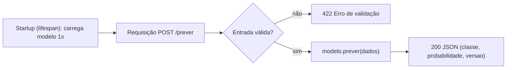

## Passo 1 · Leitura · Da função Python ao serviço HTTP de predição

Um modelo ou assistente só entrega valor quando outros sistemas conseguem chamá-lo via HTTP de forma rápida, previsível e segura. No ecossistema Python, o **FastAPI** (executado sobre o servidor ASGI **uvicorn**) é o padrão para expor endpoints de inferência porque valida o esquema do corpo JSON, gera documentação OpenAPI (`/docs`) automaticamente e gerencia o ciclo de vida do processo (*lifespan*).



Compare um serviço FastAPI real com a classe `MiniAPI` que usamos nos exercícios do sandbox (ambos seguem o mesmo contrato de rotas e respostas `(status_code, body)` do `TestClient`):

```python
# Em produção com FastAPI + uvicorn:
# from contextlib import asynccontextmanager
# from fastapi import FastAPI
#
# @asynccontextmanager
# async def lifespan(app: FastAPI):
#     app.state.modelo = carregar_modelo("modelo.joblib")  # 1 única vez!
#     yield
#
# app = FastAPI(lifespan=lifespan)
```

Quatro regras críticas ao servir modelos:

1. **Carregar o modelo uma única vez na inicialização (`lifespan`):** ler centenas de megabytes do disco a cada requisição `POST /prever` destrói a latência e esgota a memória.
2. **Validar tipos e campos obrigatórios (`422 Unprocessable Entity`):** rejeitar payloads incompletos ou com tipos errados antes de chamar `modelo.prever`.
3. **Nunca desserializar `pickle` enviado pelo cliente:** `pickle.loads` permite execução arbitrária de código. A API deve receber apenas **dados em JSON**; arquivos de pesos são carregados somente do armazenamento interno confiável.
4. **Ocultar *stack traces* em erros `500`:** se ocorrer uma falha inesperada, registre o erro completo no log interno, mas devolva ao cliente apenas uma mensagem genérica padronizada sem expor caminhos de servidor ou variáveis internas.

Para empacotar o serviço em um contêiner reproduzível, usamos um `Dockerfile` enxuto:

```dockerfile
FROM python:3.12-slim
WORKDIR /app
COPY requirements.txt .
RUN pip install --no-cache-dir -r requirements.txt
COPY . .
EXPOSE 8000
CMD ["uvicorn", "app:app", "--host", "0.0.0.0", "--port", "8000"]
```

## Passo 2 · Previsão · Carregar uma vez vs carregar a cada requisição

Observe a diferença no contador `carregamentos` e na latência acumulada após 4 requisições quando o modelo é carregado na fábrica do serviço versus dentro do handler da rota.

### Código

```python
carregamentos = 0

def carregar_pesos():
    global carregamentos
    carregamentos += 1
    return {"peso": 2.0}

def criar_servico_correto():
    modelo = carregar_pesos()
    def handler(x):
        return modelo["peso"] * x
    return handler

rota = criar_servico_correto()
saidas = [rota(1), rota(2), rota(3), rota(4)]
print("Carregamentos:", carregamentos)
print("Saidas:", saidas)
```

### Dicas

1. `carregar_pesos()` é chamada apenas no momento em que `criar_servico_correto()` é executada.
2. As 4 chamadas seguintes a `rota(...)` reutilizam o dicionário `modelo` já em memória.

### Saída esperada

```text
Carregamentos: 1
Saidas: [2.0, 4.0, 6.0, 8.0]
```

## Passo 3 · Exercício · Validando o corpo da requisição

modo: lacunas

Complete `validar_entrada(corpo, campos_obrigatorios)` para verificar se `corpo` é um dicionário contendo todos os campos numéricos exigidos pelo modelo (`int` ou `float`, rejeitando `bool`), levantando `ErroValidacao` caso contrário.

### Instruções

1. Se `not isinstance(corpo, dict)`, levante `ErroValidacao("Corpo deve ser um objeto JSON")`.
2. Para cada `campo` em `campos_obrigatorios`:
   - Se `campo not in corpo`, levante `ErroValidacao(f"Campo obrigatorio ausente: {campo}")`.
   - Se `isinstance(corpo[campo], bool)` ou `not isinstance(corpo[campo], (int, float))`, levante `ErroValidacao(f"Campo deve ser numerico: {campo}")`.
3. Retorne `True` se tudo estiver válido.

### Código inicial

```python
class ErroValidacao(ValueError):
    pass


def validar_entrada(corpo, campos_obrigatorios):
    if not isinstance(corpo, dict):
        raise ErroValidacao("Corpo deve ser um objeto JSON")
    for campo in campos_obrigatorios:
        if campo not in ___:
            raise ErroValidacao(f"Campo obrigatorio ausente: {campo}")
        valor = corpo[campo]
        if isinstance(valor, ___) or not isinstance(valor, (int, float)):
            raise ErroValidacao(f"Campo deve ser numerico: {campo}")
    return ___
```

### Solução

```python
class ErroValidacao(ValueError):
    pass


def validar_entrada(corpo, campos_obrigatorios):
    if not isinstance(corpo, dict):
        raise ErroValidacao("Corpo deve ser um objeto JSON")
    for campo in campos_obrigatorios:
        if campo not in corpo:
            raise ErroValidacao(f"Campo obrigatorio ausente: {campo}")
        valor = corpo[campo]
        if isinstance(valor, bool) or not isinstance(valor, (int, float)):
            raise ErroValidacao(f"Campo deve ser numerico: {campo}")
    return True
```

### Dicas

1. Verifique se `campo not in corpo` para detectar chaves faltantes.
2. Em Python `isinstance(True, int)` é verdadeiro, então bloqueie `isinstance(valor, bool)` explicitamente.

### Verificação

```json
[
  {
    "id": "entrada-valida",
    "name": "Aprova dicionário com todos os campos numéricos obrigatórios",
    "checkpoint": 3,
    "kind": "call",
    "function": "validar_entrada",
    "args": [
      {"frequencia": 0.85, "media": 7.5},
      ["frequencia", "media"]
    ],
    "expected": true
  },
  {
    "id": "rejeita-campo-faltante",
    "name": "Levanta ErroValidacao quando falta campo obrigatório",
    "checkpoint": 2,
    "kind": "expr",
    "expr": "validar_entrada({'frequencia': 0.85}, ['frequencia', 'media'])",
    "raises": "ErroValidacao"
  },
  {
    "id": "rejeita-booleano",
    "name": "Levanta ErroValidacao quando um campo numérico recebe booleano",
    "checkpoint": 2,
    "kind": "expr",
    "expr": "validar_entrada({'frequencia': True, 'media': 7.5}, ['frequencia', 'media'])",
    "raises": "ErroValidacao"
  }
]
```

### Soluções erradas

```python name="Aceita valores booleanos como se fossem números válidos"
class ErroValidacao(ValueError):
    pass


def validar_entrada(corpo, campos_obrigatorios):
    if not isinstance(corpo, dict):
        raise ErroValidacao("Corpo invalido")
    for campo in campos_obrigatorios:
        if campo not in corpo:
            raise ErroValidacao(f"Ausente: {campo}")
        if not isinstance(corpo[campo], (int, float)):
            raise ErroValidacao(f"Tipo invalido: {campo}")
    return True
```

```python name="Não levanta ErroValidacao quando falta um campo obrigatório"
class ErroValidacao(ValueError):
    pass


def validar_entrada(corpo, campos_obrigatorios):
    return True
```

## Passo 4 · Exercício · Handlers /prever, /saude e /versao no MiniAPI

Implemente `criar_servico(carregar_modelo, versao)` carregando o modelo **uma única vez** na criação do serviço e registrando no `MiniAPI` as rotas `GET /saude`, `GET /versao` e `POST /prever`.

### Instruções

1. Chame `modelo = carregar_modelo()` uma única vez no início de `criar_servico` e instancie `app = MiniAPI()`.
2. Registre `GET /saude` devolvendo `(200, {"status": "ok"})`.
3. Registre `GET /versao` devolvendo `(200, {"versao": versao})`.
4. Registre `POST /prever`:
   - Valide `corpo` com `validar_entrada(corpo, ["frequencia", "media"])`. Se levantar `ErroValidacao as e`, devolva `(422, {"erro": str(e)})`.
   - Caso seja válido, chame `pred = modelo.prever(corpo["frequencia"], corpo["media"])` (que retorna `{"classe": int, "probabilidade": float}`) e devolva `(200, {"classe": pred["classe"], "probabilidade": pred["probabilidade"], "versao": versao})`.
5. Retorne `app`.

### Código inicial

```python
class ErroValidacao(ValueError):
    pass


def validar_entrada(corpo, campos_obrigatorios):
    if not isinstance(corpo, dict):
        raise ErroValidacao("Corpo deve ser um objeto JSON")
    for campo in campos_obrigatorios:
        if campo not in corpo:
            raise ErroValidacao(f"Campo obrigatorio ausente: {campo}")
        valor = corpo[campo]
        if isinstance(valor, bool) or not isinstance(valor, (int, float)):
            raise ErroValidacao(f"Campo deve ser numerico: {campo}")
    return True


class MiniAPI:
    def __init__(self):
        self.rotas = {}

    def get(self, caminho):
        def reg(fn):
            self.rotas[("GET", caminho)] = fn
            return fn

        return reg

    def post(self, caminho):
        def reg(fn):
            self.rotas[("POST", caminho)] = fn
            return fn

        return reg

    def chamar(self, metodo, caminho, corpo=None):
        handler = self.rotas.get((metodo, caminho))
        if handler is None:
            return 404, {"erro": "Rota nao encontrada"}
        return handler(corpo)


class ModeloSimulado:
    def prever(self, frequencia, media):
        aprovado = 1 if (frequencia >= 0.7 and media >= 5.0) else 0
        prob = round(min(0.99, max(0.05, 0.5 * frequencia + 0.05 * media)), 4)
        return {"classe": aprovado, "probabilidade": prob}


def criar_servico(carregar_modelo, versao="1.0.0"):
    # Carregue o modelo uma única vez e registre GET /saude, GET /versao e POST /prever
    pass
```

### Solução

```python
class ErroValidacao(ValueError):
    pass


def validar_entrada(corpo, campos_obrigatorios):
    if not isinstance(corpo, dict):
        raise ErroValidacao("Corpo deve ser um objeto JSON")
    for campo in campos_obrigatorios:
        if campo not in corpo:
            raise ErroValidacao(f"Campo obrigatorio ausente: {campo}")
        valor = corpo[campo]
        if isinstance(valor, bool) or not isinstance(valor, (int, float)):
            raise ErroValidacao(f"Campo deve ser numerico: {campo}")
    return True


class MiniAPI:
    def __init__(self):
        self.rotas = {}

    def get(self, caminho):
        def reg(fn):
            self.rotas[("GET", caminho)] = fn
            return fn

        return reg

    def post(self, caminho):
        def reg(fn):
            self.rotas[("POST", caminho)] = fn
            return fn

        return reg

    def chamar(self, metodo, caminho, corpo=None):
        handler = self.rotas.get((metodo, caminho))
        if handler is None:
            return 404, {"erro": "Rota nao encontrada"}
        return handler(corpo)


class ModeloSimulado:
    def prever(self, frequencia, media):
        aprovado = 1 if (frequencia >= 0.7 and media >= 5.0) else 0
        prob = round(min(0.99, max(0.05, 0.5 * frequencia + 0.05 * media)), 4)
        return {"classe": aprovado, "probabilidade": prob}


def criar_servico(carregar_modelo, versao="1.0.0"):
    modelo = carregar_modelo()
    app = MiniAPI()

    @app.get("/saude")
    def saude(_corpo=None):
        return 200, {"status": "ok"}

    @app.get("/versao")
    def obter_versao(_corpo=None):
        return 200, {"versao": versao}

    @app.post("/prever")
    def prever(corpo):
        try:
            validar_entrada(corpo, ["frequencia", "media"])
        except ErroValidacao as e:
            return 422, {"erro": str(e)}
        pred = modelo.prever(corpo["frequencia"], corpo["media"])
        return 200, {
            "classe": int(pred["classe"]),
            "probabilidade": float(pred["probabilidade"]),
            "versao": versao,
        }

    return app
```

### Dicas

1. Chame `modelo = carregar_modelo()` fora da função `prever(corpo)` para que o carregamento ocorra apenas uma vez.
2. Em `prever(corpo)`, capture `except ErroValidacao as e:` e retorne `422, {"erro": str(e)}`.

### Verificação

```json
[
  {
    "id": "servico-rotas-e-carregamento-unico",
    "name": "Carrega o modelo apenas 1 vez, responde 200 nas rotas válidas e 422 em entrada inválida",
    "checkpoint": 4,
    "kind": "expr",
    "setup": "cont = {'n': 0}; app = criar_servico(lambda: (cont.__setitem__('n', cont['n'] + 1), ModeloSimulado())[1], versao='2.1.0'); r_saude = app.chamar('GET', '/saude'); r_ver = app.chamar('GET', '/versao'); r_ok1 = app.chamar('POST', '/prever', {'frequencia': 0.8, 'media': 7.0}); r_ok2 = app.chamar('POST', '/prever', {'frequencia': 0.5, 'media': 4.0}); r_422 = app.chamar('POST', '/prever', {'frequencia': 0.8})",
    "expr": "[cont['n'], r_saude, r_ver, r_ok1, r_ok2[1]['classe'], r_422[0]]",
    "expected": [
      1,
      [200, {"status": "ok"}],
      [200, {"versao": "2.1.0"}],
      [200, {"classe": 1, "probabilidade": 0.75, "versao": "2.1.0"}],
      0,
      422
    ]
  }
]
```

### Soluções erradas

```python name="Chama carregar_modelo() dentro do handler a cada requisição POST /prever"
def criar_servico(carregar_modelo, versao="1.0.0"):
    app = MiniAPI()

    @app.get("/saude")
    def saude(_=None):
        return 200, {"status": "ok"}

    @app.get("/versao")
    def ver(_=None):
        return 200, {"versao": versao}

    @app.post("/prever")
    def prever(corpo):
        try:
            validar_entrada(corpo, ["frequencia", "media"])
        except ErroValidacao as e:
            return 422, {"erro": str(e)}
        modelo = carregar_modelo()
        pred = modelo.prever(corpo["frequencia"], corpo["media"])
        return 200, {"classe": pred["classe"], "probabilidade": pred["probabilidade"], "versao": versao}

    return app
```

```python name="Não captura ErroValidacao para devolver status 422"
def criar_servico(carregar_modelo, versao="1.0.0"):
    modelo = carregar_modelo()
    app = MiniAPI()

    @app.get("/saude")
    def saude(_=None):
        return 200, {"status": "ok"}

    @app.get("/versao")
    def ver(_=None):
        return 200, {"versao": versao}

    @app.post("/prever")
    def prever(corpo):
        validar_entrada(corpo, ["frequencia", "media"])
        pred = modelo.prever(corpo["frequencia"], corpo["media"])
        return 200, {"classe": pred["classe"], "probabilidade": pred["probabilidade"], "versao": versao}

    return app
```

## Passo 5 · Exercício · Middleware de proteção contra erros 500

Implemente `envolver_com_seguranca(handler, logs_internos)` para capturar exceções não tratadas durante a execução de uma rota, gravar o detalhe técnico apenas em `logs_internos` e retornar uma resposta `500` padronizada e segura ao cliente.

### Instruções

1. Defina uma função interna `protegido(corpo)` dentro de `envolver_com_seguranca(handler, logs_internos)`.
2. Tente executar `return handler(corpo)`. Se o `handler` já retornar normalmente (inclusive retornos `(422, ...)` ou `(200, ...)`), repasse o retorno intacto.
3. Se uma exceção inesperada `Exception as exc` for levantada, adicione `f"{type(exc).__name__}: {exc}"` à lista `logs_internos` e retorne exatamente `(500, {"erro": "Erro interno ao processar a predicao."})` — sem incluir `str(exc)` na resposta enviada ao cliente!

### Código inicial

```python
def envolver_com_seguranca(handler, logs_internos):
    # Capture exceções inesperadas, registre em logs_internos e devolva (500, {"erro": "Erro interno ao processar a predicao."})
    pass
```

### Solução

```python
def envolver_com_seguranca(handler, logs_internos):
    def protegido(corpo=None):
        try:
            return handler(corpo)
        except Exception as exc:
            logs_internos.append(f"{type(exc).__name__}: {exc}")
            return 500, {"erro": "Erro interno ao processar a predicao."}

    return protegido
```

### Dicas

1. Use `try: return handler(corpo)` e `except Exception as exc:`.
2. A mensagem pública retornada no código `500` deve ser fixa (`"Erro interno ao processar a predicao."`), enquanto `logs_internos` guarda o detalhe real.

### Verificação

```json
[
  {
    "id": "middleware-oculta-segredo-em-500",
    "name": "Preserva respostas 200/422 e oculta detalhes internos em exceções 500",
    "checkpoint": 2,
    "kind": "expr",
    "setup": "logs = []; h_ok = envolver_com_seguranca(lambda c: (200, {'ok': True}), logs); h_422 = envolver_com_seguranca(lambda c: (422, {'erro': 'campo ausente'}), logs); h_falha = envolver_com_seguranca(lambda c: (_ for _ in ()).throw(RuntimeError('/var/secret/db_pass=123')), logs); r1 = h_ok({}); r2 = h_422({}); r3 = h_falha({})",
    "expr": "[r1, r2, r3, len(logs), 'db_pass' in str(r3), 'db_pass' in logs[0]]",
    "expected": [
      [200, {"ok": true}],
      [422, {"erro": "campo ausente"}],
      [500, {"erro": "Erro interno ao processar a predicao."}],
      1,
      false,
      true
    ]
  }
]
```

### Soluções erradas

```python name="Vaza a mensagem interna da exceção na resposta 500 ao cliente"
def envolver_com_seguranca(handler, logs_internos):
    def protegido(corpo=None):
        try:
            return handler(corpo)
        except Exception as exc:
            logs_internos.append(str(exc))
            return 500, {"erro": str(exc)}

    return protegido
```

```python name="Não registra o erro na lista logs_internos"
def envolver_com_seguranca(handler, logs_internos):
    def protegido(corpo=None):
        try:
            return handler(corpo)
        except Exception:
            return 500, {"erro": "Erro interno ao processar a predicao."}

    return protegido
```

## Passo 6 · Quiz · FastAPI, lifespan, segurança e Docker

### Pergunta

Por que o carregamento dos pesos do modelo deve ficar no `lifespan` (inicialização do serviço) em vez de ficar dentro da função da rota `@app.post("/prever")`?

- [ ] Porque funções decoradas com `@app.post` não têm acesso ao sistema de arquivos.
- [x] Porque o `lifespan` executa uma única vez quando o processo sobe, mantendo o modelo em memória para atender milhares de requisições com baixa latência.
- [ ] Porque o uvicorn apaga o arquivo `.joblib` após a primeira leitura.
- [ ] Para impedir que a rota `/saude` responda `200`.

> Recarregar o arquivo do modelo a cada requisição multiplicaria a latência por dezenas ou centenas de milissegundos e causaria contenção de disco e memória.

### Pergunta

Por que uma API pública de inferência nunca deve receber um arquivo binário `pickle` enviado pelo usuário e executar `pickle.loads(dados_usuario)`?

- [ ] Porque o módulo `pickle` só funciona no Windows.
- [x] Porque a desserialização `pickle` permite execução arbitrária de código malicioso no servidor; a API deve receber apenas dados estruturados (como JSON) validados por esquema.
- [ ] Porque arquivos `pickle` têm limite máximo de 10 bytes.
- [ ] Porque `pickle.loads` altera o código HTTP para `404`.

> `pickle` e `joblib` devem ser usados apenas para carregar artefatos internos gerados e verificados pela própria equipe, nunca dados enviados pela rede por clientes externos.

### Pergunta

Quando ocorre uma exceção inesperada no servidor durante uma predição, por que devolver um erro `500` genérico ao cliente e gravar o *traceback* apenas nos logs internos?

- [ ] Porque o formato JSON não suporta quebras de linha.
- [x] Porque *tracebacks* podem expor caminhos internos do servidor, versões de bibliotecas, consultas de banco ou fragmentos de segredos que auxiliariam um atacante.
- [ ] Porque o cliente HTTP fecha a conexão se receber mais de 50 bytes.
- [ ] Para economizar espaço no arquivo `Dockerfile`.

> O cliente precisa saber apenas que houve uma falha interna (e opcionalmente um ID de correlação), enquanto a equipe de engenharia diagnostica o problema pelos logs internos protegidos.
