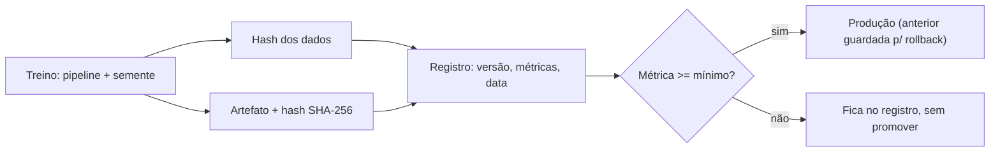

## Passo 1 · Leitura · O artefato é o pipeline inteiro

Um dos defeitos mais silenciosos em aprendizado de máquina é o **desvio entre treino e serviço** (*training-serving skew*): no notebook, os atributos são padronizados com a média e o desvio do conjunto de treino; no serviço, alguém recalcula a média no lote que chegou, esquece a padronização ou troca a ordem das colunas. Nada quebra: o modelo só passa a errar mais.

A defesa é tratar como **artefato** o pipeline inteiro, pré-processamento e modelo juntos, com os parâmetros aprendidos no treino. No scikit-learn isso é um `Pipeline`, salvo com `joblib`:

```python
# Ilustração com scikit-learn e joblib (não estão no executor desta lição)
from sklearn.pipeline import Pipeline
from sklearn.preprocessing import StandardScaler
from sklearn.linear_model import LogisticRegression
import joblib

pipe = Pipeline([("escala", StandardScaler()), ("clf", LogisticRegression(random_state=42))])
pipe.fit(X_treino, y_treino)
joblib.dump(pipe, "evasao-2.1.0.joblib")
```

O executor desta lição tem `numpy`, mas não tem scikit-learn nem joblib. Os exercícios escrevem um pipeline em numpy com a mesma interface (`fit` aprende, `predict` só aplica) e salvam com `pickle`, o formato que o `joblib` usa por baixo (ele acrescenta otimizações para arrays grandes). As regras são as mesmas: o `fit` aprende os parâmetros com os dados de treino e os guarda no objeto; o `predict` só os aplica, linha a linha, sem olhar para as linhas vizinhas do lote.

O artefato sozinho não basta. Para alguém refazer ou auditar uma previsão meses depois, cada versão precisa de metadados:

| Metadado | Responde a |
|---|---|
| versão e data | qual modelo é este, e quando foi produzido |
| hash dos dados de treino | foi treinado exatamente com quais dados |
| hash do artefato | o arquivo é o mesmo que foi registrado |
| versões das bibliotecas e semente | dá para reproduzir o treino e carregar o arquivo |
| métricas de validação | ele merece ir para produção |

Um nome de arquivo como `alunos_final_v2.csv` não identifica dados: o conteúdo muda e o nome fica. O hash muda quando qualquer número muda.



## Passo 2 · Previsão · Padronizar com as estatísticas de quem?

O modelo de brinquedo diz "classe 1" quando o atributo padronizado é positivo, isto é, acima da média **do treino**. O programa padroniza o mesmo lote de duas formas e depois tenta padronizar um lote de uma linha só. Digite a saída.

### Código
```python
import numpy as np

X_treino = np.array([[2.0], [4.0], [6.0], [8.0]])
media, desvio = X_treino.mean(axis=0), X_treino.std(axis=0)


def prever(Xz):
    return (Xz[:, 0] > 0).astype(int).tolist()


lote = np.array([[7.0], [8.0], [9.0]])
print("estatísticas do treino:", prever((lote - media) / desvio))
print("recalculadas no lote:  ", prever((lote - lote.mean(axis=0)) / lote.std(axis=0)))

um = np.array([[9.0]])
with np.errstate(invalid="ignore"):
    print("lote de uma linha:", ((um - um.mean(axis=0)) / um.std(axis=0)).tolist())
```

### Dicas
1. A média do treino é 5; os três valores do lote estão acima dela.
2. Recalculada no lote, a média passa a ser 8: um valor fica abaixo, outro fica exatamente nela.
3. Numa linha só, o desvio é 0 e a conta vira `0 / 0`.

### Saída esperada
```text
estatísticas do treino: [1, 1, 1]
recalculadas no lote:   [0, 0, 1]
lote de uma linha: [[nan]]
```

## Passo 3 · Exercício · O hash dos dados de treino
modo: ordenar

Monte `hash_dos_dados(X, y)`: converta `X` e `y` para `float64` contíguo, alimente um `hashlib.sha256()` com as formas (`shape`) dos dois arrays e depois com os bytes de `X` e de `y`, e devolva o `hexdigest()`. Duas linhas estão sobrando.

### Instruções
1. Converta `X` e `y` para arrays `float64`, para que `[[1, 2]]` e `[[1.0, 2.0]]` deem o mesmo hash.
2. Inclua as formas: um `X` 2×3 e um 3×2 com os mesmos números têm os mesmos bytes.
3. Inclua os bytes de `X` e de `y` e devolva o hexadecimal.
   Dica: `str(array)` não serve; para arrays grandes o numpy resume o texto com `...`.

### Solução
```python
import hashlib
import numpy as np


def hash_dos_dados(X, y):
    xa = np.ascontiguousarray(X, dtype=np.float64)
    ya = np.ascontiguousarray(y, dtype=np.float64)
    h = hashlib.sha256()
    h.update(repr((xa.shape, ya.shape)).encode())
    h.update(xa.tobytes())
    h.update(ya.tobytes())
    return h.hexdigest()
```

### Distratores
```python
    h.update(str(xa).encode())
    xa = np.asarray(X)
```

### Dicas
1. `tobytes()` devolve os bytes crus dos números, sem resumo nenhum.
2. A forma entra como texto: `repr` de uma tupla de tuplas vira bytes com `.encode()`.

### Verificação
```json
[
  { "id": "deterministico", "checkpoint": 3, "kind": "expr",
    "expr": "[hash_dos_dados([[1.0, 2.0], [3.0, 4.0]], [0, 1]) == hash_dos_dados([[1.0, 2.0], [3.0, 4.0]], [0, 1]), len(hash_dos_dados([[1.0]], [0]))]",
    "expected": [true, 64], "name": "Mesmos dados, mesmo hash de 64 caracteres" },
  { "id": "int-e-float", "checkpoint": 1, "kind": "expr",
    "expr": "hash_dos_dados([[1, 2], [3, 4]], [0, 1]) == hash_dos_dados([[1.0, 2.0], [3.0, 4.0]], [0.0, 1.0])",
    "expected": true, "name": "Inteiros e decimais com o mesmo valor dão o mesmo hash", "hint": "Converta tudo para o mesmo tipo antes de pegar os bytes." },
  { "id": "float32", "checkpoint": 1, "kind": "expr",
    "setup": "import numpy as np",
    "expr": "hash_dos_dados(np.array([[0.5, 0.25]], dtype=np.float32), [1]) == hash_dos_dados([[0.5, 0.25]], [1])",
    "expected": true, "name": "Array float32 e lista com os mesmos valores dão o mesmo hash" },
  { "id": "muda-x", "checkpoint": 3, "kind": "expr",
    "expr": "hash_dos_dados([[1.0, 2.0], [3.0, 4.0]], [0, 1]) != hash_dos_dados([[1.0, 2.0], [3.0, 4.5]], [0, 1])",
    "expected": true, "name": "Um valor diferente em X muda o hash" },
  { "id": "muda-y", "checkpoint": 3, "kind": "expr",
    "expr": "hash_dos_dados([[1.0, 2.0], [3.0, 4.0]], [0, 1]) != hash_dos_dados([[1.0, 2.0], [3.0, 4.0]], [1, 1])",
    "expected": true, "name": "Um rótulo diferente muda o hash", "hint": "Os rótulos também são dados de treino." },
  { "id": "forma", "checkpoint": 2, "kind": "expr",
    "expr": "hash_dos_dados([[1, 2, 3], [4, 5, 6]], [0, 1]) != hash_dos_dados([[1, 2], [3, 4], [5, 6]], [0, 1])",
    "expected": true, "name": "2×3 e 3×2 com os mesmos números são dados diferentes" },
  { "id": "ordem-das-linhas", "checkpoint": 3, "kind": "expr",
    "expr": "hash_dos_dados([[1.0, 2.0], [3.0, 4.0]], [0, 1]) != hash_dos_dados([[3.0, 4.0], [1.0, 2.0]], [1, 0])",
    "expected": true, "name": "Trocar a ordem das linhas muda o hash", "hint": "Uma soma ou média não distingue a ordem." },
  { "id": "array-grande", "checkpoint": 3, "kind": "expr",
    "setup": "import numpy as np\nA = np.arange(5000.0).reshape(1000, 5)\nB = A.copy()\nB[500, 2] += 1.0",
    "expr": "hash_dos_dados(A, np.zeros(1000)) != hash_dos_dados(B, np.zeros(1000))",
    "expected": true, "name": "Uma mudança no meio de um array grande muda o hash",
    "hint": "O texto de um array grande é resumido com '...': o meio some." }
]
```

### Soluções erradas
```python name="deixa os rótulos de fora"
import hashlib
import numpy as np


def hash_dos_dados(X, y):
    xa = np.ascontiguousarray(X, dtype=np.float64)
    h = hashlib.sha256()
    h.update(repr(xa.shape).encode())
    h.update(xa.tobytes())
    return h.hexdigest()
```
```python name="sem as formas"
import hashlib
import numpy as np


def hash_dos_dados(X, y):
    xa = np.ascontiguousarray(X, dtype=np.float64)
    ya = np.ascontiguousarray(y, dtype=np.float64)
    h = hashlib.sha256()
    h.update(xa.tobytes())
    h.update(ya.tobytes())
    return h.hexdigest()
```
```python name="hash do texto do array"
import hashlib
import numpy as np


def hash_dos_dados(X, y):
    xa = np.ascontiguousarray(X, dtype=np.float64)
    ya = np.ascontiguousarray(y, dtype=np.float64)
    h = hashlib.sha256()
    h.update(repr((xa.shape, ya.shape)).encode())
    h.update(str(xa).encode())
    h.update(str(ya).encode())
    return h.hexdigest()
```
```python name="sem normalizar o tipo"
import hashlib
import numpy as np


def hash_dos_dados(X, y):
    xa = np.asarray(X)
    ya = np.asarray(y)
    h = hashlib.sha256()
    h.update(repr((xa.shape, ya.shape)).encode())
    h.update(xa.tobytes())
    h.update(ya.tobytes())
    return h.hexdigest()
```
```python name="soma como impressão digital"
import hashlib
import numpy as np


def hash_dos_dados(X, y):
    xa = np.ascontiguousarray(X, dtype=np.float64)
    ya = np.ascontiguousarray(y, dtype=np.float64)
    resumo = f"{xa.shape}|{ya.shape}|{xa.sum()}|{ya.sum()}"
    return hashlib.sha256(resumo.encode()).hexdigest()
```

## Passo 4 · Exercício · Um pipeline que aprende uma vez e só aplica depois

Escreva `PipelinePadronizado`, um pipeline de duas etapas com a interface do scikit-learn: padronização (como o `StandardScaler`) seguida de um classificador por **centroide mais próximo**, calculado no espaço já padronizado. Tudo o que depende dos dados é aprendido no `fit` e guardado em atributos terminados em `_`; o `predict` só aplica.

### Instruções
1. `fit(X, y)` guarda `media_` e `escala_` por coluna, com o desvio **populacional** (o do `StandardScaler`); coluna constante tem desvio 0 e recebe escala `1.0`. Não altere o `X` recebido. Devolva `self`.
2. Ainda no `fit`, guarde `classes_` (rótulos distintos, em ordem crescente) e `centroides_`: a média das linhas **padronizadas** de cada classe.
3. `predict(X)` padroniza com `media_` e `escala_` do treino e devolve, num array, a classe do centroide mais próximo (distância euclidiana; no empate, a primeira classe).
4. `predict` antes do `fit` levanta `RuntimeError`. Guarde só dados nos atributos (arrays, números), para o objeto poder ser salvo com `pickle`.
   Dica: uma `lambda` guardada num atributo não pode ser serializada.

### Código inicial
```python
import numpy as np


class PipelinePadronizado:
    def __init__(self):
        self.media_ = None
        self.escala_ = None
        self.classes_ = None
        self.centroides_ = None

    def fit(self, X, y):
        pass

    def predict(self, X):
        pass
```

### Solução
```python
import numpy as np


class PipelinePadronizado:
    def __init__(self):
        self.media_ = None
        self.escala_ = None
        self.classes_ = None
        self.centroides_ = None

    def _padronizar(self, X):
        return (np.asarray(X, dtype=float) - self.media_) / self.escala_

    def fit(self, X, y):
        X = np.asarray(X, dtype=float)
        y = np.asarray(y)
        self.media_ = X.mean(axis=0)
        desvio = X.std(axis=0)
        self.escala_ = np.where(desvio == 0, 1.0, desvio)
        Z = self._padronizar(X)
        self.classes_ = np.unique(y)
        self.centroides_ = np.array([Z[y == c].mean(axis=0) for c in self.classes_])
        return self

    def predict(self, X):
        if self.media_ is None:
            raise RuntimeError("pipeline não treinado: chame fit antes de predict")
        Z = self._padronizar(X)
        distancias = ((Z[:, None, :] - self.centroides_[None, :, :]) ** 2).sum(axis=2)
        return self.classes_[np.argmin(distancias, axis=1)]
```

### Dicas
1. `X.std(axis=0)` já é o desvio populacional; `np.where` troca os zeros por 1.
2. Com `Z[:, None, :] - C[None, :, :]` você obtém a diferença de cada linha para cada centroide de uma vez.
3. `X = X - m` cria um array novo; `X -= m` escreve em cima do array de quem chamou.

### Verificação
```json
[
  { "id": "fit-devolve-self", "checkpoint": 1, "kind": "expr",
    "setup": "p = PipelinePadronizado()", "expr": "p.fit([[1.0, 2.0], [3.0, 4.0]], [0, 1]) is p", "expected": true,
    "name": "fit devolve o próprio pipeline" },
  { "id": "estatisticas", "checkpoint": 1, "kind": "expr",
    "setup": "p = PipelinePadronizado().fit([[1.0, 5.0, 7.0], [3.0, 5.0, 9.0], [5.0, 5.0, 14.0]], [0, 0, 1])",
    "expr": "[p.media_.tolist(), p.escala_.round(6).tolist()]", "expected": [[3.0, 5.0, 10.0], [1.632993, 1.0, 2.94392]],
    "name": "media_ e escala_ por coluna; coluna constante com escala 1.0",
    "hint": "O StandardScaler usa o desvio populacional (ddof=0)." },
  { "id": "nao-altera-x", "checkpoint": 1, "kind": "expr",
    "setup": "import numpy as np\nX = np.array([[0.9, 7.0, 20.0], [0.3, 2.0, 4.0]])\nPipelinePadronizado().fit(X, [0, 1])",
    "expr": "X.tolist()", "expected": [[0.9, 7.0, 20.0], [0.3, 2.0, 4.0]], "name": "O X de quem chamou continua igual",
    "hint": "Operadores como -= alteram o array no lugar." },
  { "id": "classes-e-centroides", "checkpoint": 2, "kind": "expr",
    "setup": "p = PipelinePadronizado().fit([[0.0, 0.0], [2.0, 2.0], [4.0, 4.0], [6.0, 6.0]], ['b', 'a', 'b', 'a'])",
    "expr": "[p.classes_.tolist(), p.centroides_.round(6).tolist()]",
    "expected": [["a", "b"], [[0.447214, 0.447214], [-0.447214, -0.447214]]],
    "name": "Centroides calculados no espaço padronizado, classes em ordem" },
  { "id": "treino", "checkpoint": 3, "kind": "expr",
    "setup": "X = [[0.95, 8.0, 24], [0.9, 7.0, 20], [0.85, 6.5, 22], [0.4, 3.0, 8], [0.5, 4.0, 6], [0.3, 2.5, 4]]\np = PipelinePadronizado().fit(X, [0, 0, 0, 1, 1, 1])",
    "expr": "p.predict(X).tolist()", "expected": [0, 0, 0, 1, 1, 1], "name": "Acerta as linhas do próprio treino" },
  { "id": "escala-importa", "checkpoint": 2, "kind": "expr",
    "setup": "X = [[0.95, 8.0, 24], [0.9, 7.0, 20], [0.85, 6.5, 22], [0.4, 3.0, 8], [0.5, 4.0, 6], [0.3, 2.5, 4]]\np = PipelinePadronizado().fit(X, [0, 0, 0, 1, 1, 1])",
    "expr": "p.predict([[0.35, 3.0, 20], [0.3, 2.0, 22]]).tolist()", "expected": [1, 1],
    "name": "Frequência e média baixas pesam mesmo com muitos créditos",
    "hint": "Sem padronizar antes de calcular os centroides, a coluna de créditos domina a distância." },
  { "id": "independe-do-lote", "checkpoint": 3, "kind": "expr",
    "setup": "X = [[0.95, 8.0, 24], [0.9, 7.0, 20], [0.85, 6.5, 22], [0.4, 3.0, 8], [0.5, 4.0, 6], [0.3, 2.5, 4]]\np = PipelinePadronizado().fit(X, [0, 0, 0, 1, 1, 1])\nlote = [[0.3, 2.0, 22], [0.35, 3.0, 20], [0.4, 2.5, 21]]",
    "expr": "[p.predict(lote).tolist(), p.predict([lote[0]]).tolist()]", "expected": [[1, 1, 1], [1]],
    "name": "A previsão de uma linha não depende do lote em que ela chega",
    "hint": "No predict, use só o que o fit aprendeu." },
  { "id": "antes-do-fit", "checkpoint": 4, "kind": "expr",
    "expr": "PipelinePadronizado().predict([[1.0, 2.0]])", "raises": "RuntimeError",
    "name": "predict antes do fit levanta RuntimeError" },
  { "id": "pickle", "checkpoint": 4, "kind": "expr",
    "setup": "import pickle\nX = [[0.95, 8.0, 24], [0.9, 7.0, 20], [0.4, 3.0, 8], [0.3, 2.5, 4]]\np = PipelinePadronizado().fit(X, [0, 0, 1, 1])\nq = pickle.loads(pickle.dumps(p))",
    "expr": "q.predict([[0.35, 3.0, 20], [0.9, 7.5, 21]]).tolist()", "expected": [1, 0],
    "name": "O pipeline treinado sobrevive a pickle e prevê igual", "hint": "Funções anônimas guardadas em atributos não são serializáveis." }
]
```

### Soluções erradas
```python name="recalcula média e desvio no predict"
import numpy as np


class PipelinePadronizado:
    def __init__(self):
        self.media_ = None
        self.escala_ = None
        self.classes_ = None
        self.centroides_ = None

    def fit(self, X, y):
        X = np.asarray(X, dtype=float)
        y = np.asarray(y)
        self.media_ = X.mean(axis=0)
        desvio = X.std(axis=0)
        self.escala_ = np.where(desvio == 0, 1.0, desvio)
        Z = (X - self.media_) / self.escala_
        self.classes_ = np.unique(y)
        self.centroides_ = np.array([Z[y == c].mean(axis=0) for c in self.classes_])
        return self

    def predict(self, X):
        if self.media_ is None:
            raise RuntimeError("pipeline não treinado")
        X = np.asarray(X, dtype=float)
        desvio = X.std(axis=0)
        Z = (X - X.mean(axis=0)) / np.where(desvio == 0, 1.0, desvio)
        distancias = ((Z[:, None, :] - self.centroides_[None, :, :]) ** 2).sum(axis=2)
        return self.classes_[np.argmin(distancias, axis=1)]
```
```python name="divide pelo desvio zero"
import numpy as np


class PipelinePadronizado:
    def __init__(self):
        self.media_ = None
        self.escala_ = None
        self.classes_ = None
        self.centroides_ = None

    def fit(self, X, y):
        X = np.asarray(X, dtype=float)
        y = np.asarray(y)
        self.media_ = X.mean(axis=0)
        self.escala_ = X.std(axis=0)
        with np.errstate(invalid="ignore", divide="ignore"):
            Z = (X - self.media_) / self.escala_
        self.classes_ = np.unique(y)
        self.centroides_ = np.array([Z[y == c].mean(axis=0) for c in self.classes_])
        return self

    def predict(self, X):
        if self.media_ is None:
            raise RuntimeError("pipeline não treinado")
        with np.errstate(invalid="ignore", divide="ignore"):
            Z = (np.asarray(X, dtype=float) - self.media_) / self.escala_
        distancias = ((Z[:, None, :] - self.centroides_[None, :, :]) ** 2).sum(axis=2)
        return self.classes_[np.argmin(distancias, axis=1)]
```
```python name="desvio amostral, diferente do StandardScaler"
import numpy as np


class PipelinePadronizado:
    def __init__(self):
        self.media_ = None
        self.escala_ = None
        self.classes_ = None
        self.centroides_ = None

    def fit(self, X, y):
        X = np.asarray(X, dtype=float)
        y = np.asarray(y)
        self.media_ = X.mean(axis=0)
        desvio = X.std(axis=0, ddof=1)
        self.escala_ = np.where(desvio == 0, 1.0, desvio)
        Z = (X - self.media_) / self.escala_
        self.classes_ = np.unique(y)
        self.centroides_ = np.array([Z[y == c].mean(axis=0) for c in self.classes_])
        return self

    def predict(self, X):
        if self.media_ is None:
            raise RuntimeError("pipeline não treinado")
        Z = (np.asarray(X, dtype=float) - self.media_) / self.escala_
        distancias = ((Z[:, None, :] - self.centroides_[None, :, :]) ** 2).sum(axis=2)
        return self.classes_[np.argmin(distancias, axis=1)]
```
```python name="centroides calculados nos dados brutos"
import numpy as np


class PipelinePadronizado:
    def __init__(self):
        self.media_ = None
        self.escala_ = None
        self.classes_ = None
        self.centroides_ = None

    def fit(self, X, y):
        X = np.asarray(X, dtype=float)
        y = np.asarray(y)
        self.media_ = X.mean(axis=0)
        desvio = X.std(axis=0)
        self.escala_ = np.where(desvio == 0, 1.0, desvio)
        self.classes_ = np.unique(y)
        self.centroides_ = np.array([X[y == c].mean(axis=0) for c in self.classes_])
        return self

    def predict(self, X):
        if self.media_ is None:
            raise RuntimeError("pipeline não treinado")
        X = np.asarray(X, dtype=float)
        distancias = ((X[:, None, :] - self.centroides_[None, :, :]) ** 2).sum(axis=2)
        return self.classes_[np.argmin(distancias, axis=1)]
```
```python name="padroniza o X de quem chamou no lugar"
import numpy as np


class PipelinePadronizado:
    def __init__(self):
        self.media_ = None
        self.escala_ = None
        self.classes_ = None
        self.centroides_ = None

    def fit(self, X, y):
        X = np.asarray(X, dtype=float)
        y = np.asarray(y)
        self.media_ = X.mean(axis=0)
        desvio = X.std(axis=0)
        self.escala_ = np.where(desvio == 0, 1.0, desvio)
        X -= self.media_
        X /= self.escala_
        self.classes_ = np.unique(y)
        self.centroides_ = np.array([X[y == c].mean(axis=0) for c in self.classes_])
        return self

    def predict(self, X):
        if self.media_ is None:
            raise RuntimeError("pipeline não treinado")
        Z = (np.asarray(X, dtype=float) - self.media_) / self.escala_
        distancias = ((Z[:, None, :] - self.centroides_[None, :, :]) ** 2).sum(axis=2)
        return self.classes_[np.argmin(distancias, axis=1)]
```
```python name="não confere se foi treinado"
import numpy as np


class PipelinePadronizado:
    def __init__(self):
        self.media_ = None
        self.escala_ = None
        self.classes_ = None
        self.centroides_ = None

    def fit(self, X, y):
        X = np.asarray(X, dtype=float)
        y = np.asarray(y)
        self.media_ = X.mean(axis=0)
        desvio = X.std(axis=0)
        self.escala_ = np.where(desvio == 0, 1.0, desvio)
        Z = (X - self.media_) / self.escala_
        self.classes_ = np.unique(y)
        self.centroides_ = np.array([Z[y == c].mean(axis=0) for c in self.classes_])
        return self

    def predict(self, X):
        Z = (np.asarray(X, dtype=float) - self.media_) / self.escala_
        distancias = ((Z[:, None, :] - self.centroides_[None, :, :]) ** 2).sum(axis=2)
        return self.classes_[np.argmin(distancias, axis=1)]
```
```python name="guarda a padronização numa lambda"
import numpy as np


class PipelinePadronizado:
    def __init__(self):
        self.media_ = None
        self.escala_ = None
        self.classes_ = None
        self.centroides_ = None

    def fit(self, X, y):
        X = np.asarray(X, dtype=float)
        y = np.asarray(y)
        self.media_ = X.mean(axis=0)
        desvio = X.std(axis=0)
        self.escala_ = np.where(desvio == 0, 1.0, desvio)
        self.padronizar = lambda A: (np.asarray(A, dtype=float) - self.media_) / self.escala_
        Z = self.padronizar(X)
        self.classes_ = np.unique(y)
        self.centroides_ = np.array([Z[y == c].mean(axis=0) for c in self.classes_])
        return self

    def predict(self, X):
        if self.media_ is None:
            raise RuntimeError("pipeline não treinado")
        Z = self.padronizar(X)
        distancias = ((Z[:, None, :] - self.centroides_[None, :, :]) ** 2).sum(axis=2)
        return self.classes_[np.argmin(distancias, axis=1)]
```

## Passo 5 · Leitura · Salvar com segurança e registrar versões

**Integridade antes de desserializar.** `pickle.load` (e `joblib.load`, que o usa) executa código durante a leitura: um objeto pode declarar, em `__reduce__`, qual função chamar para se reconstruir. Por isso a ordem é fixa: ler os metadados, calcular o SHA-256 dos bytes do arquivo, comparar com o hash registrado e **só então** desserializar. Conferir depois do `load` não protege nada; o código já rodou. O hash não torna um arquivo confiável, ele prova que o arquivo é o mesmo que a sua equipe registrou.

**Versões de bibliotecas.** Um artefato salvo com uma versão de biblioteca pode falhar, ou carregar e prever diferente, em outra; o scikit-learn emite `InconsistentVersionWarning` nesse caso. Por isso os metadados guardam as versões do ambiente de treino e o carregamento compara com as do ambiente atual, recusando quando divergem. A imagem Docker fixa essas versões (`requirements.txt` com `==`).

**Imutabilidade.** Uma versão publicada nunca é sobrescrita: se o arquivo `evasao-2.1.0` já existe, salvar de novo com esse nome é erro. Corrigiu algo? É a 2.1.1. Do contrário, duas previsões com "a mesma versão" podem ter vindo de modelos diferentes.

**Reprodutibilidade.** Semente fixa (`random_state`) em tudo que sorteia, hash dos dados e versões das bibliotecas permitem refazer o treino e obter o mesmo artefato, ou explicar por que não.

**O registro de modelos.** Cada versão entra com hash do artefato, métricas e data. A promoção a produção exige a métrica mínima, medida no mesmo conjunto de validação para todas as versões, senão a comparação não vale. A versão que sai de produção é guardada numa pilha para o **rollback**, e cada operação vira um evento num histórico que só cresce. A data vem de um relógio injetado, que nos testes é falso, como o `Relogio` do módulo 1. O registro inteiro é salvo em JSON, com a pilha: sem ela, um rollback depois de reiniciar o processo é impossível.

```python visualizar
producao = None
pilha = []
eventos = []


def promover(versao):
    global producao
    if producao is not None:
        pilha.append(producao)
    eventos.append(("promocao", versao))
    producao = versao
    print("produção:", producao, "| pilha:", pilha)


def rollback():
    global producao
    anterior = pilha.pop()
    eventos.append(("rollback", producao, anterior))
    producao = anterior
    print("produção:", producao, "| pilha:", pilha)


promover("v1")
promover("v2")
promover("v3")
rollback()
print(eventos)
```

## Passo 6 · Exercício · Salvar e carregar o artefato com verificação

Escreva `salvar_modelo(objeto, caminho, metadados, bibliotecas)` e `carregar_modelo(caminho, bibliotecas)`. `bibliotecas` é um dicionário nome → versão (por exemplo `{"numpy": np.__version__, "python": "3.12"}`); no salvamento ele descreve o ambiente de treino e no carregamento, o ambiente atual. Os metadados ficam em `caminho + ".meta.json"`.

### Instruções
1. `salvar_modelo` recusa com `FileExistsError` se o artefato ou o `.meta.json` já existem: versão publicada não é sobrescrita.
2. Grave o objeto com `pickle` em `caminho`, calcule o SHA-256 dos bytes do arquivo e grave o JSON com uma **cópia** de `metadados` mais `"sha256"` e `"bibliotecas"`. Devolva esse dicionário.
3. `carregar_modelo` lê o `.meta.json` (sem ele, deixe o `FileNotFoundError` subir) e confere o SHA-256 do arquivo **antes** de desserializar; divergente, levanta `ValueError` com `"hash"` na mensagem.
4. Compare cada biblioteca registrada com a versão atual; se alguma diverge, levante `ValueError` com os nomes divergentes em ordem alfabética, separados por `", "`. Tudo certo: devolva `(objeto, metadados)`.
   Dica: o teste usa um objeto que cria uma pasta quando é desserializado; ela não pode aparecer quando o hash diverge.

### Código inicial
```python
import hashlib
import json
import os
import pickle


def sha256_arquivo(caminho):
    with open(caminho, "rb") as f:
        return hashlib.sha256(f.read()).hexdigest()


def salvar_modelo(objeto, caminho, metadados, bibliotecas):
    pass


def carregar_modelo(caminho, bibliotecas):
    pass
```

### Solução
```python
import hashlib
import json
import os
import pickle


def sha256_arquivo(caminho):
    with open(caminho, "rb") as f:
        return hashlib.sha256(f.read()).hexdigest()


def salvar_modelo(objeto, caminho, metadados, bibliotecas):
    caminho_meta = caminho + ".meta.json"
    if os.path.exists(caminho) or os.path.exists(caminho_meta):
        raise FileExistsError(f"versão já publicada: {caminho}")
    with open(caminho, "wb") as f:
        pickle.dump(objeto, f)
    meta = dict(metadados)
    meta["sha256"] = sha256_arquivo(caminho)
    meta["bibliotecas"] = dict(bibliotecas)
    with open(caminho_meta, "w", encoding="utf-8") as f:
        json.dump(meta, f, ensure_ascii=False, sort_keys=True)
    return meta


def carregar_modelo(caminho, bibliotecas):
    with open(caminho + ".meta.json", encoding="utf-8") as f:
        meta = json.load(f)
    if sha256_arquivo(caminho) != meta.get("sha256"):
        raise ValueError("artefato adulterado: hash divergente")
    divergentes = sorted(
        nome for nome, versao in meta.get("bibliotecas", {}).items() if bibliotecas.get(nome) != versao
    )
    if divergentes:
        raise ValueError("versões de bibliotecas divergentes: " + ", ".join(divergentes))
    with open(caminho, "rb") as f:
        objeto = pickle.load(f)
    return objeto, meta
```

### Dicas
1. `dict(metadados)` faz uma cópia rasa: acrescentar chaves nela não muda o dicionário de quem chamou.
2. O `pickle.load` lê até o fim do objeto e ignora bytes a mais no arquivo; por isso só o hash percebe um arquivo com lixo acrescentado.
3. Uma compreensão com `sorted(...)` dá os nomes divergentes já em ordem.

### Verificação
```json
[
  { "id": "ida-e-volta", "checkpoint": 2, "kind": "expr",
    "setup": "import numpy as np\nobj = {'media': np.array([1.0, 2.0]), 'pesos': [0.5, -0.25]}\nmeta = salvar_modelo(obj, 'm1.bin', {'versao': '1.0.0'}, {'numpy': '2.0'})\nlido, meta_lido = carregar_modelo('m1.bin', {'numpy': '2.0'})",
    "expr": "[lido['media'].tolist(), lido['pesos'], meta_lido['versao'], meta_lido['bibliotecas'], len(meta_lido['sha256']), meta == meta_lido]",
    "expected": [[1.0, 2.0], [0.5, -0.25], "1.0.0", {"numpy": "2.0"}, 64, true],
    "name": "Salva, carrega e devolve os mesmos metadados" },
  { "id": "hash-do-arquivo", "checkpoint": 2, "kind": "expr",
    "setup": "import hashlib, json\nsalvar_modelo([1, 2, 3], 'm2.bin', {'versao': '1.0.0'}, {})\nno_disco = json.load(open('m2.bin.meta.json', encoding='utf-8'))",
    "expr": "no_disco['sha256'] == hashlib.sha256(open('m2.bin', 'rb').read()).hexdigest()", "expected": true,
    "name": "O .meta.json guarda o SHA-256 dos bytes do artefato" },
  { "id": "metadados-intactos", "checkpoint": 2, "kind": "expr",
    "setup": "info = {'versao': '1.0.0', 'f1': 0.81}\nsalvar_modelo([1], 'm3.bin', info, {'numpy': '2.0'})",
    "expr": "info", "expected": {"versao": "1.0.0", "f1": 0.81}, "name": "O dicionário de metadados de quem chamou não muda" },
  { "id": "nao-sobrescreve", "checkpoint": 1, "kind": "expr",
    "setup": "salvar_modelo([1, 2], 'm4.bin', {'versao': '1.0.0'}, {})\nantes = open('m4.bin', 'rb').read()\ntry:\n    salvar_modelo([9, 9], 'm4.bin', {'versao': '1.0.0'}, {})\n    erro = None\nexcept FileExistsError:\n    erro = 'FileExistsError'",
    "expr": "[erro, open('m4.bin', 'rb').read() == antes]", "expected": ["FileExistsError", true],
    "name": "Salvar de novo na mesma versão é recusado e o arquivo fica intacto" },
  { "id": "adulterado", "checkpoint": 3, "kind": "expr",
    "setup": "salvar_modelo({'a': 1}, 'm5.bin', {'versao': '1.0.0'}, {})\nwith open('m5.bin', 'ab') as f:\n    f.write(b'lixo')",
    "expr": "carregar_modelo('m5.bin', {})", "raises": "ValueError", "message_contains": "hash",
    "name": "Arquivo alterado depois do registro é recusado" },
  { "id": "nao-desserializa", "checkpoint": 3, "kind": "expr",
    "setup": "import os\nclass Armadilha:\n    def __reduce__(self):\n        return (os.mkdir, ('efeito_m6',))\nsalvar_modelo(Armadilha(), 'm6.bin', {'versao': '1.0.0'}, {})\nwith open('m6.bin', 'ab') as f:\n    f.write(b'lixo')\ntry:\n    carregar_modelo('m6.bin', {})\n    erro = None\nexcept ValueError:\n    erro = 'ValueError'",
    "expr": "[erro, os.path.exists('efeito_m6')]", "expected": ["ValueError", false],
    "name": "Com hash divergente, nada é desserializado",
    "hint": "O código de um pickle roda durante o load: confira o hash antes." },
  { "id": "sem-meta", "checkpoint": 3, "kind": "expr",
    "setup": "import os\nsalvar_modelo([1], 'm7.bin', {'versao': '1.0.0'}, {})\nos.remove('m7.bin.meta.json')",
    "expr": "carregar_modelo('m7.bin', {})", "raises": "FileNotFoundError",
    "name": "Sem metadados, o artefato não é carregado" },
  { "id": "biblioteca-divergente", "checkpoint": 4, "kind": "expr",
    "setup": "salvar_modelo([1], 'm8.bin', {'versao': '1.0.0'}, {'numpy': '2.0', 'python': '3.12'})",
    "expr": "carregar_modelo('m8.bin', {'numpy': '1.26', 'python': '3.12'})", "raises": "ValueError", "message_contains": "numpy",
    "name": "Versão de biblioteca diferente da do treino é recusada" },
  { "id": "todas-as-divergentes", "checkpoint": 4, "kind": "expr",
    "setup": "salvar_modelo([1], 'm9.bin', {'versao': '1.0.0'}, {'python': '3.12', 'numpy': '2.0'})",
    "expr": "carregar_modelo('m9.bin', {'numpy': '1.26'})", "raises": "ValueError", "message_contains": "numpy, python",
    "name": "A mensagem lista todas as bibliotecas divergentes, em ordem",
    "hint": "Uma biblioteca que falta no ambiente atual também diverge." }
]
```

### Soluções erradas
```python name="não confere o hash"
import hashlib
import json
import os
import pickle


def sha256_arquivo(caminho):
    with open(caminho, "rb") as f:
        return hashlib.sha256(f.read()).hexdigest()


def salvar_modelo(objeto, caminho, metadados, bibliotecas):
    if os.path.exists(caminho) or os.path.exists(caminho + ".meta.json"):
        raise FileExistsError(caminho)
    with open(caminho, "wb") as f:
        pickle.dump(objeto, f)
    meta = dict(metadados)
    meta["sha256"] = sha256_arquivo(caminho)
    meta["bibliotecas"] = dict(bibliotecas)
    with open(caminho + ".meta.json", "w", encoding="utf-8") as f:
        json.dump(meta, f)
    return meta


def carregar_modelo(caminho, bibliotecas):
    with open(caminho + ".meta.json", encoding="utf-8") as f:
        meta = json.load(f)
    divergentes = sorted(n for n, v in meta.get("bibliotecas", {}).items() if bibliotecas.get(n) != v)
    if divergentes:
        raise ValueError("versões de bibliotecas divergentes: " + ", ".join(divergentes))
    with open(caminho, "rb") as f:
        return pickle.load(f), meta
```
```python name="confere o hash depois de desserializar"
import hashlib
import json
import os
import pickle


def sha256_arquivo(caminho):
    with open(caminho, "rb") as f:
        return hashlib.sha256(f.read()).hexdigest()


def salvar_modelo(objeto, caminho, metadados, bibliotecas):
    if os.path.exists(caminho) or os.path.exists(caminho + ".meta.json"):
        raise FileExistsError(caminho)
    with open(caminho, "wb") as f:
        pickle.dump(objeto, f)
    meta = dict(metadados)
    meta["sha256"] = sha256_arquivo(caminho)
    meta["bibliotecas"] = dict(bibliotecas)
    with open(caminho + ".meta.json", "w", encoding="utf-8") as f:
        json.dump(meta, f)
    return meta


def carregar_modelo(caminho, bibliotecas):
    with open(caminho + ".meta.json", encoding="utf-8") as f:
        meta = json.load(f)
    with open(caminho, "rb") as f:
        objeto = pickle.load(f)
    if sha256_arquivo(caminho) != meta.get("sha256"):
        raise ValueError("artefato adulterado: hash divergente")
    divergentes = sorted(n for n, v in meta.get("bibliotecas", {}).items() if bibliotecas.get(n) != v)
    if divergentes:
        raise ValueError("versões de bibliotecas divergentes: " + ", ".join(divergentes))
    return objeto, meta
```
```python name="sobrescreve uma versão já publicada"
import hashlib
import json
import os
import pickle


def sha256_arquivo(caminho):
    with open(caminho, "rb") as f:
        return hashlib.sha256(f.read()).hexdigest()


def salvar_modelo(objeto, caminho, metadados, bibliotecas):
    with open(caminho, "wb") as f:
        pickle.dump(objeto, f)
    meta = dict(metadados)
    meta["sha256"] = sha256_arquivo(caminho)
    meta["bibliotecas"] = dict(bibliotecas)
    with open(caminho + ".meta.json", "w", encoding="utf-8") as f:
        json.dump(meta, f)
    return meta


def carregar_modelo(caminho, bibliotecas):
    with open(caminho + ".meta.json", encoding="utf-8") as f:
        meta = json.load(f)
    if sha256_arquivo(caminho) != meta.get("sha256"):
        raise ValueError("artefato adulterado: hash divergente")
    divergentes = sorted(n for n, v in meta.get("bibliotecas", {}).items() if bibliotecas.get(n) != v)
    if divergentes:
        raise ValueError("versões de bibliotecas divergentes: " + ", ".join(divergentes))
    with open(caminho, "rb") as f:
        return pickle.load(f), meta
```
```python name="escreve o hash no dicionário de quem chamou"
import hashlib
import json
import os
import pickle


def sha256_arquivo(caminho):
    with open(caminho, "rb") as f:
        return hashlib.sha256(f.read()).hexdigest()


def salvar_modelo(objeto, caminho, metadados, bibliotecas):
    if os.path.exists(caminho) or os.path.exists(caminho + ".meta.json"):
        raise FileExistsError(caminho)
    with open(caminho, "wb") as f:
        pickle.dump(objeto, f)
    meta = metadados
    meta["sha256"] = sha256_arquivo(caminho)
    meta["bibliotecas"] = dict(bibliotecas)
    with open(caminho + ".meta.json", "w", encoding="utf-8") as f:
        json.dump(meta, f)
    return meta


def carregar_modelo(caminho, bibliotecas):
    with open(caminho + ".meta.json", encoding="utf-8") as f:
        meta = json.load(f)
    if sha256_arquivo(caminho) != meta.get("sha256"):
        raise ValueError("artefato adulterado: hash divergente")
    divergentes = sorted(n for n, v in meta.get("bibliotecas", {}).items() if bibliotecas.get(n) != v)
    if divergentes:
        raise ValueError("versões de bibliotecas divergentes: " + ", ".join(divergentes))
    with open(caminho, "rb") as f:
        return pickle.load(f), meta
```
```python name="sem metadados, carrega assim mesmo"
import hashlib
import json
import os
import pickle


def sha256_arquivo(caminho):
    with open(caminho, "rb") as f:
        return hashlib.sha256(f.read()).hexdigest()


def salvar_modelo(objeto, caminho, metadados, bibliotecas):
    if os.path.exists(caminho) or os.path.exists(caminho + ".meta.json"):
        raise FileExistsError(caminho)
    with open(caminho, "wb") as f:
        pickle.dump(objeto, f)
    meta = dict(metadados)
    meta["sha256"] = sha256_arquivo(caminho)
    meta["bibliotecas"] = dict(bibliotecas)
    with open(caminho + ".meta.json", "w", encoding="utf-8") as f:
        json.dump(meta, f)
    return meta


def carregar_modelo(caminho, bibliotecas):
    if not os.path.exists(caminho + ".meta.json"):
        with open(caminho, "rb") as f:
            return pickle.load(f), {}
    with open(caminho + ".meta.json", encoding="utf-8") as f:
        meta = json.load(f)
    if sha256_arquivo(caminho) != meta.get("sha256"):
        raise ValueError("artefato adulterado: hash divergente")
    divergentes = sorted(n for n, v in meta.get("bibliotecas", {}).items() if bibliotecas.get(n) != v)
    if divergentes:
        raise ValueError("versões de bibliotecas divergentes: " + ", ".join(divergentes))
    with open(caminho, "rb") as f:
        return pickle.load(f), meta
```
```python name="não compara as versões das bibliotecas"
import hashlib
import json
import os
import pickle


def sha256_arquivo(caminho):
    with open(caminho, "rb") as f:
        return hashlib.sha256(f.read()).hexdigest()


def salvar_modelo(objeto, caminho, metadados, bibliotecas):
    if os.path.exists(caminho) or os.path.exists(caminho + ".meta.json"):
        raise FileExistsError(caminho)
    with open(caminho, "wb") as f:
        pickle.dump(objeto, f)
    meta = dict(metadados)
    meta["sha256"] = sha256_arquivo(caminho)
    meta["bibliotecas"] = dict(bibliotecas)
    with open(caminho + ".meta.json", "w", encoding="utf-8") as f:
        json.dump(meta, f)
    return meta


def carregar_modelo(caminho, bibliotecas):
    with open(caminho + ".meta.json", encoding="utf-8") as f:
        meta = json.load(f)
    if sha256_arquivo(caminho) != meta.get("sha256"):
        raise ValueError("artefato adulterado: hash divergente")
    with open(caminho, "rb") as f:
        return pickle.load(f), meta
```
```python name="só compara as bibliotecas que o ambiente atual tem"
import hashlib
import json
import os
import pickle


def sha256_arquivo(caminho):
    with open(caminho, "rb") as f:
        return hashlib.sha256(f.read()).hexdigest()


def salvar_modelo(objeto, caminho, metadados, bibliotecas):
    if os.path.exists(caminho) or os.path.exists(caminho + ".meta.json"):
        raise FileExistsError(caminho)
    with open(caminho, "wb") as f:
        pickle.dump(objeto, f)
    meta = dict(metadados)
    meta["sha256"] = sha256_arquivo(caminho)
    meta["bibliotecas"] = dict(bibliotecas)
    with open(caminho + ".meta.json", "w", encoding="utf-8") as f:
        json.dump(meta, f)
    return meta


def carregar_modelo(caminho, bibliotecas):
    with open(caminho + ".meta.json", encoding="utf-8") as f:
        meta = json.load(f)
    if sha256_arquivo(caminho) != meta.get("sha256"):
        raise ValueError("artefato adulterado: hash divergente")
    divergentes = sorted(n for n, v in bibliotecas.items() if meta.get("bibliotecas", {}).get(n, v) != v)
    if divergentes:
        raise ValueError("versões de bibliotecas divergentes: " + ", ".join(divergentes))
    with open(caminho, "rb") as f:
        return pickle.load(f), meta
```

## Passo 7 · Exercício · O registro de modelos

Escreva `RegistroDeModelos(agora)`, o registro da leitura anterior. `agora` é uma função sem argumentos que devolve a data e hora em texto; chame-a **uma vez por operação** que muda o estado (nos testes ela é um relógio falso).

### Instruções
1. `registrar(versao, sha256, metricas)` guarda em `versoes[versao]` o dicionário `{"versao", "sha256", "metricas" (cópia), "registrado_em"}` e acrescenta a `eventos` `{"evento": "registro", "versao": versao, "em": data}`. Versão repetida levanta `ValueError` sem mudar nada.
2. `promover(versao, metrica="f1", minimo=0.75)`: versão desconhecida levanta `KeyError`; métrica ausente ou abaixo do mínimo (o mínimo vale) levanta `ValueError`. Promover a versão que já está em produção não faz nada.
3. Na promoção, a versão que estava em `producao` (se havia) vai para o topo de `pilha`, e entra o evento `{"evento": "promocao", "versao": versao, "anterior": ..., "em": data}`.
4. `rollback()` tira o topo da `pilha` e o põe em produção, com o evento `{"evento": "rollback", "de": ..., "para": ..., "em": data}`; pilha vazia levanta `ValueError`. Os eventos antigos nunca são apagados.
5. `para_json()` devolve um texto JSON com `versoes`, `producao`, `pilha` e `eventos`; `RegistroDeModelos.de_json(texto, agora)` reconstrói um registro equivalente.

### Código inicial
```python
import json


class RegistroDeModelos:
    def __init__(self, agora):
        self.agora = agora
        self.versoes = {}
        self.producao = None
        self.pilha = []
        self.eventos = []

    def registrar(self, versao, sha256, metricas):
        pass

    def promover(self, versao, metrica="f1", minimo=0.75):
        pass

    def rollback(self):
        pass

    def para_json(self):
        pass

    @classmethod
    def de_json(cls, texto, agora):
        pass
```

### Solução
```python
import json


class RegistroDeModelos:
    def __init__(self, agora):
        self.agora = agora
        self.versoes = {}
        self.producao = None
        self.pilha = []
        self.eventos = []

    def registrar(self, versao, sha256, metricas):
        if versao in self.versoes:
            raise ValueError(f"versão já registrada: {versao}")
        data = self.agora()
        self.versoes[versao] = {
            "versao": versao,
            "sha256": sha256,
            "metricas": dict(metricas),
            "registrado_em": data,
        }
        self.eventos.append({"evento": "registro", "versao": versao, "em": data})

    def promover(self, versao, metrica="f1", minimo=0.75):
        if versao not in self.versoes:
            raise KeyError(versao)
        valor = self.versoes[versao]["metricas"].get(metrica)
        if valor is None or valor < minimo:
            raise ValueError(f"{metrica} = {valor} não atinge o mínimo {minimo}")
        if versao == self.producao:
            return
        anterior = self.producao
        if anterior is not None:
            self.pilha.append(anterior)
        self.producao = versao
        self.eventos.append({"evento": "promocao", "versao": versao, "anterior": anterior, "em": self.agora()})

    def rollback(self):
        if not self.pilha:
            raise ValueError("não há versão anterior para o rollback")
        atual = self.producao
        self.producao = self.pilha.pop()
        self.eventos.append({"evento": "rollback", "de": atual, "para": self.producao, "em": self.agora()})
        return self.producao

    def para_json(self):
        return json.dumps(
            {"versoes": self.versoes, "producao": self.producao, "pilha": self.pilha, "eventos": self.eventos},
            ensure_ascii=False,
            sort_keys=True,
        )

    @classmethod
    def de_json(cls, texto, agora):
        dados = json.loads(texto)
        registro = cls(agora)
        registro.versoes = dados["versoes"]
        registro.producao = dados["producao"]
        registro.pilha = dados["pilha"]
        registro.eventos = dados["eventos"]
        return registro
```

### Dicas
1. Confira tudo o que pode falhar antes de mudar qualquer atributo: um erro no meio deixa o registro pela metade.
2. `None < 0.75` levanta `TypeError` em Python 3; trate a métrica ausente antes de comparar.
3. A pilha é estado, não detalhe: sem ela no JSON, o registro reconstruído não sabe para onde voltar.

### Verificação
```json
[
  { "id": "registra", "checkpoint": 1, "kind": "expr",
    "setup": "class Relogio:\n    def __init__(self):\n        self.n = 0\n    def __call__(self):\n        self.n += 1\n        return f'2026-03-{self.n:02d}'\nreg = RegistroDeModelos(Relogio())\nm = {'f1': 0.82}\nreg.registrar('v1', 'aaa', m)\nm['f1'] = 0.1",
    "expr": "[reg.versoes, reg.eventos]",
    "expected": [{"v1": {"versao": "v1", "sha256": "aaa", "metricas": {"f1": 0.82}, "registrado_em": "2026-03-01"}}, [{"evento": "registro", "versao": "v1", "em": "2026-03-01"}]],
    "name": "registrar guarda cópia das métricas, data do relógio e o evento",
    "hint": "A data vem da função agora recebida no construtor, não do relógio do sistema." },
  { "id": "duplicada", "checkpoint": 1, "kind": "expr",
    "setup": "reg = RegistroDeModelos(lambda: '2026-03-01')\nreg.registrar('v1', 'aaa', {'f1': 0.82})\ntry:\n    reg.registrar('v1', 'bbb', {'f1': 0.99})\n    erro = None\nexcept ValueError:\n    erro = 'ValueError'",
    "expr": "[erro, reg.versoes['v1']['sha256'], reg.versoes['v1']['metricas'], len(reg.eventos)]",
    "expected": ["ValueError", "aaa", {"f1": 0.82}, 1], "name": "Versão repetida é recusada e nada muda" },
  { "id": "abaixo-do-minimo", "checkpoint": 2, "kind": "expr",
    "setup": "reg = RegistroDeModelos(lambda: '2026-03-01')\nreg.registrar('v1', 'aaa', {'f1': 0.60})\ntry:\n    reg.promover('v1')\n    erro = None\nexcept ValueError:\n    erro = 'ValueError'",
    "expr": "[erro, reg.producao, reg.pilha]", "expected": ["ValueError", null, []], "name": "F1 abaixo do mínimo não vai para produção" },
  { "id": "no-limite", "checkpoint": 2, "kind": "expr",
    "setup": "reg = RegistroDeModelos(lambda: '2026-03-01')\nreg.registrar('v1', 'aaa', {'f1': 0.75})\nreg.promover('v1')",
    "expr": "reg.producao", "expected": "v1", "name": "Métrica igual ao mínimo é promovida" },
  { "id": "metrica-ausente", "checkpoint": 2, "kind": "expr",
    "setup": "reg = RegistroDeModelos(lambda: '2026-03-01')\nreg.registrar('v1', 'aaa', {'acuracia': 0.91})",
    "expr": "reg.promover('v1')", "raises": "ValueError", "name": "Sem a métrica exigida, promoção recusada com ValueError",
    "hint": "Compare só depois de confirmar que a métrica existe." },
  { "id": "desconhecida", "checkpoint": 2, "kind": "expr",
    "setup": "reg = RegistroDeModelos(lambda: '2026-03-01')",
    "expr": "reg.promover('v9')", "raises": "KeyError", "name": "Promover versão não registrada levanta KeyError" },
  { "id": "promove-e-volta", "checkpoint": 4, "kind": "expr",
    "setup": "class Relogio:\n    def __init__(self):\n        self.n = 0\n    def __call__(self):\n        self.n += 1\n        return f'2026-03-{self.n:02d}'\nreg = RegistroDeModelos(Relogio())\nreg.registrar('v1', 'aaa', {'f1': 0.80})\nreg.registrar('v2', 'bbb', {'f1': 0.84})\nreg.promover('v1')\nreg.promover('v2')\nvolta = reg.rollback()",
    "expr": "[volta, reg.producao, reg.pilha, reg.eventos[2:]]",
    "expected": ["v1", "v1", [], [{"evento": "promocao", "versao": "v1", "anterior": null, "em": "2026-03-03"}, {"evento": "promocao", "versao": "v2", "anterior": "v1", "em": "2026-03-04"}, {"evento": "rollback", "de": "v2", "para": "v1", "em": "2026-03-05"}]],
    "name": "Promoções e rollback, com o histórico completo" },
  { "id": "rollback-vazio", "checkpoint": 4, "kind": "expr",
    "setup": "reg = RegistroDeModelos(lambda: '2026-03-01')\nreg.registrar('v1', 'aaa', {'f1': 0.80})\nreg.promover('v1')",
    "expr": "reg.rollback()", "raises": "ValueError", "name": "Rollback sem versão anterior levanta ValueError" },
  { "id": "repromover", "checkpoint": 3, "kind": "expr",
    "setup": "reg = RegistroDeModelos(lambda: '2026-03-01')\nreg.registrar('v1', 'aaa', {'f1': 0.80})\nreg.registrar('v2', 'bbb', {'f1': 0.84})\nreg.promover('v1')\nreg.promover('v2')\nreg.promover('v2')\nn = len(reg.eventos)\np = list(reg.pilha)",
    "expr": "[n, p, reg.rollback()]", "expected": [4, ["v1"], "v1"],
    "name": "Promover de novo a versão em produção não empilha nada",
    "hint": "Se a pilha recebe a própria v2, o rollback 'volta' para a v2." },
  { "id": "json", "checkpoint": 5, "kind": "expr",
    "setup": "reg = RegistroDeModelos(lambda: '2026-03-01')\nreg.registrar('v1', 'aaa', {'f1': 0.80})\nreg.registrar('v2', 'bbb', {'f1': 0.84})\nreg.promover('v1')\nreg.promover('v2')\nnovo = RegistroDeModelos.de_json(reg.para_json(), lambda: '2026-04-01')\nvolta = novo.rollback()",
    "expr": "[volta, novo.versoes == reg.versoes, len(novo.eventos), novo.eventos[-1]]",
    "expected": ["v1", true, 5, {"evento": "rollback", "de": "v2", "para": "v1", "em": "2026-04-01"}],
    "name": "Reconstruído do JSON, o registro ainda sabe fazer rollback" }
]
```

### Soluções erradas
```python name="promove sem conferir a métrica"
import json


class RegistroDeModelos:
    def __init__(self, agora):
        self.agora = agora
        self.versoes = {}
        self.producao = None
        self.pilha = []
        self.eventos = []

    def registrar(self, versao, sha256, metricas):
        if versao in self.versoes:
            raise ValueError("versão já registrada")
        data = self.agora()
        self.versoes[versao] = {"versao": versao, "sha256": sha256, "metricas": dict(metricas), "registrado_em": data}
        self.eventos.append({"evento": "registro", "versao": versao, "em": data})

    def promover(self, versao, metrica="f1", minimo=0.75):
        if versao not in self.versoes:
            raise KeyError(versao)
        if versao == self.producao:
            return
        anterior = self.producao
        if anterior is not None:
            self.pilha.append(anterior)
        self.producao = versao
        self.eventos.append({"evento": "promocao", "versao": versao, "anterior": anterior, "em": self.agora()})

    def rollback(self):
        if not self.pilha:
            raise ValueError("sem versão anterior")
        atual = self.producao
        self.producao = self.pilha.pop()
        self.eventos.append({"evento": "rollback", "de": atual, "para": self.producao, "em": self.agora()})
        return self.producao

    def para_json(self):
        return json.dumps({"versoes": self.versoes, "producao": self.producao, "pilha": self.pilha, "eventos": self.eventos})

    @classmethod
    def de_json(cls, texto, agora):
        dados = json.loads(texto)
        registro = cls(agora)
        registro.versoes, registro.producao = dados["versoes"], dados["producao"]
        registro.pilha, registro.eventos = dados["pilha"], dados["eventos"]
        return registro
```
```python name="exige métrica estritamente maior que o mínimo"
import json


class RegistroDeModelos:
    def __init__(self, agora):
        self.agora = agora
        self.versoes = {}
        self.producao = None
        self.pilha = []
        self.eventos = []

    def registrar(self, versao, sha256, metricas):
        if versao in self.versoes:
            raise ValueError("versão já registrada")
        data = self.agora()
        self.versoes[versao] = {"versao": versao, "sha256": sha256, "metricas": dict(metricas), "registrado_em": data}
        self.eventos.append({"evento": "registro", "versao": versao, "em": data})

    def promover(self, versao, metrica="f1", minimo=0.75):
        if versao not in self.versoes:
            raise KeyError(versao)
        valor = self.versoes[versao]["metricas"].get(metrica)
        if valor is None or valor <= minimo:
            raise ValueError("métrica abaixo do mínimo")
        if versao == self.producao:
            return
        anterior = self.producao
        if anterior is not None:
            self.pilha.append(anterior)
        self.producao = versao
        self.eventos.append({"evento": "promocao", "versao": versao, "anterior": anterior, "em": self.agora()})

    def rollback(self):
        if not self.pilha:
            raise ValueError("sem versão anterior")
        atual = self.producao
        self.producao = self.pilha.pop()
        self.eventos.append({"evento": "rollback", "de": atual, "para": self.producao, "em": self.agora()})
        return self.producao

    def para_json(self):
        return json.dumps({"versoes": self.versoes, "producao": self.producao, "pilha": self.pilha, "eventos": self.eventos})

    @classmethod
    def de_json(cls, texto, agora):
        dados = json.loads(texto)
        registro = cls(agora)
        registro.versoes, registro.producao = dados["versoes"], dados["producao"]
        registro.pilha, registro.eventos = dados["pilha"], dados["eventos"]
        return registro
```
```python name="compara a métrica ausente com o mínimo"
import json


class RegistroDeModelos:
    def __init__(self, agora):
        self.agora = agora
        self.versoes = {}
        self.producao = None
        self.pilha = []
        self.eventos = []

    def registrar(self, versao, sha256, metricas):
        if versao in self.versoes:
            raise ValueError("versão já registrada")
        data = self.agora()
        self.versoes[versao] = {"versao": versao, "sha256": sha256, "metricas": dict(metricas), "registrado_em": data}
        self.eventos.append({"evento": "registro", "versao": versao, "em": data})

    def promover(self, versao, metrica="f1", minimo=0.75):
        if versao not in self.versoes:
            raise KeyError(versao)
        if self.versoes[versao]["metricas"].get(metrica) < minimo:
            raise ValueError("métrica abaixo do mínimo")
        if versao == self.producao:
            return
        anterior = self.producao
        if anterior is not None:
            self.pilha.append(anterior)
        self.producao = versao
        self.eventos.append({"evento": "promocao", "versao": versao, "anterior": anterior, "em": self.agora()})

    def rollback(self):
        if not self.pilha:
            raise ValueError("sem versão anterior")
        atual = self.producao
        self.producao = self.pilha.pop()
        self.eventos.append({"evento": "rollback", "de": atual, "para": self.producao, "em": self.agora()})
        return self.producao

    def para_json(self):
        return json.dumps({"versoes": self.versoes, "producao": self.producao, "pilha": self.pilha, "eventos": self.eventos})

    @classmethod
    def de_json(cls, texto, agora):
        dados = json.loads(texto)
        registro = cls(agora)
        registro.versoes, registro.producao = dados["versoes"], dados["producao"]
        registro.pilha, registro.eventos = dados["pilha"], dados["eventos"]
        return registro
```
```python name="empilha a própria versão ao repromover"
import json


class RegistroDeModelos:
    def __init__(self, agora):
        self.agora = agora
        self.versoes = {}
        self.producao = None
        self.pilha = []
        self.eventos = []

    def registrar(self, versao, sha256, metricas):
        if versao in self.versoes:
            raise ValueError("versão já registrada")
        data = self.agora()
        self.versoes[versao] = {"versao": versao, "sha256": sha256, "metricas": dict(metricas), "registrado_em": data}
        self.eventos.append({"evento": "registro", "versao": versao, "em": data})

    def promover(self, versao, metrica="f1", minimo=0.75):
        if versao not in self.versoes:
            raise KeyError(versao)
        valor = self.versoes[versao]["metricas"].get(metrica)
        if valor is None or valor < minimo:
            raise ValueError("métrica abaixo do mínimo")
        anterior = self.producao
        if anterior is not None:
            self.pilha.append(anterior)
        self.producao = versao
        self.eventos.append({"evento": "promocao", "versao": versao, "anterior": anterior, "em": self.agora()})

    def rollback(self):
        if not self.pilha:
            raise ValueError("sem versão anterior")
        atual = self.producao
        self.producao = self.pilha.pop()
        self.eventos.append({"evento": "rollback", "de": atual, "para": self.producao, "em": self.agora()})
        return self.producao

    def para_json(self):
        return json.dumps({"versoes": self.versoes, "producao": self.producao, "pilha": self.pilha, "eventos": self.eventos})

    @classmethod
    def de_json(cls, texto, agora):
        dados = json.loads(texto)
        registro = cls(agora)
        registro.versoes, registro.producao = dados["versoes"], dados["producao"]
        registro.pilha, registro.eventos = dados["pilha"], dados["eventos"]
        return registro
```
```python name="usa o relógio do sistema"
import datetime
import json


class RegistroDeModelos:
    def __init__(self, agora):
        self.agora = agora
        self.versoes = {}
        self.producao = None
        self.pilha = []
        self.eventos = []

    def _data(self):
        return datetime.datetime.now().isoformat(timespec="seconds")

    def registrar(self, versao, sha256, metricas):
        if versao in self.versoes:
            raise ValueError("versão já registrada")
        data = self._data()
        self.versoes[versao] = {"versao": versao, "sha256": sha256, "metricas": dict(metricas), "registrado_em": data}
        self.eventos.append({"evento": "registro", "versao": versao, "em": data})

    def promover(self, versao, metrica="f1", minimo=0.75):
        if versao not in self.versoes:
            raise KeyError(versao)
        valor = self.versoes[versao]["metricas"].get(metrica)
        if valor is None or valor < minimo:
            raise ValueError("métrica abaixo do mínimo")
        if versao == self.producao:
            return
        anterior = self.producao
        if anterior is not None:
            self.pilha.append(anterior)
        self.producao = versao
        self.eventos.append({"evento": "promocao", "versao": versao, "anterior": anterior, "em": self._data()})

    def rollback(self):
        if not self.pilha:
            raise ValueError("sem versão anterior")
        atual = self.producao
        self.producao = self.pilha.pop()
        self.eventos.append({"evento": "rollback", "de": atual, "para": self.producao, "em": self._data()})
        return self.producao

    def para_json(self):
        return json.dumps({"versoes": self.versoes, "producao": self.producao, "pilha": self.pilha, "eventos": self.eventos})

    @classmethod
    def de_json(cls, texto, agora):
        dados = json.loads(texto)
        registro = cls(agora)
        registro.versoes, registro.producao = dados["versoes"], dados["producao"]
        registro.pilha, registro.eventos = dados["pilha"], dados["eventos"]
        return registro
```
```python name="rollback apaga a promoção do histórico"
import json


class RegistroDeModelos:
    def __init__(self, agora):
        self.agora = agora
        self.versoes = {}
        self.producao = None
        self.pilha = []
        self.eventos = []

    def registrar(self, versao, sha256, metricas):
        if versao in self.versoes:
            raise ValueError("versão já registrada")
        data = self.agora()
        self.versoes[versao] = {"versao": versao, "sha256": sha256, "metricas": dict(metricas), "registrado_em": data}
        self.eventos.append({"evento": "registro", "versao": versao, "em": data})

    def promover(self, versao, metrica="f1", minimo=0.75):
        if versao not in self.versoes:
            raise KeyError(versao)
        valor = self.versoes[versao]["metricas"].get(metrica)
        if valor is None or valor < minimo:
            raise ValueError("métrica abaixo do mínimo")
        if versao == self.producao:
            return
        anterior = self.producao
        if anterior is not None:
            self.pilha.append(anterior)
        self.producao = versao
        self.eventos.append({"evento": "promocao", "versao": versao, "anterior": anterior, "em": self.agora()})

    def rollback(self):
        if not self.pilha:
            raise ValueError("sem versão anterior")
        atual = self.producao
        self.producao = self.pilha.pop()
        self.eventos.pop()
        self.eventos.append({"evento": "rollback", "de": atual, "para": self.producao, "em": self.agora()})
        return self.producao

    def para_json(self):
        return json.dumps({"versoes": self.versoes, "producao": self.producao, "pilha": self.pilha, "eventos": self.eventos})

    @classmethod
    def de_json(cls, texto, agora):
        dados = json.loads(texto)
        registro = cls(agora)
        registro.versoes, registro.producao = dados["versoes"], dados["producao"]
        registro.pilha, registro.eventos = dados["pilha"], dados["eventos"]
        return registro
```
```python name="salva no JSON só a versão em produção"
import json


class RegistroDeModelos:
    def __init__(self, agora):
        self.agora = agora
        self.versoes = {}
        self.producao = None
        self.pilha = []
        self.eventos = []

    def registrar(self, versao, sha256, metricas):
        if versao in self.versoes:
            raise ValueError("versão já registrada")
        data = self.agora()
        self.versoes[versao] = {"versao": versao, "sha256": sha256, "metricas": dict(metricas), "registrado_em": data}
        self.eventos.append({"evento": "registro", "versao": versao, "em": data})

    def promover(self, versao, metrica="f1", minimo=0.75):
        if versao not in self.versoes:
            raise KeyError(versao)
        valor = self.versoes[versao]["metricas"].get(metrica)
        if valor is None or valor < minimo:
            raise ValueError("métrica abaixo do mínimo")
        if versao == self.producao:
            return
        anterior = self.producao
        if anterior is not None:
            self.pilha.append(anterior)
        self.producao = versao
        self.eventos.append({"evento": "promocao", "versao": versao, "anterior": anterior, "em": self.agora()})

    def rollback(self):
        if not self.pilha:
            raise ValueError("sem versão anterior")
        atual = self.producao
        self.producao = self.pilha.pop()
        self.eventos.append({"evento": "rollback", "de": atual, "para": self.producao, "em": self.agora()})
        return self.producao

    def para_json(self):
        return json.dumps({"versoes": self.versoes, "producao": self.producao, "eventos": self.eventos})

    @classmethod
    def de_json(cls, texto, agora):
        dados = json.loads(texto)
        registro = cls(agora)
        registro.versoes, registro.producao = dados["versoes"], dados["producao"]
        registro.eventos = dados["eventos"]
        return registro
```

## Passo 8 · Quiz · Artefatos, versões e registro

### Pergunta
A acurácia de um modelo caiu logo depois da implantação, sem nenhuma mudança nos dados. Ao investigar, você descobre que o serviço calcula a média e o desvio de cada lote que chega para padronizar os atributos, enquanto o treino usou as estatísticas do conjunto de treino. Qual é a correção?
- [ ] Usar lotes maiores no serviço, para que as estatísticas do lote se aproximem das do treino.
- [x] Salvar a padronização junto com o modelo, como um único pipeline com as estatísticas aprendidas no `fit`, e no serviço só aplicar esse pipeline.
- [ ] Retreinar o modelo com dados de produção, padronizados do mesmo jeito que o serviço faz hoje.
- [ ] Remover a padronização do treino e do serviço, porque ela é a causa do problema.
> Com estatísticas do lote, a mesma linha recebe previsões diferentes conforme as vizinhas, e um lote de uma linha vira `0 / 0`. Lotes maiores só disfarçam; o pipeline com os parâmetros do treino elimina o desvio na origem.

### Pergunta
O artefato da versão 2.1.0 foi salvo com o hash registrado. Semanas depois, o serviço carrega o arquivo com `pickle.load` e, em seguida, compara o hash; quando diverge, ele descarta o objeto e devolve erro. Isso protege contra um arquivo trocado no armazenamento?
- [ ] Sim: o objeto adulterado é descartado antes de prever qualquer coisa.
- [ ] Sim, desde que o `pickle.load` rode dentro de um `try/except`.
- [x] Não: o `pickle.load` executa código durante a leitura, então um arquivo malicioso já agiu quando o hash é conferido. A comparação precisa vir antes da desserialização.
- [ ] Não, porque o SHA-256 só detecta mudanças no começo do arquivo.
> A ordem é ler os metadados, conferir o hash dos bytes e só então desserializar. O hash prova que o arquivo é o que a equipe registrou; ele não torna um arquivo de origem desconhecida confiável.

### Pergunta
A versão 3 foi promovida e, horas depois, a equipe precisa voltar atrás. O processo do registro foi reiniciado nesse meio-tempo, e o JSON salvo tem só `versoes`, `producao` e `eventos`. O que acontece e o que deveria existir?
- [x] O registro reconstruído não tem a pilha de versões anteriores, então o rollback falha ou depende de alguém reconstruir a pilha lendo o histórico; a pilha precisa ser salva junto.
- [ ] Nada de errado: o rollback sempre volta para a versão de número anterior, a 2.
- [ ] O rollback funciona porque `eventos` guarda as promoções, e o registro lê o histórico automaticamente.
- [ ] O rollback deveria apagar a versão 3 do registro, para ela não ser promovida de novo.
> "Versão de número anterior" não é necessariamente a que estava em produção (a 2 pode nunca ter sido promovida). Estado que o rollback usa precisa ser persistido, e versões ruins continuam no registro, com o histórico, para auditoria.
