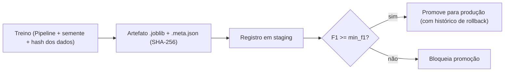

## Passo 1 · Leitura · O mesmo pipeline no treino e no serviço, hashes e model registry

Um dos bugs mais silenciosos em aprendizado de máquina aplicado é o **desvio entre treino e serviço** (*training-serving skew*): durante o treino no notebook, você normaliza os atributos com `StandardScaler` e treina uma `LogisticRegression`, mas salva apenas o classificador e, na API de produção, passa os atributos brutos (ou recalcula a média de outro jeito). A solução definitiva é empacotar **pré-processamento e estimador juntos em um único `Pipeline` do `scikit-learn`** e serializar o `Pipeline` inteiro com `joblib`.



Para que qualquer predição em produção seja auditável e reproduzível meses depois, registramos três garantias:

1. **Hash SHA-256 dos dados de treino:** nomes de arquivos como `alunos_v2_final.csv` mudam de conteúdo sem aviso. Calcular o SHA-256 das matrizes `X` e `y` crava exatamente qual conjunto gerou cada modelo.
2. **Verificação de integridade do artefato (`.joblib` + `.meta.json`):** ao salvar o pipeline, gravamos ao lado um JSON com a versão, as métricas, o hash dos dados e o **SHA-256 do arquivo binário `.joblib`**. Antes de carregar o arquivo no servidor, conferimos se o hash atual bate com o registrado.
3. **Registro de modelos (*Model Registry*) com `staging`, `producao` e `rollback`:** um modelo recém-treinado entra primeiro em `staging`, só pode ser promovido para `producao` se atingir a meta mínima de qualidade (ex.: $\text{F1} \ge 0{,}75$) e mantém o histórico de versões anteriores em produção para permitir **rollback** imediato caso apresente problemas.

Veja no visualizador como a promoção para produção guarda a versão anterior na pilha de histórico e permite reverter em um passo:

```python visualizar
historico_producao = []
ambientes = {"staging": "v1", "producao": None}

def promover_simples(versao):
    if ambientes["producao"] is not None:
        historico_producao.append(ambientes["producao"])
    ambientes["producao"] = versao

promover_simples("v1")
promover_simples("v2")
versao_antes_rollback = ambientes["producao"]
ambientes["producao"] = historico_producao.pop()
versao_apos_rollback = ambientes["producao"]
```

## Passo 2 · Exercício · Hash determinístico dos dados de treino

modo: ordenar

Ordene as linhas para implementar `hash_dos_dados(X, y)`, que converte `X` e `y` para arrays `numpy` contíguos em `float64`, alimenta um objeto `hashlib.sha256()` com as dimensões (`shape`) e os bytes de `X` e `y`, e devolve o `hexdigest()`.

### Instruções

1. Converta `X` e `y` com `np.ascontiguousarray(..., dtype=np.float64)`.
2. Crie `h = hashlib.sha256()`, atualize com `f"{xa.shape}|{ya.shape}|".encode("utf-8")`, depois com `xa.tobytes()` e `ya.tobytes()`.
3. Retorne `h.hexdigest()`.

### Solução

```python
import hashlib
import numpy as np


def hash_dos_dados(X, y):
    xa = np.ascontiguousarray(X, dtype=np.float64)
    ya = np.ascontiguousarray(y, dtype=np.float64)
    h = hashlib.sha256()
    h.update(f"{xa.shape}|{ya.shape}|".encode("utf-8"))
    h.update(xa.tobytes())
    h.update(ya.tobytes())
    return h.hexdigest()
```

### Dicas

1. `np.ascontiguousarray(..., dtype=np.float64)` garante que listas ou arrays equivalentes gerem exatamente a mesma sequência de bytes.
2. Inclua tanto `xa.tobytes()` quanto `ya.tobytes()` antes de retornar `h.hexdigest()`.

### Verificação

```json
[
  {
    "id": "hash-deterministico-e-sensivel",
    "name": "Gera o mesmo hash para dados idênticos e muda quando X ou y são alterados",
    "checkpoint": 3,
    "kind": "expr",
    "expr": "[hash_dos_dados([[1.0, 2.0], [3.0, 4.0]], [0, 1]) == hash_dos_dados([[1, 2], [3, 4]], [0.0, 1.0]), hash_dos_dados([[1.0, 2.0], [3.0, 4.0]], [0, 1]) != hash_dos_dados([[1.0, 2.0], [3.0, 9.0]], [0, 1]), hash_dos_dados([[1.0, 2.0], [3.0, 4.0]], [0, 1]) != hash_dos_dados([[1.0, 2.0], [3.0, 4.0]], [1, 1]), len(hash_dos_dados([[1.0]], [0]))]",
    "expected": [
      true,
      true,
      true,
      64
    ]
  }
]
```

### Soluções erradas

```python name="Calcula o hash apenas de X ignorando os rótulos y"
import hashlib
import numpy as np


def hash_dos_dados(X, y):
    xa = np.ascontiguousarray(X, dtype=np.float64)
    h = hashlib.sha256()
    h.update(xa.tobytes())
    return h.hexdigest()
```

```python name="Calcula o hash apenas do shape sem ler os valores de X e y"
import hashlib
import numpy as np


def hash_dos_dados(X, y):
    xa = np.ascontiguousarray(X, dtype=np.float64)
    ya = np.ascontiguousarray(y, dtype=np.float64)
    return hashlib.sha256(f"{xa.shape}|{ya.shape}".encode("utf-8")).hexdigest()
```

## Passo 3 · Exercício · Salvar e carregar pipeline com verificação de integridade

Implemente `salvar_modelo(pipeline, caminho, metadados)` e `carregar_modelo(caminho)` para persistir um pipeline (pré-processamento + parâmetros do modelo) em arquivo binário com `pickle` (a base do `joblib`) e verificar sua integridade via SHA-256 antes de carregá-lo.

### Instruções

1. Em `salvar_modelo(pipeline, caminho, metadados)`:
   - Salve `pipeline` no arquivo `caminho` usando `with open(caminho, "wb") as f: pickle.dump(pipeline, f)`.
   - Leia os bytes do arquivo `caminho` (`open(caminho, "rb").read()`) e calcule `sha256 = hashlib.sha256(bytes_arq).hexdigest()`.
   - Crie um dicionário `meta_completo = {**metadados, "sha256": sha256}` e grave-o em JSON no arquivo `caminho + ".meta.json"`.
   - Retorne `meta_completo`.
2. Em `carregar_modelo(caminho)`:
   - Leia o dicionário `meta` de `caminho + ".meta.json"`.
   - Calcule o SHA-256 atual dos bytes do arquivo `caminho`.
   - Se o hash atual for diferente de `meta.get("sha256")`, levante `ValueError("Artefato corrompido: hash divergente")` **antes** de chamar `pickle.load`.
   - Caso o hash confira, carregue o objeto com `pickle.load` e retorne `(modelo, meta)`.

### Código inicial

```python
import hashlib
import json
import pickle


def salvar_modelo(pipeline, caminho, metadados):
    # Salve com pickle.dump, calcule o SHA-256 do arquivo e grave caminho + ".meta.json"
    pass


def carregar_modelo(caminho):
    # Verifique o SHA-256 contra caminho + ".meta.json" antes de fazer pickle.load
    pass
```

### Solução

```python
import hashlib
import json
import pickle


def _sha256_arquivo(caminho):
    with open(caminho, "rb") as f:
        return hashlib.sha256(f.read()).hexdigest()


def salvar_modelo(pipeline, caminho, metadados):
    with open(caminho, "wb") as f:
        pickle.dump(pipeline, f)
    digest = _sha256_arquivo(caminho)
    meta_completo = dict(metadados)
    meta_completo["sha256"] = digest
    with open(caminho + ".meta.json", "w", encoding="utf-8") as f:
        json.dump(meta_completo, f, ensure_ascii=False)
    return meta_completo


def carregar_modelo(caminho):
    with open(caminho + ".meta.json", "r", encoding="utf-8") as f:
        meta = json.load(f)
    atual = _sha256_arquivo(caminho)
    if atual != meta.get("sha256"):
        raise ValueError("Artefato corrompido: hash divergente")
    with open(caminho, "rb") as f:
        modelo = pickle.load(f)
    return modelo, meta
```

### Dicas

1. Sempre verifique o hash SHA-256 dos bytes do arquivo **antes** de chamar `pickle.load`, pois desserializar um arquivo adulterado não é seguro.
2. Grave e leia os metadados no arquivo `caminho + ".meta.json"`.

### Verificação

```json
[
  {
    "id": "salvar-carregar-pipeline-completo",
    "name": "Salva e carrega um pipeline completo (normalização + pesos) preservando predições e metadados",
    "checkpoint": 1,
    "kind": "expr",
    "setup": "import numpy as np\nX = np.array([[10.0, 1.0], [12.0, 2.0], [80.0, 9.0], [90.0, 10.0]])\npip = {'media': np.mean(X, axis=0), 'desvio': np.std(X, axis=0), 'pesos': np.array([0.8, 0.2]), 'bias': -0.1}\nmeta_salvo = salvar_modelo(pip, 'modelo_teste_n7.pkl', {'versao': '1.0.0'})\ncarregado, meta_lido = carregar_modelo('modelo_teste_n7.pkl')\npred_orig = (((X - pip['media']) / pip['desvio']) @ pip['pesos'] + pip['bias'] > 0).tolist()\npred_carg = (((X - carregado['media']) / carregado['desvio']) @ carregado['pesos'] + carregado['bias'] > 0).tolist()",
    "expr": "[meta_lido['versao'], len(meta_lido['sha256']), pred_carg == pred_orig]",
    "expected": [
      "1.0.0",
      64,
      true
    ]
  },
  {
    "id": "rejeita-artefato-adulterado",
    "name": "Levanta ValueError se os bytes do arquivo binário forem alterados após salvar",
    "checkpoint": 2,
    "kind": "expr",
    "setup": "salvar_modelo({'a': 1}, 'corrompido_n7.pkl', {'versao': '1.0'})\nwith open('corrompido_n7.pkl', 'ab') as f:\n    f.write(b'adulterado')",
    "expr": "carregar_modelo('corrompido_n7.pkl')",
    "raises": "ValueError"
  }
]
```

### Soluções erradas

```python name="Carrega o modelo com pickle.load sem verificar se o hash SHA-256 bate"
import hashlib
import json
import pickle


def salvar_modelo(pipeline, caminho, metadados):
    with open(caminho, "wb") as f:
        pickle.dump(pipeline, f)
    with open(caminho, "rb") as f:
        d = hashlib.sha256(f.read()).hexdigest()
    m = {**metadados, "sha256": d}
    with open(caminho + ".meta.json", "w", encoding="utf-8") as f:
        json.dump(m, f)
    return m


def carregar_modelo(caminho):
    with open(caminho + ".meta.json", "r", encoding="utf-8") as f:
        meta = json.load(f)
    with open(caminho, "rb") as f:
        return pickle.load(f), meta
```

```python name="Não grava o hash SHA-256 no arquivo .meta.json"
import json
import pickle


def salvar_modelo(pipeline, caminho, metadados):
    with open(caminho, "wb") as f:
        pickle.dump(pipeline, f)
    with open(caminho + ".meta.json", "w", encoding="utf-8") as f:
        json.dump(dict(metadados), f)
    return dict(metadados)


def carregar_modelo(caminho):
    with open(caminho + ".meta.json", "r", encoding="utf-8") as f:
        meta = json.load(f)
    with open(caminho, "rb") as f:
        return pickle.load(f), meta
```

## Passo 4 · Exercício · Registro de modelos com promoção e rollback

Implemente a classe `RegistroDeModelos` para gerenciar versões registradas, validar a qualidade mínima ao promover para `"producao"` e permitir `rollback()` imediato.

### Instruções

1. Em `__init__(self)`, inicialize `self.versoes = {}`, `self.ambientes = {"staging": None, "producao": None}` e `self.historico_producao = []`.
2. Em `registrar(self, versao, hash_artefato, metricas)`:
   - Armazene `{"versao": versao, "hash": hash_artefato, "metricas": dict(metricas)}` em `self.versoes[versao]`.
   - Aponte `self.ambientes["staging"] = versao`.
3. Em `promover(self, versao, ambiente="producao", min_f1=0.75)`:
   - Se `versao not in self.versoes`, levante `ValueError("Versao inexistente")`.
   - Se `ambiente == "producao"` e `self.versoes[versao]["metricas"].get("f1", 0.0) < min_f1`, levante `ValueError("Metrica F1 abaixo do minimo para producao")`.
   - Se `ambiente == "producao"` e `self.ambientes["producao"] is not None` e `self.ambientes["producao"] != versao`, adicione a versão que estava em produção ao final de `self.historico_producao`.
   - Atualize `self.ambientes[ambiente] = versao` e retorne `self.versoes[versao]`.
4. Em `atual(self, ambiente="producao")`:
   - Retorne a string da versão ativa no `ambiente` (ou `None` se nenhuma estiver ativa).
5. Em `rollback(self)`:
   - Se `not self.historico_producao`, levante `ValueError("Sem versao anterior para rollback")`.
   - Retire a última versão de `self.historico_producao` com `.pop()`, defina `self.ambientes["producao"] = versao_anterior` e retorne `versao_anterior`.

### Código inicial

```python
class RegistroDeModelos:
    def __init__(self):
        # Inicialize versoes, ambientes e historico_producao
        pass

    def registrar(self, versao, hash_artefato, metricas):
        # Registre a versão e coloque-a em staging
        pass

    def promover(self, versao, ambiente="producao", min_f1=0.75):
        # Valide min_f1 para produção, salve a anterior no histórico e promova
        pass

    def atual(self, ambiente="producao"):
        # Retorne a versão ativa no ambiente
        pass

    def rollback(self):
        # Restaure a versão imediatamente anterior em produção
        pass
```

### Solução

```python
class RegistroDeModelos:
    def __init__(self):
        self.versoes = {}
        self.ambientes = {"staging": None, "producao": None}
        self.historico_producao = []

    def registrar(self, versao, hash_artefato, metricas):
        info = {
            "versao": versao,
            "hash": hash_artefato,
            "metricas": dict(metricas),
        }
        self.versoes[versao] = info
        self.ambientes["staging"] = versao
        return info

    def promover(self, versao, ambiente="producao", min_f1=0.75):
        if versao not in self.versoes:
            raise ValueError("Versao inexistente")
        info = self.versoes[versao]
        if ambiente == "producao":
            if info["metricas"].get("f1", 0.0) < min_f1:
                raise ValueError("Metrica F1 abaixo do minimo para producao")
            anterior = self.ambientes.get("producao")
            if anterior is not None and anterior != versao:
                self.historico_producao.append(anterior)
        self.ambientes[ambiente] = versao
        return info

    def atual(self, ambiente="producao"):
        return self.ambientes.get(ambiente)

    def rollback(self):
        if not self.historico_producao:
            raise ValueError("Sem versao anterior para rollback")
        anterior = self.historico_producao.pop()
        self.ambientes["producao"] = anterior
        return anterior
```

### Dicas

1. Antes de substituir `self.ambientes["producao"]` em `promover`, guarde a versão anterior (se não for `None`) em `self.historico_producao`.
2. Em `promover`, valide `info["metricas"].get("f1", 0.0) < min_f1` quando `ambiente == "producao"`.

### Verificação

```json
[
  {
    "id": "fluxo-registro-promocao-rollback",
    "name": "Registra versões em staging, promove v1 e v2 para produção e executa rollback para v1",
    "checkpoint": 4,
    "kind": "expr",
    "setup": "reg = RegistroDeModelos(); reg.registrar('v1', 'h1', {'f1': 0.82}); reg.promover('v1'); reg.registrar('v2', 'h2', {'f1': 0.88}); stg = reg.atual('staging'); reg.promover('v2'); prod_v2 = reg.atual('producao'); rb = reg.rollback(); prod_apos = reg.atual('producao')",
    "expr": "[stg, prod_v2, rb, prod_apos]",
    "expected": [
      "v2",
      "v2",
      "v1",
      "v1"
    ]
  },
  {
    "id": "bloqueia-promocao-f1-baixo",
    "name": "Levanta ValueError ao tentar promover modelo com F1 abaixo de min_f1",
    "checkpoint": 3,
    "kind": "expr",
    "setup": "reg = RegistroDeModelos(); reg.registrar('v_ruim', 'h0', {'f1': 0.60})",
    "expr": "reg.promover('v_ruim', ambiente='producao', min_f1=0.75)",
    "raises": "ValueError"
  }
]
```

### Soluções erradas

```python name="Promove para produção sem verificar a meta mínima min_f1"
class RegistroDeModelos:
    def __init__(self):
        self.versoes = {}
        self.ambientes = {"staging": None, "producao": None}
        self.historico_producao = []

    def registrar(self, versao, hash_artefato, metricas):
        self.versoes[versao] = {"versao": versao, "hash": hash_artefato, "metricas": dict(metricas)}
        self.ambientes["staging"] = versao

    def promover(self, versao, ambiente="producao", min_f1=0.75):
        if self.ambientes.get("producao"):
            self.historico_producao.append(self.ambientes["producao"])
        self.ambientes[ambiente] = versao
        return self.versoes[versao]

    def atual(self, ambiente="producao"):
        return self.ambientes.get(ambiente)

    def rollback(self):
        self.ambientes["producao"] = self.historico_producao.pop()
        return self.ambientes["producao"]
```

```python name="Não guarda o histórico de versões ao promover, quebrando o rollback"
class RegistroDeModelos:
    def __init__(self):
        self.versoes = {}
        self.ambientes = {"staging": None, "producao": None}

    def registrar(self, versao, hash_artefato, metricas):
        self.versoes[versao] = {"versao": versao, "hash": hash_artefato, "metricas": dict(metricas)}
        self.ambientes["staging"] = versao

    def promover(self, versao, ambiente="producao", min_f1=0.75):
        if self.versoes[versao]["metricas"].get("f1", 0.0) < min_f1:
            raise ValueError("Baixo F1")
        self.ambientes[ambiente] = versao
        return self.versoes[versao]

    def atual(self, ambiente="producao"):
        return self.ambientes.get(ambiente)

    def rollback(self):
        return None
```

## Passo 5 · Quiz · Empacotamento, reprodutibilidade e registro

### Pergunta

Por que devemos empacotar o `StandardScaler` (ou qualquer etapa de pré-processamento) junto com o classificador dentro de um único `Pipeline` do `scikit-learn` ao salvar o arquivo `.joblib`?

- [ ] Para que o arquivo `.joblib` fique maior no disco.
- [x] Para garantir que os dados de produção passem exatamente pela mesma transformação (com as mesmas médias e desvios aprendidos no treino), eliminando o *training-serving skew*.
- [ ] Porque `joblib.dump` não aceita objetos `LogisticRegression` isolados.
- [ ] Para recalcular a média do `StandardScaler` a cada única requisição individual em produção.

> Quando o pré-processador e o modelo viajam num único `Pipeline`, basta chamar `pipeline.predict(X_novo)` no servidor para aplicar automaticamente as estatísticas aprendidas no treino.

### Pergunta

Para que serve gravar o hash SHA-256 das matrizes de treino `(X, y)` nos metadados da versão do modelo?

- [ ] Para comprimir as matrizes e substituir o backup do banco de dados.
- [x] Para comprovar de forma inequívoca se dois modelos foram treinados sobre exatamente os mesmos dados, mesmo que arquivos CSV tenham sido renomeados ou sobrescritos.
- [ ] Para acelerar a convergência do gradiente descendente.
- [ ] Para evitar fixar o `random_state`.

> Qualquer alteração de um único número ou linha em `X` ou `y` muda completamente o hash SHA-256, assegurando rastreabilidade total dos dados de treino.

### Pergunta

Qual é a função do ambiente `staging` antes de promover um modelo para `producao` em um registro de modelos?

- [ ] Apagar automaticamente as versões antigas do modelo.
- [x] Permitir validar a integridade do artefato, os contratos de entrada/saída e as metas mínimas de qualidade em um ambiente de pré-produção antes de expô-lo ao tráfego real dos usuários.
- [ ] Dobrar a taxa de aprendizado do modelo.
- [ ] Desativar a verificação de hash SHA-256.

> Separar `staging` de `producao` impede que um modelo recém-treinado com regressão de métrica substitua imediatamente o modelo estável que atende os usuários.
