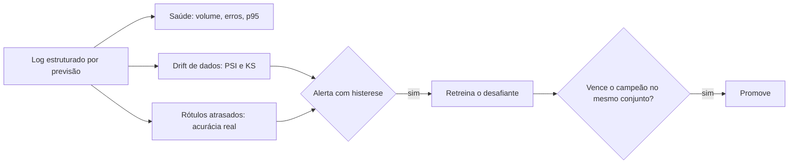

## Passo 1 · Leitura · O modelo em produção envelhece

Um programa comum que ninguém mexeu continua dando as mesmas respostas. Um modelo também, mas o mundo em volta dele muda: o perfil de quem chega, as regras, o comportamento das pessoas. Por isso o monitoramento olha três camadas.

1. **Saúde operacional**, em tempo real: volume, taxa de erro e latência. Para latência, a média engana; o **p95** (o valor abaixo do qual estão 95 % das requisições) mostra a cauda lenta que os usuários sentem. Neste módulo o p95 é o do método do posto mais próximo: ordene as $n$ latências e pegue a de posição $\lceil 0{,}95\, n \rceil$, contando a partir de 1.
2. **Drift de dados**: a distribuição das entradas, $P(X)$, se afasta da do treino. Dá para medir sem esperar rótulo nenhum, comparando a produção com uma amostra de referência (PSI e KS, no Passo 3).
3. **Drift de conceito**: a relação entre entrada e resposta, $P(Y \mid X)$, muda. Uma regra nova de aprovação, por exemplo, torna erradas previsões que antes acertavam, com as entradas iguais. Só aparece quando os **rótulos reais** chegam, muitas vezes semanas depois.

Tudo isso depende de um **log estruturado** por previsão: um registro com campos fixos, não uma linha de texto livre. O mínimo é `id_req` (para casar com o rótulo que chega depois), **versão do modelo** (senão a degradação de uma versão se mistura com a de outra), entrada, saída, erro e latência. A latência é a diferença entre duas leituras do relógio, antes e depois da previsão; como no módulo 1, o relógio é injetado, para o teste controlar o tempo. E a requisição que falhou também vai para o log: logar só os sucessos esconde justamente a taxa de erro.



## Passo 2 · Exercício · Log estruturado e resumo operacional

Escreva `medir_predicao`, o embrulho que toda previsão atravessa no serviço, e `resumo_operacional`, que lê o log. `relogio` é uma função sem argumentos que devolve o tempo em milissegundos.

### Instruções
1. `medir_predicao(log, id_req, versao, entrada, prever, relogio)` lê o relógio antes e depois de `prever(entrada)` e acrescenta ao log `{"id_req", "versao", "entrada" (cópia), "saida", "erro", "latencia_ms"}`, com `erro` = `None` no sucesso. Devolve a saída.
2. Se `prever` levantar uma exceção, registre também: `saida` = `None` e `erro` = nome da classe da exceção; depois **relance** a exceção, para o serviço responder `500`.
   Dica: o `finally` ou um `except` que termina com `raise` resolvem.
3. `resumo_operacional(log)` devolve um dicionário por versão com `total`, `erros`, `taxa_erro`, `latencia_media_ms` e `p95_ms`. Log vazio devolve `{}`.
4. O `p95_ms` é o do posto mais próximo, sobre as latências **ordenadas** da versão, incluindo as das requisições que falharam.

### Código inicial
```python
import math

import numpy as np


def medir_predicao(log, id_req, versao, entrada, prever, relogio):
    pass


def resumo_operacional(log):
    pass
```

### Solução
```python
import math

import numpy as np


def medir_predicao(log, id_req, versao, entrada, prever, relogio):
    inicio = relogio()
    saida, erro = None, None
    try:
        saida = prever(entrada)
        return saida
    except Exception as exc:
        erro = type(exc).__name__
        raise
    finally:
        log.append({
            "id_req": id_req,
            "versao": versao,
            "entrada": dict(entrada),
            "saida": saida,
            "erro": erro,
            "latencia_ms": relogio() - inicio,
        })


def resumo_operacional(log):
    por_versao = {}
    for item in log:
        por_versao.setdefault(item["versao"], []).append(item)
    resumo = {}
    for versao, itens in por_versao.items():
        latencias = np.sort(np.array([i["latencia_ms"] for i in itens], dtype=float))
        erros = sum(1 for i in itens if i["erro"] is not None)
        posto = math.ceil(0.95 * len(latencias))
        resumo[versao] = {
            "total": len(itens),
            "erros": erros,
            "taxa_erro": erros / len(itens),
            "latencia_media_ms": float(latencias.mean()),
            "p95_ms": float(latencias[posto - 1]),
        }
    return resumo
```

### Dicas
1. O bloco `finally` roda tanto quando o `try` termina com `return` quanto quando uma exceção sai dele.
2. Leia o relógio de novo no momento de registrar; a leitura do início fica guardada numa variável.
3. Com 20 latências, o posto mais próximo do p95 é o 19º valor da lista ordenada, ou seja, o índice 18.

### Verificação
```json
[
  { "id": "registro-sucesso", "checkpoint": 1, "kind": "expr",
    "setup": "class Relogio:\n    def __init__(self):\n        self.ms = 1000\n    def __call__(self):\n        return self.ms\nrel = Relogio()\ndef prever(e):\n    rel.ms += 40\n    return 1\nlog = []\nsaida = medir_predicao(log, 'r1', '2.1.0', {'media': 7.0}, prever, rel)",
    "expr": "[saida, log]",
    "expected": [1, [{"id_req": "r1", "versao": "2.1.0", "entrada": {"media": 7.0}, "saida": 1, "erro": null, "latencia_ms": 40}]],
    "name": "Uma previsão vira um registro com versão e latência",
    "hint": "A latência é a diferença entre a leitura do relógio depois e antes de prever." },
  { "id": "entrada-copiada", "checkpoint": 1, "kind": "expr",
    "setup": "log = []\nentrada = {'media': 7.0}\nmedir_predicao(log, 'r1', '2.1.0', entrada, lambda e: 0, lambda: 0)\nentrada['media'] = 0.0",
    "expr": "log[0]['entrada']", "expected": {"media": 7.0}, "name": "O log guarda uma cópia da entrada",
    "hint": "Se o chamador reaproveitar o dicionário, o registro antigo não pode mudar junto." },
  { "id": "falha-relancada", "checkpoint": 2, "kind": "expr",
    "setup": "def quebra(e):\n    raise ValueError('coluna faltando')",
    "expr": "medir_predicao([], 'r2', '2.1.0', {'media': 7.0}, quebra, lambda: 0)", "raises": "ValueError",
    "name": "A exceção do modelo continua subindo", "hint": "Registrar não é engolir: o serviço precisa saber que falhou." },
  { "id": "falha-registrada", "checkpoint": 2, "kind": "expr",
    "setup": "class Relogio:\n    def __init__(self):\n        self.ms = 0\n    def __call__(self):\n        return self.ms\nrel = Relogio()\ndef quebra(e):\n    rel.ms += 15\n    raise KeyError('creditos')\nlog = []\ntry:\n    medir_predicao(log, 'r2', '2.1.0', {'media': 7.0}, quebra, rel)\nexcept KeyError:\n    pass",
    "expr": "log", "expected": [{"id_req": "r2", "versao": "2.1.0", "entrada": {"media": 7.0}, "saida": null, "erro": "KeyError", "latencia_ms": 15}],
    "name": "A requisição que falhou também vai para o log, com o tipo do erro" },
  { "id": "p95-posto", "checkpoint": 4, "kind": "expr",
    "setup": "lat = [(7 * i) % 20 + 1 for i in range(20)]\nlog = [{'id_req': str(i), 'versao': 'v1', 'entrada': {}, 'saida': 0, 'erro': None, 'latencia_ms': x} for i, x in enumerate(lat)]",
    "expr": "resumo_operacional(log)",
    "expected": {"v1": {"total": 20, "erros": 0, "taxa_erro": 0.0, "latencia_media_ms": 10.5, "p95_ms": 19.0}},
    "name": "p95 pelo posto mais próximo, com as latências fora de ordem",
    "hint": "Ordene antes de escolher a posição; a posição é o teto de 0,95 n, contada a partir de 1." },
  { "id": "p95-dez", "checkpoint": 4, "kind": "expr",
    "setup": "log = [{'id_req': str(i), 'versao': 'v1', 'entrada': {}, 'saida': 0, 'erro': None, 'latencia_ms': x} for i, x in enumerate([30, 10, 20, 50, 40, 90, 60, 80, 70, 100])]",
    "expr": "resumo_operacional(log)['v1']['p95_ms']", "expected": 100.0, "name": "Com 10 requisições, o p95 é a maior latência" },
  { "id": "por-versao", "checkpoint": 3, "kind": "expr",
    "setup": "log = [\n    {'id_req': 'a', 'versao': 'v1', 'entrada': {}, 'saida': 1, 'erro': None, 'latencia_ms': 10},\n    {'id_req': 'b', 'versao': 'v2', 'entrada': {}, 'saida': None, 'erro': 'KeyError', 'latencia_ms': 300},\n    {'id_req': 'c', 'versao': 'v1', 'entrada': {}, 'saida': None, 'erro': 'ValueError', 'latencia_ms': 30},\n    {'id_req': 'd', 'versao': 'v2', 'entrada': {}, 'saida': 0, 'erro': None, 'latencia_ms': 100},\n    {'id_req': 'e', 'versao': 'v1', 'entrada': {}, 'saida': 0, 'erro': None, 'latencia_ms': 20},\n    {'id_req': 'f', 'versao': 'v1', 'entrada': {}, 'saida': 1, 'erro': None, 'latencia_ms': 40}\n]",
    "expr": "resumo_operacional(log)",
    "expected": {"v1": {"total": 4, "erros": 1, "taxa_erro": 0.25, "latencia_media_ms": 25.0, "p95_ms": 40.0}, "v2": {"total": 2, "erros": 1, "taxa_erro": 0.5, "latencia_media_ms": 200.0, "p95_ms": 300.0}},
    "name": "Um resumo por versão; falhas entram na taxa de erro e na latência" },
  { "id": "vazio", "checkpoint": 3, "kind": "call", "function": "resumo_operacional", "args": [[]], "expected": {},
    "name": "Log vazio devolve um dicionário vazio" },
  { "id": "ponta-a-ponta", "checkpoint": 3, "kind": "expr",
    "setup": "class Relogio:\n    def __init__(self):\n        self.ms = 0\n    def __call__(self):\n        return self.ms\nrel = Relogio()\ndef prever(e):\n    rel.ms += e['custo']\n    if e['custo'] > 100:\n        raise TimeoutError('lento')\n    return 1\nlog = []\nfor i, custo in enumerate([20, 40, 200, 60]):\n    try:\n        medir_predicao(log, f'r{i}', '3.0.0', {'custo': custo}, prever, rel)\n    except TimeoutError:\n        pass",
    "expr": "resumo_operacional(log)",
    "expected": {"3.0.0": {"total": 4, "erros": 1, "taxa_erro": 0.25, "latencia_media_ms": 80.0, "p95_ms": 200.0}},
    "name": "medir_predicao e resumo_operacional juntos" }
]
```

### Soluções erradas
```python name="só registra as previsões que deram certo"
import math

import numpy as np


def medir_predicao(log, id_req, versao, entrada, prever, relogio):
    inicio = relogio()
    saida = prever(entrada)
    log.append({"id_req": id_req, "versao": versao, "entrada": dict(entrada), "saida": saida,
                "erro": None, "latencia_ms": relogio() - inicio})
    return saida


def resumo_operacional(log):
    por_versao = {}
    for item in log:
        por_versao.setdefault(item["versao"], []).append(item)
    resumo = {}
    for versao, itens in por_versao.items():
        latencias = np.sort(np.array([i["latencia_ms"] for i in itens], dtype=float))
        erros = sum(1 for i in itens if i["erro"] is not None)
        resumo[versao] = {"total": len(itens), "erros": erros, "taxa_erro": erros / len(itens),
                          "latencia_media_ms": float(latencias.mean()),
                          "p95_ms": float(latencias[math.ceil(0.95 * len(latencias)) - 1])}
    return resumo
```
```python name="engole a exceção do modelo"
import math

import numpy as np


def medir_predicao(log, id_req, versao, entrada, prever, relogio):
    inicio = relogio()
    saida, erro = None, None
    try:
        saida = prever(entrada)
    except Exception as exc:
        erro = type(exc).__name__
    log.append({"id_req": id_req, "versao": versao, "entrada": dict(entrada), "saida": saida,
                "erro": erro, "latencia_ms": relogio() - inicio})
    return saida


def resumo_operacional(log):
    por_versao = {}
    for item in log:
        por_versao.setdefault(item["versao"], []).append(item)
    resumo = {}
    for versao, itens in por_versao.items():
        latencias = np.sort(np.array([i["latencia_ms"] for i in itens], dtype=float))
        erros = sum(1 for i in itens if i["erro"] is not None)
        resumo[versao] = {"total": len(itens), "erros": erros, "taxa_erro": erros / len(itens),
                          "latencia_media_ms": float(latencias.mean()),
                          "p95_ms": float(latencias[math.ceil(0.95 * len(latencias)) - 1])}
    return resumo
```
```python name="lê o relógio de início depois de prever"
import math

import numpy as np


def medir_predicao(log, id_req, versao, entrada, prever, relogio):
    saida, erro = None, None
    try:
        saida = prever(entrada)
        return saida
    except Exception as exc:
        erro = type(exc).__name__
        raise
    finally:
        inicio = relogio()
        log.append({"id_req": id_req, "versao": versao, "entrada": dict(entrada), "saida": saida,
                    "erro": erro, "latencia_ms": relogio() - inicio})


def resumo_operacional(log):
    por_versao = {}
    for item in log:
        por_versao.setdefault(item["versao"], []).append(item)
    resumo = {}
    for versao, itens in por_versao.items():
        latencias = np.sort(np.array([i["latencia_ms"] for i in itens], dtype=float))
        erros = sum(1 for i in itens if i["erro"] is not None)
        resumo[versao] = {"total": len(itens), "erros": erros, "taxa_erro": erros / len(itens),
                          "latencia_media_ms": float(latencias.mean()),
                          "p95_ms": float(latencias[math.ceil(0.95 * len(latencias)) - 1])}
    return resumo
```
```python name="guarda a própria entrada, sem cópia"
import math

import numpy as np


def medir_predicao(log, id_req, versao, entrada, prever, relogio):
    inicio = relogio()
    saida, erro = None, None
    try:
        saida = prever(entrada)
        return saida
    except Exception as exc:
        erro = type(exc).__name__
        raise
    finally:
        log.append({"id_req": id_req, "versao": versao, "entrada": entrada, "saida": saida,
                    "erro": erro, "latencia_ms": relogio() - inicio})


def resumo_operacional(log):
    por_versao = {}
    for item in log:
        por_versao.setdefault(item["versao"], []).append(item)
    resumo = {}
    for versao, itens in por_versao.items():
        latencias = np.sort(np.array([i["latencia_ms"] for i in itens], dtype=float))
        erros = sum(1 for i in itens if i["erro"] is not None)
        resumo[versao] = {"total": len(itens), "erros": erros, "taxa_erro": erros / len(itens),
                          "latencia_media_ms": float(latencias.mean()),
                          "p95_ms": float(latencias[math.ceil(0.95 * len(latencias)) - 1])}
    return resumo
```
```python name="p95 com int(0,95 n) como índice"
import math

import numpy as np


def medir_predicao(log, id_req, versao, entrada, prever, relogio):
    inicio = relogio()
    saida, erro = None, None
    try:
        saida = prever(entrada)
        return saida
    except Exception as exc:
        erro = type(exc).__name__
        raise
    finally:
        log.append({"id_req": id_req, "versao": versao, "entrada": dict(entrada), "saida": saida,
                    "erro": erro, "latencia_ms": relogio() - inicio})


def resumo_operacional(log):
    por_versao = {}
    for item in log:
        por_versao.setdefault(item["versao"], []).append(item)
    resumo = {}
    for versao, itens in por_versao.items():
        latencias = np.sort(np.array([i["latencia_ms"] for i in itens], dtype=float))
        erros = sum(1 for i in itens if i["erro"] is not None)
        indice = min(int(0.95 * len(latencias)), len(latencias) - 1)
        resumo[versao] = {"total": len(itens), "erros": erros, "taxa_erro": erros / len(itens),
                          "latencia_media_ms": float(latencias.mean()), "p95_ms": float(latencias[indice])}
    return resumo
```
```python name="p95 sem ordenar as latências"
import math

import numpy as np


def medir_predicao(log, id_req, versao, entrada, prever, relogio):
    inicio = relogio()
    saida, erro = None, None
    try:
        saida = prever(entrada)
        return saida
    except Exception as exc:
        erro = type(exc).__name__
        raise
    finally:
        log.append({"id_req": id_req, "versao": versao, "entrada": dict(entrada), "saida": saida,
                    "erro": erro, "latencia_ms": relogio() - inicio})


def resumo_operacional(log):
    por_versao = {}
    for item in log:
        por_versao.setdefault(item["versao"], []).append(item)
    resumo = {}
    for versao, itens in por_versao.items():
        latencias = np.array([i["latencia_ms"] for i in itens], dtype=float)
        erros = sum(1 for i in itens if i["erro"] is not None)
        resumo[versao] = {"total": len(itens), "erros": erros, "taxa_erro": erros / len(itens),
                          "latencia_media_ms": float(latencias.mean()),
                          "p95_ms": float(latencias[math.ceil(0.95 * len(latencias)) - 1])}
    return resumo
```
```python name="latência só das requisições bem-sucedidas"
import math

import numpy as np


def medir_predicao(log, id_req, versao, entrada, prever, relogio):
    inicio = relogio()
    saida, erro = None, None
    try:
        saida = prever(entrada)
        return saida
    except Exception as exc:
        erro = type(exc).__name__
        raise
    finally:
        log.append({"id_req": id_req, "versao": versao, "entrada": dict(entrada), "saida": saida,
                    "erro": erro, "latencia_ms": relogio() - inicio})


def resumo_operacional(log):
    por_versao = {}
    for item in log:
        por_versao.setdefault(item["versao"], []).append(item)
    resumo = {}
    for versao, itens in por_versao.items():
        ok = [i["latencia_ms"] for i in itens if i["erro"] is None] or [0.0]
        latencias = np.sort(np.array(ok, dtype=float))
        erros = sum(1 for i in itens if i["erro"] is not None)
        resumo[versao] = {"total": len(itens), "erros": erros, "taxa_erro": erros / len(itens),
                          "latencia_media_ms": float(latencias.mean()),
                          "p95_ms": float(latencias[math.ceil(0.95 * len(latencias)) - 1])}
    return resumo
```

## Passo 3 · Leitura · PSI e KS: medir o afastamento sem rótulo

O **PSI** (*Population Stability Index*) compara duas distribuições de um atributo por faixas. Divida os valores em $B$ faixas; seja $q_b$ a proporção da referência (o treino) na faixa $b$ e $p_b$ a da produção:

$$
\text{PSI} = \sum_{b=1}^{B} \left(p_b - q_b\right) \ln \frac{p_b}{q_b}
$$

Cada termo é zero ou positivo (os dois fatores têm o mesmo sinal), então o PSI só cresce quando as proporções se afastam. Quatro detalhes decidem se o número presta:

1. **As faixas vêm da referência e são fixas.** Use os quantis da referência como bordas internas, para cada faixa ter a mesma fração dela (com $B = 5$, 20 % em cada). Recalcular as faixas na produção redistribui os valores de novo por igual e esconde o deslocamento (Passo 4).
2. **As pontas vão ao infinito.** A primeira borda é $-\infty$ e a última, $+\infty$; senão um valor de produção maior que o máximo do treino cai fora do histograma e some, justamente quando a distribuição se mexeu.
3. **Faixa vazia.** Se $p_b = 0$, aparece $\ln 0$; o PSI vira infinito ou `nan`. A prática é aplicar um piso pequeno às proporções (aqui, $10^{-4}$) antes da conta.
4. **Cada amostra é dividida pelo próprio tamanho.** A produção da última hora pode ter 50 linhas e a referência, 10 000.

Os limites usados no mercado, $\text{PSI} < 0{,}10$ estável, entre $0{,}10$ e $0{,}25$ atenção, $\ge 0{,}25$ mudança forte, são uma **convenção**, não uma lei: o valor depende do número de faixas e do tamanho das amostras.

O **teste KS** (Kolmogorov-Smirnov de duas amostras) olha a maior distância vertical entre as funções de distribuição acumulada empíricas, $D = \max_x |F_{\text{ref}}(x) - F_{\text{prod}}(x)|$, avaliada nos pontos das **duas** amostras. Ele não precisa de faixas. Com tamanhos $n$ e $m$, o valor crítico aproximado ao nível $\alpha$ é

$$
D_{\text{crit}} = \sqrt{-\tfrac{1}{2}\ln\tfrac{\alpha}{2}} \cdot \sqrt{\frac{n + m}{n\, m}}
$$

e $D > D_{\text{crit}}$ indica que as amostras dificilmente vêm da mesma distribuição. Em produção usa-se `scipy.stats.ks_2samp`; esta lição não tem `scipy`, então o $D$ é calculado em numpy. Atenção: com amostras enormes, o KS acusa mudanças minúsculas, sem importância prática. Por isso o alerta combina PSI, KS e um tamanho mínimo de janela, e o que decide o retreino é o efeito no desempenho.

```python visualizar
import numpy as np

ref = np.arange(1, 101)
prod = np.arange(31, 131)
internas = np.quantile(ref, [0.25, 0.5, 0.75])
bordas = np.concatenate(([-np.inf], internas, [np.inf]))
q = np.histogram(ref, bordas)[0] / len(ref)
p = np.histogram(prod, bordas)[0] / len(prod)
print("bordas internas:", internas.tolist())
print("referência:", q.tolist())
print("produção:  ", p.tolist())
p = np.maximum(p, 1e-4)
q = np.maximum(q, 1e-4)
termos = (p - q) * np.log(p / q)
print("termos:", termos.round(4).tolist())
print("PSI:", round(float(termos.sum()), 4))
```

## Passo 4 · Previsão · Bordas próprias, bordas da referência e a faixa vazia

A produção se deslocou 100 unidades em relação à referência. O programa calcula as proporções com bordas próprias em cada amostra, depois com as bordas da referência, e por fim os termos do PSI sem e com piso. Digite a saída.

### Código
```python
import numpy as np

ref = np.array([10.0, 20.0, 30.0, 40.0])
prod = np.array([110.0, 120.0, 130.0, 140.0])

c_ref, _ = np.histogram(ref, bins=2)
c_prod, _ = np.histogram(prod, bins=2)
print("bordas próprias:", (c_ref / 4).tolist(), (c_prod / 4).tolist())

bordas = np.array([-np.inf, 25.0, np.inf])
p_ref = np.histogram(ref, bins=bordas)[0] / 4
p_prod = np.histogram(prod, bins=bordas)[0] / 4
print("bordas da referência:", p_ref.tolist(), p_prod.tolist())

with np.errstate(divide="ignore", invalid="ignore"):
    termos = (p_prod - p_ref) * np.log(p_prod / p_ref)
print("termos sem piso:", termos.round(4).tolist())

p_prod = np.maximum(p_prod, 1e-4)
termos = (p_prod - p_ref) * np.log(p_prod / p_ref)
print("PSI com piso:", round(float(termos.sum()), 2))
```

### Dicas
1. `np.histogram(x, bins=2)` divide o intervalo entre o mínimo e o máximo **de `x`** em duas metades iguais.
2. Com a borda em 25, nenhum valor da produção fica na primeira faixa.
3. $(0 - 0{,}5) \cdot \ln 0$ é $(-0{,}5) \cdot (-\infty)$.

### Saída esperada
```text
bordas próprias: [0.5, 0.5] [0.5, 0.5]
bordas da referência: [0.5, 0.5] [0.0, 1.0]
termos sem piso: [inf, 0.3466]
PSI com piso: 4.6
```

## Passo 5 · Exercício · PSI, KS e o relatório por atributo

Implemente as medidas da leitura, em numpy.

### Instruções
1. `bordas_da_referencia(referencia, n_bins)` devolve `[-inf, quantis internos..., +inf]`, com os quantis de `np.quantile` nas frações `1/n_bins, ..., (n_bins-1)/n_bins` e sem bordas repetidas (`np.unique`).
2. `calcular_psi(referencia, producao, n_bins=5, piso=1e-4)` usa essas bordas nas duas amostras, divide cada contagem pelo tamanho da **própria** amostra, aplica o piso às duas proporções e devolve o PSI como `float`.
3. `estatistica_ks(a, b)` devolve o $D$ como `float`, avaliando as duas funções acumuladas em todos os pontos de `a` e de `b`.
   Dica: `np.searchsorted(ordenado, pontos, side="right")` conta quantos valores são menores ou iguais a cada ponto.
4. `drift_por_atributo(X_ref, X_prod, nomes, limiar_psi=0.25, alpha=0.05, n_bins=5)` devolve, por coluna, `{"atributo", "psi", "ks", "ks_critico", "em_drift"}`, com os três números arredondados a 4 casas e `em_drift` verdadeiro quando `psi >= limiar_psi` **ou** `ks > ks_critico` (compare os valores sem arredondar).

### Código inicial
```python
import math

import numpy as np


def bordas_da_referencia(referencia, n_bins):
    pass


def calcular_psi(referencia, producao, n_bins=5, piso=1e-4):
    pass


def estatistica_ks(a, b):
    pass


def drift_por_atributo(X_ref, X_prod, nomes, limiar_psi=0.25, alpha=0.05, n_bins=5):
    pass
```

### Solução
```python
import math

import numpy as np


def bordas_da_referencia(referencia, n_bins):
    fracoes = np.arange(1, n_bins) / n_bins
    internas = np.unique(np.quantile(np.asarray(referencia, dtype=float), fracoes))
    return np.concatenate(([-np.inf], internas, [np.inf]))


def calcular_psi(referencia, producao, n_bins=5, piso=1e-4):
    ref = np.asarray(referencia, dtype=float)
    prod = np.asarray(producao, dtype=float)
    bordas = bordas_da_referencia(ref, n_bins)
    q = np.histogram(ref, bordas)[0] / len(ref)
    p = np.histogram(prod, bordas)[0] / len(prod)
    q = np.maximum(q, piso)
    p = np.maximum(p, piso)
    return float(np.sum((p - q) * np.log(p / q)))


def estatistica_ks(a, b):
    a = np.sort(np.asarray(a, dtype=float))
    b = np.sort(np.asarray(b, dtype=float))
    pontos = np.concatenate([a, b])
    fa = np.searchsorted(a, pontos, side="right") / len(a)
    fb = np.searchsorted(b, pontos, side="right") / len(b)
    return float(np.max(np.abs(fa - fb)))


def drift_por_atributo(X_ref, X_prod, nomes, limiar_psi=0.25, alpha=0.05, n_bins=5):
    xr = np.asarray(X_ref, dtype=float)
    xp = np.asarray(X_prod, dtype=float)
    n, m = len(xr), len(xp)
    critico = math.sqrt(-0.5 * math.log(alpha / 2)) * math.sqrt((n + m) / (n * m))
    relatorio = []
    for j, nome in enumerate(nomes):
        psi = calcular_psi(xr[:, j], xp[:, j], n_bins)
        ks = estatistica_ks(xr[:, j], xp[:, j])
        relatorio.append({
            "atributo": nome,
            "psi": round(psi, 4),
            "ks": round(ks, 4),
            "ks_critico": round(critico, 4),
            "em_drift": bool(psi >= limiar_psi or ks > critico),
        })
    return relatorio
```

### Dicas
1. `np.arange(1, n_bins) / n_bins` dá as frações das bordas internas.
2. `np.maximum(p, piso)` aplica o piso elemento a elemento.
3. O máximo da distância entre as acumuladas pode estar num ponto que só existe na outra amostra.

### Verificação
```json
[
  { "id": "bordas", "checkpoint": 1, "kind": "expr",
    "expr": "[bordas_da_referencia(list(range(1, 101)), 4).tolist(), bordas_da_referencia([20, 20, 20, 20, 24, 30], 4).tolist()]",
    "expected": [[{"$float": "-inf"}, 25.75, 50.5, 75.25, {"$float": "inf"}], [{"$float": "-inf"}, 20.0, 23.0, {"$float": "inf"}]],
    "name": "Bordas: quantis da referência, sem repetidas, com infinito nas pontas" },
  { "id": "psi-zero", "checkpoint": 2, "kind": "expr",
    "expr": "round(calcular_psi(list(range(1, 101)), list(range(1, 101)), 4), 6)", "expected": 0.0,
    "name": "Mesma distribuição dá PSI zero" },
  { "id": "psi-deslocado", "checkpoint": 2, "kind": "expr",
    "expr": "calcular_psi(list(range(1, 101)), list(range(31, 131)), 4)", "expected": 2.202923, "tolerance": 1e-5,
    "name": "PSI de uma produção deslocada", "hint": "As bordas são sempre as da referência." },
  { "id": "psi-fora-da-faixa", "checkpoint": 2, "kind": "expr",
    "expr": "calcular_psi(list(range(1, 101)), list(range(200, 300)), 4)", "expected": 6.905408, "tolerance": 1e-5,
    "name": "Valores acima do máximo do treino continuam contando",
    "hint": "Sem infinito na última borda, o histograma descarta esses valores." },
  { "id": "psi-tamanhos", "checkpoint": 2, "kind": "expr",
    "expr": "calcular_psi(list(range(1, 101)), list(range(31, 81)), 4)", "expected": 2.33646, "tolerance": 1e-5,
    "name": "Produção com metade do tamanho da referência", "hint": "Cada contagem é dividida pelo tamanho da própria amostra." },
  { "id": "psi-finito", "checkpoint": 2, "kind": "expr",
    "setup": "import math",
    "expr": "math.isfinite(calcular_psi([1, 2, 3, 4, 5, 6, 7, 8, 9, 10], [50, 60, 70], 5))", "expected": true,
    "name": "Faixa vazia não produz infinito nem nan" },
  { "id": "ks-basico", "checkpoint": 3, "kind": "expr",
    "expr": "[estatistica_ks([1, 2, 3], [1, 2, 3]), estatistica_ks([1, 2], [5, 6]), estatistica_ks([1, 2, 3, 4], [3, 4, 5, 6])]",
    "expected": [0.0, 1.0, 0.5], "name": "KS de amostras iguais, separadas e sobrepostas" },
  { "id": "ks-duas-amostras", "checkpoint": 3, "kind": "expr",
    "expr": "round(estatistica_ks([5, 6, 7, 8], [0, 1, 10]), 4)", "expected": 0.6667,
    "name": "O máximo pode estar num ponto da outra amostra", "hint": "Avalie as acumuladas nos pontos de a e de b." },
  { "id": "relatorio", "checkpoint": 4, "kind": "expr",
    "setup": "X_ref = [[i, i, i] for i in range(2000)]\nX_prod = [[i, i + 100, i + 1000] for i in range(2000)]",
    "expr": "drift_por_atributo(X_ref, X_prod, ['frequencia', 'media', 'creditos'])",
    "expected": [
      {"atributo": "frequencia", "psi": 0.0, "ks": 0.0, "ks_critico": 0.0429, "em_drift": false},
      {"atributo": "media", "psi": 0.0255, "ks": 0.05, "ks_critico": 0.0429, "em_drift": true},
      {"atributo": "creditos", "psi": 3.7345, "ks": 0.5, "ks_critico": 0.0429, "em_drift": true}
    ],
    "tolerance": 1e-4,
    "name": "Relatório por atributo: estável, só o KS acusa, os dois acusam",
    "hint": "O valor crítico do KS depende dos tamanhos das duas amostras." },
  { "id": "relatorio-limiar", "checkpoint": 4, "kind": "expr",
    "setup": "X_ref = [[i] for i in range(1, 101)]\nX_prod = [[i] for i in range(31, 131)]",
    "expr": "[r['em_drift'] for r in drift_por_atributo(X_ref, X_prod, ['x'], limiar_psi=5.0, alpha=0.05, n_bins=4)]",
    "expected": [true], "name": "Com o PSI abaixo do limiar, o KS ainda dispara o alerta" }
]
```

### Soluções erradas
```python name="cada amostra com as próprias bordas"
import math

import numpy as np


def bordas_da_referencia(referencia, n_bins):
    fracoes = np.arange(1, n_bins) / n_bins
    internas = np.unique(np.quantile(np.asarray(referencia, dtype=float), fracoes))
    return np.concatenate(([-np.inf], internas, [np.inf]))


def calcular_psi(referencia, producao, n_bins=5, piso=1e-4):
    ref = np.asarray(referencia, dtype=float)
    prod = np.asarray(producao, dtype=float)
    q = np.histogram(ref, bins=n_bins)[0] / len(ref)
    p = np.histogram(prod, bins=n_bins)[0] / len(prod)
    q = np.maximum(q, piso)
    p = np.maximum(p, piso)
    return float(np.sum((p - q) * np.log(p / q)))


def estatistica_ks(a, b):
    a = np.sort(np.asarray(a, dtype=float))
    b = np.sort(np.asarray(b, dtype=float))
    pontos = np.concatenate([a, b])
    fa = np.searchsorted(a, pontos, side="right") / len(a)
    fb = np.searchsorted(b, pontos, side="right") / len(b)
    return float(np.max(np.abs(fa - fb)))


def drift_por_atributo(X_ref, X_prod, nomes, limiar_psi=0.25, alpha=0.05, n_bins=5):
    xr = np.asarray(X_ref, dtype=float)
    xp = np.asarray(X_prod, dtype=float)
    n, m = len(xr), len(xp)
    critico = math.sqrt(-0.5 * math.log(alpha / 2)) * math.sqrt((n + m) / (n * m))
    relatorio = []
    for j, nome in enumerate(nomes):
        psi = calcular_psi(xr[:, j], xp[:, j], n_bins)
        ks = estatistica_ks(xr[:, j], xp[:, j])
        relatorio.append({"atributo": nome, "psi": round(psi, 4), "ks": round(ks, 4),
                          "ks_critico": round(critico, 4), "em_drift": bool(psi >= limiar_psi or ks > critico)})
    return relatorio
```
```python name="sem piso: faixa vazia vira log(0)"
import math

import numpy as np


def bordas_da_referencia(referencia, n_bins):
    fracoes = np.arange(1, n_bins) / n_bins
    internas = np.unique(np.quantile(np.asarray(referencia, dtype=float), fracoes))
    return np.concatenate(([-np.inf], internas, [np.inf]))


def calcular_psi(referencia, producao, n_bins=5, piso=1e-4):
    ref = np.asarray(referencia, dtype=float)
    prod = np.asarray(producao, dtype=float)
    bordas = bordas_da_referencia(ref, n_bins)
    q = np.histogram(ref, bordas)[0] / len(ref)
    p = np.histogram(prod, bordas)[0] / len(prod)
    with np.errstate(divide="ignore", invalid="ignore"):
        return float(np.sum((p - q) * np.log(p / q)))


def estatistica_ks(a, b):
    a = np.sort(np.asarray(a, dtype=float))
    b = np.sort(np.asarray(b, dtype=float))
    pontos = np.concatenate([a, b])
    fa = np.searchsorted(a, pontos, side="right") / len(a)
    fb = np.searchsorted(b, pontos, side="right") / len(b)
    return float(np.max(np.abs(fa - fb)))


def drift_por_atributo(X_ref, X_prod, nomes, limiar_psi=0.25, alpha=0.05, n_bins=5):
    xr = np.asarray(X_ref, dtype=float)
    xp = np.asarray(X_prod, dtype=float)
    n, m = len(xr), len(xp)
    critico = math.sqrt(-0.5 * math.log(alpha / 2)) * math.sqrt((n + m) / (n * m))
    relatorio = []
    for j, nome in enumerate(nomes):
        psi = calcular_psi(xr[:, j], xp[:, j], n_bins)
        ks = estatistica_ks(xr[:, j], xp[:, j])
        relatorio.append({"atributo": nome, "psi": round(psi, 4), "ks": round(ks, 4),
                          "ks_critico": round(critico, 4), "em_drift": bool(psi >= limiar_psi or ks > critico)})
    return relatorio
```
```python name="bordas entre o mínimo e o máximo, sem infinito"
import math

import numpy as np


def bordas_da_referencia(referencia, n_bins):
    ref = np.asarray(referencia, dtype=float)
    return np.linspace(ref.min(), ref.max(), n_bins + 1)


def calcular_psi(referencia, producao, n_bins=5, piso=1e-4):
    ref = np.asarray(referencia, dtype=float)
    prod = np.asarray(producao, dtype=float)
    bordas = bordas_da_referencia(ref, n_bins)
    q = np.histogram(ref, bordas)[0] / len(ref)
    p = np.histogram(prod, bordas)[0] / len(prod)
    q = np.maximum(q, piso)
    p = np.maximum(p, piso)
    return float(np.sum((p - q) * np.log(p / q)))


def estatistica_ks(a, b):
    a = np.sort(np.asarray(a, dtype=float))
    b = np.sort(np.asarray(b, dtype=float))
    pontos = np.concatenate([a, b])
    fa = np.searchsorted(a, pontos, side="right") / len(a)
    fb = np.searchsorted(b, pontos, side="right") / len(b)
    return float(np.max(np.abs(fa - fb)))


def drift_por_atributo(X_ref, X_prod, nomes, limiar_psi=0.25, alpha=0.05, n_bins=5):
    xr = np.asarray(X_ref, dtype=float)
    xp = np.asarray(X_prod, dtype=float)
    n, m = len(xr), len(xp)
    critico = math.sqrt(-0.5 * math.log(alpha / 2)) * math.sqrt((n + m) / (n * m))
    relatorio = []
    for j, nome in enumerate(nomes):
        psi = calcular_psi(xr[:, j], xp[:, j], n_bins)
        ks = estatistica_ks(xr[:, j], xp[:, j])
        relatorio.append({"atributo": nome, "psi": round(psi, 4), "ks": round(ks, 4),
                          "ks_critico": round(critico, 4), "em_drift": bool(psi >= limiar_psi or ks > critico)})
    return relatorio
```
```python name="divide a produção pelo tamanho da referência"
import math

import numpy as np


def bordas_da_referencia(referencia, n_bins):
    fracoes = np.arange(1, n_bins) / n_bins
    internas = np.unique(np.quantile(np.asarray(referencia, dtype=float), fracoes))
    return np.concatenate(([-np.inf], internas, [np.inf]))


def calcular_psi(referencia, producao, n_bins=5, piso=1e-4):
    ref = np.asarray(referencia, dtype=float)
    prod = np.asarray(producao, dtype=float)
    bordas = bordas_da_referencia(ref, n_bins)
    q = np.histogram(ref, bordas)[0] / len(ref)
    p = np.histogram(prod, bordas)[0] / len(ref)
    q = np.maximum(q, piso)
    p = np.maximum(p, piso)
    return float(np.sum((p - q) * np.log(p / q)))


def estatistica_ks(a, b):
    a = np.sort(np.asarray(a, dtype=float))
    b = np.sort(np.asarray(b, dtype=float))
    pontos = np.concatenate([a, b])
    fa = np.searchsorted(a, pontos, side="right") / len(a)
    fb = np.searchsorted(b, pontos, side="right") / len(b)
    return float(np.max(np.abs(fa - fb)))


def drift_por_atributo(X_ref, X_prod, nomes, limiar_psi=0.25, alpha=0.05, n_bins=5):
    xr = np.asarray(X_ref, dtype=float)
    xp = np.asarray(X_prod, dtype=float)
    n, m = len(xr), len(xp)
    critico = math.sqrt(-0.5 * math.log(alpha / 2)) * math.sqrt((n + m) / (n * m))
    relatorio = []
    for j, nome in enumerate(nomes):
        psi = calcular_psi(xr[:, j], xp[:, j], n_bins)
        ks = estatistica_ks(xr[:, j], xp[:, j])
        relatorio.append({"atributo": nome, "psi": round(psi, 4), "ks": round(ks, 4),
                          "ks_critico": round(critico, 4), "em_drift": bool(psi >= limiar_psi or ks > critico)})
    return relatorio
```
```python name="KS avaliado só nos pontos da primeira amostra"
import math

import numpy as np


def bordas_da_referencia(referencia, n_bins):
    fracoes = np.arange(1, n_bins) / n_bins
    internas = np.unique(np.quantile(np.asarray(referencia, dtype=float), fracoes))
    return np.concatenate(([-np.inf], internas, [np.inf]))


def calcular_psi(referencia, producao, n_bins=5, piso=1e-4):
    ref = np.asarray(referencia, dtype=float)
    prod = np.asarray(producao, dtype=float)
    bordas = bordas_da_referencia(ref, n_bins)
    q = np.histogram(ref, bordas)[0] / len(ref)
    p = np.histogram(prod, bordas)[0] / len(prod)
    q = np.maximum(q, piso)
    p = np.maximum(p, piso)
    return float(np.sum((p - q) * np.log(p / q)))


def estatistica_ks(a, b):
    a = np.sort(np.asarray(a, dtype=float))
    b = np.sort(np.asarray(b, dtype=float))
    fa = np.searchsorted(a, a, side="right") / len(a)
    fb = np.searchsorted(b, a, side="right") / len(b)
    return float(np.max(np.abs(fa - fb)))


def drift_por_atributo(X_ref, X_prod, nomes, limiar_psi=0.25, alpha=0.05, n_bins=5):
    xr = np.asarray(X_ref, dtype=float)
    xp = np.asarray(X_prod, dtype=float)
    n, m = len(xr), len(xp)
    critico = math.sqrt(-0.5 * math.log(alpha / 2)) * math.sqrt((n + m) / (n * m))
    relatorio = []
    for j, nome in enumerate(nomes):
        psi = calcular_psi(xr[:, j], xp[:, j], n_bins)
        ks = estatistica_ks(xr[:, j], xp[:, j])
        relatorio.append({"atributo": nome, "psi": round(psi, 4), "ks": round(ks, 4),
                          "ks_critico": round(critico, 4), "em_drift": bool(psi >= limiar_psi or ks > critico)})
    return relatorio
```
```python name="valor crítico do KS sem o fator dos tamanhos"
import math

import numpy as np


def bordas_da_referencia(referencia, n_bins):
    fracoes = np.arange(1, n_bins) / n_bins
    internas = np.unique(np.quantile(np.asarray(referencia, dtype=float), fracoes))
    return np.concatenate(([-np.inf], internas, [np.inf]))


def calcular_psi(referencia, producao, n_bins=5, piso=1e-4):
    ref = np.asarray(referencia, dtype=float)
    prod = np.asarray(producao, dtype=float)
    bordas = bordas_da_referencia(ref, n_bins)
    q = np.histogram(ref, bordas)[0] / len(ref)
    p = np.histogram(prod, bordas)[0] / len(prod)
    q = np.maximum(q, piso)
    p = np.maximum(p, piso)
    return float(np.sum((p - q) * np.log(p / q)))


def estatistica_ks(a, b):
    a = np.sort(np.asarray(a, dtype=float))
    b = np.sort(np.asarray(b, dtype=float))
    pontos = np.concatenate([a, b])
    fa = np.searchsorted(a, pontos, side="right") / len(a)
    fb = np.searchsorted(b, pontos, side="right") / len(b)
    return float(np.max(np.abs(fa - fb)))


def drift_por_atributo(X_ref, X_prod, nomes, limiar_psi=0.25, alpha=0.05, n_bins=5):
    xr = np.asarray(X_ref, dtype=float)
    xp = np.asarray(X_prod, dtype=float)
    critico = math.sqrt(-0.5 * math.log(alpha / 2))
    relatorio = []
    for j, nome in enumerate(nomes):
        psi = calcular_psi(xr[:, j], xp[:, j], n_bins)
        ks = estatistica_ks(xr[:, j], xp[:, j])
        relatorio.append({"atributo": nome, "psi": round(psi, 4), "ks": round(ks, 4),
                          "ks_critico": round(critico, 4), "em_drift": bool(psi >= limiar_psi or ks > critico)})
    return relatorio
```
```python name="em_drift olha só o PSI"
import math

import numpy as np


def bordas_da_referencia(referencia, n_bins):
    fracoes = np.arange(1, n_bins) / n_bins
    internas = np.unique(np.quantile(np.asarray(referencia, dtype=float), fracoes))
    return np.concatenate(([-np.inf], internas, [np.inf]))


def calcular_psi(referencia, producao, n_bins=5, piso=1e-4):
    ref = np.asarray(referencia, dtype=float)
    prod = np.asarray(producao, dtype=float)
    bordas = bordas_da_referencia(ref, n_bins)
    q = np.histogram(ref, bordas)[0] / len(ref)
    p = np.histogram(prod, bordas)[0] / len(prod)
    q = np.maximum(q, piso)
    p = np.maximum(p, piso)
    return float(np.sum((p - q) * np.log(p / q)))


def estatistica_ks(a, b):
    a = np.sort(np.asarray(a, dtype=float))
    b = np.sort(np.asarray(b, dtype=float))
    pontos = np.concatenate([a, b])
    fa = np.searchsorted(a, pontos, side="right") / len(a)
    fb = np.searchsorted(b, pontos, side="right") / len(b)
    return float(np.max(np.abs(fa - fb)))


def drift_por_atributo(X_ref, X_prod, nomes, limiar_psi=0.25, alpha=0.05, n_bins=5):
    xr = np.asarray(X_ref, dtype=float)
    xp = np.asarray(X_prod, dtype=float)
    n, m = len(xr), len(xp)
    critico = math.sqrt(-0.5 * math.log(alpha / 2)) * math.sqrt((n + m) / (n * m))
    relatorio = []
    for j, nome in enumerate(nomes):
        psi = calcular_psi(xr[:, j], xp[:, j], n_bins)
        ks = estatistica_ks(xr[:, j], xp[:, j])
        relatorio.append({"atributo": nome, "psi": round(psi, 4), "ks": round(ks, 4),
                          "ks_critico": round(critico, 4), "em_drift": bool(psi >= limiar_psi)})
    return relatorio
```

## Passo 6 · Exercício · Um alerta que não fica piscando

Um alerta que dispara e se apaga a cada janela, porque o PSI oscila em torno do limiar, logo é ignorado. Escreva `MonitorDeDrift`, que recebe o PSI de cada janela de produção e decide o estado com três proteções: **tamanho mínimo** da janela, **janelas consecutivas** acima do limiar para disparar e **histerese** (um limiar de rearme mais baixo para voltar ao normal).

### Instruções
1. `MonitorDeDrift(disparo=0.25, rearme=0.10, consecutivas=2, minimo_amostras=200)` começa em `estado = "ok"`, com `eventos = []`.
2. `observar(janela, psi, n)` devolve o estado depois da janela. Janela com `n < minimo_amostras` é inconclusiva: não muda o estado nem a contagem de consecutivas.
3. Em `"ok"`, cada janela com `psi >= disparo` soma uma consecutiva e qualquer outra zera a contagem; ao chegar a `consecutivas`, o estado vira `"alerta"` e entra o evento `{"janela": janela, "evento": "disparou", "psi": psi}`.
4. Em `"alerta"`, só `psi < rearme` volta para `"ok"`, com o evento `"normalizou"` e a contagem zerada; entre `rearme` e `disparo` o alerta continua.

### Código inicial
```python
class MonitorDeDrift:
    def __init__(self, disparo=0.25, rearme=0.10, consecutivas=2, minimo_amostras=200):
        self.disparo = disparo
        self.rearme = rearme
        self.consecutivas = consecutivas
        self.minimo_amostras = minimo_amostras
        self.estado = "ok"
        self.eventos = []

    def observar(self, janela, psi, n):
        pass
```

### Solução
```python
class MonitorDeDrift:
    def __init__(self, disparo=0.25, rearme=0.10, consecutivas=2, minimo_amostras=200):
        self.disparo = disparo
        self.rearme = rearme
        self.consecutivas = consecutivas
        self.minimo_amostras = minimo_amostras
        self.estado = "ok"
        self.eventos = []
        self._seguidas = 0

    def observar(self, janela, psi, n):
        if n < self.minimo_amostras:
            return self.estado
        if self.estado == "ok":
            if psi >= self.disparo:
                self._seguidas += 1
                if self._seguidas >= self.consecutivas:
                    self.estado = "alerta"
                    self.eventos.append({"janela": janela, "evento": "disparou", "psi": psi})
            else:
                self._seguidas = 0
        elif psi < self.rearme:
            self.estado = "ok"
            self._seguidas = 0
            self.eventos.append({"janela": janela, "evento": "normalizou", "psi": psi})
        return self.estado
```

### Dicas
1. Guarde a contagem de janelas seguidas num atributo; ela sobrevive entre as chamadas.
2. Os dois estados têm regras diferentes: escreva um ramo para cada.
3. Pense no que deveria acontecer com a contagem quando o alerta se apaga e o PSI sobe de novo uma única vez.

### Verificação
```json
[
  { "id": "uma-janela", "checkpoint": 3, "kind": "expr",
    "setup": "m = MonitorDeDrift()", "expr": "[m.observar('s1', 0.40, 500), m.eventos]", "expected": ["ok", []],
    "name": "Uma janela alta só não dispara", "hint": "São precisas duas janelas seguidas acima do limiar." },
  { "id": "duas-seguidas", "checkpoint": 3, "kind": "expr",
    "setup": "m = MonitorDeDrift()\nm.observar('s1', 0.40, 500)", "expr": "[m.observar('s2', 0.30, 500), m.eventos]",
    "expected": ["alerta", [{"janela": "s2", "evento": "disparou", "psi": 0.30}]], "name": "Duas janelas seguidas disparam o alerta" },
  { "id": "nao-seguidas", "checkpoint": 3, "kind": "expr",
    "setup": "m = MonitorDeDrift()", "expr": "[m.observar('s1', 0.40, 500), m.observar('s2', 0.05, 500), m.observar('s3', 0.40, 500)]",
    "expected": ["ok", "ok", "ok"], "name": "Alta, baixa, alta não são consecutivas", "hint": "Uma janela abaixo do limiar zera a contagem." },
  { "id": "limite-disparo", "checkpoint": 3, "kind": "expr",
    "setup": "m = MonitorDeDrift()", "expr": "[m.observar('s1', 0.25, 500), m.observar('s2', 0.25, 500)]",
    "expected": ["ok", "alerta"], "name": "PSI igual ao limiar de disparo conta" },
  { "id": "histerese", "checkpoint": 4, "kind": "expr",
    "setup": "m = MonitorDeDrift()\nm.observar('s1', 0.40, 500)\nm.observar('s2', 0.40, 500)",
    "expr": "[m.observar('s3', 0.15, 500), m.observar('s4', 0.10, 500), m.observar('s5', 0.09, 500)]",
    "expected": ["alerta", "alerta", "ok"], "name": "Entre rearme e disparo o alerta continua; abaixo do rearme, volta",
    "hint": "Voltar ao normal exige PSI estritamente menor que o rearme." },
  { "id": "evento-normalizou", "checkpoint": 4, "kind": "expr",
    "setup": "m = MonitorDeDrift()\nm.observar('s1', 0.40, 500)\nm.observar('s2', 0.40, 500)\nm.observar('s3', 0.02, 500)",
    "expr": "m.eventos", "expected": [{"janela": "s2", "evento": "disparou", "psi": 0.40}, {"janela": "s3", "evento": "normalizou", "psi": 0.02}],
    "name": "Os eventos registram o disparo e a normalização" },
  { "id": "janela-pequena", "checkpoint": 2, "kind": "expr",
    "setup": "m = MonitorDeDrift()", "expr": "[m.observar('s1', 0.90, 50), m.observar('s2', 0.90, 80), m.observar('s3', 0.40, 500)]",
    "expected": ["ok", "ok", "ok"], "name": "Janelas com poucas amostras não contam",
    "hint": "Com 50 previsões, o PSI oscila muito por acaso." },
  { "id": "pequena-nao-zera", "checkpoint": 2, "kind": "expr",
    "setup": "m = MonitorDeDrift()", "expr": "[m.observar('s1', 0.40, 500), m.observar('s2', 0.01, 30), m.observar('s3', 0.40, 500)]",
    "expected": ["ok", "ok", "alerta"], "name": "Uma janela inconclusiva no meio não zera a contagem" },
  { "id": "pequena-nao-normaliza", "checkpoint": 2, "kind": "expr",
    "setup": "m = MonitorDeDrift()\nm.observar('s1', 0.40, 500)\nm.observar('s2', 0.40, 500)", "expr": "m.observar('s3', 0.01, 20)",
    "expected": "alerta", "name": "Uma janela pequena e calma não apaga o alerta" },
  { "id": "redispara", "checkpoint": 4, "kind": "expr",
    "setup": "m = MonitorDeDrift()\nfor j, p in [('s1', 0.4), ('s2', 0.4), ('s3', 0.05)]:\n    m.observar(j, p, 500)",
    "expr": "[m.observar('s4', 0.40, 500), m.observar('s5', 0.40, 500)]", "expected": ["ok", "alerta"],
    "name": "Depois de normalizar, disparar de novo exige janelas seguidas outra vez" }
]
```

### Soluções erradas
```python name="sem histerese: apaga abaixo do disparo"
class MonitorDeDrift:
    def __init__(self, disparo=0.25, rearme=0.10, consecutivas=2, minimo_amostras=200):
        self.disparo = disparo
        self.rearme = rearme
        self.consecutivas = consecutivas
        self.minimo_amostras = minimo_amostras
        self.estado = "ok"
        self.eventos = []
        self._seguidas = 0

    def observar(self, janela, psi, n):
        if n < self.minimo_amostras:
            return self.estado
        if self.estado == "ok":
            if psi >= self.disparo:
                self._seguidas += 1
                if self._seguidas >= self.consecutivas:
                    self.estado = "alerta"
                    self.eventos.append({"janela": janela, "evento": "disparou", "psi": psi})
            else:
                self._seguidas = 0
        elif psi < self.disparo:
            self.estado = "ok"
            self._seguidas = 0
            self.eventos.append({"janela": janela, "evento": "normalizou", "psi": psi})
        return self.estado
```
```python name="dispara na primeira janela alta"
class MonitorDeDrift:
    def __init__(self, disparo=0.25, rearme=0.10, consecutivas=2, minimo_amostras=200):
        self.disparo = disparo
        self.rearme = rearme
        self.consecutivas = consecutivas
        self.minimo_amostras = minimo_amostras
        self.estado = "ok"
        self.eventos = []

    def observar(self, janela, psi, n):
        if n < self.minimo_amostras:
            return self.estado
        if self.estado == "ok":
            if psi >= self.disparo:
                self.estado = "alerta"
                self.eventos.append({"janela": janela, "evento": "disparou", "psi": psi})
        elif psi < self.rearme:
            self.estado = "ok"
            self.eventos.append({"janela": janela, "evento": "normalizou", "psi": psi})
        return self.estado
```
```python name="ignora o tamanho da janela"
class MonitorDeDrift:
    def __init__(self, disparo=0.25, rearme=0.10, consecutivas=2, minimo_amostras=200):
        self.disparo = disparo
        self.rearme = rearme
        self.consecutivas = consecutivas
        self.minimo_amostras = minimo_amostras
        self.estado = "ok"
        self.eventos = []
        self._seguidas = 0

    def observar(self, janela, psi, n):
        if self.estado == "ok":
            if psi >= self.disparo:
                self._seguidas += 1
                if self._seguidas >= self.consecutivas:
                    self.estado = "alerta"
                    self.eventos.append({"janela": janela, "evento": "disparou", "psi": psi})
            else:
                self._seguidas = 0
        elif psi < self.rearme:
            self.estado = "ok"
            self._seguidas = 0
            self.eventos.append({"janela": janela, "evento": "normalizou", "psi": psi})
        return self.estado
```
```python name="janela pequena zera a contagem"
class MonitorDeDrift:
    def __init__(self, disparo=0.25, rearme=0.10, consecutivas=2, minimo_amostras=200):
        self.disparo = disparo
        self.rearme = rearme
        self.consecutivas = consecutivas
        self.minimo_amostras = minimo_amostras
        self.estado = "ok"
        self.eventos = []
        self._seguidas = 0

    def observar(self, janela, psi, n):
        if n < self.minimo_amostras:
            self._seguidas = 0
            return self.estado
        if self.estado == "ok":
            if psi >= self.disparo:
                self._seguidas += 1
                if self._seguidas >= self.consecutivas:
                    self.estado = "alerta"
                    self.eventos.append({"janela": janela, "evento": "disparou", "psi": psi})
            else:
                self._seguidas = 0
        elif psi < self.rearme:
            self.estado = "ok"
            self._seguidas = 0
            self.eventos.append({"janela": janela, "evento": "normalizou", "psi": psi})
        return self.estado
```
```python name="conta janelas altas sem exigir que sejam seguidas"
class MonitorDeDrift:
    def __init__(self, disparo=0.25, rearme=0.10, consecutivas=2, minimo_amostras=200):
        self.disparo = disparo
        self.rearme = rearme
        self.consecutivas = consecutivas
        self.minimo_amostras = minimo_amostras
        self.estado = "ok"
        self.eventos = []
        self._seguidas = 0

    def observar(self, janela, psi, n):
        if n < self.minimo_amostras:
            return self.estado
        if self.estado == "ok":
            if psi >= self.disparo:
                self._seguidas += 1
                if self._seguidas >= self.consecutivas:
                    self.estado = "alerta"
                    self.eventos.append({"janela": janela, "evento": "disparou", "psi": psi})
        elif psi < self.rearme:
            self.estado = "ok"
            self._seguidas = 0
            self.eventos.append({"janela": janela, "evento": "normalizou", "psi": psi})
        return self.estado
```
```python name="não zera a contagem ao normalizar"
class MonitorDeDrift:
    def __init__(self, disparo=0.25, rearme=0.10, consecutivas=2, minimo_amostras=200):
        self.disparo = disparo
        self.rearme = rearme
        self.consecutivas = consecutivas
        self.minimo_amostras = minimo_amostras
        self.estado = "ok"
        self.eventos = []
        self._seguidas = 0

    def observar(self, janela, psi, n):
        if n < self.minimo_amostras:
            return self.estado
        if self.estado == "ok":
            if psi >= self.disparo:
                self._seguidas += 1
                if self._seguidas >= self.consecutivas:
                    self.estado = "alerta"
                    self.eventos.append({"janela": janela, "evento": "disparou", "psi": psi})
            else:
                self._seguidas = 0
        elif psi < self.rearme:
            self.estado = "ok"
            self.eventos.append({"janela": janela, "evento": "normalizou", "psi": psi})
        return self.estado
```
```python name="rearme com menor ou igual"
class MonitorDeDrift:
    def __init__(self, disparo=0.25, rearme=0.10, consecutivas=2, minimo_amostras=200):
        self.disparo = disparo
        self.rearme = rearme
        self.consecutivas = consecutivas
        self.minimo_amostras = minimo_amostras
        self.estado = "ok"
        self.eventos = []
        self._seguidas = 0

    def observar(self, janela, psi, n):
        if n < self.minimo_amostras:
            return self.estado
        if self.estado == "ok":
            if psi >= self.disparo:
                self._seguidas += 1
                if self._seguidas >= self.consecutivas:
                    self.estado = "alerta"
                    self.eventos.append({"janela": janela, "evento": "disparou", "psi": psi})
            else:
                self._seguidas = 0
        elif psi <= self.rearme:
            self.estado = "ok"
            self._seguidas = 0
            self.eventos.append({"janela": janela, "evento": "normalizou", "psi": psi})
        return self.estado
```

## Passo 7 · Exercício · Rótulos atrasados e a decisão de retreino

Os rótulos reais chegam depois (um aluno só tranca ou não tranca semanas mais tarde). Escreva `desempenho_atrasado`, que casa o log com os rótulos que já chegaram, e `decidir_retreino`, o procedimento que diz se é preciso retreinar e se o desafiante pode substituir o campeão.

### Instruções
1. `desempenho_atrasado(log, rotulos, versao, minimo=30)` considera só os registros da `versao` sem erro e devolve `{"avaliados", "cobertura", "acuracia"}`: `avaliados` são os que já têm rótulo (busca por `id_req`), `cobertura` é `avaliados` dividido pelos registros válidos da versão (0.0 se não houver nenhum) e `acuracia` é a fração de acertos, ou `None` quando `avaliados < minimo`.
2. `decidir_retreino(psi_max, acuracia_ref, acuracia_atual, campeao, desafiante, limiar_psi=0.25, queda_max=0.05, margem=0.01)` monta `motivos`: `"drift_de_dados"` se `psi_max >= limiar_psi` e `"queda_de_desempenho"` se `acuracia_atual` não é `None` e `acuracia_ref - acuracia_atual >= queda_max`. Há retreino quando a lista não está vazia.
3. `campeao` e `desafiante` são `{"f1": ..., "conjunto": ...}`. Se os dois `conjunto` diferem, levante `ValueError`: métricas de conjuntos diferentes não se comparam.
4. Promova (`"promover": True`) só quando há retreino e `desafiante["f1"] >= campeao["f1"] + margem`. Devolva `{"retreinar", "motivos", "promover"}`.

### Código inicial
```python
def desempenho_atrasado(log, rotulos, versao, minimo=30):
    pass


def decidir_retreino(psi_max, acuracia_ref, acuracia_atual, campeao, desafiante,
                     limiar_psi=0.25, queda_max=0.05, margem=0.01):
    pass
```

### Solução
```python
def desempenho_atrasado(log, rotulos, versao, minimo=30):
    validos = [item for item in log if item["versao"] == versao and item["erro"] is None]
    casados = [item for item in validos if item["id_req"] in rotulos]
    acertos = sum(1 for item in casados if item["saida"] == rotulos[item["id_req"]])
    return {
        "avaliados": len(casados),
        "cobertura": len(casados) / len(validos) if validos else 0.0,
        "acuracia": acertos / len(casados) if len(casados) >= minimo else None,
    }


def decidir_retreino(psi_max, acuracia_ref, acuracia_atual, campeao, desafiante,
                     limiar_psi=0.25, queda_max=0.05, margem=0.01):
    if campeao["conjunto"] != desafiante["conjunto"]:
        raise ValueError("campeão e desafiante avaliados em conjuntos diferentes")
    motivos = []
    if psi_max >= limiar_psi:
        motivos.append("drift_de_dados")
    if acuracia_atual is not None and acuracia_ref - acuracia_atual >= queda_max:
        motivos.append("queda_de_desempenho")
    retreinar = bool(motivos)
    promover = retreinar and desafiante["f1"] >= campeao["f1"] + margem
    return {"retreinar": retreinar, "motivos": motivos, "promover": promover}
```

### Dicas
1. Filtre primeiro por versão e erro; só depois procure o rótulo.
2. Poucos rótulos não dão uma acurácia confiável: `None` diz "ainda não sei", o que é diferente de 0.
3. Drift de conceito aparece com PSI baixo: o motivo de desempenho não depende do PSI.

### Verificação
```json
[
  { "id": "casa-rotulos", "checkpoint": 1, "kind": "expr",
    "setup": "log = [\n    {'id_req': 'a', 'versao': 'v2', 'saida': 1, 'erro': None},\n    {'id_req': 'b', 'versao': 'v2', 'saida': 0, 'erro': None},\n    {'id_req': 'c', 'versao': 'v2', 'saida': 1, 'erro': None},\n    {'id_req': 'd', 'versao': 'v2', 'saida': None, 'erro': 'KeyError'},\n    {'id_req': 'e', 'versao': 'v1', 'saida': 0, 'erro': None}\n]\nrot = {'a': 1, 'b': 1, 'd': 0, 'e': 1, 'zz': 1}",
    "expr": "desempenho_atrasado(log, rot, 'v2', minimo=1)", "expected": {"avaliados": 2, "cobertura": 0.6666666666666666, "acuracia": 0.5},
    "name": "Casa por id_req só os registros válidos da versão", "hint": "Registros com erro e de outra versão ficam de fora." },
  { "id": "poucos-rotulos", "checkpoint": 1, "kind": "expr",
    "setup": "log = [{'id_req': str(i), 'versao': 'v2', 'saida': 1, 'erro': None} for i in range(100)]\nrot = {str(i): 1 for i in range(10)}",
    "expr": "desempenho_atrasado(log, rot, 'v2')", "expected": {"avaliados": 10, "cobertura": 0.1, "acuracia": null},
    "name": "Abaixo do mínimo de rótulos, a acurácia é None", "hint": "Dez acertos em dez não querem dizer 100 %." },
  { "id": "sem-registros", "checkpoint": 1, "kind": "expr",
    "expr": "desempenho_atrasado([], {'a': 1}, 'v2')", "expected": {"avaliados": 0, "cobertura": 0.0, "acuracia": null},
    "name": "Sem registros da versão" },
  { "id": "drift-de-dados", "checkpoint": 2, "kind": "expr",
    "expr": "decidir_retreino(0.31, 0.85, 0.84, {'f1': 0.5, 'conjunto': 'val-07'}, {'f1': 0.625, 'conjunto': 'val-07'}, margem=0.125)",
    "expected": {"retreinar": true, "motivos": ["drift_de_dados"], "promover": true}, "name": "Drift de dados e desafiante com a margem exata" },
  { "id": "drift-de-conceito", "checkpoint": 2, "kind": "expr",
    "expr": "decidir_retreino(0.03, 0.85, 0.78, {'f1': 0.80, 'conjunto': 'val-07'}, {'f1': 0.79, 'conjunto': 'val-07'})",
    "expected": {"retreinar": true, "motivos": ["queda_de_desempenho"], "promover": false},
    "name": "PSI baixo com queda de acurácia: retreina, mas o desafiante pior não entra",
    "hint": "A relação entre entrada e resposta pode mudar sem a entrada mudar." },
  { "id": "dois-motivos", "checkpoint": 2, "kind": "expr",
    "expr": "decidir_retreino(0.40, 0.85, 0.70, {'f1': 0.5, 'conjunto': 'val-07'}, {'f1': 0.75, 'conjunto': 'val-07'})",
    "expected": {"retreinar": true, "motivos": ["drift_de_dados", "queda_de_desempenho"], "promover": true}, "name": "Os dois motivos, em ordem" },
  { "id": "acuracia-desconhecida", "checkpoint": 2, "kind": "expr",
    "expr": "decidir_retreino(0.05, 0.85, None, {'f1': 0.5, 'conjunto': 'val-07'}, {'f1': 0.75, 'conjunto': 'val-07'})",
    "expected": {"retreinar": false, "motivos": [], "promover": false},
    "name": "Acurácia ainda desconhecida não conta como queda" },
  { "id": "abaixo-da-margem", "checkpoint": 4, "kind": "expr",
    "expr": "decidir_retreino(0.40, 0.85, 0.84, {'f1': 0.5, 'conjunto': 'val-07'}, {'f1': 0.55, 'conjunto': 'val-07'}, margem=0.125)",
    "expected": {"retreinar": true, "motivos": ["drift_de_dados"], "promover": false},
    "name": "Ganho menor que a margem não troca o campeão", "hint": "Diferenças pequenas podem ser ruído do conjunto de validação." },
  { "id": "nada-acontece", "checkpoint": 4, "kind": "expr",
    "expr": "decidir_retreino(0.05, 0.85, 0.84, {'f1': 0.5, 'conjunto': 'val-07'}, {'f1': 0.75, 'conjunto': 'val-07'})",
    "expected": {"retreinar": false, "motivos": [], "promover": false}, "name": "Sem motivo, nada é retreinado nem trocado" },
  { "id": "conjuntos-diferentes", "checkpoint": 3, "kind": "expr",
    "expr": "decidir_retreino(0.40, 0.85, 0.70, {'f1': 0.80, 'conjunto': 'val-03'}, {'f1': 0.90, 'conjunto': 'val-07'})",
    "raises": "ValueError", "name": "Campeão e desafiante medidos em conjuntos diferentes não se comparam" }
]
```

### Soluções erradas
```python name="mistura versões e registros com erro"
def desempenho_atrasado(log, rotulos, versao, minimo=30):
    casados = [item for item in log if item["id_req"] in rotulos]
    acertos = sum(1 for item in casados if item["saida"] == rotulos[item["id_req"]])
    return {
        "avaliados": len(casados),
        "cobertura": len(casados) / len(log) if log else 0.0,
        "acuracia": acertos / len(casados) if len(casados) >= minimo else None,
    }


def decidir_retreino(psi_max, acuracia_ref, acuracia_atual, campeao, desafiante,
                     limiar_psi=0.25, queda_max=0.05, margem=0.01):
    if campeao["conjunto"] != desafiante["conjunto"]:
        raise ValueError("conjuntos diferentes")
    motivos = []
    if psi_max >= limiar_psi:
        motivos.append("drift_de_dados")
    if acuracia_atual is not None and acuracia_ref - acuracia_atual >= queda_max:
        motivos.append("queda_de_desempenho")
    retreinar = bool(motivos)
    return {"retreinar": retreinar, "motivos": motivos, "promover": retreinar and desafiante["f1"] >= campeao["f1"] + margem}
```
```python name="acurácia calculada com poucos rótulos"
def desempenho_atrasado(log, rotulos, versao, minimo=30):
    validos = [item for item in log if item["versao"] == versao and item["erro"] is None]
    casados = [item for item in validos if item["id_req"] in rotulos]
    acertos = sum(1 for item in casados if item["saida"] == rotulos[item["id_req"]])
    return {
        "avaliados": len(casados),
        "cobertura": len(casados) / len(validos) if validos else 0.0,
        "acuracia": acertos / len(casados) if casados else 0.0,
    }


def decidir_retreino(psi_max, acuracia_ref, acuracia_atual, campeao, desafiante,
                     limiar_psi=0.25, queda_max=0.05, margem=0.01):
    if campeao["conjunto"] != desafiante["conjunto"]:
        raise ValueError("conjuntos diferentes")
    motivos = []
    if psi_max >= limiar_psi:
        motivos.append("drift_de_dados")
    if acuracia_atual is not None and acuracia_ref - acuracia_atual >= queda_max:
        motivos.append("queda_de_desempenho")
    retreinar = bool(motivos)
    return {"retreinar": retreinar, "motivos": motivos, "promover": retreinar and desafiante["f1"] >= campeao["f1"] + margem}
```
```python name="só o PSI decide o retreino"
def desempenho_atrasado(log, rotulos, versao, minimo=30):
    validos = [item for item in log if item["versao"] == versao and item["erro"] is None]
    casados = [item for item in validos if item["id_req"] in rotulos]
    acertos = sum(1 for item in casados if item["saida"] == rotulos[item["id_req"]])
    return {
        "avaliados": len(casados),
        "cobertura": len(casados) / len(validos) if validos else 0.0,
        "acuracia": acertos / len(casados) if len(casados) >= minimo else None,
    }


def decidir_retreino(psi_max, acuracia_ref, acuracia_atual, campeao, desafiante,
                     limiar_psi=0.25, queda_max=0.05, margem=0.01):
    if campeao["conjunto"] != desafiante["conjunto"]:
        raise ValueError("conjuntos diferentes")
    motivos = ["drift_de_dados"] if psi_max >= limiar_psi else []
    retreinar = bool(motivos)
    return {"retreinar": retreinar, "motivos": motivos, "promover": retreinar and desafiante["f1"] >= campeao["f1"] + margem}
```
```python name="promove qualquer desafiante melhor, sem margem"
def desempenho_atrasado(log, rotulos, versao, minimo=30):
    validos = [item for item in log if item["versao"] == versao and item["erro"] is None]
    casados = [item for item in validos if item["id_req"] in rotulos]
    acertos = sum(1 for item in casados if item["saida"] == rotulos[item["id_req"]])
    return {
        "avaliados": len(casados),
        "cobertura": len(casados) / len(validos) if validos else 0.0,
        "acuracia": acertos / len(casados) if len(casados) >= minimo else None,
    }


def decidir_retreino(psi_max, acuracia_ref, acuracia_atual, campeao, desafiante,
                     limiar_psi=0.25, queda_max=0.05, margem=0.01):
    if campeao["conjunto"] != desafiante["conjunto"]:
        raise ValueError("conjuntos diferentes")
    motivos = []
    if psi_max >= limiar_psi:
        motivos.append("drift_de_dados")
    if acuracia_atual is not None and acuracia_ref - acuracia_atual >= queda_max:
        motivos.append("queda_de_desempenho")
    retreinar = bool(motivos)
    return {"retreinar": retreinar, "motivos": motivos, "promover": retreinar and desafiante["f1"] > campeao["f1"]}
```
```python name="compara métricas de conjuntos diferentes"
def desempenho_atrasado(log, rotulos, versao, minimo=30):
    validos = [item for item in log if item["versao"] == versao and item["erro"] is None]
    casados = [item for item in validos if item["id_req"] in rotulos]
    acertos = sum(1 for item in casados if item["saida"] == rotulos[item["id_req"]])
    return {
        "avaliados": len(casados),
        "cobertura": len(casados) / len(validos) if validos else 0.0,
        "acuracia": acertos / len(casados) if len(casados) >= minimo else None,
    }


def decidir_retreino(psi_max, acuracia_ref, acuracia_atual, campeao, desafiante,
                     limiar_psi=0.25, queda_max=0.05, margem=0.01):
    motivos = []
    if psi_max >= limiar_psi:
        motivos.append("drift_de_dados")
    if acuracia_atual is not None and acuracia_ref - acuracia_atual >= queda_max:
        motivos.append("queda_de_desempenho")
    retreinar = bool(motivos)
    return {"retreinar": retreinar, "motivos": motivos, "promover": retreinar and desafiante["f1"] >= campeao["f1"] + margem}
```
```python name="acurácia desconhecida tratada como zero"
def desempenho_atrasado(log, rotulos, versao, minimo=30):
    validos = [item for item in log if item["versao"] == versao and item["erro"] is None]
    casados = [item for item in validos if item["id_req"] in rotulos]
    acertos = sum(1 for item in casados if item["saida"] == rotulos[item["id_req"]])
    return {
        "avaliados": len(casados),
        "cobertura": len(casados) / len(validos) if validos else 0.0,
        "acuracia": acertos / len(casados) if len(casados) >= minimo else None,
    }


def decidir_retreino(psi_max, acuracia_ref, acuracia_atual, campeao, desafiante,
                     limiar_psi=0.25, queda_max=0.05, margem=0.01):
    if campeao["conjunto"] != desafiante["conjunto"]:
        raise ValueError("conjuntos diferentes")
    motivos = []
    if psi_max >= limiar_psi:
        motivos.append("drift_de_dados")
    if acuracia_ref - (acuracia_atual or 0.0) >= queda_max:
        motivos.append("queda_de_desempenho")
    retreinar = bool(motivos)
    return {"retreinar": retreinar, "motivos": motivos, "promover": retreinar and desafiante["f1"] >= campeao["f1"] + margem}
```
```python name="promove o desafiante mesmo sem motivo de retreino"
def desempenho_atrasado(log, rotulos, versao, minimo=30):
    validos = [item for item in log if item["versao"] == versao and item["erro"] is None]
    casados = [item for item in validos if item["id_req"] in rotulos]
    acertos = sum(1 for item in casados if item["saida"] == rotulos[item["id_req"]])
    return {
        "avaliados": len(casados),
        "cobertura": len(casados) / len(validos) if validos else 0.0,
        "acuracia": acertos / len(casados) if len(casados) >= minimo else None,
    }


def decidir_retreino(psi_max, acuracia_ref, acuracia_atual, campeao, desafiante,
                     limiar_psi=0.25, queda_max=0.05, margem=0.01):
    if campeao["conjunto"] != desafiante["conjunto"]:
        raise ValueError("conjuntos diferentes")
    motivos = []
    if psi_max >= limiar_psi:
        motivos.append("drift_de_dados")
    if acuracia_atual is not None and acuracia_ref - acuracia_atual >= queda_max:
        motivos.append("queda_de_desempenho")
    return {"retreinar": bool(motivos), "motivos": motivos, "promover": desafiante["f1"] >= campeao["f1"] + margem}
```

## Passo 8 · Quiz · Ler os sinais e decidir

### Pergunta
Num painel, a latência média de `/prever` está estável em 40 ms, mas os usuários reclamam de lentidão. O p95 subiu de 120 ms para 900 ms na última semana. O que isso indica?
- [ ] Nada relevante: a média é que representa a experiência dos usuários, e ela não mudou.
- [x] Uma parte pequena das requisições ficou muito mais lenta; a média dilui essa cauda, e o p95 a mostra. Vale cruzar com o log por versão e por tipo de entrada.
- [ ] O p95 subiu porque o número de requisições aumentou; ele cresce sempre que o volume cresce.
- [ ] O relógio do servidor está errado, porque média e p95 deveriam andar juntos.
> Com 5 % das requisições dez vezes mais lentas, a média sobe pouco e o p95 dispara. É a cauda que gera reclamação, e o log estruturado (com versão e entrada) ajuda a achar quais requisições formam essa cauda.

### Pergunta
O PSI de todos os atributos ficou abaixo de 0,05 nas últimas quatro semanas, mas a acurácia medida com os rótulos que chegaram caiu de 0,86 para 0,74, com cobertura suficiente. Uma regra de aprovação mudou no período. Como interpretar?
- [ ] É ruído: sem drift nas entradas, o desempenho não pode ter mudado de verdade.
- [ ] Os rótulos estão errados, porque PSI baixo garante que o modelo continua bom.
- [x] É drift de conceito: $P(Y \mid X)$ mudou com $P(X)$ estável. O PSI não enxerga isso; o motivo de retreino é a queda de desempenho, com dados rotulados depois da mudança.
- [ ] Basta aumentar o número de faixas do PSI até ele acusar o problema.
> PSI e KS olham só as entradas. Quando a regra muda, as mesmas entradas passam a ter outra resposta certa, e só os rótulos mostram isso. Por isso o procedimento tem os dois motivos de retreino.

### Pergunta
Um desafiante retreinado teve F1 de 0,83 no conjunto de validação deste mês; o campeão em produção tinha F1 de 0,80, medido no conjunto de validação do semestre passado. A margem combinada é 0,01. O que fazer?
- [ ] Promover: 0,83 supera 0,80 com folga maior que a margem.
- [x] Avaliar o campeão no mesmo conjunto deste mês antes de decidir: números de conjuntos diferentes não são comparáveis, e o conjunto novo pode simplesmente ser mais fácil ou mais difícil.
- [ ] Promover só se o PSI do mês estiver acima de 0,25.
- [ ] Manter o campeão para sempre, porque um modelo retreinado sempre esquece o que aprendeu antes.
> A comparação campeão × desafiante só vale no mesmo conjunto, de preferência recente e com rótulos confiáveis. Se o campeão também tiver 0,83 nele, a troca não traz ganho nenhum.
