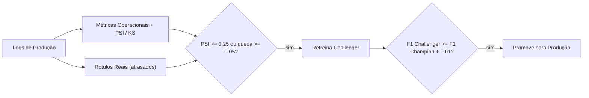

## Passo 1 · Leitura · O modelo em produção envelhece: métricas operacionais, PSI, KS e retreino

Um software tradicional sem alterações no código continua produzindo o mesmo resultado; já um modelo em produção pode degradar silenciosamente porque **o mundo ao redor dele muda**. Por isso, monitoramos três camadas:

1. **Saúde operacional (tempo real):** volume de requisições, taxa de erros HTTP/exceções e percentil 95 de latência (`p95`, que captura a lentidão sentida pelos 5% de chamadas mais demoradas melhor do que a média simples).
2. **Mudança na distribuição de entrada (*data drift*):** mesmo antes de termos os rótulos reais, comparamos os atributos recebidos em produção ($p_{\text{prod}}$) com a amostra de referência do treino ($p_{\text{ref}}$) usando o **Teste de Kolmogorov-Smirnov (KS)** (`scipy.stats.ks_2samp`) e o **PSI (*Population Stability Index*)** sobre $B$ faixas (*bins*) definidas **na referência**:

$$\text{PSI} = \sum_{b=1}^{B} \left(p_{\text{prod}, b} - p_{\text{ref}, b}\right) \ln\!\left(\frac{p_{\text{prod}, b}}{p_{\text{ref}, b}}\right)$$

   Na prática, $\text{PSI} < 0{,}10$ indica distribuição estável, $0{,}10 \le \text{PSI} < 0{,}25$ pede atenção e $\text{PSI} \ge 0{,}25$ sinaliza *drift* severo.
3. **Mudança na relação entrada-saída (*concept drift*) e retreino *Champion vs Challenger*:** quando os rótulos verdadeiros chegam (por exemplo, ao fim do semestre), casamos cada `id_req` do log com o desfecho real. Se houver *drift* severo ou queda de acurácia, treinamos um modelo candidato (*challenger*) e **só o promovemos** se ele superar o modelo atual (*champion*) no conjunto de validação recente.



Veja no visualizador como o PSI permanece baixo quando a amostra de produção segue a referência e dispara quando há deslocamento:

```python visualizar
import numpy as np

ref = np.array([1.0, 2.0, 3.0, 4.0, 5.0, 6.0, 7.0, 8.0, 9.0, 10.0])
prod_estavel = np.array([1.2, 2.1, 3.3, 4.0, 5.2, 6.1, 7.0, 8.2, 9.1, 9.8])
prod_deslocada = ref + 5.0

bordas = np.linspace(np.min(ref), np.max(ref), 6)
bordas[0], bordas[-1] = -np.inf, np.inf

p_ref = np.maximum(np.histogram(ref, bins=bordas)[0] / len(ref), 1e-4)
p_est = np.maximum(np.histogram(prod_estavel, bins=bordas)[0] / len(prod_estavel), 1e-4)
p_des = np.maximum(np.histogram(prod_deslocada, bins=bordas)[0] / len(prod_deslocada), 1e-4)

psi_estavel = round(float(np.sum((p_est - p_ref) * np.log(p_est / p_ref))), 4)
psi_deslocado = round(float(np.sum((p_des - p_ref) * np.log(p_des / p_ref))), 4)
```

## Passo 2 · Previsão · Por que os limites dos bins do PSI vêm da referência

Observe o que acontece quando alguém calcula erroneamente as bordas dos *bins* separadamente na amostra de produção deslocada em vez de usar as bordas fixadas na referência.

### Código

```python
import numpy as np

ref = np.array([10.0, 20.0, 30.0, 40.0])
prod = np.array([110.0, 120.0, 130.0, 140.0])  # deslocou +100!

# Errado: cada amostra com suas próprias bordas
c_ref_err, _ = np.histogram(ref, bins=2)
c_prod_err, _ = np.histogram(prod, bins=2)
print("Proporcoes com bordas separadas:", (c_ref_err / 4).tolist(), (c_prod_err / 4).tolist())

# Correto: bordas fixadas na referência (com -inf e +inf nas pontas)
bordas = np.array([-np.inf, 25.0, np.inf])
c_ref_ok, _ = np.histogram(ref, bins=bordas)
c_prod_ok, _ = np.histogram(prod, bins=bordas)
print("Proporcoes com bordas da referencia:", (c_ref_ok / 4).tolist(), (c_prod_ok / 4).tolist())
```

### Dicas

1. Quando `np.histogram(..., bins=2)` calcula bordas próprias em cada vetor, tanto `ref` quanto `prod` têm 2 itens na metade inferior e 2 na metade superior (`[0.5, 0.5]`).
2. Com a borda fixa em `25.0`, todos os 4 valores de `prod` (`110..140`) caem na segunda faixa (`[0.0, 1.0]`), revelando imediatamente o *drift*!

### Saída esperada

```text
Proporcoes com bordas separadas: [0.5, 0.5] [0.5, 0.5]
Proporcoes com bordas da referencia: [0.5, 0.5] [0.0, 1.0]
```

## Passo 3 · Exercício · Log estruturado e resumo operacional

Implemente `registrar_predicao(log, id_req, entrada, saida, versao, latencia_ms, erro=False)` e `resumo_operacional(log)` para acompanhar volume, taxa de erro, latência média e p95.

### Instruções

1. Em `registrar_predicao(log, id_req, entrada, saida, versao, latencia_ms, erro=False)`:
   - Crie o dicionário `item = {"id_req": id_req, "entrada": entrada, "saida": saida, "versao": versao, "latencia_ms": float(latencia_ms), "erro": bool(erro)}`, adicione-o à lista `log` e retorne `item`.
2. Em `resumo_operacional(log)`:
   - Se `log` estiver vazio, retorne `{"total": 0, "taxa_erro": 0.0, "latencia_media_ms": 0.0, "latencia_p95_ms": 0.0}`.
   - Caso contrário, calcule a fração de itens com `item.get("erro", False)` em `"taxa_erro"`, a média de `"latencia_ms"` em `"latencia_media_ms"` e o percentil 95 com `float(np.percentile(latencias, 95))` em `"latencia_p95_ms"`.

### Código inicial

```python
import numpy as np


def registrar_predicao(log, id_req, entrada, saida, versao, latencia_ms, erro=False):
    # Adicione o registro estruturado ao log e devolva o dicionário criado
    pass


def resumo_operacional(log):
    # Calcule total, taxa_erro, latencia_media_ms e latencia_p95_ms
    pass
```

### Solução

```python
import numpy as np


def registrar_predicao(log, id_req, entrada, saida, versao, latencia_ms, erro=False):
    item = {
        "id_req": id_req,
        "entrada": entrada,
        "saida": saida,
        "versao": versao,
        "latencia_ms": float(latencia_ms),
        "erro": bool(erro),
    }
    log.append(item)
    return item


def resumo_operacional(log):
    n = len(log)
    if n == 0:
        return {
            "total": 0,
            "taxa_erro": 0.0,
            "latencia_media_ms": 0.0,
            "latencia_p95_ms": 0.0,
        }
    latencias = np.array([item["latencia_ms"] for item in log], dtype=float)
    erros = sum(1 for item in log if item.get("erro", False))
    return {
        "total": int(n),
        "taxa_erro": float(erros / n),
        "latencia_media_ms": float(np.mean(latencias)),
        "latencia_p95_ms": float(np.percentile(latencias, 95)),
    }
```

### Dicas

1. Use `float(np.percentile(latencias, 95))` para obter o percentil 95 como `float` nativo do Python.
2. Trate `if len(log) == 0:` retornando zeros para evitar divisão por zero.

### Verificação

```json
[
  {
    "id": "resumo-operacional-p95",
    "name": "Registra predições e calcula taxa de erro, média e p95 de latência",
    "checkpoint": 2,
    "kind": "expr",
    "setup": "lg = []; registrar_predicao(lg, 'r1', {'x': 1}, 1, 'v1', 10.0, False); registrar_predicao(lg, 'r2', {'x': 2}, 0, 'v1', 20.0, False); registrar_predicao(lg, 'r3', {'x': 3}, 1, 'v1', 30.0, False); registrar_predicao(lg, 'r4', {'x': 4}, None, 'v1', 100.0, True)",
    "expr": "resumo_operacional(lg)",
    "expected": {
      "total": 4,
      "taxa_erro": 0.25,
      "latencia_media_ms": 40.0,
      "latencia_p95_ms": 89.5
    },
    "tolerance": 1e-6
  },
  {
    "id": "resumo-log-vazio",
    "name": "Retorna métricas zeradas quando o log está vazio",
    "checkpoint": 2,
    "kind": "call",
    "function": "resumo_operacional",
    "args": [[]],
    "expected": {
      "total": 0,
      "taxa_erro": 0.0,
      "latencia_media_ms": 0.0,
      "latencia_p95_ms": 0.0
    }
  }
]
```

### Soluções erradas

```python name="Retorna a latência máxima no lugar do percentil 95"
import numpy as np


def registrar_predicao(log, id_req, entrada, saida, versao, latencia_ms, erro=False):
    item = {"id_req": id_req, "entrada": entrada, "saida": saida, "versao": versao, "latencia_ms": float(latencia_ms), "erro": bool(erro)}
    log.append(item)
    return item


def resumo_operacional(log):
    if not log:
        return {"total": 0, "taxa_erro": 0.0, "latencia_media_ms": 0.0, "latencia_p95_ms": 0.0}
    lats = [i["latencia_ms"] for i in log]
    return {
        "total": len(log),
        "taxa_erro": float(sum(1 for i in log if i["erro"]) / len(log)),
        "latencia_media_ms": float(np.mean(lats)),
        "latencia_p95_ms": float(np.max(lats)),
    }
```

```python name="Divide por zero quando o log está vazio"
import numpy as np


def registrar_predicao(log, id_req, entrada, saida, versao, latencia_ms, erro=False):
    item = {"id_req": id_req, "entrada": entrada, "saida": saida, "versao": versao, "latencia_ms": float(latencia_ms), "erro": bool(erro)}
    log.append(item)
    return item


def resumo_operacional(log):
    lats = [i["latencia_ms"] for i in log]
    return {
        "total": len(log),
        "taxa_erro": float(sum(1 for i in log if i["erro"]) / len(log)),
        "latencia_media_ms": float(np.mean(lats)),
        "latencia_p95_ms": float(np.percentile(lats, 95)),
    }
```

## Passo 4 · Exercício · Cálculo de PSI e detecção de drift com KS

Implemente `calcular_psi(referencia, producao, n_bins=5)` e `drift_por_atributo(X_ref, X_prod, alpha=0.05)` usando `numpy` para calcular o PSI e a estatística de Kolmogorov-Smirnov ($D = \max_v |F_{\text{ref}}(v) - F_{\text{prod}}(v)|$).

### Instruções

1. Em `calcular_psi(referencia, producao, n_bins=5)`:
   - Converta `ref = np.asarray(referencia, dtype=float)` e `prod = np.asarray(producao, dtype=float)`.
   - Crie as bordas na referência: `bordas = np.linspace(np.min(ref), np.max(ref), n_bins + 1)` e substitua as extremidades com `bordas[0] = -np.inf` e `bordas[-1] = np.inf`.
   - Calcule as contagens com `np.histogram(ref, bins=bordas)[0]` e `np.histogram(prod, bins=bordas)[0]`.
   - Converta em proporções e aplique piso `1e-4` para evitar divisão por zero:
     `p_ref = np.maximum(cont_ref / len(ref), 1e-4)` e `p_prod = np.maximum(cont_prod / len(prod), 1e-4)`.
   - Devolva `float(np.sum((p_prod - p_ref) * np.log(p_prod / p_ref)))`.
2. Em `drift_por_atributo(X_ref, X_prod, alpha=0.05)`:
   - Converta `xr = np.asarray(X_ref, dtype=float)` e `xp = np.asarray(X_prod, dtype=float)`.
   - Para cada coluna `j` de `0` até `xr.shape[1] - 1`:
     - Calcule a estatística KS de duas amostras `estatistica, p_valor = ks_2samp_np(xr[:, j], xp[:, j])` (usando a função auxiliar fornecida no código inicial).
     - Adicione à lista de saída `{"atributo": int(j), "estatistica": float(estatistica), "p_valor": float(p_valor), "em_drift": bool(p_valor < alpha)}`.

### Código inicial

```python
import numpy as np


def ks_2samp_np(amostra1, amostra2):
    a1 = np.sort(np.asarray(amostra1, dtype=float))
    a2 = np.sort(np.asarray(amostra2, dtype=float))
    todos = np.concatenate([a1, a2])
    cdf1 = np.searchsorted(a1, todos, side="right") / len(a1)
    cdf2 = np.searchsorted(a2, todos, side="right") / len(a2)
    d = float(np.max(np.abs(cdf1 - cdf2)))
    n_ef = (len(a1) * len(a2)) / (len(a1) + len(a2))
    p_valor = float(min(1.0, 2.0 * np.exp(-2.0 * n_ef * (d ** 2))))
    return d, p_valor


def calcular_psi(referencia, producao, n_bins=5):
    # Calcule o PSI com bordas fixadas na referência e piso 1e-4 nas proporções
    pass


def drift_por_atributo(X_ref, X_prod, alpha=0.05):
    # Aplique ks_2samp_np em cada coluna e marque em_drift quando p_valor < alpha
    pass
```

### Solução

```python
import numpy as np


def ks_2samp_np(amostra1, amostra2):
    a1 = np.sort(np.asarray(amostra1, dtype=float))
    a2 = np.sort(np.asarray(amostra2, dtype=float))
    todos = np.concatenate([a1, a2])
    cdf1 = np.searchsorted(a1, todos, side="right") / len(a1)
    cdf2 = np.searchsorted(a2, todos, side="right") / len(a2)
    d = float(np.max(np.abs(cdf1 - cdf2)))
    n_ef = (len(a1) * len(a2)) / (len(a1) + len(a2))
    p_valor = float(min(1.0, 2.0 * np.exp(-2.0 * n_ef * (d ** 2))))
    return d, p_valor


def calcular_psi(referencia, producao, n_bins=5):
    ref = np.asarray(referencia, dtype=float)
    prod = np.asarray(producao, dtype=float)
    bordas = np.linspace(np.min(ref), np.max(ref), n_bins + 1)
    bordas[0] = -np.inf
    bordas[-1] = np.inf
    cont_ref, _ = np.histogram(ref, bins=bordas)
    cont_prod, _ = np.histogram(prod, bins=bordas)
    p_ref = np.maximum(cont_ref / len(ref), 1e-4)
    p_prod = np.maximum(cont_prod / len(prod), 1e-4)
    return float(np.sum((p_prod - p_ref) * np.log(p_prod / p_ref)))


def drift_por_atributo(X_ref, X_prod, alpha=0.05):
    xr = np.asarray(X_ref, dtype=float)
    xp = np.asarray(X_prod, dtype=float)
    relatorio = []
    for j in range(xr.shape[1]):
        est, p_val = ks_2samp_np(xr[:, j], xp[:, j])
        relatorio.append(
            {
                "atributo": int(j),
                "estatistica": float(est),
                "p_valor": float(p_val),
                "em_drift": bool(p_val < alpha),
            }
        )
    return relatorio
```

### Dicas

1. Substitua `bordas[0] = -np.inf` e `bordas[-1] = np.inf` após `np.linspace` para que nenhum valor da produção seja perdido fora do histograma.
2. No teste KS, a hipótese nula é que as duas amostras vêm da mesma distribuição; portanto, há evidência de *drift* quando `p_val < alpha`.

### Verificação

```json
[
  {
    "id": "psi-estavel-vs-drift",
    "name": "PSI vale 0.0 para amostras idênticas e supera 0.25 para amostra deslocada",
    "checkpoint": 1,
    "kind": "expr",
    "setup": "ref = [1, 2, 3, 4, 5, 6, 7, 8, 9, 10]; prod_desl = [8, 9, 10, 11, 12, 13, 14, 15, 16, 17]",
    "expr": "[round(calcular_psi(ref, ref, n_bins=5), 6), calcular_psi(ref, prod_desl, n_bins=5) > 0.25]",
    "expected": [
      0.0,
      true
    ]
  },
  {
    "id": "ks-por-coluna",
    "name": "Detecta drift apenas na coluna deslocada usando o teste de Kolmogorov-Smirnov",
    "checkpoint": 2,
    "kind": "expr",
    "setup": "xr = [[float(i), float(i)] for i in range(20)]; xp = [[float(i), float(i + 100)] for i in range(20)]; r = drift_por_atributo(xr, xp, alpha=0.05)",
    "expr": "[r[0]['em_drift'], r[1]['em_drift'], round(r[0]['estatistica'], 4), round(r[1]['estatistica'], 4)]",
    "expected": [
      false,
      true,
      0.0,
      1.0
    ]
  }
]
```

### Soluções erradas

```python name="Calcula bordas separadas para referência e produção mascarando o deslocamento"
import numpy as np


def calcular_psi(referencia, producao, n_bins=5):
    cont_ref, _ = np.histogram(referencia, bins=n_bins)
    cont_prod, _ = np.histogram(producao, bins=n_bins)
    p_ref = np.maximum(cont_ref / len(referencia), 1e-4)
    p_prod = np.maximum(cont_prod / len(producao), 1e-4)
    return float(np.sum((p_prod - p_ref) * np.log(p_prod / p_ref)))


def drift_por_atributo(X_ref, X_prod, alpha=0.05):
    return []
```

```python name="Marca em_drift quando p_valor >= alpha invertendo o teste de hipótese"
import numpy as np


def ks_2samp_np(amostra1, amostra2):
    a1 = np.sort(np.asarray(amostra1, dtype=float))
    a2 = np.sort(np.asarray(amostra2, dtype=float))
    todos = np.concatenate([a1, a2])
    cdf1 = np.searchsorted(a1, todos, side="right") / len(a1)
    cdf2 = np.searchsorted(a2, todos, side="right") / len(a2)
    d = float(np.max(np.abs(cdf1 - cdf2)))
    n_ef = (len(a1) * len(a2)) / (len(a1) + len(a2))
    p_valor = float(min(1.0, 2.0 * np.exp(-2.0 * n_ef * (d ** 2))))
    return d, p_valor


def calcular_psi(referencia, producao, n_bins=5):
    ref = np.asarray(referencia, dtype=float)
    prod = np.asarray(producao, dtype=float)
    bordas = np.linspace(np.min(ref), np.max(ref), n_bins + 1)
    bordas[0], bordas[-1] = -np.inf, np.inf
    p_ref = np.maximum(np.histogram(ref, bins=bordas)[0] / len(ref), 1e-4)
    p_prod = np.maximum(np.histogram(prod, bins=bordas)[0] / len(prod), 1e-4)
    return float(np.sum((p_prod - p_ref) * np.log(p_prod / p_ref)))


def drift_por_atributo(X_ref, X_prod, alpha=0.05):
    xr = np.asarray(X_ref, dtype=float)
    xp = np.asarray(X_prod, dtype=float)
    return [
        {
            "atributo": j,
            "estatistica": float(ks_2samp_np(xr[:, j], xp[:, j])[0]),
            "p_valor": float(ks_2samp_np(xr[:, j], xp[:, j])[1]),
            "em_drift": bool(ks_2samp_np(xr[:, j], xp[:, j])[1] >= alpha),
        }
        for j in range(xr.shape[1])
    ]
```

## Passo 5 · Exercício · Desempenho com rótulos atrasados e decisão de retreino

Implemente `avaliar_desempenho_atrasado(log, rotulos_reais)` e `decidir_retreino(psi_max, queda_acuracia, f1_champion, f1_challenger)`.

### Instruções

1. Em `avaliar_desempenho_atrasado(log, rotulos_reais)`:
   - Percorra os itens de `log` que **não** tiveram erro (`not item.get("erro", False)`) e cujo `item["id_req"]` exista no dicionário `rotulos_reais`.
   - Conte quantos desses itens tiveram `item["saida"] == rotulos_reais[item["id_req"]]`.
   - Devolva `{"avaliados": int(total_casados), "acuracia": float(acertos / total_casados) if total_casados > 0 else 0.0}`.
2. Em `decidir_retreino(psi_max, queda_acuracia, f1_champion, f1_challenger)`:
   - Defina `retreinar = (psi_max >= 0.25) or (queda_acuracia >= 0.05)`.
   - Defina `promover_challenger = bool(retreinar and (f1_challenger >= f1_champion + 0.01))`.
   - Devolva `{"retreinar": bool(retreinar), "promover_challenger": promover_challenger}`.

### Código inicial

```python
def avaliar_desempenho_atrasado(log, rotulos_reais):
    # Case os registros sem erro do log com rotulos_reais por id_req e calcule a acurácia
    pass


def decidir_retreino(psi_max, queda_acuracia, f1_champion, f1_challenger):
    # Decida se deve retreinar e se o challenger supera o champion em pelo menos 0.01
    pass
```

### Solução

```python
def avaliar_desempenho_atrasado(log, rotulos_reais):
    avaliados = 0
    acertos = 0
    for item in log:
        if item.get("erro", False):
            continue
        req_id = item.get("id_req")
        if req_id in rotulos_reais:
            avaliados += 1
            if item.get("saida") == rotulos_reais[req_id]:
                acertos += 1
    acuracia = float(acertos / avaliados) if avaliados > 0 else 0.0
    return {"avaliados": int(avaliados), "acuracia": acuracia}


def decidir_retreino(psi_max, queda_acuracia, f1_champion, f1_challenger):
    retreinar = bool(psi_max >= 0.25 or queda_acuracia >= 0.05)
    promover = bool(retreinar and (f1_challenger >= f1_champion + 0.01))
    return {
        "retreinar": retreinar,
        "promover_challenger": promover,
    }
```

### Dicas

1. Em `avaliar_desempenho_atrasado`, ignore registros com `item.get("erro", False)` ou cujo `id_req` ainda não tenha rótulo em `rotulos_reais`.
2. Em `decidir_retreino`, o *challenger* só é promovido se `retreinar` for verdadeiro **e** `f1_challenger >= f1_champion + 0.01`.

### Verificação

```json
[
  {
    "id": "rotulos-atrasados-casamento",
    "name": "Calcula acurácia real casando id_req com os rótulos atrasados disponíveis",
    "checkpoint": 1,
    "kind": "call",
    "function": "avaliar_desempenho_atrasado",
    "args": [
      [
        {"id_req": "q1", "saida": 1, "erro": false},
        {"id_req": "q2", "saida": 0, "erro": false},
        {"id_req": "q3", "saida": 1, "erro": false},
        {"id_req": "q4", "saida": null, "erro": true}
      ],
      {"q1": 1, "q2": 1, "q4": 0}
    ],
    "expected": {
      "avaliados": 2,
      "acuracia": 0.5
    },
    "tolerance": 1e-6
  },
  {
    "id": "decisao-champion-challenger",
    "name": "Aciona retreino por PSI ou queda de acurácia e exige ganho mínimo do challenger",
    "checkpoint": 2,
    "kind": "expr",
    "expr": "[decidir_retreino(0.30, 0.01, 0.80, 0.83), decidir_retreino(0.08, 0.07, 0.80, 0.79), decidir_retreino(0.05, 0.01, 0.80, 0.85)]",
    "expected": [
      {"retreinar": true, "promover_challenger": true},
      {"retreinar": true, "promover_challenger": false},
      {"retreinar": false, "promover_challenger": false}
    ]
  }
]
```

### Soluções erradas

```python name="Promove o challenger mesmo quando seu F1 é inferior ao do champion"
def avaliar_desempenho_atrasado(log, rotulos_reais):
    itens = [i for i in log if not i.get("erro") and i["id_req"] in rotulos_reais]
    ac = sum(1 for i in itens if i["saida"] == rotulos_reais[i["id_req"]])
    return {"avaliados": len(itens), "acuracia": float(ac / len(itens)) if itens else 0.0}


def decidir_retreino(psi_max, queda_acuracia, f1_champion, f1_challenger):
    ret = bool(psi_max >= 0.25 or queda_acuracia >= 0.05)
    return {"retreinar": ret, "promover_challenger": ret}
```

```python name="Olha apenas o PSI e ignora queda de acurácia por concept drift"
def avaliar_desempenho_atrasado(log, rotulos_reais):
    return {"avaliados": 0, "acuracia": 0.0}


def decidir_retreino(psi_max, queda_acuracia, f1_champion, f1_challenger):
    ret = bool(psi_max >= 0.25)
    return {"retreinar": ret, "promover_challenger": bool(ret and f1_challenger >= f1_champion + 0.01)}
```

## Passo 6 · Quiz · PSI, teste KS, rótulos atrasados e champion/challenger

### Pergunta

Ao rodar o teste de Kolmogorov-Smirnov (`ks_2samp`) comparando um atributo contínuo entre a referência de treino e o tráfego da última semana, você obteve estatística $D = 0{,}42$ e $p\text{-valor} = 0{,}0003$ (com nível de significância $\alpha = 0{,}05$). O que isso significa?

- [ ] Que as duas distribuições são estatisticamente idênticas.
- [x] Que rejeitamos a hipótese nula de igualdade das distribuições ($p < \alpha$), indicando evidência estatística de *data drift* nesse atributo.
- [ ] Que a acurácia do modelo subiu $42\%$.
- [ ] Que a latência p95 caiu para $0{,}0003\text{ ms}$.

> No teste KS de duas amostras, $p < \alpha$ indica que a distância máxima $D$ entre as funções de distribuição acumulada dificilmente ocorreu por acaso.

### Pergunta

Em qual situação o PSI e o teste KS nos atributos de entrada permanecem baixos (sem *data drift*), mas a acurácia medida pelos rótulos atrasados cai drasticamente?

- [ ] Quando o servidor HTTP está desligado.
- [x] Quando ocorre *concept drift*: o perfil dos alunos na entrada continua o mesmo, mas a regra de negócio ou o comportamento real mudou (por exemplo, uma mudança no regimento alterou o critério de aprovação).
- [ ] Quando o arquivo `.joblib` tem hash SHA-256 válido.
- [ ] Quando `n_bins` é igual a 5.

> *Data drift* olha para $P(X)$, enquanto *concept drift* ocorre quando a relação condicional $P(Y \mid X)$ muda mesmo com $P(X)$ constante.

### Pergunta

Por que um pipeline automatizado de retreino nunca deve colocar o novo modelo (*challenger*) diretamente em produção sem antes compará-lo com o modelo atual (*champion*) em um conjunto de validação recente?

- [ ] Porque treinar um modelo apaga os logs anteriores.
- [x] Porque dados recentes podem conter ruído, falhas de coleta ou poucos exemplos rotulados, fazendo com que o modelo retreinado tenha desempenho pior que o modelo já em produção.
- [ ] Porque o `scikit-learn` proíbe carregar dois modelos na mesma máquina.
- [ ] Para dobrar o tempo de resposta da API.

> A avaliação *Champion vs Challenger* garante que a troca em produção só aconteça quando a nova versão demonstra ganho real e consistente sobre a versão ativa.
