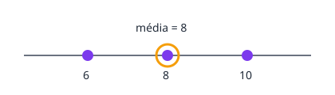
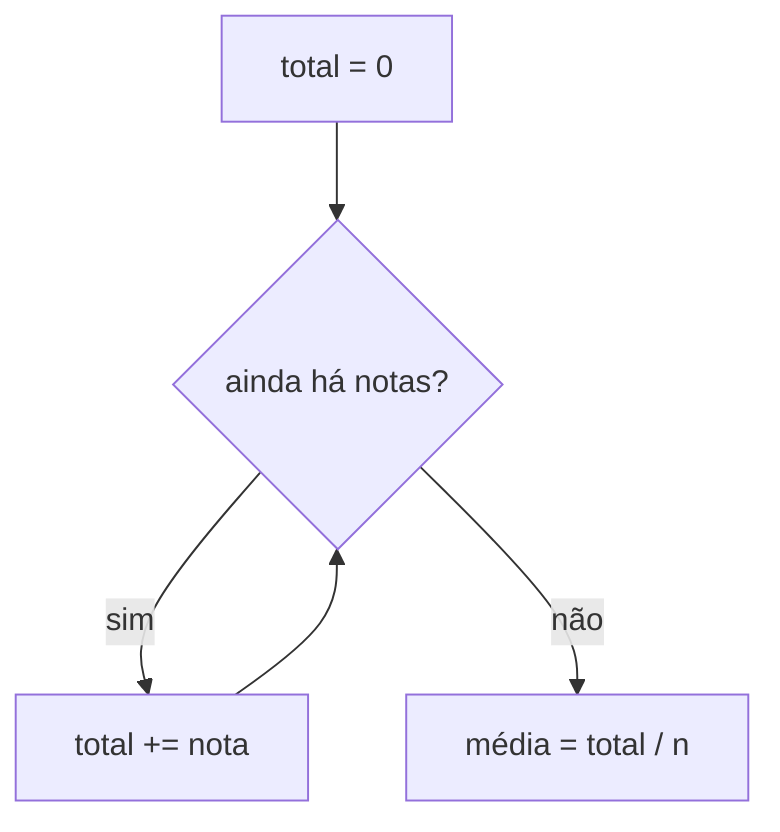

## Passo 1 · Leitura · O que é a média

A média aritmética de $n$ notas é a soma delas dividida por $n$:

$$
\bar{x} = \frac{1}{n} \sum_{i=1}^{n} x_i
$$

Para as notas 6, 8 e 10, a soma é $6 + 8 + 10 = 24$ e a média é $24 / 3 = 8$.
O cifrão que não é fórmula leva barra: a apostila custa R\$ 25,00 e o caderno, R\$ 12,50.
Dentro de código ele não precisa de nada: `preco = "R$ 25,00"`.



O programa que calcula a média segue sempre o mesmo caminho:



Acompanhe a execução linha a linha e veja `total` mudar a cada volta do laço:

```python visualizar
notas = [6, 8, 10]
total = 0
for nota in notas:
    total += nota
media = total / len(notas)
print(media)
```

::video[Média aritmética em dois minutos](https://www.youtube.com/watch?v=AAAAAAAAAAA)
> Resumo: o vídeo soma três notas uma a uma em uma variável acumuladora, divide o total pela
> quantidade de notas e mostra que o resultado fica sempre entre a menor e a maior nota.

## Passo 2 · Exercício · Complete a média
modo: lacunas

Complete as três lacunas (`___`) para que `media` devolva a média da lista.

### Instruções
1. Comece o acumulador `total` em zero.
2. Some cada nota ao acumulador.
   Dica: a variável do laço se chama `nota`.
3. Divida o total pela quantidade de notas, $n$ = `len(notas)`.

### Código inicial
```python
def media(notas):
    total = ___
    for nota in notas:
        total += ___
    return total / ___
```

### Solução
```python
def media(notas):
    total = 0
    for nota in notas:
        total += nota
    return total / len(notas)
```

### Dicas
1. O acumulador começa no valor que não muda a soma.
2. A quantidade de itens de uma lista vem de `len(lista)`.

### Verificação
```json
[
  { "id": "media-3", "checkpoint": 2, "kind": "call", "function": "media", "args": [[6, 8, 10]], "expected": 8.0, "tolerance": 1e-9,
    "name": "media([6, 8, 10]) é 8.0" },
  { "id": "media-1", "checkpoint": 3, "kind": "call", "function": "media", "args": [[5]], "expected": 5.0, "tolerance": 1e-9,
    "name": "media([5]) é 5.0", "hint": "Divida pela quantidade de notas, não por um número fixo." },
  { "id": "media-4", "checkpoint": 1, "kind": "call", "function": "media", "args": [[1, 2, 3, 4]], "expected": 2.5, "tolerance": 1e-9,
    "name": "media([1, 2, 3, 4]) é 2.5" }
]
```

### Soluções erradas
```python name="divide por um número fixo"
def media(notas):
    total = 0
    for nota in notas:
        total += nota
    return total / 3
```
```python name="acumulador começa em 1"
def media(notas):
    total = 1
    for nota in notas:
        total += nota
    return total / len(notas)
```

## Passo 3 · Exercício · Monte a função situacao
modo: ordenar

Arraste as linhas para montar `situacao(notas)` e ajuste a indentação de cada uma.
Duas linhas estão sobrando: elas não fazem parte da resposta.

### Instruções
1. Calcule a média das notas dentro da função.
2. Devolva `"aprovado"` quando a média for 6 ou mais.
3. Nos demais casos, devolva `"reprovado"`.

### Solução
```python
def situacao(notas):
    media = sum(notas) / len(notas)
    if media >= 6:
        return "aprovado"
    return "reprovado"
```

### Distratores
```python
if media > 6:
return aprovado
```

### Dicas
1. A linha com `def` vem primeiro e não tem indentação.
2. Só o `return "aprovado"` fica dentro do `if`.

### Verificação
```json
[
  { "id": "media-calculada", "checkpoint": 1, "kind": "call", "function": "situacao", "args": [[10, 8]], "expected": "aprovado",
    "name": "situacao([10, 8]) é aprovado" },
  { "id": "limite", "checkpoint": 2, "kind": "call", "function": "situacao", "args": [[6, 6]], "expected": "aprovado",
    "name": "média exatamente 6 é aprovado", "hint": "A média 6 também aprova: confira o operador de comparação." },
  { "id": "reprovado", "checkpoint": 3, "kind": "call", "function": "situacao", "args": [[2, 4]], "expected": "reprovado",
    "name": "situacao([2, 4]) é reprovado" }
]
```

### Soluções erradas
```python name="comparação estrita"
def situacao(notas):
    media = sum(notas) / len(notas)
    if media > 6:
        return "aprovado"
    return "reprovado"
```
```python name="reprovado dentro do if"
def situacao(notas):
    media = sum(notas) / len(notas)
    if media >= 6:
        return "aprovado"
        return "reprovado"
```

## Passo 4 · Previsão · O que este laço imprime

Leia o programa com calma, sem executar, e digite exatamente o que ele imprime
(uma linha de saída por linha da sua resposta).

### Código
```python
notas = [7, 9, 5]
total = 0
for nota in notas:
    total += nota
    print(total)
print("média:", total / len(notas))
```

### Dicas
1. O `print(total)` está dentro do laço: ele roda uma vez por nota.
2. A divisão com `/` sempre devolve um número com ponto decimal.

### Saída esperada
```text
7
16
21
média: 7.0
```

## Passo 5 · Quiz · Fixando

### Pergunta
Qual é a média $\bar{x}$ das notas 4, 6 e 8?
- [ ] $\bar{x} = 18$
- [x] $\bar{x} = 6$
- [ ] $\bar{x} = 3$
> A soma é $4 + 6 + 8 = 18$ e há três notas: $18 / 3 = 6$.
