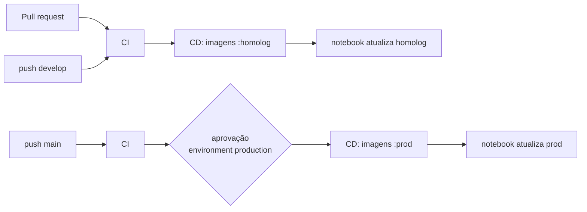

# Ambientes, CI/CD e deploy

## Ambientes

| Ambiente | Onde roda | Branch | Imagens | Dados |
|---|---|---|---|---|
| **dev** | sua máquina (`pnpm dev`) | qualquer | — (código local) | Postgres do `compose.dev.yml` |
| **homolog** | notebook, projeto `levelusp-homolog`, porta 3001 | `develop` | `ghcr.io/<dono>/levelusp/*:homolog` | banco próprio + seed demo |
| **prod** | notebook (depois: VM/servidor), projeto `levelusp-prod`, porta 3000 | `main` | `…:prod` | banco próprio, dados reais |

Fluxo de branches: `feature/*` → PR para `develop` (homologação) → PR de
`develop` para `main` (produção). Os PRs exigem o CI verde.

## Pipeline



**CI** (`.github/workflows/ci.yml`): lint, tipos, testes unitários e build;
API e2e com PostgreSQL; executor WASI (testes de segurança + verificação dos
gabaritos); Playwright contra a pilha completa; build das imagens em PRs.

**CD** (`.github/workflows/cd.yml`): após CI verde num push, publica as três
imagens no GHCR com as tags do ambiente e `sha-<commit>`. O notebook **puxa**
as imagens (tarefa agendada a cada 5 min) — nenhuma porta fica aberta para o
GitHub.

## Configuração única no GitHub

1. *Settings → Environments*: crie `homolog` e `production`; em `production`,
   marque *Required reviewers* (você e/ou o orientador).
2. *Settings → Branches*: proteja `main` e `develop` exigindo os checks do CI.
3. Depois do primeiro CD, em *Packages*, deixe os pacotes `levelusp/api`,
   `levelusp/runner` e `levelusp/web` como **públicos** (o código já é público)
   ou faça `docker login ghcr.io` no notebook com um token `read:packages`.
4. Desconecte o projeto antigo da Vercel antes de mesclar em `main` (a Vercel
   tentaria publicar o monorepo).

## Passo a passo no notebook (Windows)

Pré-requisitos: Docker Desktop (com WSL2) e o repositório clonado.

```powershell
# 1. Cria infra/env/homolog.env com senhas aleatórias (anote a senha do admin)
.\infra\scripts\levelusp.ps1 setup -Env homolog

# 2. Sobe banco, executor, API, front e o túnel; mostra o link público
.\infra\scripts\levelusp.ps1 up -Env homolog

# 3. Popula a homologação (admin, professora/aluna demo, curso Python Completo)
.\infra\scripts\levelusp.ps1 seed -Env homolog

# 4. Atualização automática + backup diário de prod
.\infra\scripts\levelusp.ps1 install-autoupdate
```

Outros comandos: `status`, `logs [-Service api]`, `update`, `backup`,
`restore -File`, `import` (Supabase), `down`. Em Linux/macOS/WSL use
`infra/scripts/levelusp.sh` com os mesmos comandos.

### Sobre o Quick Tunnel

O endereço `*.trycloudflare.com` muda a cada reinício do túnel; `status`
mostra o atual. Para endereço fixo: crie um túnel nomeado numa conta gratuita
da Cloudflare com um domínio próprio e troque o comando do serviço `tunnel` por
`tunnel run --token ${CLOUDFLARE_TUNNEL_TOKEN}`.

### Construir as imagens localmente (sem GHCR)

```bash
docker compose -f infra/compose/compose.yml -f infra/compose/compose.build.yml \
  --env-file infra/env/homolog.env build
```

## Desenvolvimento local

```bash
pnpm install
docker compose -f infra/compose/compose.dev.yml up -d       # Postgres
pnpm --filter @levelusp/runner setup:python                 # Wasmtime + CPython WASI (Linux/WSL)
cp apps/api/.env.example apps/api/.env
pnpm build && pnpm db:migrate && SEED_DEMO_USERS=true pnpm db:seed
pnpm dev                                                    # web :3000, api :4000, runner :8081
```
