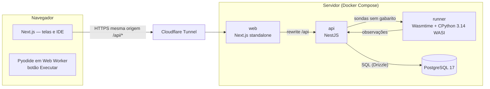

# Arquitetura

O LevelUSP v2 separa **interface**, **regras de negócio** e **execução de código
não confiável** em processos distintos. O navegador nunca fala com o banco.



## Camadas

| Camada | Onde | Responsabilidade |
|---|---|---|
| Apresentação | `apps/web` | Telas, IDE, estado de UI. Nenhuma regra de negócio nem segredo. |
| Contratos | `packages/contracts` | Tipos e schemas Zod compartilhados (fonte única do formato dos dados). |
| Aplicação/Domínio | `apps/api/src/modules/*` | Controllers finos → services (regras e autorização) → repositories (SQL). Regras puras em `*.domain.ts`. |
| Infraestrutura | `apps/api/src/infra`, `packages/db` | Banco, executor, e-mail, armazenamento de imagens, migrações. |
| Execução isolada | `apps/runner` | Roda código Python do aluno em WebAssembly; sem segredos, banco ou rede. |

## Estrutura de pastas

```
apps/
  api/         NestJS: src/{config,common,infra,modules}, test/e2e
  runner/      src/ (servidor HTTP mínimo, sandbox, plano de lotes), python/harness.py
  web/         Next.js: src/{app,components,contexts,hooks,lib/api}, e2e/ (Playwright)
packages/
  contracts/   schemas Zod + tipos (users, auth, courses, lessons, grading, exams, …)
  db/          schema Drizzle, migrations/, seed/, tools/ (conversor de gabaritos)
infra/
  docker/      Dockerfiles (api, runner, web)
  compose/     compose.yml (homolog/prod), compose.dev.yml, compose.build.yml
  env/         *.env.example (os .env reais não são versionados)
  scripts/     levelusp.ps1 / levelusp.sh (operação no notebook)
.github/workflows/  ci.yml, cd.yml
legacy/        código da versão Supabase/Vercel (referência)
```

## Módulos da API

`auth` (sessão própria), `account` (LGPD), `users` (perfis, ranking, atividade),
`catalog` (módulos, cursos, lições), `learning` (progresso, snapshots,
submissões), `grading` (motor de correção), `quizzes`, `gamification`
(XP, nível, sequência, badges — única porta de escrita), `exams`,
`certificates` (PDF + verificação pública), `notes`, `notifications`,
`library`, `teacher-requests`, `admin`, `audit`, `health`.

## Decisões e trade-offs

| Decisão | Por quê | Custo |
|---|---|---|
| NestJS modular | Convenções claras (módulos, DI, guards), fácil de explicar e manter | Mais estrutura que um Fastify puro |
| Drizzle ORM | SQL explícito e tipado; migrações SQL legíveis | Menos "mágica" que Prisma (mais SQL escrito à mão) |
| Sessão opaca em cookie httpOnly | Token inacessível ao JavaScript; revogação imediata no banco | Uma consulta por requisição (indexada) |
| Front e API na mesma origem (rewrite) | Cookie de primeira parte, sem CORS | O Next precisa conhecer a URL interna da API no build |
| Executor separado, em WASI | Isolamento por capacidades; sem segredos no processo | ~3× mais lento que CPython nativo; sem numpy no servidor |
| Gabarito declarativo | Comparação fora do sandbox: aluno não forja aprovação | Gabaritos antigos precisam de conversão |
| Pyodide no navegador para "Executar" | CPU do aluno, resposta imediata, gráficos | Download inicial do runtime |
| Notebook + Cloudflare Tunnel | Custo zero e controle total na fase de testes | Disponibilidade depende do notebook |
